# 简单易懂的破解脱壳从 0 开始

> 原文：[`www.pediy.com/kssd/pediy12/128977.html`](https://www.pediy.com/kssd/pediy12/128977.html)

一、 准备好常用破解工具，   
1、 查壳工具：PEiD   0.95   
2、 脱壳调试：OllyICE　v1.10（俗称 OD，可下载一些 OD 插件保存在程序文件目录下的 plugin 文件夹中，启动 OD 时会自动链接插件）  
3、 Win32 反汇编：WinHex　14.2　  
4、 修复工具：ImportREC V1.6　　  
5、 注册机编写：keymake  
二、 壳的概念：关于壳的介绍文章很多，很多初学者还不知道壳是什么，那么你就暂且这样通俗的去理解：壳就是软件的包装外壳。  
三、 脱壳：顾名思义，我就不多说了。  
四、 调试：用 OD 调试程序的进程，寻找关键（算法）CALL，修改有关汇编语言达到软件注册或破解的目的。  
五、 有人问：我不懂汇编语言和算法怎么办？我告诉你，没关系，首先你必须从简单的、好欺负的软件入手（初学者千万别找年轻的、经常更新的或高版本的软件），否则，你只会以失败而告终。  
六、 如果你是第一次学破解，我告诉你一个方法，只要你按如下操作一般都能成功（有的新版本软件除外）：  
1、 首先注册软件，查看软件弹出的有关注册失败的信息框的内容。  
2、 查壳：有壳脱壳，无壳用 OD 载入。  
3、 手动脱壳基本方法：从 OD 载入软件程序后弹出是否分析对话框，点“否”，停在程序壳的入口（含有 pushad 等类似字符）。接下来我们的目的是要寻找第一个 popad 。  
（1） 首先按 F8，接下来或近处便是 CALL，此时的 CALL 或是离这里很近的 CALL 必须按 F7，否则你就掉入陷井，后面遇到 CALL 一旦掉入也没关系，你先记下来，重新载入程序（按 CTRL+F2），再遇到这个时就用 F7 进入。  
（2） 出现往回跳转时，即红色线显示跳转实现，必须在下一行点左，然后按 F4 步过，灰色为跳转未实现，可不理它照样 F8。  
（3） 其他全部 F8，一路下去必定能找到第一个 popad，找到后离此不远必定有一个大的跳转，一旦跳转来到有 push   ebp 字样，说明壳己走完到主程序（OEP），在此用 OD 插件→ollyDump→Dump debu…→Dump 脱壳→保存。  
4、 破解：OD 载入程序、点文件→打开→点击要破解的软件程序（无壳或己脱壳的）。  
5、 鼠标置左上（反汇编）窗口点右，弹出框选项中选择 ultra string reference（过激的字符串参考）中的 Find 　ASCII。  
6、 在弹出的窗口内查找第一步骤的注册信息内容或有关注册成功和注册失败的字符。如果找不到，建议你放弃，另选其他软件，最好是年纪大些的（一般在 2005 年及以前的）。  
7、 找到有关字符后，双击它，回到 OD 主窗口，在反汇编窗口（左上）中可以看到有关字符，然后就在字符上下附近寻找关键跳转（即跳向注册失败或注册成功处），在该跳转近处必定有一个就是关键 CALL。  
8、 如果用爆破，就修改关键跳转（jnz 改为 jz，jz 改为 jnz 等）。  
9、 如果是追注册码就在关键 CALL 这行下断点（按 F2 或双击鼠标），然后按 F9 运行后，会弹出软件注册对话框，随意输入注册信息后确定，这时注意观察右上的寄存器窗口会显示出你输入的假码和软件的真码，真码可以注册，而这个 CALL 可以用来做注册机。  
下面，我给大家找来一个简单的软件演示一下实例：  
【软件名称】现代汉语词典  
【注册方式】确认码+注册码  
【破解工具】PEiD   0.95　　　OllyICE　v1.10　　keymake  
1、 查壳为 ASPack 2.12 -> Alexey Solodovnikov  
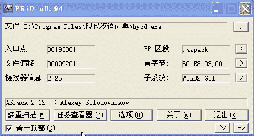  
2、 下面开始脱壳，首先用 OD 载入软件，分析项点“否”。  
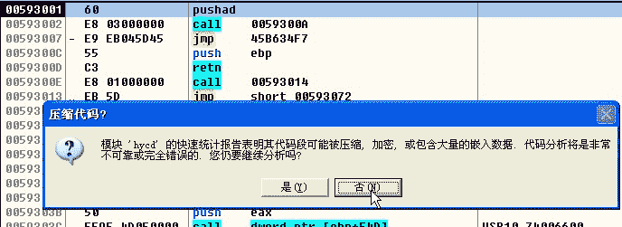  
3、接下来第一步按 F8、第 2 步 F7（这里的 CALL 离入口很近哦）、第 3 步 F8……以下按图中的注释操作，未注释用 F7 或 F4 的则，全部用 F8。  
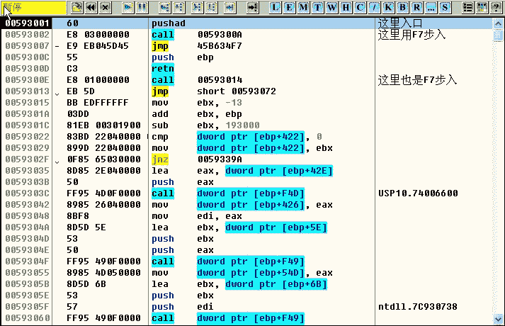  
中间省略…　…一路 F8 来到这里后，按图注释走，注释栏未注明全部 F8  
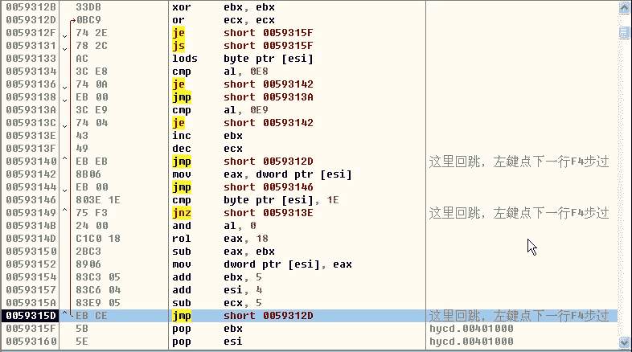  
中间省略…　…一路 F8 来到这里后，按图注释走，注释栏未注明全部 F8  
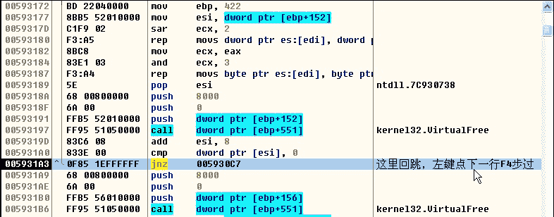  
中间省略…　…路 F8 来到这里后，按图注释走，注释栏未注明全部 F8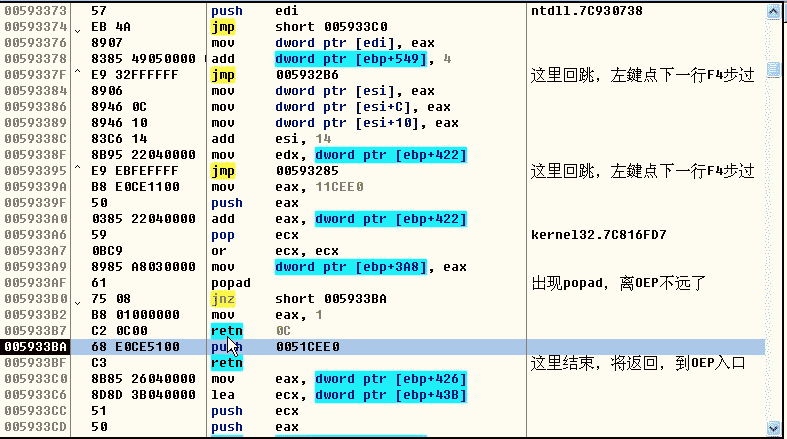  
从上面程序返回直接跳到这里，这就是典型的 OEP 入口了。  
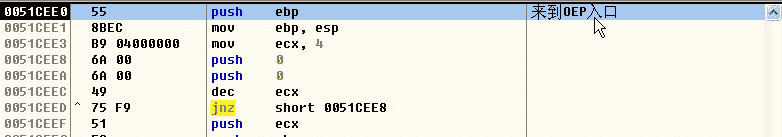  
4、用 OD 插件直接 Dump，如下图  
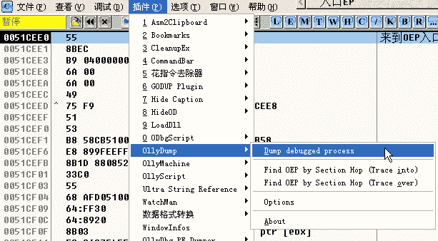  
5、在弹出对话框中点 Dump 后命名文件、保存。  
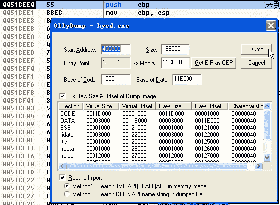  
生成的文件便是已经脱壳的程序文件了。  
接下来可以开始破解了：  
1、用 OD 载入己脱壳的程序文件，程序停在 OEP 入口（注意看，这里己不是壳的入口了）。鼠标置反汇编窗口中点右，在弹出对话框中按下图选择。  
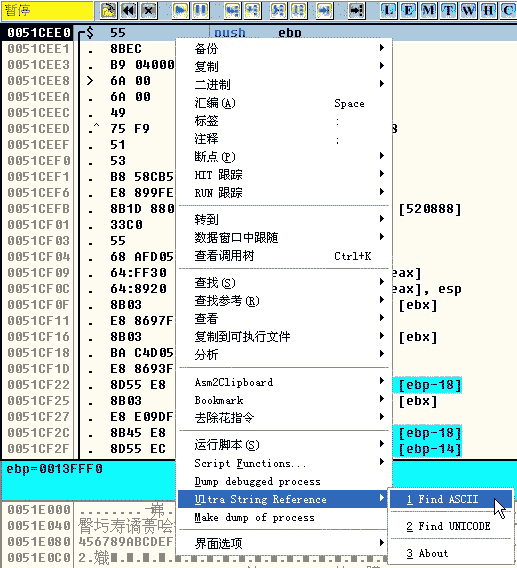  
2、双击如图注册失败….字符  
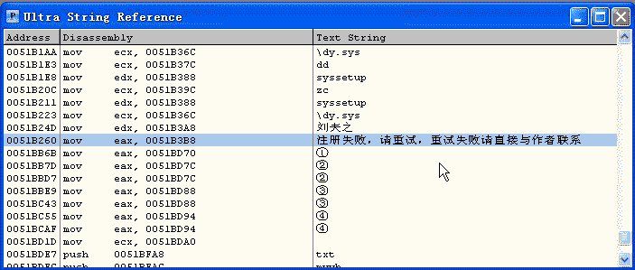  
3、双击后回到 OD 主窗口，可以看到注册失败由上方跳转而来，我们顺着红线向上找关键跳转及关键 CALL。  
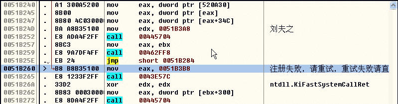  
4、 找到这里，0051B153 跳向注册失败，必是关键跳转了，它上面的 CALL 一般都是关键 CALL（因为是初学我们暂不进入跟踪算法）。  
我在此介绍三种简单的破解方式，具体看以下内容及参考图注释操作。  
（1） 爆破：在关键跳转处的 jnz 改为 jz 或点右→二进制→用 nop 填充。  
（2） 追注册码：在关键 CALL 处下断点，然后 F9 运行。  
（3） 注册机：利用上面的操作及参考寄存器窗口内容，用 keymake（注册机编写器）制作。  
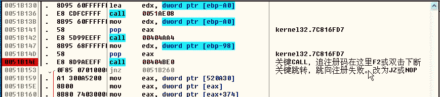  
（1）爆破：Nop 填充图  
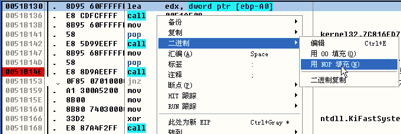  
5、 关键跳转修改后，点右→复制到可执行文件→所有修改→（弹出对话框）点全部复制。   
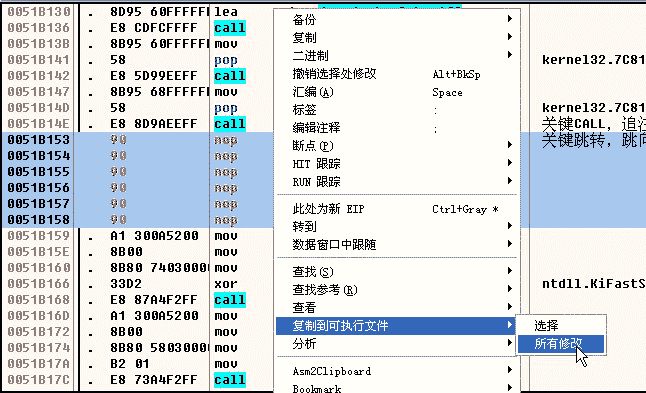  
6、在新弹出窗口点右，选择保存文件即可，至此爆破完成，运行软件即可注册成功。  
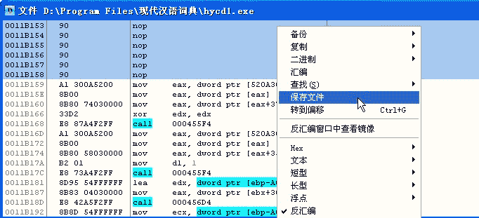  
（2）追注册码：  
1、 我们在关键 CALL 处下断点 F9 运行程序弹出软件，选择注册项并输入注册信息，点确认注册。  
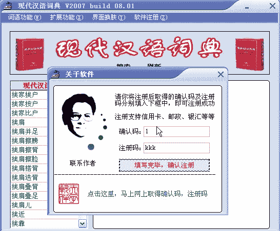  
2、查看寄存器窗口，这里显示软件的真假码。KKK 为我这里输入的码假，在第三行 EDX 处显示的为真码（注意：这里的真码与输入的确认码对应）。另须说明：当点确认注册后，OD 会陆续弹出几个出错的对话框（说明软件有调用函数，既是初学，这里暂不去深究），可以直接点“否”，打开软件输入对应确认码和真码即可注册成功。  
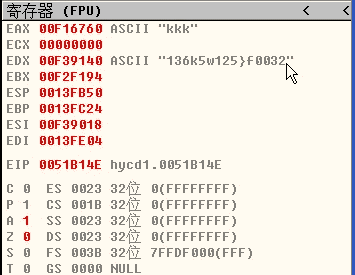