# 手脱 ASProtect 1.23RC4 补回 OEP 头

> 原文：[`www.pediy.com/kssd/pediy11/112535.html`](https://www.pediy.com/kssd/pediy11/112535.html)

ASProtect 1.23RC4  是 ASProtect 发展的一个重要里程碑，而且是经常偷代码的其中一个壳，现在对他进行脱壳，补充 OEP 头。  
菜鸟第一贴，请各大虾把不对的地方指出，本人水平有限，表达能力有限，望谅解。好，现在开现：  
1、首先在选项设置一下，隐藏一下 OD，采用最后一次异常法去脱  
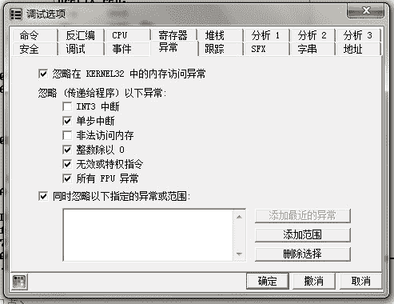  
2、SHIFT+F9 运行  
（第 17 次跑飞，第 16 次为最后一次异常，重裁）  
其实对这个壳不数次数也可以，当出现如下特征码，即证明为最后一次异常  
je   
。。。。  
。。。。  
CALL  
。。。。  
。。。。  
je  
。。。。  
。。。。  
retn       
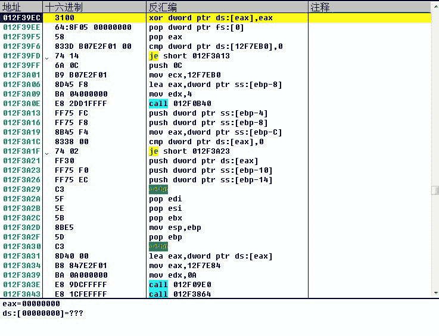  
3、在 RETN 外 F2 下断，SHIFT+F9 运行到此，F2 取消断点  
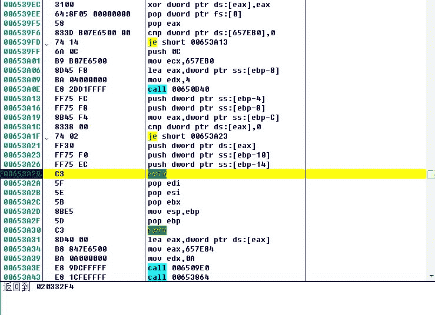  
4、此时观察堆栈窗口，用数值为 00400000 下面的第二个地址下硬件断点  
HR 0012FF30  
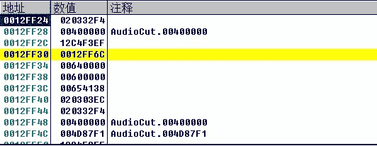  
5、下好断点后，SHIFT+F9 运行，断在下面地方，之后 F8 单步走  
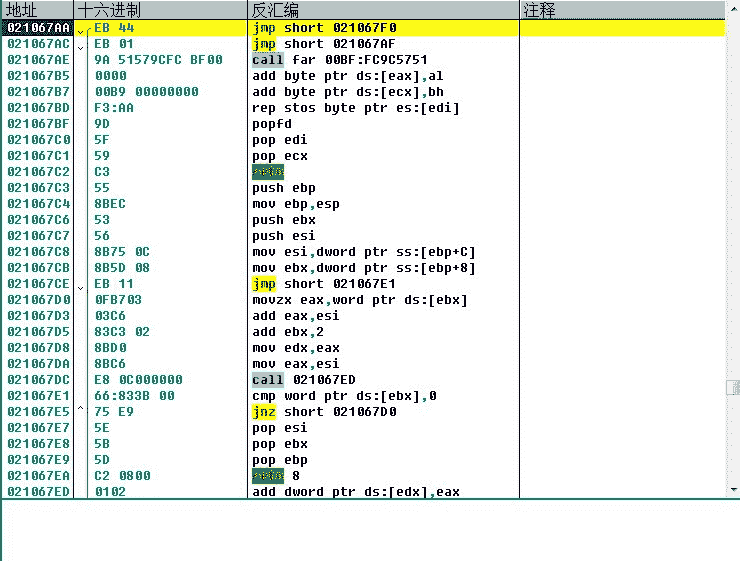  
6、来到 papad 后跟一个 jmp 时，改用 F7 单步进去  
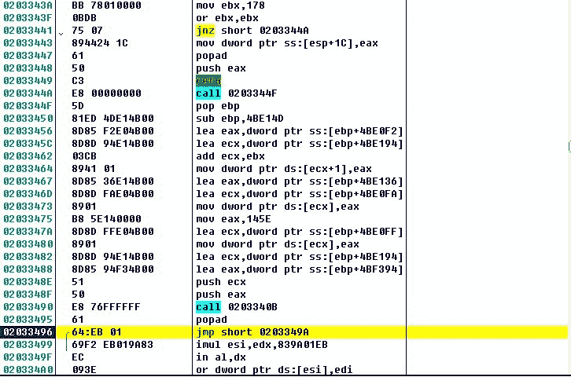  
7、跳到下面地址，此时开始追踪被偷代码  
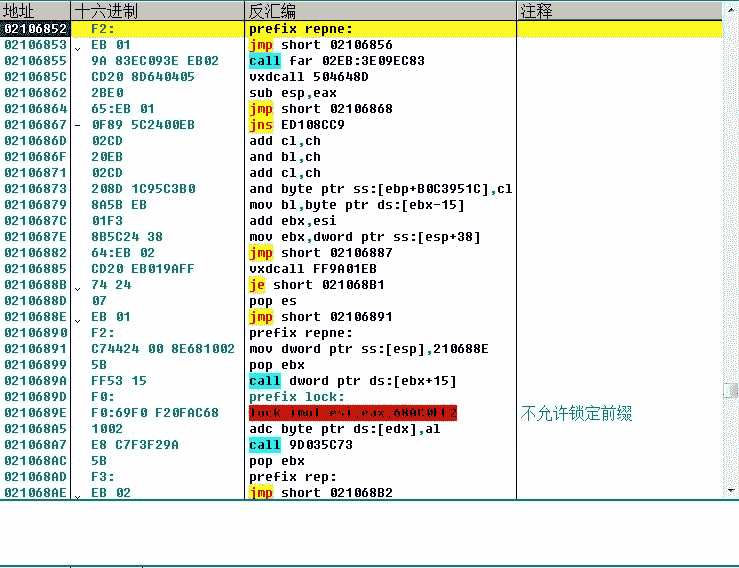  
F7 继续单步走  
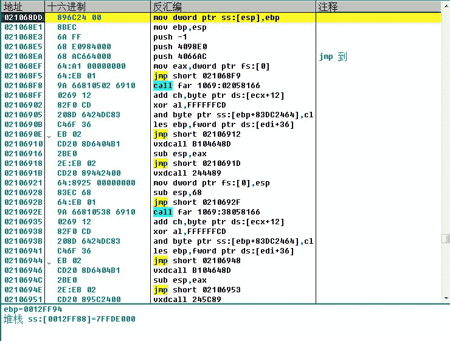  
来到此处发现第一外被偷代码  
第一处被偷代码找到  
021068DD    896C24 00            mov dword ptr ss:\[esp\],ebp  
021068E1    8BEC                 mov ebp,esp  
021068E3    6A FF                push -1  
021068E5    68 E0984000          push 4098E0  
021068EA    68 AC664000          push 4066AC                        ; jmp 到  
021068EF    64:A1 00000000       mov eax,dword ptr fs:\[0\]  
记录下来，继续 F7 走  
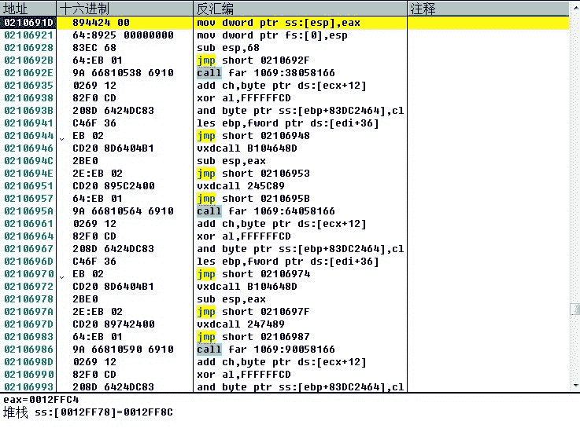  
第二处被偷代码找到  
0210691D    894424 00            mov dword ptr ss:\[esp\],eax  
02106921    64:8925 00000000     mov dword ptr fs:\[0\],esp  
02106928    83EC 68              sub esp,68  
记录下来，继续 F7 走  
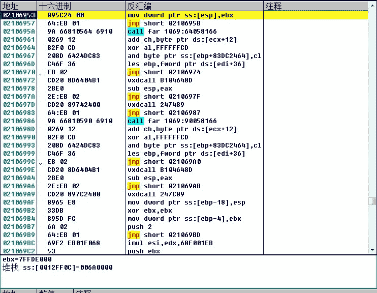  
第三处被偷代码找到  
02106953    895C24 00            mov dword ptr ss:\[esp\],ebx  
记录下来，继续 F7 走  
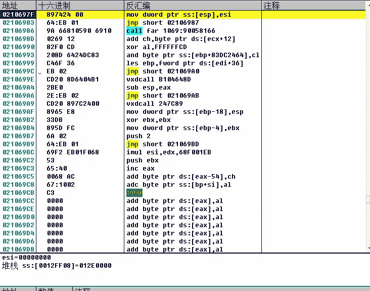  
第四处被偷代码找到  
0210697F    897424 00            mov dword ptr ss:\[esp\],esi  
记录下来，继续 F7 走  
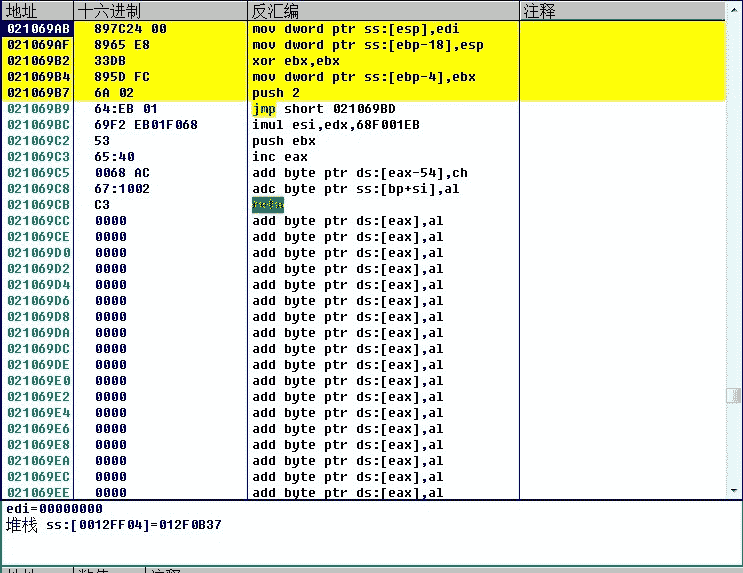  
第五处被偷代码找到  
021069AB    897C24 00            mov dword ptr ss:\[esp\],edi  
021069AF    8965 E8              mov dword ptr ss:\[ebp-18\],esp  
021069B2    33DB                 xor ebx,ebx  
021069B4    895D FC              mov dword ptr ss:\[ebp-4\],ebx  
021069B7    6A 02                push 2  
记录下来，继续 F7 走  
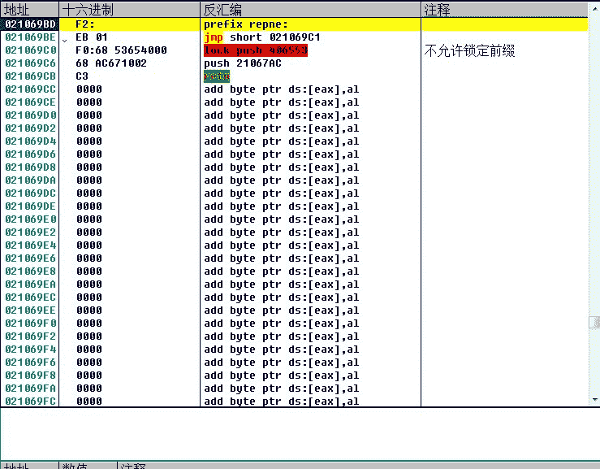  
此时被偷代码全部找到，F8 走  
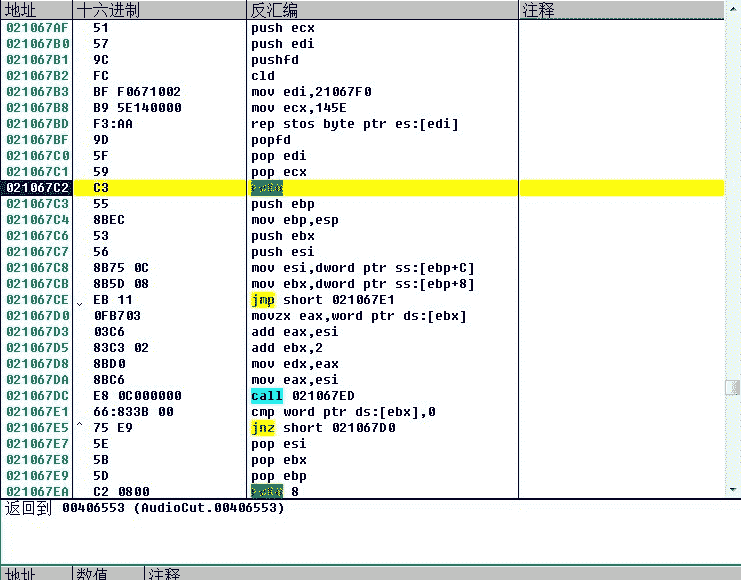  
此处跳去 OEP  
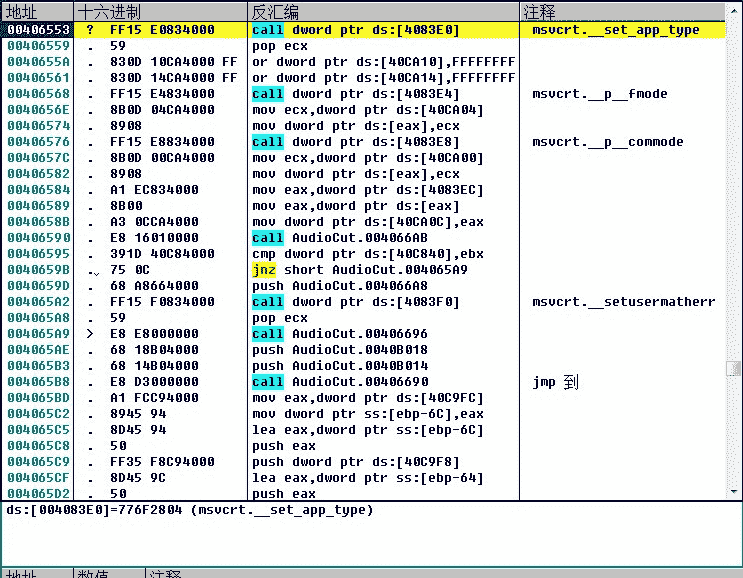  
到达 OEP  
  
7、开始补回 OEP 头  
记录下来的被偷代码如下：  
第一处被偷代码  
021068DD    896C24 00            mov dword ptr ss:\[esp\],ebp  
021068E1    8BEC                 mov ebp,esp  
021068E3    6A FF                push -1  
021068E5    68 E0984000          push 4098E0  
021068EA    68 AC664000          push 4066AC                        ; jmp 到  
021068EF    64:A1 00000000       mov eax,dword ptr fs:\[0\]  
第二处被偷代码  
0210691D    894424 00            mov dword ptr ss:\[esp\],eax  
02106921    64:8925 00000000     mov dword ptr fs:\[0\],esp  
02106928    83EC 68              sub esp,68  
第三处被偷代码  
02106953    895C24 00            mov dword ptr ss:\[esp\],ebx  
第四处被偷代码  
0210697F    897424 00            mov dword ptr ss:\[esp\],esi  
第五处被偷代码  
021069AB    897C24 00            mov dword ptr ss:\[esp\],edi  
021069AF    8965 E8              mov dword ptr ss:\[ebp-18\],esp  
021069B2    33DB                 xor ebx,ebx  
021069B4    895D FC              mov dword ptr ss:\[ebp-4\],ebx  
021069B7    6A 02                push 2  
对代码处理一下：  
每一处第一个代码命令改为 PUSH，修改后为：  
Push ebp  
mov ebp,esp  
push -1  
push 4098E0  
push 4066AC  
mov eax,dword ptr fs:\[0\]  
Push eax  
mov dword ptr fs:\[0\],esp  
sub esp,68  
Push ebx  
Push esi  
Push edi  
mov dword ptr ss:\[ebp-18\],esp  
xor ebx,ebx  
mov dword ptr ss:\[ebp-4\],ebx  
push 2  
此时开始修复 OEP  
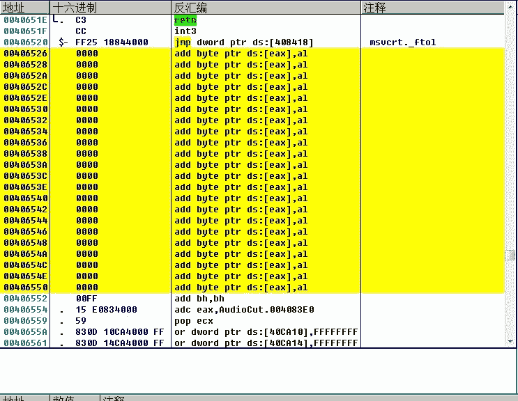  
选定上面一段 JMP 以下的空代码 NOP 掉  
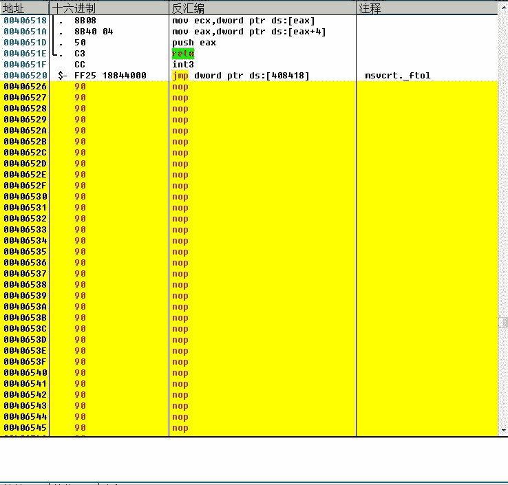  
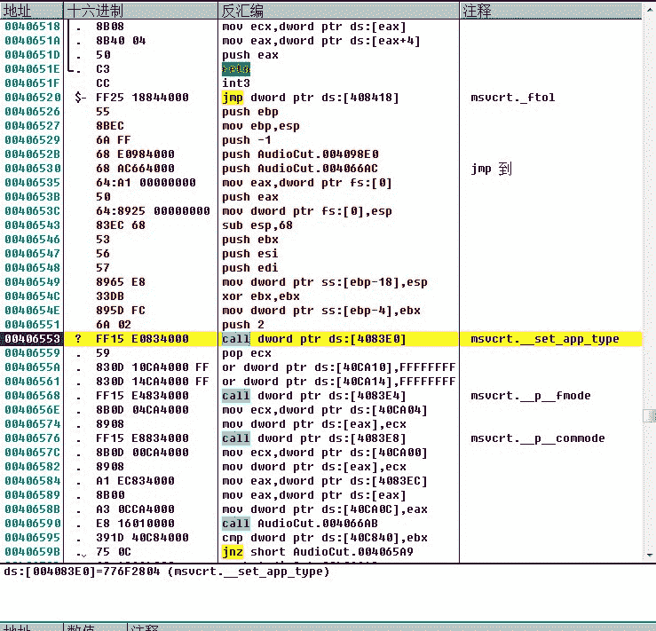  
回补刚才记录下来的代码  
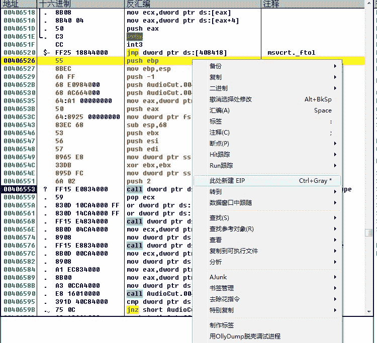  
回补完成后在 PUSH ebp 处新建 EIP  
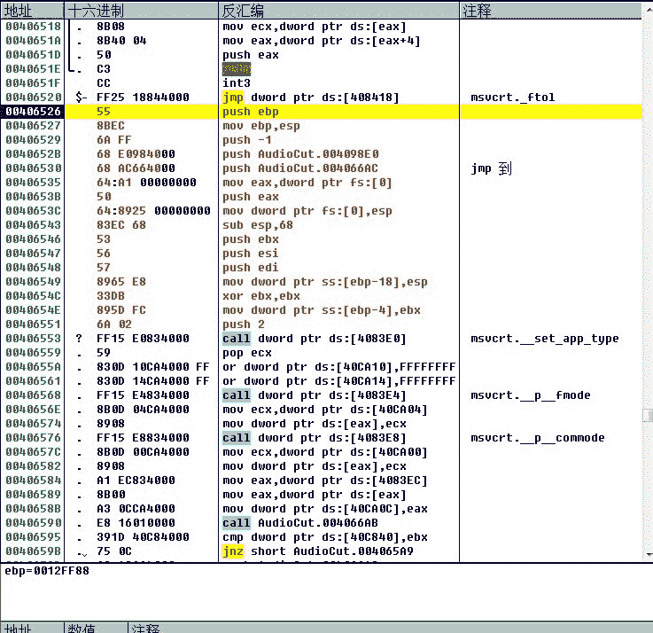  
此时 OEP 完全修复完成，脱壳。脱壳就不说了。  
  
附上原程序：  
Mp3Cutter.rar