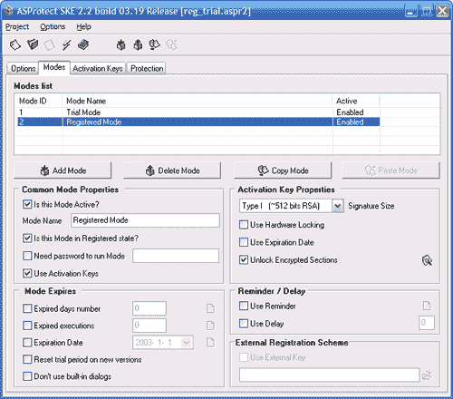
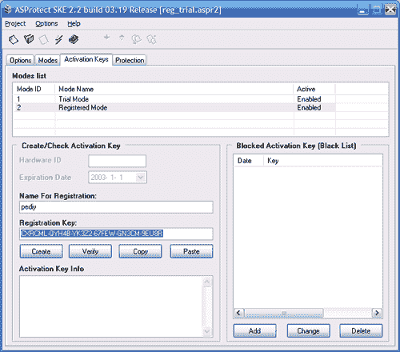
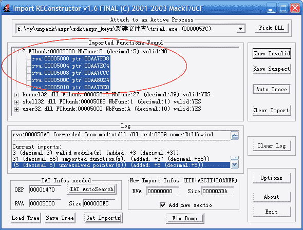

# ASProtect SKE 2.2 SDK 中的 API 修复

> 原文：[`www.pediy.com/kssd/pediy08/pediy8-643.htm`](https://www.pediy.com/kssd/pediy08/pediy8-643.htm)

【文章标题】: ASProtect SKE 2.2 SDK 中的 API 修复  
【附件下载】: asprsdk.rar  
\--------------------------------------------------------------------------------  
【详细过程】  
  
   有关 ASProtect 的 SDK，近期论坛不少文章涉及到了，如 cyto 的文章（本文一些补丁代码参考了 cyto 文章）。SDK 的修复 VolX、shoooo 等大侠更是轻车熟路。这 2 天也学习了一下 SDK 修复，有少许心得，现拿出来希望大家帮忙指正一下。  
   
    ASProtect 的 SDK 种类比较多，本文主要介绍如何修复 ASProtect 自带的一些 API，如 GetHardwareID,CheckKeyAndDecrypt,GetRegistrationKeys,GetModeInformation,GetRegistrationInformation 等。    
    学习 SDK 最好的方法是将 ASProtect 的帮助文档看一遍，并结合其样例掌握用法。  
  
**1.准备工作**   
  
   本文以 ASProtect 自带的样例 Examples\\Reg Trial\\VC\\ 来讨论。为了降低难度，我将样例中的 REG\_CRYPT\_BEGIN1 与 REG\_CRYPT\_END1 注释掉，这对标签是加密代码的，无 key 代码就不能解密，当然有 key 还得修复这段代码，修复方法类似 stolen OEP。  
  

引用:    
  //REG\_CRYPT\_BEGIN1 //注释掉，不加密如下代码  
  strcpy( caption, "Registered version!" );  
  SetWindowText( hwnd, caption );  
        GetModeInformation( 0, &ModeName, &mode\_status );  
  SetWindowText( GetDlgItem(hwnd,IDCANCEL), "Close" );  
  ShowWindow(GetDlgItem(hwnd,IDC\_BUYNOW), SW\_HIDE);  
  ShowWindow(GetDlgItem(hwnd,IDC\_REG\_BUTTON), SW\_HIDE);  
  wsprintf( buffer,"Key: %s\\nName: \\t\\t%s\\nMode Name: \\t%s",UserKey, UserName, ModeName );  
  SetDlgItemText(hwnd, IDC\_TEXT, buffer);  
        //REG\_CRYPT\_END1 //注释掉  

  
  
   然后用 VC 6.0 编译 Reg Trial 样例，得到 trial.exe 文件，运行 ASProtect 主程序，打开该样例提供的 reg\_trial.aspr2 项目文件，本文主要是讨论 SDK 修复，因此 protectin Options 全部不选。Modes 部分 reg\_trial.aspr2 己设置好，如图：  
  
  
  
   然后点击 Protect 按钮将 trial.exe 加壳保护，生成的 trial.exe 无 key 运行是试用版，需要输入 key 才能为注册版。key 可以在 Activation keys 栏生成：  
  
  
  本例将加密标签 REG\_CRYPT\_BEGIN1 与 REG\_CRYPT\_END1 注释掉了，因此不存在解码问题。  
  
**2.用脚本脱壳**  
  
   非常感谢 VolX 能与大家分享他那强大的脚本！OD 加载 trial.exe 后，用 ODbgScript 1.4x 插件跑 VolX 的脚本：Asprotect 2.XX SKE IAT Fixer 。  

引用:  http://bbs.pediy.com/showthread.php?s=&threadid=24557

  
  
运行一会儿，脚本有一个提示：“Import table is fixed, you can dump the file now or later. check the address and size of IAT in log window”  
点击确定后，再单击 ODbgScript/Resume 继续执行脚本，不一会儿就到 OEP：“OEP found, no stolen code at the OEP!”。  
  
00401470    55              push    ebp                              ; trial.00400000  
00401471    8BEC            mov     ebp, esp  
00401473    6A FF           push    -1  
  
此时就可 Dump 取 trial.exe 程序了，并用 ImportREC 重建输入表：  
  
  
  
这里会发现有一些函数不能识别，这些函数就是 ASProtect 自己的 API，可以直接 Cut，就可重建输入表了，得到 dumped\_.exe。  
  
在 OD 里查看这些 ASProtect 的 API，会发现它们与 IAT 其他函数靠在一起：  
  
00405000  00AA7FD8  
00405004  00AA7EC4  
00405008  00AA7CCC  
0040500C  00AA8024  
00405010  00AA7BE0  
00405014  00000000  
00405018  7C801D77  kernel32.LoadLibraryA  
0040501C  7C80AC28  kernel32.GetProcAddress  
00405020  7C9379FD  ntdll.RtlReAllocateHeap  
  
**3.修复 SDK**  
  
  如果此时运行脱壳后的文件 dumped\_.exe，就会异常，因为程序里会调用 ASProtect 的 API 函数：  
  
00404A18   $- FF25 0C504000 jmp     \[40500C\]  //F2 下断点  
00404A1E   $- FF25 08504000 jmp     \[405008\]  //F2 下断点  
00404A24   $- FF25 04504000 jmp     \[405004\]  //F2 下断点  
00404A2A   $- FF25 00504000 jmp     \[405000\]  //F2 下断点  
00404A30   $- FF25 10504000 jmp     \[405010\]  //F2 下断点  
00404A36   $- FF25 A8504000 jmp     \[<&kernel32.RtlUnwind>\]          ;  ntdll.RtlUnwind  
  
  接下来就是要猜这些 API 函数了，运行加壳的 trial.exe，来到 OEP 后，对 00404A18～00404A36 这段代码下断点。再运行程序，首先会中断在 00404A30 这行。  
  
00404A18  - FF25 0C504000   jmp     \[40500C\]  
00404A1E  - FF25 08504000   jmp     \[405008\]  
00404A24  - FF25 04504000   jmp     \[405004\]  
00404A2A  - FF25 00504000   jmp     \[405000\]  
00404A30  - FF25 10504000   jmp     \[405010\]     //首先中断这行  
00404A36  - FF25 A8504000   jmp     \[4050A8\]                         ; ntdll.RtlUnwind  
  
然后查看堆栈，对返回地址设断：  
  
0012FA84   004011AA  返回到 trial.004011AA 来自 trial.00404A30  
0012FA88   00000000  
0012FA8C   004086C0  trial.004086C0  
0012FA90   004086C4  trial.004086C4  
  
对 004011AA 设断后，会来到：  
  
00401196  |.  53            push    ebx  
00401197  |.  56            push    esi  
00401198  |.  57            push    edi  
00401199  |.  68 C4864000   push    004086C4  
0040119E  |.  68 C0864000   push    004086C0  
004011A3  |.  6A 00         push    0  
004011A5  |.  E8 86380000   call    00404A30  
004011AA  |.  8B3D C0864000 mov     edi, \[4086C0\]  //来到这里  
  
此时 EAX＝1,结合源码及 ASProtect 帮助文档，可以猜出这个是 GetRegistrationInformation。  
用这种方法就可确定其他几个函数：  
  
00404A18  - FF25 0C504000   jmp     \[40500C\]                         ; GetHardwareID  
00404A1E  - FF25 08504000   jmp     \[405008\]                         ; CheckKeyAndDecrypt  
00404A24  - FF25 04504000   jmp     \[405004\]                         ; GetTrialDays  
00404A2A  - FF25 00504000   jmp     \[405000\]                         ; GetModeInformation  
00404A30  - FF25 10504000   jmp     \[405010\]                         ; GetRegistrationInformation  
00404A36  - FF25 A8504000   jmp     \[4050A8\]                         ; ntdll.RtlUnwind  
  
其中带 key 脱壳后，只有 GetRegistrationInformation 与 GetModeInformation 被调用（其他函数确定，请删除注册文件 aspr\_keys.ini 尝试），因此只需要修复这 2 个函数即可。  
  
**3.1 构造 GetRegistrationInformation 函数的参数及返回值**  
  
函数原型：  
GetRegistrationInformation( 0, &Key, &Name );    
  
  
dumped\_.exe 程序中的代码：  
00401199  |.  68 C4864000   push    004086C4   //&Name  
0040119E  |.  68 C0864000   push    004086C0   //&Key  
004011A3  |.  6A 00         push    0  
004011A5  |.  E8 86380000   call    00404A30  
  
  
00404A30   $ /FF25 10504000 jmp     \[405010\]                         ;  GetRegistrationInformation  
  
找一段空地写下如下代码：  
  
00404A41         mov     eax, \[esp+8\]  
00404A45         mov     dword ptr \[eax\], 00404A5E        ;  ASCII "78787878" //参数 Key  
00404A4B         mov     eax, \[esp+C\]  
00404A4F         mov     dword ptr \[eax\], 00404A68        ;  ASCII "pediy"   //参数 Name  
00404A55         mov     eax, 1                           //返回值  
00404A5A         retn    0C  
  
00404A5E  37 38 37 38 37 38 37 38 00 00 70 65 64 69 79 00  78787878..pediy.  
  
再将 00405010 改成如下：  
00405010  41 4A 40 00                                      AJ@.  
  
这样 jmp     \[405010\] 就能跳到 00404A41 执行了。  
  
**3.2 构造 GetModeInformation 函数的参数及返回值**  
  
函数原型：  
GetModeInformation( 0, &ModeName, &mode\_status );  
  
dumped\_.exe 程序中的代码：  
00401205    52              push    edx       //&mode\_status  
00401206    68 CC864000     push    004086CC  //&ModeName  
0040120B    6A 00           push    0  
0040120D    E8 18380000     call    00404A2A // call GetModeInformation  
……  
00404A2A  - FF25 00504000   jmp     \[405000\]                         ; GetModeInformation  
  
找一段空地写下如下代码：  
  
00404A79       mov     eax, \[esp+8\]  
00404A7D       mov     dword ptr \[eax\], 00404A8D        ;  ASCII "Registered"  //参数 ModeName  
00404A83       mov     eax, 1  
00404A88       retn    0C  
  
00404A8D  52 65 67 69 73 74 65 72 65 64 00 00 00 00 00 00  Registered......  
  
再将 00405000 改成如下：  
00405000  79 4A 40 00            
  
这样 jmp     \[405000\]  就能跳到 00404A79 执行了  
  
  
\--------------------------------------------------------------------------------  
  
                                                      2006 年 07 月 10 日 20:10:21 

 4dd466d0e1e0cc123afbe504da2462ca