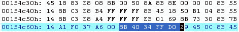
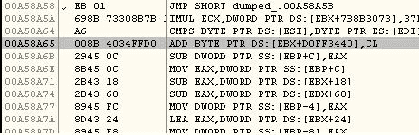
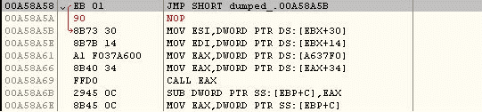
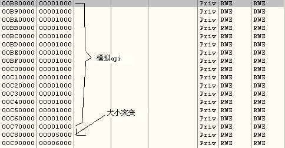

# ASProtect 2.1x SKE -> Alexey Solodovnikov 的 stolen code 脱壳【原创】

> 原文：[`www.pediy.com/kssd/pediy08/pediy8-613.htm`](https://www.pediy.com/kssd/pediy08/pediy8-613.htm)

文章标题:ASProtect 2.1x SKE -> Alexey Solodovnikov 的 stolen code 脱壳  
软件名称:Twilight 复读机  
保护方式:ASProtect 2.1x SKE -> Alexey Solodovniko  
使用工具:od  ImportREC v1.6   LordPE v1.40  
软件大小:393K  
作者声明:只是感兴趣，没有其他目的。失误之处敬请诸位大侠赐教!  
  
  
看了好久别人脱 ASPR 的教程了，想到这个壳的 stolen code 有难度,所以特找个软件,来说说 stolen code 的脱壳,希望高手不要见笑!~!  
  
脱壳步骤:  
  
1   找到 stolen code  
  
2   DUMP 程序  
  
3   补区段  
  
4   去校验  
  
  
一  找到 stolen code 处  
  
载入程序  到 EP 处  
  
00401000 >  68 01904B00     PUSH twilight.004B9001  
00401005    E8 01000000     CALL twilight.0040100B  
0040100A    C3              RETN  
0040100B    C3              RETN  
0040100C    C4E4            LES ESP,ESP                              ; 非法使用寄存器  
0040100E    21441D BE       AND DWORD PTR SS:\[EBP+EBX-42\],EAX  
00401012    93              XCHG EAX,EBX  
00401013    1210            ADC DL,BYTE PTR DS:\[EAX\]  
00401015    A0 49705525     MOV AL,BYTE PTR DS:\[25557049\]  
  
  
忽略除 INT3 以外的所有异常 shift+f9 两次  呵呵,ASPR2.1 的特征,前面的文章里已经讲过了,这里就不多说了  
  
停在这里  
  
00A4C73B    90              NOP  
00A4C73C    EB 01           JMP SHORT 00A4C73F  
00A4C73E    6966 81 FE47467>IMUL ESP,DWORD PTR DS:\[ESI-7F\],744647FE  
00A4C745    05 31C040EB     ADD EAX,EB40C031  
00A4C74A    0231            ADD DH,BYTE PTR DS:\[ECX\]  
00A4C74C    C031 DB         SAL BYTE PTR DS:\[ECX\],0DB                ; 移位常量超出 1..31 的范围  
00A4C74F    64:8F03         POP DWORD PTR FS:\[EBX\]  
00A4C752    83C4 04         ADD ESP,4  
00A4C755    EB 01           JMP SHORT 00A4C758  
  
  
此时 VM 区段已经全部解开,alt+M   在 VM 区段上下断  
  
  
内存映射, 条目 56  
 地址=00C80000  
 大小=00005000 (20480.)  
 属主=         00C80000 (自身)  
 区段=  
 类型=Priv 00021040  
 访问=RWE  
 初始访问=RWE  
  
  
shift+f9 程序中断在 stolen code 处  
  
  
00C80367 >  55              PUSH EBP                                 ; (initial cpu selection)  
00C80368    EB 02           JMP SHORT dumped\_.00C8036C  
00C8036A    CD 20           INT 20  
00C8036C    8DAC0B 5E304800 LEA EBP,DWORD PTR DS:\[EBX+ECX+48305E\]  
00C80373    8D6C4B 12       LEA EBP,DWORD PTR DS:\[EBX+ECX\*2+12\]  
00C80377    8D6C0D EE       LEA EBP,DWORD PTR SS:\[EBP+ECX-12\]  
00C8037B    2BE9            SUB EBP,ECX  
00C8037D    2BE9            SUB EBP,ECX  
00C8037F    8D6C24 1B       LEA EBP,DWORD PTR SS:\[ESP+1B\]  
00C80383    8D6C25 E5       LEA EBP,DWORD PTR SS:\[EBP-1B\]  
00C80387    6A FF           PUSH -1  
00C80389    EB 02           JMP SHORT dumped\_.00C8038D  
00C8038B    CD 20           INT 20  
00C8038D    68 0A304400     PUSH dumped\_.0044300A  
00C80392    EB 02           JMP SHORT dumped\_.00C80396  
00C80394    CD 20           INT 20  
  
  
二   DUMP 程序  
  
  
  
呵呵,这里我们找到 OEP 接下来,就是 DUMP 了  
打开 LordPE v1.40 找到程序,完全 DUMP 出来保存为 dumped.exe  
  
  
打开  
  
ImportREC v1.6  
  
选择程序的进程,点自动搜索 IAT,然后将大小改为 1000,呵呵,估计足够了,再点获取输入表,因为这个软件,IAT 没加密,所以直接可以这样修复,  
再填入 OEP   00870367    修复抓取文件,OK 了,文件修复完毕  
  
  
三    补区段  
  
  
这也是我们今天说的重点所在,前面的找 OEP 可以直接用 Volx 大侠的脚本找到的  
好,现在我们开始 DUMP 程序的 VM 区段  
  
先看看程序用到 vm 哪些段 ,要 DUMP 那几个区段,这里我们用到最少区段法,  
就是对 vm 全部下段 ,看程序在哪些段断下 ,就说明程序用到了 vm 的那些段  
在这几个区段上全部下断,然后 F9 运行程序,看程序都在那几个区段上停下了,也就是程序用到了那几个区段,我们就要合部 DUMP 下来  
  
这几个是我这里用到的并一一记录（应用该方法就能准确的定位出，该 dump 哪些区段了）  
  
00C70000     00005000   
00CE0000     00001000  
00A20000     00043000   
00A70000     00014000  
00CF0000     00001000  
00C90000     00001000  
00C80000     00006000  
00ADC000     00004000  
00AEC000     00004000   
00AB0000     0000C000  
00CA0000     00001000  
00CD0000     00001000  
  
之后程序起动了,呵呵,前面这些就是我这里所用到的区段  
通过 LordPE v1.40 全部 DUMP 下来,之后,就可以补区段了  
  
将所有区段的补完之后,要进行 PE 重建,要不然,程序不能运行的  
  
  
四   去校验  
  
所有 ASPR 的壳,都要找特征码  
  
这里给大家讲一种比较好的,又有校的方法,用 Ultraedit 打开补好区段的程序搜索下特征码：8B 40 34 FF D0  
定位到文件偏移（154c66）如图：  
   
用 LordPE 转换下得到 VA 为：00A58A66  
立即用 OD 载入，Ctrl+G，到达 00A58A66 地址，发现跟 SYSCOM 大侠讲的不一样，代码面目全非，不像大侠给出的那样（如图）  
   
失望之时，往上一看，原来有个花指令，干扰了我们，看到那个 Jmp Short dumped\_.00A58A5B 了吗？呵呵，我们把 00A58A5A 给 nop 掉，哈哈，真面目出来了！！如图：  
   
代码修改为如下：  
00A58A58   /EB 01           JMP SHORT dumped\_.00A58A5B  
00A58A5A   |90              NOP  
00A58A5B   \\8B73 30         MOV ESI,DWORD PTR DS:\[EBX+30\]  
00A58A5E    8B7B 14         MOV EDI,DWORD PTR DS:\[EBX+14\]  
00A58A61    A1 F037A600     MOV EAX,DWORD PTR DS:\[A637F0\]  
00A58A66    3E:8B4424 34    MOV EAX,DWORD PTR DS:\[ESP+34\]  
00A58A6B    83E8 05         SUB EAX,5  
00A58A6E    90              NOP  
00A58A6F    90              NOP  
00A58A70    90              NOP  
00A58A71    2B43 18         SUB EAX,DWORD PTR DS:\[EBX+18\]  
OK!!搞定，收工。  
  
  
在此特别感谢论坛的秀才兄，一直鼓励着我。 

Route Check 代码  
  
014D8A5E      8B7B 14            mov edi,dword ptr ds:\[ebx+14\]  
014D8A61      A1 F0374E01        mov eax,dword ptr ds:\[14E37F0\]  
014D8A66      8B40 34            mov eax,dword ptr ds:\[eax+34\]  
014D8A69      FFD0               call eax  
014D8A6B      2945 0C            sub dword ptr ss:\[ebp+C\],eax     
014D8A6E      8B45 0C            mov eax,dword ptr ss\[ebp+C\]   
014D8A71      2B43 18            sub eax,dword ptr ds:\[ebx+18\]  
014D8A74      2B43 68            sub eax,dword ptr ds:\[ebx+68\]  
014D8A77      8945 FC            mov dword ptr ss:\[ebp-4\],eax  
  
其中下面的代码只要是 aspr 加密过机器码都一样  
  
014D8A66      8B40 34            mov eax,dword ptr ds:\[eax+34\]  
014D8A69      FFD0               call eax   
  
即文章中说的机器码(特征码):8B 40 34 FF D0  
详细请见 SYSCOM 大侠的文章 

引用:  *最初由** 无奈无赖 **发布*  
此时 VM 区段已经全部解开,alt+M   在 VM 区段上下断  
  
  
内存映射, 条目 56  
 地址=00C80000  
........ 

  
  
00C70000    8BFF            MOV EDI,EDI  
00C70002    55              PUSH EBP  
00C70003    8BEC            MOV EBP,ESP  
00C70005    64:A1 18000000  MOV EAX,DWORD PTR FS:\[18\]  
00C7000B    8B4D 08         MOV ECX,DWORD PTR SS:\[EBP+8\]  
00C7000E    8948 34         MOV DWORD PTR DS:\[EAX+34\],ECX  
00C70011    5D              POP EBP  
00C70012    C2 0400         RETN 4  
00C70015    90              NOP  
00C70016    0000            ADD BYTE PTR DS:\[EAX\],AL  
00C70018    0000            ADD BYTE PTR DS:\[EAX\],AL  
00C7001A    0000            ADD BYTE PTR DS:\[EAX\],AL  
00C7001C    0000            ADD BYTE PTR DS:\[EAX\],AL  
00C7001E    0000            ADD BYTE PTR DS:\[EAX\],AL  
00C70020    0000            ADD BYTE PTR DS:\[EAX\],AL  
00C70022    0000            ADD BYTE PTR DS:\[EAX\],AL  
00C70024    0000            ADD BYTE PTR DS:\[EAX\],AL  
00C70026    0000            ADD BYTE PTR DS:\[EAX\],AL  
00C70028    0000            ADD BYTE PTR DS:\[EAX\],AL  
00C7002A    0000            ADD BYTE PTR DS:\[EAX\],AL  
这是 C70000 区段的代码!!!(模拟 API)

  

 4dd466d0e1e0cc123afbe504da2462ca