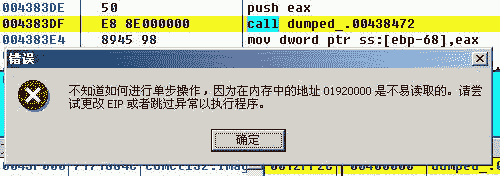

# \[VC6.0\]\[ASProtect 2.1x SKE\]\[Stolen Code\]BetterJPEG 1.5.0.5

> 原文：[`www.pediy.com/kssd/pediy08/pediy8-622.htm`](https://www.pediy.com/kssd/pediy08/pediy8-622.htm)

BetterJPEG 1.5.0.5  
  
ASProtect 2.1x SKE -> Alexey Solodovnikov  
  
先声明，是原创的。  
  
这个还是没有 stolen oep，有 stolen code。  
没能找到参考的程序，全部一句一句推测还原的，还原后可以运行程序，试了下功能没有限制，但是遗憾的是 Help 中的 About＆帮助文件点击的话有问题。  
搞了一整天，眼睛很累，等心情好的时候再端了 Help。  

**1.OEP+IAT：**

Volx 脚本 Aspr2.XX\_IATfixer\_v1.02.osc,Resume 到 oep：

004382B0      55                  push ebp                              ; BetterJP.00400000

004382B1      8BEC                mov ebp,esp

004382B3      6A FF               push -1

004382B5      68 38544400         push BetterJP.00445438

没有 stolen oep。

 

LordPE 选择进程 dump，ImportREC 选择进程，OEP=000382B0，自动搜索，Asprotect1.22 插件修复，全部有效，先保存备用，然后修复存为 dumped\_.exe。

Microsoft Visual C++ 6.0

 

OD 加载 dump.exe，在这里出现错误：

 

跟踪原程序发现是 stolen code 搞的鬼，跟进来到 stolen code 的地方：

0040EF37    - E9 C4105101      jmp 01920000       // 非要往壳里钻

 

**2.Stolen Code 的还原：**

上原程序，跟随 0040EF37 来到：

01920000      68 A2019201      push 19201A2

01920005      E8 F6FF0100      call 01940000                   ; 是个变形 call

跟进到特征码处：

019500CD    - FF6424 FC        jmp dword ptr ss:\[esp-4\]        ; BetterJP.00437C82

原来是 call 00437C82

 

继续：

019201A2      8D4424 10        lea eax,dword ptr ss:\[esp+10\]   ; 返回处

019201A6      8D8E DC000000    lea ecx,dword ptr ds:\[esi+DC\]

019201AC      50               push eax

019201AD      68 07019201      push 1920107

019201B2      E8 49FE0100      call 01940000                   ; 变形 call

跟进：

019500CD    - FF6424 FC        jmp dword ptr ss:\[esp-4\]        ; BetterJP.00434C60

原来是 call 00434C60

 

01920107     /36:EB 01         jmp short 0192010B              ; 返回处

 

0192010B      8B00             mov eax,dword ptr ds:\[eax\]      ; mfc42.6BD156C8

0192010D    ^ E9 B2FFFFFF      jmp 019200C4

 

019200C4      64:FF35 00000000  push dword ptr fs:\[0\]

019200CB      66:9C             pushfw

019200CD      57                push edi

019200CE      F3:               prefix rep:

 

019200D3      81DF C9F38200     sbb edi,82F3C9

019200D9      F3:               prefix rep:

 

019200DE     /EB 02             jmp short 019200E2

 

019200E2      8D7C7A 18         lea edi,dword ptr ds:\[edx+edi\*2+18\]

019200E6      8D7C24 60         lea edi,dword ptr ss:\[esp+60\]

019200EA      83EF 60           sub edi,60

019200ED      26:EB 02          jmp short 019200F2

 

019200F2      8D7C1F 06         lea edi,dword ptr ds:\[edi+ebx+6\]

019200F6      2BFB              sub edi,ebx

019200F8      68 C8DA4400       push 44DAC8                    ; ASCII "BetterJPEG Official Tester"

019200FD      8F07              pop dword ptr ds:\[edi\]

019200FF      5F                pop edi

01920100      66:9D             popfw                          ; =push 44DAC8

01920102    ^ E9 95FFFFFF       jmp 0192009C

 

0192009C      50                push eax                       ; mfc42.6BD156C8

0192009D      C78424 38010000 0>mov dword ptr ss:\[esp+138\],0

019200A8      FF15 74F84300     call dword ptr ds:\[43F874\]     ; MSVCRT.\_mbscmp

019200AE      83C4 08           add esp,8

019200B1      85C0              test eax,eax

019200B3    ^ 0F85 56FFFFFF     jnz 0192000F

 

0192000F      32DB              xor bl,bl

01920011      8D4C24 10         lea ecx,dword ptr ss:\[esp+10\]

01920015      C78424 30010000 F>mov dword ptr ss:\[esp+130\],-1

01920020      68 BE019201       push 19201BE

01920025      E8 D6FF0100       call 01940000                  ; 变形 call

跟进：

019500CD    - FF6424 FC         jmp dword ptr ss:\[esp-4\]       ; BetterJP.00437766

原来是 call 00437766

 

019201BE      84DB              test bl,bl                     ; 返回到此

019201C0    ^ 0F84 4CFFFFFF     je 01920112

 

01920112     /2E:EB 01          jmp short 01920116

 

01920116      51                push ecx                       ; mfc42.6BD156BC

01920117      66:9C             pushfw

01920119      50                push eax

0192011A      2E:EB 01          jmp short 0192011E

 

0192011E      2B4424 00         sub eax,dword ptr ss:\[esp\]     ; mfc42.6BD156C8

01920122      EB 02             jmp short 01920126

 

01920126      2BC1              sub eax,ecx                    ; mfc42.6BD156BC

01920128      81E0 3A98757C     and eax,7C75983A

0192012E      81E0 5290C5D0     and eax,D0C59052

01920134      EB 01             jmp short 01920137

 

01920137      8D442C 75         lea eax,dword ptr ss:\[esp+ebp+75\]

0192013B      2BC5              sub eax,ebp

0192013D      83E8 75           sub eax,75

01920140      EB 01             jmp short 01920143

 

01920143      8D4408 06         lea eax,dword ptr ds:\[eax+ecx+6\]

01920147      2BC1              sub eax,ecx

01920149      F2:               prefix repne:

 

0192014D      57                push edi                       ; BetterJP.0044EB80

0192014E      F2:               prefix repne:

 

01920152      8D3C11            lea edi,dword ptr ds:\[ecx+edx\]

01920155      BF DEDA4100       mov edi,41DADE

0192015A      BF 160E4800       mov edi,480E16

0192015F      26:EB 02          jmp short 01920164

 

01920164      8DBC35 B4EF4000   lea edi,dword ptr ss:\[ebp+esi+40EFB4\]

0192016B      2BFE              sub edi,esi

0192016D      2BFD              sub edi,ebp

0192016F      8938              mov dword ptr ds:\[eax\],edi

01920171      5F                pop edi

01920172      58                pop eax

01920173      66:9D             popfw                          ; =push 40efb4

01920175      C3                retn                           ; 返回到 0040EFB4 (BetterJP.0040EFB4)

 

终于完了，上面分析的这些就是 stolen code，加了些变形，兰色部分就是还原后的 stolen code。

归纳如下：

call 00437C82

lea eax,dword ptr ss:\[esp+10\] 

lea ecx,dword ptr ds:\[esi+0DC\]

push eax

call 00434C60

mov eax,dword ptr ds:\[eax\]      ; mfc42.6BD156C8

push 0044dac8

push eax                               ; mfc42.6BD156C8

mov dword ptr ss:\[esp+138\],0

call dword ptr ds:\[43F874\]             ; MSVCRT.\_mbscmp

add esp,8

test eax,eax

jnz label1

 

**label1**:

xor bl,bl                             ; label 1

lea ecx,dword ptr ss:\[esp+10\]

mov dword ptr ss:\[esp+130\],-1

call 00437766

test bl,bl         

je label2

 

**label2**:

push 40efb4

retn                  ; 返回到 0040EFB4 (BetterJP.0040EFB4)

 

**搞定第一个跳转 jnz label1 跳过的内容：**

进入壳后来到：

0192009C      50                   push eax

0192009D      C78424 38010000 0000>mov dword ptr ss:\[esp+138\],0

019200A8      FF15 74F84300        call dword ptr ds:\[43F874\]     ; MSVCRT.\_mbscmp

019200AE      83C4 08              add esp,8

019200B1      85C0                 test eax,eax

019200B3    ^ 0F85 56FFFFFF        jnz 0192000F                   ; 这里修改跳转

 

019200B9      8D8E E0000000        lea ecx,dword ptr ds:\[esi+E0\]

019200BF     /E9 C3000000          jmp 01920187

 

01920187      68 80019201          push 1920180

0192018C      E8 6FFE0100          call 01940000                   ; 变形 call

019500ED    - FF6424 FC            jmp dword ptr ss:\[esp-4\]        ; BetterJP.00423300

等于 call 00423300

 

01920180      85C0                 test eax,eax                    ; 返回到此

01920182    ^ E9 0DFFFFFF          jmp 01920094         

 

01920094      0F94C0               sete al

01920097      E9 2F010000          jmp 019201CB

 

019201CB      84C0                 test al,al

019201CD    ^ 0F84 3CFEFFFF        je 0192000F                     ; je label 1

019201D3      B3 01                mov bl,1

019201D5    ^ E9 30FEFFFF          jmp 0192000A                    ; jmp label 3

 

0192000A     /E9 02000000          jmp 01920011

0192000F     |32DB                 xor bl,bl                       ; label 1，这里接上

01920011     \\8D4C24 10            lea ecx,dword ptr ss:\[esp+10\]   ; label 3，这里接上

01920015      C78424 30010000 FFFF>mov dword ptr ss:\[esp+130\],-1

 

红色的是先前跟过的，兰色就是需要补的 code，需要补充的代码：

test eax,eax

jnz label1

lea ecx,dword ptr ds:\[esi+E0\]

call 00423300

test eax,eax

sete al

je label1

mov bl,1

jmp  label 3

xor bl,bl                      ; label 1

lea ecx,dword ptr ss:\[esp+10\]  ; label 3

 

这样就补齐了第一个跳转跳过的内容。

 

**搞定 je label2 跳转跳过的内容：**

来到：

019201BE      84DB                 test bl,bl                      ; call 00437766 返回处

019201C0    ^ 0F84 4CFFFFFF        je 01920112                     ; label2，修改，使不跳转

019201C6    ^ E9 D0FFFFFF          jmp 0192019B

 

0192019B      6A 00                push 0

0192019D      E9 15000000          jmp 019201B7

 

019201B7      6A 00                push 0

019201B9    ^ E9 77FEFFFF          jmp 01920035

 

01920035     /65:EB 01             jmp short 01920039

 

01920039      52                   push edx

0192003A      66:9C                pushfw

0192003C      55                   push ebp

0192003D      EB 01                jmp short 01920040

 

01920040      8D6C51 3B            lea ebp,dword ptr ds:\[ecx+edx\*2+3B\]

01920044      8D6D C5              lea ebp,dword ptr ss:\[ebp-3B\]

01920047      1BE9                 sbb ebp,ecx

01920049      036C24 38            add ebp,dword ptr ss:\[esp+38\]

0192004D      036C24 18            add ebp,dword ptr ss:\[esp+18\]

01920051      8D6C34 26            lea ebp,dword ptr ss:\[esp+esi+26\]

01920055      2BEE                 sub ebp,esi

01920057      8D6C35 DA            lea ebp,dword ptr ss:\[ebp+esi-26\]

0192005B      F2:                  prefix repne:

 

0192005F      2BEE                 sub ebp,esi                     ; BetterJP.0044EB80

01920061      64:EB 02             jmp short 01920066

 

01920066      8D6C1D 06            lea ebp,dword ptr ss:\[ebp+ebx+6\]

0192006A      2BEB                 sub ebp,ebx

0192006C      51                   push ecx

0192006D      034C24 18            add ecx,dword ptr ss:\[esp+18\]

01920071      36:EB 01             jmp short 01920075

 

01920075      C1F9 8E              sar ecx,8E

01920078      8D4C4B D2            lea ecx,dword ptr ds:\[ebx+ecx\*2-2E\]

0192007C      8D8C3A 60DA4400      lea ecx,dword ptr ds:\[edx+edi+44DA60\]

01920083      2BCF                 sub ecx,edi

01920085      2BCA                 sub ecx,edx

01920087      51                   push ecx

01920088      8F45 00              pop dword ptr ss:\[ebp\]

0192008B      59                   pop ecx

0192008C      5D                   pop ebp

0192008D      66:9D                popfw                           ; =push 44DA60

0192008F      E9 FD000000          jmp 01920191

 

01920191      68 79019201          push 1920179

01920196      E8 65FE0100          call 01940000                   ; 变形 call

019500ED    - FF6424 FC            jmp dword ptr ss:\[esp-4\]        ; BetterJP.00437A00

相当于 call 00437A00

 

01920179      6A 01                push 1                          ; 返回处

0192017B    ^ E9 AAFEFFFF          jmp 0192002A

 

0192002A      FF15 B0F84300        call dword ptr ds:\[43F8B0\]      ; MSVCRT.exit

然后退出。

 

兰色就是所需的代码，这样得到了第二个跳转跳过的内容：

call 00437766

test bl,bl         

je label2

push 0

push 0

push 44DA60

call 00437A00

push 1

call dword ptr ds:\[43F8B0\]              ; MSVCRT.exit

push 40efb4                             ; label2

retn

 

**这样就得到 stolen code 的整段汇编代码，如下：**

call 00437C82

lea eax,dword ptr ss:\[esp+10\] 

lea ecx,dword ptr ds:\[esi+0DC\]

push eax

call 00434C60

mov eax,dword ptr ds:\[eax\]             ; mfc42.6BD156C8

push 0044dac8

push eax                               ; mfc42.6BD156C8

mov dword ptr ss:\[esp+138\],0

call dword ptr ds:\[43F874\]             ; MSVCRT.\_mbscmp

add esp,8

test eax,eax

jnz label1

lea ecx,dword ptr ds:\[esi+E0\]

call 00423300

test eax,eax

sete al

je label1

mov bl,1

jmp  label 3

xor bl,bl                              ; label 1

lea ecx,dword ptr ss:\[esp+10\]          ; label 3

mov dword ptr ss:\[esp+130\],-1

call 00437766

test bl,bl         

je label2

push 0

push 0

push 44DA60

call 00437A00

push 1

call dword ptr ds:\[43F8B0\]             ; MSVCRT.exit

push 40efb4                            ; label2

retn

 

因为长度关系，从 0040EF31 开始写代码：

0040EF31     /E9 01000000                 jmp dumped\_2.0040EF37           ; 这里开始写

 

0040EF37    - E9 C4105101                 jmp 01920000                    ; stolen code 开始处

...

0040EFB4      8B86 C8010000               mov eax,dword ptr ds:\[esi+1C8\]  ; 返回处，到此为止

 

得到代码：

0040EF31      E8 4C8D0200                 call <jmp.&mfc42.#2621>

0040EF36      8D4424 10                   lea eax,dword ptr ss:\[esp+10\]

0040EF3A      8D8E DC000000               lea ecx,dword ptr ds:\[esi+DC\]

0040EF40      50                          push eax

0040EF41      E8 1A5D0200                 call dumped\_4.00434C60

0040EF46      8B00                        mov eax,dword ptr ds:\[eax\]

0040EF48      68 C8DA4400                 push dumped\_4.0044DAC8                   ; ASCII "BetterJPEG Official Tester"

0040EF4D      50                          push eax

0040EF4E      C78424 38010000 00000000    mov dword ptr ss:\[esp+138\],0

0040EF59      FF15 74F84300               call dword ptr ds:\[<&msvcrt.\_mbscmp>\]    ; MSVCRT.\_mbscmp

0040EF5F      83C4 08                     add esp,8

0040EF62      85C0                        test eax,eax

0040EF64      75 16                       jnz short dumped\_4.0040EF7C

0040EF66      8D8E E0000000               lea ecx,dword ptr ds:\[esi+E0\]

0040EF6C      E8 8F430100                 call dumped\_4.00423300

0040EF71      85C0                        test eax,eax

0040EF73      0F94C0                      sete al

0040EF76      74 04                       je short dumped\_4.0040EF7C

0040EF78      B3 01                       mov bl,1

0040EF7A      EB 02                       jmp short dumped\_4.0040EF7E

0040EF7C      32DB                        xor bl,bl

0040EF7E      8D4C24 10                   lea ecx,dword ptr ss:\[esp+10\]

0040EF82      C78424 30010000 FFFFFFFF    mov dword ptr ss:\[esp+130\],-1

0040EF8D      E8 D4870200                 call <jmp.&mfc42.#800>

0040EF92      84DB                        test bl,bl

0040EF94      74 16                       je short dumped\_4.0040EFAC

0040EF96      6A 00                       push 0

0040EF98      6A 00                       push 0

0040EF9A      68 60DA4400                 push dumped\_4.0044DA60                   ; ASCII " The registration key you are using is not valid.

Please register to obtain a valid registration key."

0040EF9F      E8 5C8A0200                 call <jmp.&mfc42.#1200>

0040EFA4      6A 01                       push 1

0040EFA6      FF15 B0F84300               call dword ptr ds:\[<&msvcrt.exit>\]       ; MSVCRT.exit

0040EFAC      68 B4EF4000                 push dumped\_4.0040EFB4

0040EFB1      90                          nop

0040EFB2      90                          nop

0040EFB3      C3                          retn

 

二进制代码：

E8 4C 8D 02 00 8D 44 24 10 8D 8E DC 00 00 00 50 E8 1A 5D 02 00 8B 00 68 C8 DA 44 00 50 C7 84 24

38 01 00 00 00 00 00 00 FF 15 74 F8 43 00 83 C4 08 85 C0 75 16 8D 8E E0 00 00 00 E8 8F 43 01 00

85 C0 0F 94 C0 74 04 B3 01 EB 02 32 DB 8D 4C 24 10 C7 84 24 30 01 00 00 FF FF FF FF E8 D4 87 02

00 84 DB 74 16 6A 00 6A 00 68 60 DA 44 00 E8 5C 8A 02 00 6A 01 FF 15 B0 F8 43 00 68 B4 EF 40 00

90 90 C3

 

运行 ok，试了下，点击 Help 的 About 提示错误退出，点击帮助文件无反应，其他功能 ok，而且不再提示未注册，无试用时间限制。

  

用 ver 插件得到 ASProtect 1.35 build 01.26 Release  
从注册模式上来看确实是 aspr 1.3X 系列  
PEID 把 aspr 1.3X 系列统统识别为  
ASProtect 2.x SKE -> Alexey Solodovnikov 

帮助文件没反应只要把帮助文件名改成和主文件一样的名字就可以了  
比如脱壳后文件 dumped\_4.exe  
帮助名改成 dumped\_4.chm 

引用:  *最初由** 堀北真希 **发布*  
帮助文件没反应只要把帮助文件名改成和主文件一样的名字就可以了  
比如脱壳后文件 dumped\_4.exe  
帮助名改成 dumped\_4.chm 

  
  
谢谢！  
还请指点下 About 是如何搞定的？  
好多 Asprotect 加壳后的 About 一样的。 

呵呵, 比较一下就知道了  
也是 SDK 的一种 

补充：  
解决 About 的问题：  
OD 载入脱壳修复后程序，搜索字符串，来到：  
0040F68E      B9 86DA4400          mov ecx,gao\_.0044DA86                       ; ASCII " not valid.  
Please register to obtain a valid registration key."  
往下步进，修改这个 je 为 jmp：  
0040F6B0     /0F84 23000000        je gao\_.0040F6D9  
因为相等的话就说明这个 key 无效，所以修改跳转。  
呵呵，这下点击 About 不再出错，注册给 JPEG 了。  
  
继续往下来到注册用户名的地方：  
0040F897     /74 39            je short gao\_.0040F8D2                ; nop 掉  
0040F899     |68 14DB4400      push gao\_.0044DB14                    ; ASCII "This product is licensed to:"  
0040F89E      E8 D3800200      call <jmp.&mfc42.#6199>  
0040F8A3      8D4424 10        lea eax,dword ptr ss:\[esp+10\]  
0040F8A7      8BCF             mov ecx,edi  
0040F8A9      50               push eax                              
0040F8AA      E8 B1530200      call gao\_.00434C60                    ; 跟进  
0040F8AF      8B00             mov eax,dword ptr ds:\[eax\]            ; 注意这个值  
0040F8B1      8D8E 74010000    lea ecx,dword ptr ds:\[esi+174\]  
0040F8B7      50               push eax  
0040F8B8      C64424 64 04     mov byte ptr ss:\[esp+64\],4  
0040F8BD      E8 B4800200      call <jmp.&mfc42.#6199>  
0040F8C2      8D4C24 10        lea ecx,dword ptr ss:\[esp+10\]  
0040F8C6      C64424 60 01     mov byte ptr ss:\[esp+60\],1  
0040F8CB      E8 967E0200      call <jmp.&mfc42.#800>  
0040F8D0      EB 1A            jmp short gao\_1.0040F8EC  
  
整个这段代码就是 0040F8AA 的 call 是 code 的，发现修改这个 call 后的 eax 值：  
堆栈 ds:\[0012F3D0\]=011BA384, (ASCII "cyto")  
011BA384  63 79 74 6F 00 00 BA 0D  cyto..?  
那么注册用户名就是 cyto。  
  
跟进 0040F8AA      E8 B1530200      call gao\_.00434C60 看看在哪里赋值：  
00434C60      51                   push ecx  
00434C61      A1 44E94400          mov eax,dword ptr ds:\[44E944\]         ; 这里赋值？  
00434C66      56                   push esi  
00434C67      8B7424 0C            mov esi,dword ptr ss:\[esp+C\]  
00434C6B      50                   push eax  
00434C6C      8BCE                 mov ecx,esi  
00434C6E      C74424 08 00000000   mov dword ptr ss:\[esp+8\],0  
00434C76      E8 E52A0000          call <jmp.&mfc42.#537>  
00434C7B      8BC6                 mov eax,esi  
00434C7D      5E                   pop esi  
00434C7E      59                   pop ecx  
00434C7F      C2 0400              retn 4  
  
看来看去就只有 ds:\[44E944\]最可疑，好，对他下手试试，找块空间，写上：  
0043EFE0  63 79 74 6F 00 00 00 00  cyto....  
然后修改 ds:\[44E944\]为：  
0044E944  0043EFE0  ASCII "cyto"  
全部保存修改。  
呵呵，点击 About 成功的显示：  
This product is licensed to:  
cyto 

 4dd466d0e1e0cc123afbe504da2462ca