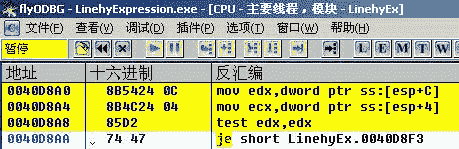
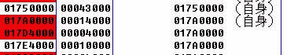
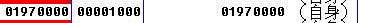
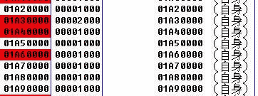
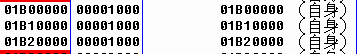
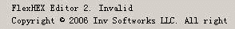

# \[VC6\]\[ASProtect 2.11 SKE build 03.13\]\[补区段\]FlexHex\_212

> 原文：[`www.pediy.com/kssd/pediy08/pediy8-624.htm`](https://www.pediy.com/kssd/pediy08/pediy8-624.htm)

FlexHex\_212  
  
PEID0.94:ASProtect 2.1x SKE -> Alexey Solodovnikov  
Version 0.13: ASProtect 2.11 SKE build 03.13 Release \[1\]  
VC6.0  
  
  
加壳选项：  
stolen code  
CRC  
SDK 函数  
  
Stolen code 用补区段方法解决  
CRC 的解决：2 个脚本对照跑  
SDK 函数：写 code 及修改字符串搞定  
 

**入口点：**

00401000 Fl>  68 01D09B00    push FlexHEX.009BD001

00401005      E8 01000000    call FlexHEX.0040100B

0040100A      C3             retn

0040100B      C3             retn

 

**DUMP+REFIX:**

Volx 脚本：Aspr2.XX\_IATfixer\_v1.02.osc

运行完毕，Resume 两次来到 OEP，提示无 stolen oep。

004A0B14      55               push ebp

004A0B15      8BEC             mov ebp,esp

004A0B17      6A FF            push -1

004A0B19      68 08FD5A00      push FlexHEX.005AFD08

004A0B1E      68 E05F4A00      push FlexHEX.004A5FE0

004A0B23      64:A1 00000000   mov eax,dword ptr fs:\[0\]

 

LordPE 选择进程 dump，ImportREC 选择进程，填入 OEP，自动获取，最后一个 Thunk 明显不是函数，删除，Level1＋Asprotect 插件，还有 7 个无效。先修复 dump，存为 dumped\_.exe。

Microsoft Visual C++ 6.0

 

**Stolen code 1：**

OD 载入，第一处错误，堆栈：

0012F77C   004AD9B9    返回到 dumped\_.004AD9B9 来自 dumped\_.004A3EC0

来到：

004A3EC0    - E9 3BC15A01    jmp 01A50000          // 到壳里

 

载入原程序：

01A50000      8B5424 0C        mov edx,dword ptr ss:\[esp+C\]      // stolen

01A50004      8B4C24 04        mov ecx,dword ptr ss:\[esp+4\]      // stolen

01A50008      85D2             test edx,edx                      // stolen

01A5000A      E8 F1FF0B00      call 01B10000                     // 变形跳转

 

参考 VC6.0 程序：Linehy 表达式计算器 1.0.5:

Ctrl＋S 搜索：

mov edx,dword ptr ss:\[esp+C\] 

mov ecx,dword ptr ss:\[esp+4\] 

test edx,edx 

 

 

 

对照参考程序，继续跟踪原程序，从变形跳转进入，来到：

01B200A5    - FF6424 FC        jmp dword ptr ss:\[esp-4\]           ; 01A500FA

跟随：

01A500FA      33C0             xor eax,eax                        ; stolen

01A500FC      8A4424 08        mov al,byte ptr ss:\[esp+8\]         ; stolen

01A50100      57               push edi                           ; stolen

01A50101      C1CF 99          ror edi,99

01A50104      83CF 95          or edi,FFFFFF95

01A50107      337C24 28        xor edi,dword ptr ss:\[esp+28\]

01A5010B      F2:              prefix repne:

 

一模一样，不用再继续跟了，直接拷贝二进制代码：

8B 54 24 0C 8B 4C 24 04 85 D2 74 47 33 C0 8A 44 24 08 57 8B F9 83 FA 04 72 2D F7 D9 83 E1 03 74

08 2B D1 88 07 47 49 75 FA 8B C8 C1 E0 08 03 C1 8B C8 C1 E0 10 03 C1 8B CA 83 E2 03 C1 E9 02 74

06 F3 AB 85 D2 74 06 88 07 47 4A 75 FA 8B 44 24 08 5F C3

 

恢复后汇编代码如下：

004A3EC0      8B5424 0C        mov edx,dword ptr ss:\[esp+C\]

004A3EC4      8B4C24 04        mov ecx,dword ptr ss:\[esp+4\]

004A3EC8      85D2             test edx,edx

004A3ECA      74 47            je short dumped\_.004A3F13

004A3ECC      33C0             xor eax,eax

004A3ECE      8A4424 08        mov al,byte ptr ss:\[esp+8\]

004A3ED2      57               push edi

004A3ED3      8BF9             mov edi,ecx

004A3ED5      83FA 04          cmp edx,4

004A3ED8      72 2D            jb short dumped\_.004A3F07

004A3EDA      F7D9             neg ecx

004A3EDC      83E1 03          and ecx,3

004A3EDF      74 08            je short dumped\_.004A3EE9

004A3EE1      2BD1             sub edx,ecx

004A3EE3      8807             mov byte ptr ds:\[edi\],al

004A3EE5      47               inc edi

004A3EE6      49               dec ecx

004A3EE7    ^ 75 FA            jnz short dumped\_.004A3EE3

004A3EE9      8BC8             mov ecx,eax

004A3EEB      C1E0 08          shl eax,8

004A3EEE      03C1             add eax,ecx

004A3EF0      8BC8             mov ecx,eax

004A3EF2      C1E0 10          shl eax,10

004A3EF5      03C1             add eax,ecx

004A3EF7      8BCA             mov ecx,edx

004A3EF9      83E2 03          and edx,3

004A3EFC      C1E9 02          shr ecx,2

004A3EFF      74 06            je short dumped\_.004A3F07

004A3F01      F3:AB            rep stos dword ptr es:\[edi\]

004A3F03      85D2             test edx,edx

004A3F05      74 06            je short dumped\_.004A3F0D

004A3F07      8807             mov byte ptr ds:\[edi\],al

004A3F09      47               inc edi

004A3F0A      4A               dec edx

004A3F0B    ^ 75 FA            jnz short dumped\_.004A3F07

004A3F0D      8B4424 08        mov eax,dword ptr ss:\[esp+8\]

004A3F11      5F               pop edi

004A3F12      C3               retn

004A3F13      8B4424 04        mov eax,dword ptr ss:\[esp+4\]

004A3F17      C3               retn

 

保存为 dumped\_1.exe。

 

**暗桩－CRC 验证？：**

载入 dumped\_1.exe,F9 就退出，载入原程序，修复 IAT 脚本运行后 F9 也一样退出，但是寻找 OEP 的脚本不会退出。

好，2 个脚本比较跟踪：

Aspr2.XX\_IATfixer\_v1.02.osc

Asprotect 2.xx SKE OEP finder.txt

层层进入：

004A0BEE     E8 F4210A00     call FlexHEX.00542DE7

00542DF7     E8 2ECD0000     call FlexHEX.0054FB2A

0054FB6E     FF50 50         call dword ptr ds:\[eax+50\]            ; FlexHEX.00408D80

 

再进入后发现在下面的 call 后跳转不一样：

00408DA9     8BF1            mov esi,ecx

00408DAB     E8 10C80400     call dumped\_1.004555C0

00408DB0     85C0            test eax,eax

00408DB2     0F84 BA0C0000   je dumped\_1.00409A72           ; 这里不一样的跳转

 

呵呵，这里很熟，CRC 验证，参考：Web Log Explorer 3.1 Standard Edition

进入 00408DAB 的 call 来到不同的地方：

0045562A    /0F85 2B000000   jnz FlexHEX.0045565B         ; nop

nop 掉就 ok 了，其实就是得到 eax 的值=1。

 

**Stolen code 2：**

继续往下，又一个不可读的地址，堆栈：

0012DB9C   004AE6B7    返回到 dumped\_1.004AE6B7 来自 dumped\_1.004AA5D0

跟随到：

004AE6B2     E8 19BFFFFF     call dumped\_1.004AA5D0

        004AA5D0   - E9 2B5A5B01     jmp 01A60000        ; stolen code

004AE6B7     59              pop ecx

 

同样参考程序，拷贝二进制：

8B 4C 24 04 F7 C1 03 00 00 00 74 14 8A 01 41 84 C0 74 40 F7 C1 03 00 00 00 75 F1 05 00 00 00 00 8B 01 BA FF FE FE 7E 03 D0 83 F0 FF 33 C2 83 C1 04 A9 00 01 01 81 74 E8 8B 41 FC 84 C0 74 32 84 E4 74 24 A9 00 00 FF 00 74 13 A9 00 00 00 FF 74 02 EB CD 8D 41 FF 8B 4C 24 04 2B C1 C3 8D 41 FE 8B 4C 24 04 2B C1 C3 8D 41 FD 8B 4C 24 04 2B C1 C3 8D 41 FC 8B 4C 24 04 2B C1 C3

 

恢复后的代码：

004AA5D0     8B4C24 04       mov ecx,dword ptr ss:\[esp+4\]

004AA5D4     F7C1 03000000   test ecx,3

004AA5DA     74 14           je short dumped\_1.004AA5F0

004AA5DC     8A01            mov al,byte ptr ds:\[ecx\]

004AA5DE     41              inc ecx

004AA5DF     84C0            test al,al

004AA5E1     74 40           je short dumped\_1.004AA623

004AA5E3     F7C1 03000000   test ecx,3

004AA5E9   ^ 75 F1           jnz short dumped\_1.004AA5DC

004AA5EB     05 00000000     add eax,0

004AA5F0     8B01            mov eax,dword ptr ds:\[ecx\]

004AA5F2     BA FFFEFE7E     mov edx,7EFEFEFF

004AA5F7     03D0            add edx,eax

004AA5F9     83F0 FF         xor eax,FFFFFFFF

004AA5FC     33C2            xor eax,edx

004AA5FE     83C1 04         add ecx,4

004AA601     A9 00010181     test eax,81010100

004AA606   ^ 74 E8           je short dumped\_1.004AA5F0

004AA608     8B41 FC         mov eax,dword ptr ds:\[ecx-4\]

004AA60B     84C0            test al,al

004AA60D     74 32           je short dumped\_1.004AA641

004AA60F     84E4            test ah,ah

004AA611     74 24           je short dumped\_1.004AA637

004AA613     A9 0000FF00     test eax,0FF0000

004AA618     74 13           je short dumped\_1.004AA62D

004AA61A     A9 000000FF     test eax,FF000000

004AA61F     74 02           je short dumped\_1.004AA623

004AA621   ^ EB CD           jmp short dumped\_1.004AA5F0

004AA623     8D41 FF         lea eax,dword ptr ds:\[ecx-1\]

004AA626     8B4C24 04       mov ecx,dword ptr ss:\[esp+4\]

004AA62A     2BC1            sub eax,ecx

004AA62C     C3              retn

004AA62D     8D41 FE         lea eax,dword ptr ds:\[ecx-2\]

004AA630     8B4C24 04       mov ecx,dword ptr ss:\[esp+4\]

004AA634     2BC1            sub eax,ecx

004AA636     C3              retn

004AA637     8D41 FD         lea eax,dword ptr ds:\[ecx-3\]

004AA63A     8B4C24 04       mov ecx,dword ptr ss:\[esp+4\]

004AA63E     2BC1            sub eax,ecx

004AA640     C3              retn

004AA641     8D41 FC         lea eax,dword ptr ds:\[ecx-4\]

004AA644     8B4C24 04       mov ecx,dword ptr ss:\[esp+4\]

004AA648     2BC1            sub eax,ecx

004AA64A     C3              retn

 

**SDK 函数：**

又异常了，终于到了这 7 个未修复的函数出场了，堆栈：

0012E558   0040C035    返回到 dumped\_1.0040C035 来自 dumped\_1.00539C64

跟随到：

0040C02F     51              push ecx

0040C030     E8 2FDC1200     call dumped\_1.00539C64

        00539C64   - FF25 88705900    jmp dword ptr ds:\[597088\]

0040C035     85C0            test eax,eax

0040C037     75 04           jnz short dumped\_1.0040C03D

 

总共 7 个：

00539C64   - FF25 88705900    jmp dword ptr ds:\[597088\]   // 第 1 个

00539C6A   - FF25 84705900    jmp dword ptr ds:\[597084\]   // 第 2 个

00539C70   - FF25 80705900    jmp dword ptr ds:\[597080\]   // 第 3 个

00539C76   - FF25 70705900    jmp dword ptr ds:\[597070\]   // 第 4 个

00539C7C   - FF25 7C705900    jmp dword ptr ds:\[59707C\]   // 第 5 个

00539C82   - FF25 78705900    jmp dword ptr ds:\[597078\]   // 第 6 个

00539C88   - FF25 74705900    jmp dword ptr ds:\[597074\]   // 第 7 个

 

估计就是注册标志等函数。

OEP FIND 脚本运行到 OEP，然后 7 个函数下断，F9 运行观察断点位置，发现只有前面 3 个函数断下，剩下的估计是 About 的内容。先解决程序启动用到的 3 个函数：

00539C64   - FF25 88705900    jmp dword ptr ds:\[597088\]   // 第 1 个

00539C6A   - FF25 84705900    jmp dword ptr ds:\[597084\]   // 第 2 个

00539C70   - FF25 80705900    jmp dword ptr ds:\[597080\]   // 第 3 个

 

**先从第 1 个函数入手：**

0040C02F     51              push ecx

0040C030     E8 2FDC1200     call dumped\_2.00539C64

        00539C64   - FF25 88705900    jmp dword ptr ds:\[597088\]

        堆栈：

        0012E54C   0040C035    返回到 FlexHEX.0040C035 来自 FlexHEX.00539C64

        0012E550   0012E57C    // \[esp+4\]

        0012E554   0012E55C    // \[esp+8\]

        0012E558   00000001

0040C035     85C0            test eax,eax

0040C037     75 04           jnz short dumped\_2.0040C03D

 

跟踪发现前 3 个堆栈结构类似，老办法搞定注册标志。

空地写上注册标志：

00596E80  63 79 74 6F              cyto

空地写上 code：

00596D00     8B4424 04        mov eax,dword ptr ss:\[esp+4\]

00596D04     C700 806E5900    mov dword ptr ds:\[eax\],dumped\_1.00596E80   ; ASCII "cyto"

00596D0A     8B4424 08        mov eax,dword ptr ss:\[esp+8\]

00596D0E     C700 806E5900    mov dword ptr ds:\[eax\],dumped\_1.00596E80    ; ASCII "cyto"

00596D14     B8 01000000      mov eax,1

00596D19     C2 0C00          retn 0C

 

修改前 3 个函数的地址：

0059706C  00000000

00597070  01775EF0                         // 第 4 个

00597074  017763CC                         // 第 7 个

00597078  01776068                         // 第 6 个

0059707C  01776208                         // 第 5 个

00597080  00596D00  dumped\_1.00596D00      // 第 3 个

00597084  00596D00  dumped\_1.00596D00      // 第 2 个

00597088  00596D00  dumped\_1.00596D00      // 第 1 个

0059708C  00000000

 

另存为 dumped\_2.exe，可以运行了，但是点击 About 就异常退出。

 

**Activate，用到第 6 个函数：**

还是加载原程序，Find OEP 脚本运行，然后下断剩下的 jmp 函数，点击 About，竟然没反应，看来这几个 jmp 函数应该是注册过后才会断下的。

点击 Activate，断在第 6 个函数：

0040C2CA     51              push ecx

0040C2CB     E8 B2D91200     call FlexHEX.00539C82

        00539C82   - FF25 78705900    jmp dword ptr ds:\[597078\] 

        堆栈：

        0012F168   0040C2D0    返回到 FlexHEX.0040C2D0 来自 FlexHEX.00539C82

        0012F16C   0012F968    ASCII "87654321"   // 练码

        0012F170   0012F864    ASCII "ExtTrial"

        0012F174   00000001

0040C2D0     85C0            test eax,eax                        ; 未注册返回 0

0040C2D2     74 0B           je short FlexHEX.0040C2DF

0040C2D4     6A 00           push 0

0040C2D6     6A 40           push 40

0040C2D8     68 F82A5E00     push dumped\_2.005E2AF8                ; UNICODE "Software has been successfully activated."

 

写上 code：

mov veax,1

retn 0C

这个可以利用上面写的 code：

00596D14     B8 01000000      mov eax,1

00596D19     C2 0C00          retn 0C

修改 jmp 函数地址为：

00597078  00596D14  dumped\_2.00596D14       // 第 6 个

呵呵，又搞定一个函数。

 

**About：**

点击 About 异常，提示 01A20000 不易读取，估计是 stolen code，堆栈看不出消息来源，只好搜索 jmp 01A20000，只有一处：

0040A00C   - E9 EF5F6101     jmp 01A20000

试了下，的确点击 About 在这里断下。

往下还看到几个：

0040A071   - E9 FD5F6101     jmp 01A20073

0040A0A9   - E9 D65F6101     jmp 01A20084

...

看来挺多的，而且乱码一大段，stolen 挺多，还是补区段搞定吧。

 

**补区段：**

载入原程序，这次用 IAT 修复的脚本走，修改 CRC 验证跳转，并写上已经搞定的 jmp 函数的 code，这下就可以启动程序了，而且状态与脱壳后的程序一样。

Alt＋M，对可疑区段各个下断，用到的区段如下：

解码：

 

未知：Route Check？

 

Stolen code:

 

 

删除脱壳修改过代码的 dumped\_2.exe 的 IAT 区段，然后把这些区段添进去，Rebuild PE 后修复 IAT，再解决 Route Check：

01778A66     8B40 34         mov eax,dword ptr ds:\[eax+34\]

01778A69     FFD0            call eax

01778A6B     2945 0C         sub dword ptr ss:\[ebp+C\],eax

 

保存为 cyto.exe，可以运行了，About 也没问题，发现 01B00000 的 3 个区段没用到，可能是上面分析修复的 stolen code 1 与 stolen code 2（好像不是 stolen code，而是 Emulate Standard system Functions？），可以删除这些区段，只是还要修复 IAT。01A20000 的几个区段才是 Stolen code。

 

**解决 About 的注册标志：**

恢复 Stolen code 是个体力活，为了得到跳转实现与否的所有代码，只好不停的点击 About（还好不用重新加载），然后修改跳转获得。

试了下，非常多的代码，而且用到其中的 SDK 函数：第 1 个，第 4 个。

其中第 1 个函数取出注册信息 cyto 与内置的字符串比较：

005E2914  4C 69 63 65 6E 73 65 64         Licensed

005E2908  4D 75 6C 74 69 55 73 65 72      MultiUser

如果不一样的话提示 Invalid：

 

第 4 个函数也取出注册信息与字符串：“100-”比较，如果相等的话就继续与 1，3...等几个数值比较

01A20336     3C 31             cmp al,31

01A202DE     3C 33             cmp al,33

不同的数值表示不同的版本。

其实这些已经无关紧要了，只是注册显示问题而已，直接修改 Invalid 来的更快。

 

搜索：Invalid

005E281C  49 00 6E 00 76 00 61 00 6C 00 69 00 64 00 00 00  I.n.v.a.l.i.d...

修改为：

005E281C  4C 00 69 00 63 00 65 00 6E 00 73 00 65 00 64 00  L.i.c.e.n.s.e.d.

005E282C  20 00 74 00 6F 00 20 00 63 00 79 00 74 00 6F 00   .t.o. .c.y.t.o.

005E283C  00 00 00 00 00 00 00 00 00 00 00 00 00 00 00 00  ................

  

 4dd466d0e1e0cc123afbe504da2462ca