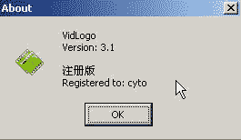

# \[Asprotect\]-\[体验 Volx 2.2 脚本\]-VidLogo 3.1

> 原文：[`www.pediy.com/kssd/pediy08/pediy8-657.htm`](https://www.pediy.com/kssd/pediy08/pediy8-657.htm)

中秋佳节,感谢 Volx 送出大礼:Aspr2.XX\_IATfixer\_v2.2s.osc,  
使得我等小菜有幸对 Asprotect 高版本进行初级探索,  
以下的一些分析送给大家,祝大家:  
年年有今日,岁岁有今朝!  
  
VidLogo 3.1  
  
Do you want to add Your or your Company Logo to any video? Use VidLogo to modify video files and add logos and video watermarks. Use animated logo or AVI logo for videos like a TV sign in one of the corners of screen.   
VidLogo support AVI, BMP, JPEG graphic formats for logos. True Alpha in video is fuly supported!   
  
Features  
Add bitmap (bmp, jpeg, gif) Logo to Video  
Add Video AVI logo to Video  
Convert Video to AVI with different codec (recodec AVI)  
Fast Conversion speed  
Supports AVI, ASF,WMV,DivX,XVid,3ivx,MP4  
Easy to use interface  
  
PEID 0.94:ASProtect V2.X Registered -> Alexey Solodovnikov \*  
Ver0.13:Version: \[ Unknown! \], Signature: \[ 3FCBD2DA \], E-Mail: \[ PE\_Kill@mail.ru \]  
用 Volx 的 1.02 脚本跑不起来,linex 的 0426 找 OEP 的也不支持该版本,可能是 2.3.0626 版本的.  
  
1.Volx 脚本:Aspr2.XX\_IATfixer\_v2.2s.osc  
伪 OEP:  
05F002D5     6A 74                push 74                              ; 00040A212  
05F002D7     EB 01                jmp short 05F002DA  
  
SDK 函数:  
0040A9FC   - FF25 08C04000        jmp dword ptr ds:\[40C008\]     // 第一个 SDK 函数  
0040AA02   - FF25 00C04000        jmp dword ptr ds:\[40C000\]     // 第二个 SDK 函数  
0040AA08   - FF25 04C04000        jmp dword ptr ds:\[40C004\]     // 第三个 SDK 函数  
  
2.Stolen CODE:  
看程序入口点应该是:Visual C++ 7.0 Method2 \[Debug\].刚好有个程序(Xilisoft DVD Ripper 4.0.53)是这个,载入参考之.  
  
2.1 搜索 code 段,有这么些被 Stolen:  
0040A212 u>- E9 BE60AF05          jmp 05F002D5       // Stolen OEP  
0040A278   - E9 0F6EAF05          jmp 05F0108C       // lab  
0040A27E   - E9 A56AAF05          jmp 05F00D28       // lab  
0040A35C   - E9 3361AF05          jmp 05F00494       // lab  
0040A372   - E9 1968AF05          jmp 05F00B90       // lab   
0040A3A6   - E9 3369AF05          jmp 05F00CDE       // lab  
0040A416   - E9 F360AF05          jmp 05F0050E       // call stolen code  
0040A5AE   - E9 465FAF05          jmp 05F004F9       // call stolen code  
0040A60C   - E9 E167AF05          jmp 05F00DF2       // call stolen code  
0040A647   - E9 E263AF05          jmp 05F00A2E       // call stolen code  
0040A722   - E9 E865AF05          jmp 05F00D0F       // call stolen code  
0040A735   - E9 A85DAF05          jmp 05F004E2       // lab  
0040A756   - E9 1463AF05          jmp 05F00A6F       // lab  
0040A760   - E9 FF68AF05          jmp 05F01064       // lab  
0040A7B0   - E9 6063AF05          jmp 05F00B15       // call stolen code  
有些是跳转 lab,有些是 call 里面被偷.  
  
2.2 0040A212 u>- E9 BE60AF05          jmp 05F002D5         // Stolen OEP  
0040A212 X>  6A 74              push 74  
0040A214     68 B8EE4000        push XX\_VidLo.0040EEB8  
0040A219     E8 EE030000        call XX\_VidLo.0040A60C  
0040A21E     33FF               xor edi,edi  
0040A220     897D E0            mov dword ptr ss:\[ebp-20\],edi  
0040A223     57                 push edi  
0040A224     8B1D C0C04000      mov ebx,dword ptr ds:\[<&kernel32.GetModuleHandleA>\]    
0040A22A     FFD3               call ebx  
0040A22C     66:8138 4D5A       cmp word ptr ds:\[eax\],5A4D  
0040A231     75 1F              jnz short XX\_VidLo.0040A252  
0040A233     8B48 3C            mov ecx,dword ptr ds:\[eax+3C\]  
0040A236     03C8               add ecx,eax  
0040A238     8139 50450000      cmp dword ptr ds:\[ecx\],4550  
0040A23E     75 12              jnz short XX\_VidLo.0040A252  
0040A240     0FB741 18          movzx eax,word ptr ds:\[ecx+18\]  
0040A244     3D 0B010000        cmp eax,10B  
0040A249     74 1F              je short XX\_VidLo.0040A26A  
0040A24B     3D 0B020000        cmp eax,20B  
0040A250     74 05              je short XX\_VidLo.0040A257  
0040A252     897D E4            mov dword ptr ss:\[ebp-1C\],edi  
0040A255     EB 27              jmp short XX\_VidLo.0040A27E  
0040A257     83B9 84000000 0E   cmp dword ptr ds:\[ecx+84\],0E  
0040A25E   ^ 76 F2              jbe short XX\_VidLo.0040A252  
0040A260     33C0               xor eax,eax  
0040A262     39B9 F8000000      cmp dword ptr ds:\[ecx+F8\],edi  
0040A268     EB 0E              jmp short XX\_VidLo.0040A278  
0040A26A     8379 74 0E         cmp dword ptr ds:\[ecx+74\],0E  
0040A26E   ^ 76 E2              jbe short XX\_VidLo.0040A252  
0040A270     33C0               xor eax,eax  
0040A272     39B9 E8000000      cmp dword ptr ds:\[ecx+E8\],edi  
0040A278     0F95C0             setne al  
0040A27B     8945 E4            mov dword ptr ss:\[ebp-1C\],eax  
0040A27E     897D FC            mov dword ptr ss:\[ebp-4\],edi  
0040A281     6A 02              push 2  
0040A283     FF15 88C74000      call dword ptr ds:\[<&msvcr71.\_\_set\_app\_type>\]    
0040A289     59                 pop ecx  
0040A28A     830D 4C224100 FF   or dword ptr ds:\[41224C\],FFFFFFFF  
0040A291     830D 50224100 FF   or dword ptr ds:\[412250\],FFFFFFFF  
0040A298     FF15 84C74000      call dword ptr ds:\[<&msvcr71.\_\_p\_\_fmode>\]     
0040A29E     8B0D 04224100      mov ecx,dword ptr ds:\[412204\]  
0040A2A4     8908               mov dword ptr ds:\[eax\],ecx  
0040A2A6     FF15 80C74000      call dword ptr ds:\[<&msvcr71.\_\_p\_\_commode>\]        
0040A2AC     8B0D 00224100      mov ecx,dword ptr ds:\[412200\]  
0040A2B2     8908               mov dword ptr ds:\[eax\],ecx  
0040A2B4     A1 7CC74000        mov eax,dword ptr ds:\[<&msvcr71.\_adjust\_fdiv>\]  
0040A2B9     8B00               mov eax,dword ptr ds:\[eax\]  
0040A2BB     A3 48224100        mov dword ptr ds:\[412248\],eax  
0040A2C0     E8 5D040000        call XX\_VidLo.0040A722  
0040A2C5     E8 F8040000        call XX\_VidLo.0040A7C2  
0040A2CA     393D 10214100      cmp dword ptr ds:\[412110\],edi  
0040A2D0     75 0C              jnz short XX\_VidLo.0040A2DE  
0040A2D2     68 42A74000        push XX\_VidLo.0040A742  
0040A2D7     FF15 78C74000      call dword ptr ds:\[<&msvcr71.\_\_setusermatherr>\]    
0040A2DD     59                 pop ecx  
0040A2DE     E8 CD040000        call XX\_VidLo.0040A7B0  
0040A2E3     68 24204100        push XX\_VidLo.00412024  
0040A2E8     68 20204100        push XX\_VidLo.00412020  
0040A2ED     E8 B8040000        call <jmp.&msvcr71.\_initterm>  
0040A2F2     68 66A74000        push XX\_VidLo.0040A766  
0040A2F7     E8 B2020000        call XX\_VidLo.0040A5AE  
0040A2FC     A1 FC214100        mov eax,dword ptr ds:\[4121FC\]  
0040A301     8945 D8            mov dword ptr ss:\[ebp-28\],eax  
0040A304     8D45 D8            lea eax,dword ptr ss:\[ebp-28\]  
0040A307     50                 push eax  
0040A308     FF35 F8214100      push dword ptr ds:\[4121F8\]  
0040A30E     8D45 D0            lea eax,dword ptr ss:\[ebp-30\]  
0040A311     50                 push eax  
0040A312     8D45 CC            lea eax,dword ptr ss:\[ebp-34\]  
0040A315     50                 push eax  
0040A316     8D45 C8            lea eax,dword ptr ss:\[ebp-38\]  
0040A319     50                 push eax  
0040A31A     FF15 70C74000      call dword ptr ds:\[<&msvcr71.\_\_wgetmainargs>\]     
0040A320     83C4 20            add esp,20  
0040A323     8945 C4            mov dword ptr ss:\[ebp-3C\],eax  
0040A326     3BC7               cmp eax,edi  
0040A328     7D 08              jge short XX\_VidLo.0040A332      
0040A32A     6A 08              push 8  
0040A32C     E8 EB030000        call <jmp.&msvcr71.\_amsg\_exit>  
0040A331     59                 pop ecx  
0040A332     68 1C204100        push XX\_VidLo.0041201C  
0040A337     68 00204100        push XX\_VidLo.00412000  
0040A33C     E8 69040000        call <jmp.&msvcr71.\_initterm>  
0040A341     59                 pop ecx  
0040A342     59                 pop ecx  
0040A343     A1 60C74000        mov eax,dword ptr ds:\[<&msvcr71.\_wcmdln>\]  
0040A348     8B30               mov esi,dword ptr ds:\[eax\]  
0040A34A     3BF7               cmp esi,edi    
0040A34C     75 0E              jnz short XX\_VidLo.0040A35C             ; jnz lab 1  
0040A34E     834D FC FF         or dword ptr ss:\[ebp-4\],FFFFFFFF  
0040A352     B8 FF000000        mov eax,0FF  
0040A357     E9 BA000000        jmp XX\_VidLo.0040A416  
0040A35C     8975 DC            mov dword ptr ss:\[ebp-24\],esi           ; lab 1  
0040A35F     66:8B06            mov ax,word ptr ds:\[esi\]  
0040A362     66:83F8 20         cmp ax,20  
0040A366     77 63              ja short XX\_VidLo.0040A3CB              ; ja lab 2  
0040A368     66:3BC7            cmp ax,di  
0040A36B     74 05              je short XX\_VidLo.0040A372              ; je lab 4  
0040A36D     397D E0            cmp dword ptr ss:\[ebp-20\],edi  
0040A370     75 59              jnz short XX\_VidLo.0040A3CB             ; jne lab 2  
0040A372     66:8B06            mov ax,word ptr ds:\[esi\]                ; lab 4  
0040A375     66:3BC7            cmp ax,di  
0040A378     74 0D              je short XX\_VidLo.0040A387              ; je lab 5  
0040A37A     66:83F8 20         cmp ax,20  
0040A37E     77 07              ja short XX\_VidLo.0040A387              ; ja lab 5  
0040A380     46                 inc esi  
0040A381     46                 inc esi  
0040A382     8975 DC            mov dword ptr ss:\[ebp-24\],esi  
0040A385   ^ EB EB              jmp short XX\_VidLo.0040A372  
0040A387     897D A8            mov dword ptr ss:\[ebp-58\],edi           ; lab 5  
0040A38A     8D85 7CFFFFFF      lea eax,dword ptr ss:\[ebp-84\]  
0040A390     50                 push eax  
0040A391     FF15 BCC04000      call dword ptr ds:\[<&kernel32.GetStartupInfoW>\]    
0040A397     F645 A8 01         test byte ptr ss:\[ebp-58\],1  
0040A39B     74 06              je short XX\_VidLo.0040A3A3              ; je lab 6  
0040A39D     0FB745 AC          movzx eax,word ptr ss:\[ebp-54\]  
0040A3A1     EB 03              jmp short XX\_VidLo.0040A3A6             ; jmp lab 7  
0040A3A3     6A 0A              push 0A                                 ; lab 6  
0040A3A5     58                 pop eax  
0040A3A6     50                 push eax                                ; lab 7  
0040A3A7     56                 push esi  
0040A3A8     57                 push edi  
0040A3A9     57                 push edi  
0040A3AA     FFD3               call ebx  
0040A3AC     50                 push eax  
0040A3AD     E8 5C060000        call XX\_VidLo.0040AA0E  
0040A3B2     8BF0               mov esi,eax  
0040A3B4     8975 C0            mov dword ptr ss:\[ebp-40\],esi  
0040A3B7     397D E4            cmp dword ptr ss:\[ebp-1C\],edi  
0040A3BA     75 07              jnz short XX\_VidLo.0040A3C3  
0040A3BC     56                 push esi  
0040A3BD     FF15 5CC74000      call dword ptr ds:\[<&msvcr71.exit>\]      
0040A3C3     FF15 58C74000      call dword ptr ds:\[<&msvcr71.\_cexit>\]    
0040A3C9     EB 45              jmp short XX\_VidLo.0040A410    
0040A3CB     66:83F8 22         cmp ax,22  
0040A3CF     75 0B              jnz short XX\_VidLo.0040A3DC            ; jnz lab 3  
0040A3D1     33C0               xor eax,eax  
0040A3D3     397D E0            cmp dword ptr ss:\[ebp-20\],edi  
0040A3D6     0F94C0             sete al  
0040A3D9     8945 E0            mov dword ptr ss:\[ebp-20\],eax  
0040A3DC     46                 inc esi                                ; lab 3  
0040A3DD     46                 inc esi  
0040A3DE   ^ E9 79FFFFFF        jmp XX\_VidLo.0040A35C  
6A 74 68 B8 EE 40 00 E8 EE 03 00 00 33 FF 89 7D E0 57 8B 1D C0 C0 40 00 FF D3 66 81 38 4D 5A 75  
1F 8B 48 3C 03 C8 81 39 50 45 00 00 75 12 0F B7 41 18 3D 0B 01 00 00 74 1F 3D 0B 02 00 00 74 05  
89 7D E4 EB 27 83 B9 84 00 00 00 0E 76 F2 33 C0 39 B9 F8 00 00 00 EB 0E 83 79 74 0E 76 E2 33 C0  
39 B9 E8 00 00 00 0F 95 C0 89 45 E4 89 7D FC 6A 02 FF 15 88 C7 40 00 59 83 0D 4C 22 41 00 FF 83  
0D 50 22 41 00 FF FF 15 84 C7 40 00 8B 0D 04 22 41 00 89 08 FF 15 80 C7 40 00 8B 0D 00 22 41 00  
89 08 A1 7C C7 40 00 8B 00 A3 48 22 41 00 E8 5D 04 00 00 E8 F8 04 00 00 39 3D 10 21 41 00 75 0C  
68 42 A7 40 00 FF 15 78 C7 40 00 59 E8 CD 04 00 00 68 24 20 41 00 68 20 20 41 00 E8 B8 04 00 00  
68 66 A7 40 00 E8 B2 02 00 00 A1 FC 21 41 00 89 45 D8 8D 45 D8 50 FF 35 F8 21 41 00 8D 45 D0 50  
8D 45 CC 50 8D 45 C8 50 FF 15 70 C7 40 00 83 C4 20 89 45 C4 3B C7 7D 08 6A 08 E8 EB 03 00 00 59  
68 1C 20 41 00 68 00 20 41 00 E8 69 04 00 00 59 59 A1 60 C7 40 00 8B 30 3B F7 75 0E 83 4D FC FF  
B8 FF 00 00 00 E9 BA 00 00 00 89 75 DC 66 8B 06 66 83 F8 20 77 63 66 3B C7 74 05 39 7D E0 75 59  
66 8B 06 66 3B C7 74 0D 66 83 F8 20 77 07 46 46 89 75 DC EB EB 89 7D A8 8D 85 7C FF FF FF 50 FF  
15 BC C0 40 00 F6 45 A8 01 74 06 0F B7 45 AC EB 03 6A 0A 58 50 56 57 57 FF D3 50 E8 5C 06 00 00  
8B F0 89 75 C0 39 7D E4 75 07 56 FF 15 5C C7 40 00 FF 15 58 C7 40 00 EB 45 66 83 F8 22 75 0B 33  
C0 39 7D E0 0F 94 C0 89 45 E0 46 46 E9 79 FF FF FF  
  
2.3 0040A416   - E9 F360AF05          jmp 05F0050E  
0040A416     E8 2C020000          call XX\_VidLo.0040A647  
0040A41B     C3                   retn  
E8 2C 02 00 00 C3  
  
2.4 0040A5AE   - E9 465FAF05          jmp 05F004F9  
0040A5AE     FF7424 04            push dword ptr ss:\[esp+4\]  
0040A5B2     E8 D1FFFFFF          call XX\_VidLo.0040A588  
0040A5B7     F7D8                 neg eax  
0040A5B9     1BC0                 sbb eax,eax  
0040A5BB     F7D8                 neg eax  
0040A5BD     59                   pop ecx  
0040A5BE     48                   dec eax  
0040A5BF     C3                   retn  
FF 74 24 04 E8 D1 FF FF FF F7 D8 1B C0 F7 D8 59 48 C3  
  
2.5 0040A60C   - E9 E167AF05          jmp 05F00DF2  
0040A60C     68 76A54000          push <jmp.&msvcr71.\_except\_handler3>  
0040A611     64:A1 00000000       mov eax,dword ptr fs:\[0\]  
0040A617     50                   push eax  
0040A618     8B4424 10            mov eax,dword ptr ss:\[esp+10\]  
0040A61C     896C24 10            mov dword ptr ss:\[esp+10\],ebp  
0040A620     8D6C24 10            lea ebp,dword ptr ss:\[esp+10\]  
0040A624     2BE0                 sub esp,eax  
0040A626     53                   push ebx  
0040A627     56                   push esi  
0040A628     57                   push edi  
0040A629     8B45 F8              mov eax,dword ptr ss:\[ebp-8\]  
0040A62C     8965 E8              mov dword ptr ss:\[ebp-18\],esp  
0040A62F     50                   push eax  
0040A630     8B45 FC              mov eax,dword ptr ss:\[ebp-4\]  
0040A633     C745 FC FFFFFFFF     mov dword ptr ss:\[ebp-4\],-1  
0040A63A     8945 F8              mov dword ptr ss:\[ebp-8\],eax  
0040A63D     8D45 F0              lea eax,dword ptr ss:\[ebp-10\]  
0040A640     64:A3 00000000       mov dword ptr fs:\[0\],eax  
0040A646     C3                   retn  
68 76 A5 40 00 64 A1 00 00 00 00 50 8B 44 24 10 89 6C 24 10 8D 6C 24 10 2B E0 53 56 57 8B 45 F8  
89 65 E8 50 8B 45 FC C7 45 FC FF FF FF FF 89 45 F8 8D 45 F0 64 A3 00 00 00 00 C3  
  
2.6 0040A647   - E9 E263AF05          jmp 05F00A2E  
0040A647     8B4D F0              mov ecx,dword ptr ss:\[ebp-10\]  
0040A64A     64:890D 00000000     mov dword ptr fs:\[0\],ecx  
0040A651     59                   pop ecx  
0040A652     5F                   pop edi  
0040A653     5E                   pop esi  
0040A654     5B                   pop ebx  
0040A655     C9                   leave  
0040A656     51                   push ecx  
0040A657     C3                   retn  
8B 4D F0 64 89 0D 00 00 00 00 59 5F 5E 5B C9 51 C3  
  
2.7 0040A722   - E9 E865AF05          jmp 05F00D0F  
0040A722     6A 0C              push 0C  
0040A724     68 00EF4000        push XX\_VidLo.0040EF00  
0040A729     E8 DEFEFFFF        call XX\_VidLo.0040A60C  
0040A72E     C745 E4 04F14000   mov dword ptr ss:\[ebp-1C\],XX\_VidLo.0040F104  
0040A735     817D E4 04F14000   cmp dword ptr ss:\[ebp-1C\],XX\_VidLo.0040F104  
0040A73C     73 22              jnb short XX\_VidLo.0040A760  
0040A73E     8365 FC 00         and dword ptr ss:\[ebp-4\],0  
0040A742     8B45 E4            mov eax,dword ptr ss:\[ebp-1C\]  
0040A745     8B00               mov eax,dword ptr ds:\[eax\]  
0040A747     85C0               test eax,eax  
0040A749     74 0B              je short XX\_VidLo.0040A756  
0040A74B     FFD0               call eax  
0040A74D     EB 07              jmp short XX\_VidLo.0040A756  
0040A74F     33C0               xor eax,eax  
0040A751     40                 inc eax  
0040A752     C3                 retn  
0040A753     8B65 E8            mov esp,dword ptr ss:\[ebp-18\]  
0040A756     834D FC FF         or dword ptr ss:\[ebp-4\],FFFFFFFF  
0040A75A     8345 E4 04         add dword ptr ss:\[ebp-1C\],4  
0040A75E   ^ EB D5              jmp short XX\_VidLo.0040A735  
0040A760     E8 E2FEFFFF        call XX\_VidLo.0040A647  
0040A765     C3                 retn  
6A 0C 68 00 EF 40 00 E8 DE FE FF FF C7 45 E4 04 F1 40 00 81 7D E4 04 F1 40 00 73 22 83 65 FC 00  
8B 45 E4 8B 00 85 C0 74 0B FF D0 EB 07 33 C0 40 C3 8B 65 E8 83 4D FC FF 83 45 E4 04 EB D5 E8 E2  
FE FF FF C3  
  
2.8 0040A7B0   - E9 6063AF05          jmp 05F00B15  
0040A7B0     68 00000300          push 30000  
0040A7B5     68 00000100          push 10000        
0040A7BA     E8 85000000          call <jmp.&msvcr71.\_controlfp>  
0040A7BF     59                   pop ecx  
0040A7C0     59                   pop ecx  
0040A7C1     C3                   retn  
68 00 00 03 00 68 00 00 01 00 E8 85 00 00 00 59 59 C3  
  
3.部分代码恢复过程:某段跳转特多的地方  
从 0040A34A     3BF7               cmp esi,edi  开始  
即:05F00AC6     E8 35F50500          call 05F60000              ; cmp esi,edi;jnz lab 1  
  
3.1 跳转未实现:  
05F00D16     834D FC FF           or dword ptr ss:\[ebp-4\],FFFFFFFF  
05F00FF9     8D8425 FF000000      lea eax,dword ptr ss:\[ebp+FF\]  
05F01000     2BC5                 sub eax,ebp                    ; mov eax,ff  
05F01002     E8 F9EF0500          call 05F60000                  ; jmp 40a416  
05F0050E     68 F804F005          push 5F004F8                   ; 00040A416  
05F00513     E8 E8FA0500          call 05F60000                  ; call 40a647  
05F004F8     C3                   retn  
  
3.2 跳转实现:  
05F00494     8975 DC              mov dword ptr ss:\[ebp-24\],esi  ; lab 1,00040A35C,  
05F0106E     66:8B06              mov ax,word ptr ds:\[esi\]  
05F01071     66:3D 2000           cmp ax,20  
05F01075   ^ 0F87 4CFCFFFF        ja 05F00CC7                    ; ja lab 2  
05F0107B     66:3BC7              cmp ax,di  
05F0107E     E8 7DEF0500          call 05F60000                  ; je lab 4,40a372  
05F00B87     397D E0              cmp dword ptr ss:\[ebp-20\],edi  
05F00B8A     0F85 37010000        jnz 05F00CC7                   ; jnz lab 2  
05F00B90     66:8B06              mov ax,word ptr ds:\[esi\]       ; 00040A372,lab 4  
05F00B93     66:3BC7              cmp ax,di  
05F00B96   ^ 0F84 4BFAFFFF        je 05F005E7                    ; je lab 5  
05F00B9C     66:3D 2000           cmp ax,20  
05F00BA0     E8 5BF40500          call 05F60000                  ; ja(7B?jpo) lab 5  
  
05F004EE     46                   inc esi  
05F004EF     46                   inc esi  
05F004F0     8975 DC              mov dword ptr ss:\[ebp-24\],esi  
05F004F3     E8 08FB0500          call 05F60000                  ; jmp lab 4,40a372  
  
\------------------------------------------------------------  
未解决的 lab 有 lab 2 与 lab 5,从参考程序来看,lab 2 在后头.  
  
3.3 lab 5  
05F005E7     897D A8              mov dword ptr ss:\[ebp-58\],edi  ; lab 5  
05F005EA     8D85 7CFFFFFF        lea eax,dword ptr ss:\[ebp-84\]  
05F005F0     50                   push eax  
05F005F1     FF15 BCC04000        call dword ptr ds:\[40C0BC\]       
05F005F7     F645 A8 01           test byte ptr ss:\[ebp-58\],1  
05F005FB     0F84 DA060000        je 05F00CDB                    ; je lab 6  
05F00601     0FB745 AC            movzx eax,word ptr ss:\[ebp-54\]  
05F00605    /E9 D4060000          jmp 05F00CDE                   ; jmp lab 7;0040a3a6  
  
05F00CDB     6A 0A                push 0A                        ; lab 6  
05F00CDD     58                   pop eax  
05F00CDE     50                   push eax                       ; 00040A3A6;lab 7  
05F00341     56                   push esi  
05F00342     57                   push edi  
05F00343     57                   push edi  
05F00344     FFD3                 call ebx  
05F00346     50                   push eax  
05F00347     68 7C05F005          push 5F0057C  
05F0034C     E8 AFFC0500          call 05F60000                  ; call 40aa0e  
  
05F0057C     C1C6 A9              rol esi,0A9  
...  
05F005A5     8D7408 19            lea esi,dword ptr ds:\[eax+ecx+19\]  
05F005A9     2BF1                 sub esi,ecx  
05F005AB     8D7416 E7            lea esi,dword ptr ds:\[esi+edx-19\]  
05F005AF     2BF2                 sub esi,edx                    ; mov esi,eax  
05F005B1     8975 C0              mov dword ptr ss:\[ebp-40\],esi  
05F005B4     397D E4              cmp dword ptr ss:\[ebp-1C\],edi  
05F005B7     E8 44FA0500          call 05F60000                  ; jnz lab 8  
05F00C60     56                   push esi  
05F00C61     FF15 5CC74000        call dword ptr ds:\[40C75C\]     ; MSVCR71.exit  
  
05F00C6C     FF7424 08            push dword ptr ss:\[esp+8\]  
05F00C70     66:9C                pushfw  
...  
05F00CBD     66:9D                popfw                          ; push 40a3c3  
05F00CBF     C3                   retn  
  
然后返回到:  
0040A3C3     FF15 58C74000        call dword ptr ds:\[40C758\]      ; MSVCR71.\_cexit  
0040A3C9     EB 45                jmp short VidLogo.0040A410  
\------------------------------  
  
3.4 lab 2  
05F00CC7     66:3D 2200           cmp ax,22                       ; lab 2  
05F00CCB   ^ 0F85 F1F8FFFF        jnz 05F005C2                    ; jnz lab 3  
05F00CD1     33C0                 xor eax,eax  
05F00CD3     397D E0              cmp dword ptr ss:\[ebp-20\],edi  
05F005BC     0F94C0               sete al  
05F005BF     8945 E0              mov dword ptr ss:\[ebp-20\],eax  
05F005C2     46                   inc esi                          ; lab 3  
05F005C3     46                   inc esi  
05F005C4     E8 37FA0500          call 05F60000                    ; jmp lab 1;40A35C  
\------------------------------  
  
4.对变形 call 及变形跳转的部分理解  
4.1 变形 call 分类处:  
04D2460E     FFD2                 call edx  
04D24610     8945 F0              mov dword ptr ss:\[ebp-10\],eax  
04D24613     80EB 02              sub bl,2                    ; 与之前版本不同,改为 bl  
04D24616     0F82 CE000000        jb 04D246EA  
04D2461C     74 75                je short 04D24693  
04D2461E     FECB                 dec bl  
04D24620     0F85 F3000000        jnz 04D24719  
  
4.2 跳转类型的对应关系  
分类处与之前的版本不一样,以第 3 种情况(jxx z)为例,来到这里:  
04D24638     8A47 04              mov al,byte ptr ds:\[edi+4\]  
04D2463B     8B55 F8              mov edx,dword ptr ss:\[ebp-8\]  
04D2463E     8B5C82 40            mov ebx,dword ptr ds:\[edx+eax\*4+40\]  
04D24642     8BC6                 mov eax,esi  
04D24644     FFD3                 call ebx             
04D24646     8BD8                 mov ebx,eax                    ; 之前的看 eax 的值  
04D24648     8B45 F8              mov eax,dword ptr ss:\[ebp-8\]  
04D2464B     3258 70              xor bl,byte ptr ds:\[eax+70\]    ; 0426,0626 版本的看 xor 的 bl 值  
04D2464E     8B4D 10              mov ecx,dword ptr ss:\[ebp+10\]  
04D24651     8BD3                 mov edx,ebx  
04D24653     8B45 F8              mov eax,dword ptr ss:\[ebp-8\]  
04D24656     E8 A5030000          call 04D24A00  
04D2465B     84C0                 test al,al                    ; 跳转实现与否,  
04D2465D     74 1A                je short 04D24679  
  
bl 值对应跳转关系:3-jnb,4-je,5-jne;A-jbe,B-ja(这两个是参考对照程序推测的)  
  
第 4 种情况:cmp x,y;jxx z 好像也有所不同,不过整个 stolen code 才出现 2 次:  
0040A326     3BC7               cmp eax,edi  
0040A328     7D 08              jge short XX\_VidLo.0040A332     
  
0040A34A     3BF7               cmp esi,edi    
0040A34C     75 0E              jnz short XX\_VidLo.0040A35C             ; jnz lab 1  
因为都属于 cmp x,y;jxx z 的第 5 种情况,因此不能不能进一步分辨出,期待大侠指出.  
  
5.SDK 函数的处理:  
5.1 启动过程中断在第一个 SDK 函数:  
0040A9FC   - FF25 08C04000        jmp dword ptr ds:\[40C008\]  
堆栈:  
0012F8B0   00409787    返回到 VidLogo.00409787 来自 VidLogo.0040A9FC  
0012F8B4   00000000    ; push 0  ,参数 3  
0012F8B8   0012F8C0    ; push ecx,参数 2  
0012F8BC   0012F8C4    ; push eax,参数 1  
0012F8C0   00000000  
  
返回后:eax=1  
堆栈:  
0012F8C0   04DD0F38    ASCII "Trial"    // 参数 2 返回值,这里是试验版  
0012F8C4   00000002                     // 参数 1 返回值  
  
调用的 call:  
0040976C     8D4424 04            lea eax,dword ptr ss:\[esp+4\]  
00409770     50                   push eax                       ; 参数 1  
00409771     8D4C24 04            lea ecx,dword ptr ss:\[esp+4\]  
00409775     51                   push ecx                       ; 参数 2  
00409776     6A 00                push 0                         ; 0  
00409778     C705 EC214100 010000>mov dword ptr ds:\[4121EC\],1  
00409782     E8 75120000          call VidLogo.0040A9FC          ; 此处调用第一个 SDK 函数  
00409787     85C0                 test eax,eax                   ; 返回值:eax=1  
00409789     74 18                je short VidLogo.004097A3    
0040978B     0FB64424 04          movzx eax,byte ptr ss:\[esp+4\]  ; 注意这里,参数 1 的返回值  
00409790     83F8 02              cmp eax,2                      ; 与 2 比较  
00409793     76 0E                jbe short VidLogo.004097A3     ; 小于等于就跳转 004097A3  
00409795     B8 01000000          mov eax,1  
0040979A     A3 E4214100          mov dword ptr ds:\[4121E4\],eax  
0040979F     83C4 0C              add esp,0C  
004097A2     C3                   retn  
004097A3     A1 E4214100          mov eax,dword ptr ds:\[4121E4\]  
004097A8     83C4 0C              add esp,0C  
004097AB     C3                   retn  
  
入栈 2 个参数,一个返回版本(参数 2),一个返回数值(参数 1),返回的数值与 2 比较,看上面的反汇编代码,必须大于 2.  
从这里可以看出这个 SDK 函数需要代码:  
mov eax,\[esp+8\]  
mov \[eax\],参数 2    ; 参数 2 即版本类型,修改为注册版,找空间写入  
mov eax,\[esp+0c\]  
mov \[eax\],参数 1    ; 参数 1 需要大于 2,修改为 5  
mov eax,1          ; 赋值 eax=1  
retn 0c              
  
写上备用注册标志:  
0040BFD8  63 79 74 6F 00 00 00 00  cyto.... // 参数 4  
0040BFE0  70 65 64 69 79 00 00 00  pediy...   
0040BFE8  00 00 00 00 00 00 00 00  .......    
0040BFF0  D7 A2 B2 E1 B0 E6 00 00  注册版..  // 参数 2  
0040BFF8  00 00 00 00 00 00 00 00  ........  
  
写上代码:  
0040BD61     8B4424 08            mov eax,dword ptr ss:\[esp+8\]  
0040BD65     C700 F0BF4000        mov dword ptr ds:\[eax\],XX\_VidLo.0040BFF0  
0040BD6B     8B4424 0C            mov eax,dword ptr ss:\[esp+C\]  
0040BD6F     C700 05000000        mov dword ptr ds:\[eax\],5  
0040BD75     B8 01000000          mov eax,1  
0040BD7A     C2 0C00              retn 0C  
8B 44 24 08 C7 00 F0 BF 40 00 8B 44 24 0C C7 00 05 00 00 00 B8 01 00 00 00 C2 0C 00  
  
修改 SDK 函数地址:  
0040C008  0040BD61  cyto\_Vid.0040BD61  
  
程序可以启动进入了.  
  
5.2 点击 About 来到第三个 SDK 函数:  
0040AA08   - FF25 04C04000        jmp dword ptr ds:\[40C004\]  
堆栈:  
0012F68C   004097CF    返回到 cyto\_Vid.004097CF 来自 cyto\_Vid.0040AA08  
0012F690   00000000  
0012F694   0012F6B0    // 参数 4  
0012F698   0012F6BC    // 参数 3  
0012F69C   00000110  
0012F6A0   0012FB6C  
0012F6A4   00B21060  
0012F6A8   7C266736    返回到 MFC71U.7C266736 来自 MFC71U.7C266027  
0012F6AC   0040D2B0    UNICODE "  "  
0012F6B0   00000000    // 参数 4 的值  
0012F6B4   00000110  
0012F6B8   7C274E62    返回到 MFC71U.7C274E62  
0012F6BC   00000000    // 参数 3 的值  
  
调用的 call:  
004097B9     8D45 FC              lea eax,dword ptr ss:\[ebp-4\]  
004097BC     50                   push eax                        ; 参数 3  
004097BD     8D4D F0              lea ecx,dword ptr ss:\[ebp-10\]  
004097C0     33F6                 xor esi,esi  
004097C2     51                   push ecx                        ; 参数 4  
004097C3     56                   push esi                        ; 0  
004097C4     8975 F0              mov dword ptr ss:\[ebp-10\],esi   ; 对参数 4 的值清 0  
004097C7     8975 FC              mov dword ptr ss:\[ebp-4\],esi    ; 对参数 3 的值清 0  
004097CA     E8 39120000          call cyto\_Vid.0040AA08          ; 此处调用第三个 SDK 函数  
004097CF     3975 FC              cmp dword ptr ss:\[ebp-4\],esi    ; 参数 3 是否为空?  
004097D2     75 09                jnz short cyto\_Vid.004097DD     ; 不为空即跳走  
004097D4     8B15 D4204100        mov edx,dword ptr ds:\[4120D4\]   ; cyto\_Vid.0040EE70  
004097DA     8955 FC              mov dword ptr ss:\[ebp-4\],edx  
004097DD     8D45 E8              lea eax,dword ptr ss:\[ebp-18\]  
004097E0     50                   push eax  
004097E1     8D4D F8              lea ecx,dword ptr ss:\[ebp-8\]  
004097E4     51                   push ecx  
004097E5     56                   push esi  
004097E6     8975 F8              mov dword ptr ss:\[ebp-8\],esi  
004097E9     E8 0E120000          call cyto\_Vid.0040A9FC          ; 再次调用第一个 SDK 函数  
004097EE     85C0                 test eax,eax  
004097F0     75 09                jnz short cyto\_Vid.004097FB  
  
参数 4 在 004097E9 处调用第一个 SDK 函数时被参数 2 的值替换.  
  
写上代码:  
mov eax,\[esp+8\]  
mov \[eax\],参数 4    ; 参数 4 改为参数 2 的值,0040BFF0    
mov eax,\[esp+0c\]  
mov \[eax\],参数 3    ; 参数 3 改为 cyto 或 pediy,0040BFD8   
mov eax,1          ; 赋值 eax=1  
retn 0c              
  
0040BD7F     8B4424 08            mov eax,dword ptr ss:\[esp+8\]  
0040BD83     C700 F0BF4000        mov dword ptr ds:\[eax\],cyto\_Vid.0040BFF0  
0040BD89     8B4424 0C            mov eax,dword ptr ss:\[esp+C\]  
0040BD8D     C700 D8BF4000        mov dword ptr ds:\[eax\],cyto\_Vid.0040BFD8     ; ASCII "cyto"  
0040BD93     B8 01000000          mov eax,1  
0040BD98     C2 0C00              retn 0C  
8B 44 24 08 C7 00 F0 BF 40 00 8B 44 24 0C C7 00 D8 BF 40 00 B8 01 00 00 00 C2 0C 00  
  
修改 SDK 函数地址:  
0040C004  0040BD7F  cyto\_Vid.0040BD7F  
  
这回点击 About 提示:  
   
   
  
看来参数 2 与参数 4 是提示版本注册类型,参数 3 是注册用户名.  
  
5.3 点击 Registration,断在第二个 SDK 函数:  
0040AA02   - FF25 00C04000        jmp dword ptr ds:\[40C000\]  
堆栈:  
0012EB4C   0040971E    返回到 VidLogo.0040971E 来自 VidLogo.0040AA02  
0012EB50   0012EB5C    ASCII "87654321"    // 参数 6,输入的注册码  
0012EB54   0012EB70    ASCII "cyto"        // 参数 5,输入的用户名  
0012EB58   00000001  
0012EB5C   35363738  
0012EB60   31323334  
0012EB64   0012EB00  
  
调用函数的 call:  
00409715     6A 01                push 1  
00409717     56                   push esi                        ; 参数 5,用户名  
00409718     50                   push eax                        ; 参数 6,注册码  
00409719     E8 E4120000          call VidLogo.0040AA02           ; 调用第二个 SDK 函数  
0040971E     8BF0                 mov esi,eax                     ; 返回值 eax 给 esi  
00409720     8D45 F8              lea eax,dword ptr ss:\[ebp-8\]  
00409723     50                   push eax  
00409724     8D4D 0C              lea ecx,dword ptr ss:\[ebp+C\]  
00409727     51                   push ecx  
00409728     6A 00                push 0  
0040972A     E8 CD120000          call VidLogo.0040A9FC           ; 调用第一个 SDK 函数  
0040972F     85C0                 test eax,eax  
00409731     74 1F                je short VidLogo.00409752  
00409733     0FB645 F8            movzx eax,byte ptr ss:\[ebp-8\]  
00409737     83F8 02              cmp eax,2  
0040973A     8BC6                 mov eax,esi                     ; esi 再传回 eax,作为返回值  
0040973C     76 16                jbe short cyto\_Vid.00409754  
0040973E     C705 E4214100 010000>mov dword ptr ds:\[4121E4\],1  
00409748     8D65 EC              lea esp,dword ptr ss:\[ebp-14\]  
0040974B     5F                   pop edi  
0040974C     5E                   pop esi  
0040974D     5B                   pop ebx  
0040974E     8BE5                 mov esp,ebp  
00409750     5D                   pop ebp  
00409751     C3                   retn  
  
返回后:  
004015A2     E8 C9800000          call cyto\_Vid.00409670  
004015A7     83C4 08              add esp,8                       ; 返回处  
004015AA     85C0                 test eax,eax                    ; 返回值  
004015AC     74 20                je short cyto\_Vid.004015CE  
004015AE     6A 00                push 0  
004015B0     6A 40                push 40  
004015B2     68 98CB4000          push cyto\_Vid.0040CB98          ; UNICODE "Registration OK"  
004015B7     E8 CC8B0000          call <jmp.&mfc71u.#1118>  
004015BC     8B8C24 14100000      mov ecx,dword ptr ss:\[esp+1014\]  
004015C3     E8 998E0000          call cyto\_Vid.0040A461  
004015C8     5F                   pop edi  
004015C9     5E                   pop esi  
004015CA     8BE5                 mov esp,ebp  
004015CC     5D                   pop ebp  
004015CD     C3                   retn  
004015CE     6A 40                push 40  
004015D0     68 8CCB4000          push cyto\_Vid.0040CB8C          ; UNICODE "Error"  
004015D5     68 50CB4000          push cyto\_Vid.0040CB50          ; UNICODE "Registration key is not valid"  
004015DA     8BCE                 mov ecx,esi  
004015DC     E8 A18B0000          call <jmp.&mfc71u.#4098>  
004015E1     8B8C24 14100000      mov ecx,dword ptr ss:\[esp+1014\]  
004015E8     E8 748E0000          call cyto\_Vid.0040A461  
004015ED     5F                   pop edi  
004015EE     5E                   pop esi  
004015EF     8BE5                 mov esp,ebp  
004015F1     5D                   pop ebp  
004015F2     C3                   retn  
  
看来第二个 SDK 函数只是用来标志注册是否成功,0 即 error,1 即 ok.  
虽然没用,还是写上代码:  
mov eax,1  
retn 0c  
或者借用第一个或第三个函数的末尾,修改 SDK 函数地址为:  
0040C000  0040BD75  cyto\_Vid.0040BD75  
  
附件是脱壳手记. 

 4dd466d0e1e0cc123afbe504da2462ca