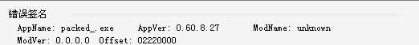
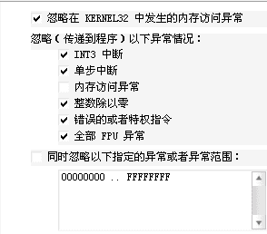
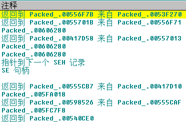
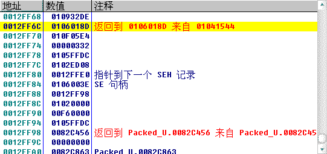

# 学习 VolX 的 ASPr 脚本的简单笔记\[附修改了的脚本\]-修正链接

> 原文：[`www.pediy.com/kssd/pediy08/pediy8-631.htm`](https://www.pediy.com/kssd/pediy08/pediy8-631.htm)

学习 VolX 的 ASPr 脚本的简单笔记  
\---------By Pass ASProtect.2.3.0626(跳过注册、过期)  
  
  
作者：wynney  
工具：ASProtect.2.3.06.26  
Thanks: Volx；winndy  
  
前言：今年是 ASProtect 的倒霉年，玩它的文章不计其数，用它来保护的软件真是不胜枚举了，更有甚者加成注册，我呢，看见注册框就烦躁，此文是介绍如何去掉注册框、过期提示之后来完成脱壳的。当然，此法对于其他版本通用，大家自己去举一反三吧。在此要感谢 Volx 为我们提供了无比的便利，他的脚本基本和脱壳机无异！但是，针对 2.3.06.26 在我这里有点小麻烦。 

一、声明：

为了测试的方便，同一目标程序加了两个壳，分别是 Packed.exe 和 Packed.Unregistered.exe

二、加壳设置： 

Packed.Unregistered.exe 的加密设置 

没有使用“保护原始入口”设置，主要是为了方便测试 lang=EN-US> 

Packed.exe 的选项里的设置是一样的，就是没有用模式 

三、用脚本对 Packed.exe 的试练 

 1、              OD 载入 Packed.exe，使用 volx 的 2.2s 脚本，一下子就到了 OEP，IAT 都修复好了，太强了！大家来膜拜下 Volx 大侠吧：）。。。。。。膜拜中。。。。。。， 脱壳修复发现跑不起来（脚本怎么使用？\----）见 volx 的使用说明）

 

 

 

2、问题的解决

 

OD 载入，脱壳后修复的程序

如下图所示设置异常

Shift+F9 运行，看堆栈提示

选中第 1 行，右键—》反汇编中跟随

 

00556F76     E8 F582FEFF        call Packed\_.0053F270             ; Enter 进去

00556F7B     51                 push ecx                         ; 来到这里

看看 0053F270 长什么样吧

 

0053F270     68 00002202        push 2220000               ；出问题了吧，指向壳内

0053F275     C3                 retn

0053F276     77 29              ja short Packed\_.0053F2A1

0053F278     1F                 pop ds

0053F279     72 72              jb short Packed\_.0053F2ED

0053F27B     6232               bound esi,qword ptr ds:\[edx\]

0053F27D     76 4F              jbe short Packed\_.0053F2CE

0053F27F     55                 push ebp

0053F280     BF 96E5005D        mov edi,5D00E596

0053F285     50                 push eax

0053F286     58                 pop eax

0053F287     2B60 5E            sub esp,dword ptr ds:\[eax+5E\]

0053F28A     53                 push ebx

0053F28B     383D 7FAA558B      cmp byte ptr ds:\[8B55AA7F\],bh

0053F291     EC                 in al,dx

0053F292     83EC 20            sub esp,20

0053F295     8B45 08            mov eax,dword ptr ss:\[ebp+8\]

0053F298     56                 push esi

0053F299     57                 push edi

0053F29A     6A 08              push 8

0053F29C     59                 pop ecx

0053F29D     BE E4845A00        mov esi,Packed\_.005A84E4

0053F2A2     8D7D E0            lea edi,dword ptr ss:\[ebp-20\]

0053F2A5     F3:A5              rep movs dword ptr es:\[edi\],dword>

0053F2A7     8945 F8            mov dword ptr ss:\[ebp-8\],eax

0053F2AA     8B45 0C            mov eax,dword ptr ss:\[ebp+C\]

0053F2AD     8945 FC            mov dword ptr ss:\[ebp-4\],eax

0053F2B0     8D45 F4            lea eax,dword ptr ss:\[ebp-C\]

0053F2B3     50                 push eax

0053F2B4     FF75 F0            push dword ptr ss:\[ebp-10\]

0053F2B7     FF75 E4            push dword ptr ss:\[ebp\-1C\]

0053F2BA     FF75 E0            push dword ptr ss:\[ebp-20\]

0053F2BD     FF15 F4A38F00      call dword ptr ds:\[<&kernel32.Rai>; kernel32.RaiseException

0053F2C3     5F                 pop edi

0053F2C4     5E                 pop esi

0053F2C5     C9                 leave

0053F2C6     C2 0800            retn 8

 

很明显了，这里被偷的代码没有修复还原，下面介绍两种解决方法

1、本程序是 Microsoft Visual C++ 7.0 \[Debug\]写的，同样找个此种语言写的程序，通过下 bpx RaiseException 断点，找到类似的位置，发现这里的代码应该是这样的

2、既然它是指向壳的 2220000，那么就可以在脚本跑到 OEP 的时候，Dump 下加壳程序的 2220000 所在区段，把他修补到脱壳修复后程序中去

 

0053F270     6A FF              push -1

0053F272     50                 push eax

0053F273     64:A1 00000000     mov eax,dword ptr fs:\[0\]

0053F279     50                 push eax

0053F27A     8B4424 0C          mov eax,dword ptr ss:\[esp+C\]

0053F27E     64:8925 00000000   mov dword ptr fs:\[0\],esp

0053F285     896C24 0C          mov dword ptr ss:\[esp+C\],ebp

0053F289     8D6C24 0C          lea ebp,dword ptr ss:\[esp+C\]

0053F28D     50                 push eax

0053F28E     C3                 retn

0053F28F     55                 push ebp

0053F290     8BEC               mov ebp,esp

0053F292     83EC 20            sub esp,20

0053F295     8B45 08            mov eax,dword ptr ss:\[ebp+8\]

0053F298     56                 push esi

0053F299     57                 push edi

0053F29A     6A 08              push 8

0053F29C     59                 pop ecx

0053F29D     BE E4845A00        mov esi,BitComet.005A84E4

0053F2A2     8D7D E0            lea edi,dword ptr ss:\[ebp-20\]

0053F2A5     F3:A5              rep movs dword ptr es:\[edi\],dword ptr >

0053F2A7     8945 F8            mov dword ptr ss:\[ebp-8\],eax

0053F2AA     8B45 0C            mov eax,dword ptr ss:\[ebp+C\]

0053F2AD     8945 FC            mov dword ptr ss:\[ebp-4\],eax

0053F2B0     8D45 F4            lea eax,dword ptr ss:\[ebp-C\]

0053F2B3     50                 push eax

0053F2B4     FF75 F0            push dword ptr ss:\[ebp-10\]

0053F2B7     FF75 E4            push dword ptr ss:\[ebp\-1C\]

0053F2BA     FF75 E0            push dword ptr ss:\[ebp-20\]

0053F2BD  FF15 F4935900     call dword ptr ds:\<&KERNEL32.RaiseExc>; kernel32.RaiseException

0053F2C3     5F                 pop edi

0053F2C4     5E                 pop esi

0053F2C5     C9                 leave

0053F2C6     C2 0800            retn 8

 

好了，手动还原代码吧

6A FF 50 64 A1 00 00 00 00 50 8B 44 24 0C 64 89 25 00 00 00 00 89 6C 24 0C 8D 6C 24 0C 50 C3

再另存为一份 程序就可以运行了！

 

BTW：这里体现了脚本的问题，不过本人用不同的设置加了几个试了下，有的有问题，有的没问题，估计是不一样的加密设置造成的。出现的都是此类小问题，大家可以自行修复。

四、进入正题，跳过注册

 

OD 载入 Packed.Unregistered.exe,忽略所有异常

bp MessageBoxA,Shift+F9 运行，出现注册框，点 Cancel，中断下来

取消断点，Alt+F9 返回

![

 

0103FF67     A1 F02B0601        mov eax,dword ptr ds:\[1062BF0\]   ; 返回到这里

0103FF6C     8B00               mov eax,dword ptr ds:\[eax\]

0103FF6E     8B00               mov eax,dword ptr ds:\[eax\]

0103FF70     8BD0               mov edx,eax

 

看堆栈，一直往下拉吧，找到这里

 

 

 

大家可能要说，为什么找到了这里呢？

其实大家自己去试下就知道了“返回到 0082C456。。。”是从上面下拉的过程中第 1 个返回到程序领空的位置，这个可以做为一个标记，让我们快速的找到关键位置

至于为什么，大家自行揣摩下吧

 

OK,Ctrl+G:0106018D

 

0106009F     E8 7851FFFF        call 0105521C             ; 在这里下硬件执行断点

010600A4     8BD8               mov ebx,eax

010600A6     85DB               test ebx,ebx

010600A8     74 38              je short 010600E2

010600AA     A1 282B0601        mov eax,dword ptr ds:\[1062B28\]

010600AF     8B53 01            mov edx,dword ptr ds:\[ebx+1\]

010600B2     8910               mov dword ptr ds:\[eax\],edx

010600B4     A1 282B0601        mov eax,dword ptr ds:\[1062B28\]

010600B9     8B00               mov eax,dword ptr ds:\[eax\]

010600BB     E8 8C24FCFF        call 0102254C

010600C0     8B15 102A0601      mov edx,dword ptr ds:\[1062A10\]

010600C6     8902               mov dword ptr ds:\[edx\],eax

010600C8     8B0D 282B0601      mov ecx,dword ptr ds:\[1062B28\]

010600CE     8B09               mov ecx,dword ptr ds:\[ecx\]

010600D0     8B15 102A0601      mov edx,dword ptr ds:\[1062A10\]

010600D6     8B12               mov edx,dword ptr ds:\[edx\]

010600D8     8D43 09            lea eax,dword ptr ds:\[ebx+9\]

010600DB     E8 7825FCFF        call 01022658

010600E0     EB 09              jmp short 010600EB

010600E2     A1 102A0601        mov eax,dword ptr ds:\[1062A10\]

010600E7     33D2               xor edx,edx

010600E9     8910               mov dword ptr ds:\[eax\],edx

010600EB     A1 242B0601        mov eax,dword ptr ds:\[1062B24\]

010600F0     8B00               mov eax,dword ptr ds:\[eax\]

010600F2     B2 06              mov dl,6

010600F4     E8 2351FFFF        call 0105521C         ; 这个 Call 出来后给 eax 非 0 值

010600F9     8BD8               mov ebx,eax          ；赋值给 ebx

010600FB     85DB               test ebx,ebx          ；非 0 值导致

010600FD     0F84 92000000      je 01060195          ；不跳

01060103     8D4424 04          lea eax,dword ptr ss:\[esp+4\]

01060107     50                 push eax

01060108     8D4C24 04          lea ecx,dword ptr ss:\[esp+4\]

0106010C     A1 242B0601        mov eax,dword ptr ds:\[1062B24\]

01060111     8B00               mov eax,dword ptr ds:\[eax\]

01060113     8BD3               mov edx,ebx

01060115     E8 AA53FFFF        call 010554C4

0106011A     B2 01              mov dl,1

0106011C     A1 10010401        mov eax,dword ptr ds:\[1040110\]

01060121     E8 6E09FEFF        call 01040A94

01060126     8B15 B82B0601      mov edx,dword ptr ds:\[1062BB8\]

0106012C     8902               mov dword ptr ds:\[edx\],eax

0106012E     A1 B82B0601        mov eax,dword ptr ds:\[1062BB8\]

01060133     8B00               mov eax,dword ptr ds:\[eax\]

01060135     E8 4621FEFF        call 01042280

0106013A     A1 B82B0601        mov eax,dword ptr ds:\[1062BB8\]

0106013F     8B00               mov eax,dword ptr ds:\[eax\]

01060141     8B4C24 04          mov ecx,dword ptr ss:\[esp+4\]

01060145     8B1424             mov edx,dword ptr ss:\[esp\]

01060148     E8 2724FEFF        call 01042574

0106014D     84C0               test al,al

0106014F     74 14              je short 01060165

01060151     8B15 682A0601      mov edx,dword ptr ds:\[1062A68\]

01060157     A1 B82B0601        mov eax,dword ptr ds:\[1062BB8\]

0106015C     8B00               mov eax,dword ptr ds:\[eax\]

0106015E     E8 1D24FEFF        call 01042580

01060163     EB 0A              jmp short 0106016F

01060165     68 CC010601        push 10601CC                ; ASCII "170"

0106016A     E8 615BFDFF        call 01035CD0

0106016F     A1 B82B0601        mov eax,dword ptr ds:\[1062BB8\]

01060174     8B00               mov eax,dword ptr ds:\[eax\]

01060176     33D2               xor edx,edx

01060178     E8 6F1FFEFF        call 010420EC

0106017D     A1 B82B0601        mov eax,dword ptr ds:\[1062BB8\]

01060182     8B00               mov eax,dword ptr ds:\[eax\]

01060184     B1 01              mov cl,1

01060186     33D2               xor edx,edx

01060188     E8 B713FEFF        call 01041544          ；这里就是调用注册框的位置

0106018D     8B0424             mov eax,dword ptr ss:\[esp\]   ; G 到这里来的，往上翻

 

调用注册框、过期提示的位置找到了，那么我们接下来就需要找控制这个位置的跳转了，OK，Ctrl + F2,直接中断在 0106009F，注册框还未出现，这就说明我们的确已经赶在它前面中断下来了，单步走吧，找关键跳吧

 

010600F9     8BD8               mov ebx,eax                       ; 给 eax 清 0

010600FB     85DB               test ebx,ebx

010600FD     0F84 92000000      je 01060195                       ; 让他跳

 

清 0 之后，F9 运行看看，呵呵 程序界面出来了，没有注册框了！^\_^

 

需要注意的是上面只需给 eax 清 0，不需要改动代码；如果你想通过改动代码来达到使 eax 为 0，那么之后你必须把代码改回去，否则，程序异常！

 

接下来你有 2 种选择：）

 

1、            手动脱壳

由于手脱的教程甚多，我也不想多说了，但是，这里给大家指个步骤

1）、从上述过程当中，找到了 010600F9 是关键，那么就在这里下硬件执行断点

2）、设置 OD 除了 INT3、指定异常外的所有异常

3）、F9，int3 中断下来，找#85 特征，按照各位大侠的方法处理好 IAT

4）、上面把 IAT 处理好了，由于硬件断点的缘故，F9 会中断在 010600F9，eax 清 0

5）、接下来可以把硬件执行断点删除，按照各位大侠的方法补代码修复变形 Call

6）、收工（上面的前 4 个步骤里 010600F9 处的硬件执行断点都是存在的）

手脱 ASProtect 是件痛苦而漫长的过程，在此过程中，你会想到 Volx 大侠的牛 B。他给我们带来了福利呀：）

 

2、            脚本来脱

把 volx 大侠的脚本稍微做下修改，就可以脱了

载入 Packed.Unregistered，使用修改后的脚本很快就到了 OEP，强大的脚本此时已经帮你 Dump 下来了，修复—》同样修复哪个脚本尚未修复的地方—》Over！

 

说明：文章中附带的脚本只是针对 2.3.06.26 版本的壳，它可以脱 2.3.06.26 不需要注册以及需要注册的目标程序

附件下载：By Pass ASProtect.2.3.06.26.rar 

后记：由于本人没有 ASPr 的历届版本，如果大家有，可以加一个需要注册的目标程序给我，最好是注明版本，这样我就可以搜集到需要定位的特征码，从而修改一个通用的脚本给大家玩玩：）Email：wynney@126.com，感谢你看完：）

  
  
  
 4dd466d0e1e0cc123afbe504da2462ca