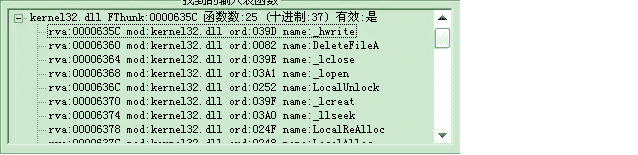
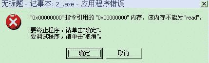

# 手动查找 IAT 出错之后。。

> 原文：[`www.pediy.com/kssd/pediy10/79073.html`](https://www.pediy.com/kssd/pediy10/79073.html)

作 者: lijingli  
   
说明：很简单的，大家都知道的。我只是想分享一下我的学习方法，希望大家多指正。  
   
我说说我的学习方法，希望能给和我一样的菜鸟朋友一点启示，可以进步快点。  
   
1.有时间，心情好的话，整理一下电脑里的资料，方便以后学习。  
2.把视频教程转化为文字（可以减少其占有的磁盘空间^\_\_^）,可以加深自己的理解  
3.把论坛出的书好好看一遍，如果你真的想了解 WHY 要那样做的话  
4.安心的把汇编看看 然后看看 WIN32 汇编  
5.多动手做。  
6.经常回头看看以前不明白的东西，收获会很多的。  
   
这个是我现在的学习方法，觉得真的比较管用。  
现在还是转入正题吧。  
   
有的壳需要手动查找 IAT.表现为：  
1.如果 ImpotREC 修复程序时候，自动查找的 API 过少 则说明有问题   
2.修复之后运行程序的时候说：无法定位程序输入点 API 名字 于动态连接库 DLL 名 上。  
   
这时候就要我们自己手动查找 IAT 了，因为 ImpotREC 的自动查找 IAT 出错了。需要我们自己找，然后填进去 。  
   
手动查找 IAT 有两种方法：  
1.查看 ImpotREC 中追踪到的函数地址，如：  
  
rav：0000635C kernel32.dll ord：039D name：\_hwrite  
则\_hwrite 的地址在 0040635c （加上基址） 则输入表 0040635c 区域   
在 OD 里的内存窗口 CTRL+G 输入：40635c 就可跳到输入表  
   
2.在 OD 里 找 CALL \[\*\*\*\*\*\*\*\*\] 即 JMP 到 IAT 的 CALL （可以搜索二进制：FF15 或 FF25，因为左右的 CALL 其实是 JMP 到一个地址的）  
   
然后在在 OD 里的内存窗口 CTRL+G 输入：\[\]中的地址 跳到输入表  
然后右键选择 长型 地址 即可看见 IAT 了   

引用: .....  
004063E8 7C810082 kernel32.GlobalUnlock  
004063EC 7C839418 kernel32.\_lread  
004063F0 7C810119 kernel32.GlobalLock  
004063F4 7FFFFFFF  
004063F8 7D646F10 SHELL32.DragFinish  
004063FC 7D6322AA SHELL32.ShellAboutA  
00406400 7D610E18 SHELL32.ShellExecuteA  
00406404 7D5FAEA8 SHELL32.DragAcceptFiles  
00406408 7D6887A2 SHELL32.SHGetSpecialFolderPathA  
0040640C 7D646F21 SHELL32.DragQueryFileA  
00406410 7FFFFFFF  
00406414 77D1A8AD USER32.wsprintfA  
00406418 77D3023D USER32.CloseClipboard  
0040641C 77D2F13E USER32.IsClipboardFormatAvailable  
..... 

  
然后向上找 0 区域 0 区域下面是 IAT 的启始位置 RVA  
然后向下找 0 区域 0 区域的开始地址就是 IAT 的结束位置 RVA  

引用: 004062CC 00000000  
004062D0 00000000  
004062D4 00000000  
004062D8 00000000  
004062DC 00000000  
004062E0 00000000  
004062E4 77DA7883 ADVAPI32.RegQueryValueExA  
004062E8 77DA6BF0 ADVAPI32.RegCloseKey  
004062EC 77DAEBE7 ADVAPI32.RegSetValueExA  
004062F0 77DCC41B ADVAPI32.RegOpenKeyA  
004062F4 77DCD5BB ADVAPI32.RegCreateKeyA  
004062F8 FFFFFFFF  
004062FC 77EF8C33 GDI32.GetObjectA 

004062E0 为 0 区域 即为 IAT 的开始地址  
结束地址也是这么找的，结束地址：00406504  

引用: 004064EC 77D1B5F5 USER32.InvalidateRect  
004064F0 77D1DBEC USER32.MoveWindow  
004064F4 77D20F90 USER32.CharNextA  
004064F8 77D1BE27 USER32.IsIconic  
004064FC 77D21211 USER32.PostQuitMessage  
00406500 77D2FA9C USER32.TranslateAcceleratorA  
00406504 7FFFFFFF  
00406508 7632311E  
0040650C 7633C289  
00406510 7633867C  
00406514 763447B1  
00406518 76337CD8  
0040651C 763300CE  
00406520 76322533 

  
相减即可得到 IAT 大小 大小也可以填 0x1000 （不过会有很多垃圾数据,0X1000 是内存对齐）  
然后用 ImpotREC 修复，有无效指针。  
我们查找 IAT 的时候也可以看见中间会有一些地方地址为 7FFFFFFF 如上。这些是没有用的，所以我们直接剪切掉。  
  
可是我运行的时候，给我跳出一个内存访问异常。。。  
  
“0x00000000”指令引用的“0x00000000”内存。该内存不能为“read”.  
我就没想明白了，好好的怎么出错了呢 。还是用 OD 看看吧。  
  
调试修复之后的程序，单步到异常的位置。  
OD 中显示：  

引用: 00402125 |. 50 |push eax  
00402126 |. FF35 E8554000 |push dword ptr \[4055E8\]  
0040212C |. FF35 00504000 |push dword ptr \[405000\]  
00402132 |. FF15 00654000 |call dword ptr \[406500\] ;就是这里 出错的  
00402138 |. 85C0 |test eax, eax  
0040213A |. 75 14 |jnz short 00402150 

提示窗口：  

引用: ds:\[00406500\]=00000000 

然后调试正常的加壳程序。  
也到这里，OD 中显示：  

引用: 00402125 50 push eax  
00402126 FF35 E8554000 push dword ptr \[4055E8\]  
0040212C FF35 00504000 push dword ptr \[405000\]  
00402132 FF15 00654000 call dword ptr \[406500\] ;SER32.TranslateAcceleratorA  
00402138 85C0 test eax, eax  
0040213A 75 14 jnz short 00402150 

引用: ds:\[00406500\]=77D2FA9C (USER32.TranslateAcceleratorA) 

  
仔细想想，应该是没有获取到正确的函数地址。比较正常的和修复的 IAT 表，是少了一个 TranslateAcceleratorA。TranslateAcceleratorA 位置又在最后，所以我想可能是我修复的时候，用的是最后一个函数的地址减去开始的 RVA，这样丢掉了最后一个函数的地址。  
不然不会在程序运行的时候，，CALL \[\*\*\*\*\*\*\*\*\] 即 JMP 到函数的时候，获取不到函数的地址，而出现内存访问异常。  
所以从新修复的时候，IAT 大小又加了 4，修复之后就可以正常运行 了。  
  
  
所以，其实没什么技术，只是分享一点学习的体会。  
这些都是 加密解密 2 里面的知识。。