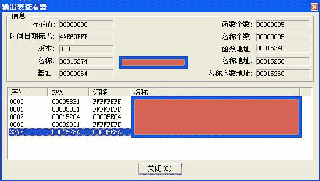

# IMPREC 1.7 遇到过大的输出函数序号时非法

> 原文：[`www.pediy.com/kssd/pediy10/101760.html`](https://www.pediy.com/kssd/pediy10/101760.html)

IMPREC 保证 函数列表是按照序号排列的，初始化数据和显示时是分开的，内存中的符号数据都是排序好的，是以序号作为插入时的下标来实现的。  
输出的函数名称插入数组时是按照序号来插入符号名称数组的，但分配此数组的大小是根据 输出函数的数量来的。因此一个异常的输出表函数序号，大出之前的输出函数序号很多，会导致 IMPrec 访问一个无效内存地址。  
具体错误位置是：  
  
00409078  |> /8B93 00040000 /mov     edx, dword ptr \[ebx+400\]  
0040907E  |. |8B28          |mov     ebp, dword ptr \[eax\]  
00409080  |. |33FF          |xor     edi, edi  
00409082  |. |83C0 04       |add     eax, 4  
00409085  |. |8B92 0C040000 |mov     edx, dword ptr \[edx+40C\]  
0040908B  |. |66:8B39       |mov     di, word ptr \[ecx\]  
//此处是读取输出函数的序号作为数组下标  
0040908E  |. |03D5          |add     edx, ebp  
00409090  |. |8BAB 24040000 |mov     ebp, dword ptr \[ebx+424\]  
00409096  |. |83C1 02       |add     ecx, 2  
00409099  |. |46            |inc     esi  
0040909A  |. |8954BD 00     |mov     dword ptr \[ebp+edi\*4\], edx //导致非法出现在此处,  
//当序号>输出函数数量达到一定程度时便会非法，一般在 windows 的内存分配机制下大上 1000 是铁定非法了  
0040909E  |. |8B93 28040000 |mov     edx, dword ptr \[ebx+428\]  
004090A4  |. |3B72 18       |cmp     esi, dword ptr \[edx+18\]  
004090A7  |.^\\72 CF         \\jb      short 00409078  
  
  
保存输出表函数名称的数组大小为:  
00409012  |> \\8B89 0C040000 mov     ecx, dword ptr \[ecx+40C\]  
00409018  |.  03C1          add     eax, ecx  
0040901A  |.  8983 28040000 mov     dword ptr \[ebx+428\], eax  
00409020  |.  8B50 14       mov     edx, dword ptr \[eax+14\]// eax+ 14= 输出函数数量  
00409023  |.  C1E2 02       shl     edx, 2  
00409026  |.  52            push    edx  
00409027  |.  E8 06970300   call    00442732// \_malloc\_Wapper  
分配的内存大小为输出函数数量\* 4，没有进一步调试，不过据此猜测函数列表输出时极可能是递增和序号无关的计数器输出的。  
  
分配的数组大小：  
size= 0x984 = 0x261\* 4  
gdi32.dll  
  
size= 0xb70= 0x2DC\* 4  
user32.dll  
  
  
因此临时重写非法位置的代码为递增 edi，也便是假设序号是顺序的，当序号乱序时会有符号名和实际函数不配套的情况。临时要用而已，没想修改其他地方的流程，但也许可以修改 malloc 的地方以最大序号\* 4 来简单低性能的修复此 bug。 /:^\]~~   
00409078      33FF          xor     edi, edi  
0040907A      8B93 00040000 mov     edx, dword ptr \[ebx+400\]  
00409080      8B28          mov     ebp, dword ptr \[eax\]  
00409082      83C0 04       add     eax, 4  
00409085      8B92 0C040000 mov     edx, dword ptr \[edx+40C\]  
0040908B      03D5          add     edx, ebp  
0040908D      8BAB 24040000 mov     ebp, dword ptr \[ebx+424\]  
00409093      83C1 02       add     ecx, 2  
00409096      46            inc     esi  
00409097      8954BD 00     mov     dword ptr \[ebp+edi\*4\], edx  
0040909B      47            inc     edi  
0040909C      8B93 28040000 mov     edx, dword ptr \[ebx+428\]  
004090A2      3B72 18       cmp     esi, dword ptr \[edx+18\]  
004090A5    ^ 72 D3         jb      short 0040907A  
004090A7      90            \\nop  
004090A8      90            nop  
  
\_\_\_\_\_\_\_\_\_\_\_\_\_\_\_\_\_\_\_\_\_\_\_\_\_  
一个引起异常的输出表  
  
