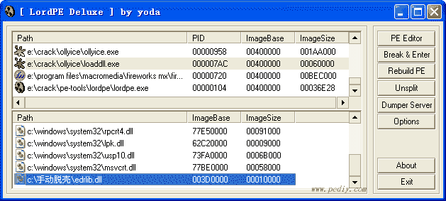
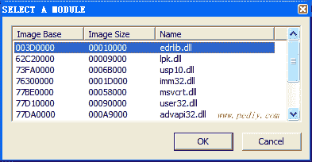
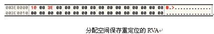
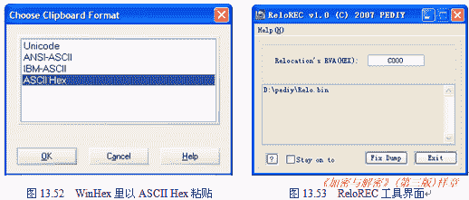

# 【样章 2】《加密与解密(第三版)》--13.5 DLL 文件脱壳（重定位表修复部分）

> 原文：[`www.pediy.com/kssd/pediy10/61334.html`](https://www.pediy.com/kssd/pediy10/61334.html)

**13.5 DLL 文件脱壳**  
   

DLL 文件的脱壳与 EXE 文件步骤差不多，所不同的是，DLL 文件多了个基址重定位表等要考虑。  
   
在 2003 年出版的《加密与解密》(第二版)中以 UPX，PECompact 为例讲述了 DLL 重定位重建的方法，由于本人的思路限制，当时只是从 UPX，PECompact 自身特点找思路解决这问题，即先分析 UPX，PECompact 对重定位表处理算法，然后写工具逆算法还原重定位表，如 UPXAngela.exe 等工具。这种思路的通用性不好，针对不同的壳和版本，要重写工具，并且逆算法可能不完美，从而存在 bug。  
   
后来，askformore 在“[**重建重定位表脚本**](http://bbs.pediy.com/showthread.php?t=5878)”一文中，提出了一种更通用性的解决办法，利用外壳重定位相关数据时，会根据外壳转储的重定位表确定要重定位的 RVA，完成代码重定位工作。将这些要重定位的 RVA 提取出来，再将这些 RVA 根据重定位表的定义重新生成一份新的重定位表。shoooo 也曾提到过这个思路。于是，在第三版重写这部分时，根据这个思路写了一款工具来完成这个重建功能，详见附件的 ReloREC。另外，ReloREC 重构重定位表的算法代码，参考了 ccfer 在看雪论坛.珠海金山 2007 逆向分析挑战赛 [**第二阶段第三题**](http://bbs.pediy.com/showthread.php?t=51038&tcatid=55) 提交的代码。在此一并表示感谢！  
  
  
声明：本文以第三版“13.5 DLL 文件脱壳”一文和其他章节临时整理组织，稍有简化，可能有部分地方用词和描述不是太连贯。  
  
加壳的 DLL 处理重定位表有以下几种情况：   
1)完整的保留了原重定位表；   
2)对原重定位表进行了加密处理；  
等等  
  
像 ASPack,ASProtect 等壳属于第 1 种情况，没有加密重定位表，脱壳后，只需找到重定位的地址和大小即可。  
像 UPX，PECompact 等壳属于第 2 种情况，必须重建重定位表，这也是本文所要讨论的，本文以 UPX 为例来讲述一下重定位的重建。  
用 UPX v3.01 将 EdrLib.dll 文件加壳，用 PE 工具查看其 PE 信息。  
EntryPoint：E640h  
ImageBase：400000h  
  
  
**13.5.1 寻找 OEP**  
  
当 DLL 被初次映射到进程的地址空间中时，系统将调用 DllMain 函数，当卸载 DLL 时也会再次调用 DllMain 函数。也就是说，DLL 文件相比 EXE 文件运行有一些特殊性，EXE 的入口点只在开始时执行一次，而 DLL 的入口点在整个执行过程中至少要执行两次。一次是在开始时，用来对 DLL 做一些初始化。至少还有一次是在退出时，用来清理 DLL 再退出。所以 DLL 找 OEP 也有两条路可以走，一是载入时找，另一方法是在退出时找。而且一般来说前一种方法外壳代码较复杂，建议用第二种方法。  
UPX 壳比较简单，往下翻翻，就可看到跳到 OEP 的代码：  
代码:

```
003DE7F5   .  58              pop     eax
003DE7F6   .  61              popad
003DE7F7   .  8D4424 80       lea     eax, dword ptr \[esp-80\]
003DE7FB   >  6A 00           push    0
003DE7FD   .  39C4            cmp     esp, eax
003DE7FF   .^ 75 FA           jnz     short 003DE7FB
003DE801   .  83EC 80         sub     esp, -80
003DE804   >- E9 372AFFFF     jmp     003D1240  //跳到 OEP

```

  
**13.5.2 Dump 映像文件**  
  
停在 OEP 后，运行 LordPE，在进程窗口选择 loaddll.exe 进程，在下方窗口中的 EdrLib.dll 模块上单击右键，执行“dump full”菜单命令，将文件抓取并保存到文件里，如图 13.43 所示。  
  
  
图 13.45 抓取 DLL 内存映像  
  
对于 DLL 文件来说，Windows 系统没有办法保证每一次运行时提供相同的基地址。如果 DLL 基址所在内存空间被占用或该区域不够大，系统会寻找另一个地址空间的区域来映射 DLL，此时外壳将对 DLL 执行某些重定位操作。从图 13.43 得知，此时 DLL 被映射到内存的地址是 03D000h，与 EdrLib.dll 默认的基址 400000h 不同，被重定位项所指向的地方是已经重定位了的代码数据。  
例如这句：  
代码:

```
003D1266     A1 58B43D00        mov     eax, dword ptr \[3DB458\]

```

为了得到与加壳前一样的文件，必须找到重定位的代码，跳过它，让其不被重定位。重新加载 DLL，对上句重定位的地址 3D1267h 下内存写断点，中断几下，就可来到重定位的处理代码。  
  
代码:

```
003DE79E  mov     al, byte ptr \[edi\]              ;指向 UPX 自己加密过的重定位表
003DE7A0  inc     edi                                  ;指针移向下一位
003DE7A1  or      eax, eax                            ;EAX=0？结束标志
003DE7A3  je      short 003DE7C7               
003DE7A5  cmp     al, 0EF
003DE7A7  ja      short 003DE7BA                   
003DE7A9  add     ebx, eax                          ;EBX 的初值为（0xFFC+基址）
003DE7AB  mov     eax, dword ptr \[ebx\]             ;EBX 指向需要重定位的数据，取出放到 EAX
003DE7AD  xchg    ah, al
003DE7AF  rol     eax, 10
003DE7B2  xchg    ah, al
003DE7B4  add     eax, esi                          ; ESI 指向 UPX0 区块的 VA，本例=3D1000
003DE7B6  mov     dword ptr \[ebx\], eax           ;重定位
003DE7B8  jmp     short 003DE79C              
003DE7BA  and     al, 0F
003DE7BC  shl     eax, 10
003DE7BF  mov     ax, word ptr \[edi\]
003DE7C2  add     edi, 2
003DE7C5  jmp     short 003DE7A9            
003DE7C7  mov     ebp, dword ptr \[esi+E044\]        ;改好 ESI 为 401000 后，按 F4 到这里

```

  
UPX 壳己将原基址重定位表清零，重定位操作时，使用其自己的重定位表。地址 3DE7B4h 处 ESI 指向 UPX0 区块的 VA，本例为 3D1000h，为了让代码以默认 ImageBase 的值 400000h 重定位代码，可以在这句强制将 ESI 的值改为 401000h。来到这句后，双击 ESI 寄存器，改成 401000h，然后按 F4 来到 3DE7C7h 这时。此时代码段的数据没被重定位，可以 Dump 了。  
代码:

```
003D1253     833D 68AD4000 00     cmp     dword ptr \[40AD68\], 0

```

运行 LordPE 将 DLL 映像抓取，并保存为 upx\_dumped.dll。  
  
**13.5.3 重建 DLL 的输入表**  
  
ImportREC 能很好地支持 DLL 的输入表的重建，首先，在 Options 里将“Use PE Header From Disk”默认的选项去除。这是因为 ImportREC 需要获得基址计算 RVA 值，DLL 如果重定位了，从磁盘取默认基址计算会导致结果错误。  
  
1)在 ImportREC 下拉列表框中选择 DLL 装载器的进程，此处为 loaddll.exe 进程。  
2)单击“Pick DLL”按钮，在 DLL 进程列表中选择 EdrLib.dll 进程（见图 13.47）。  
  
  
图 13.47 选择 DLL 进程  
3)在 OEP 处，填上 DLL 入口的 RVA 值 1240h，单击 IAT AutoSearch 按钮获取 IAT 地址。如果失败，必须手工判断 DLL 的 IAT 位置和大小，其 RVA 为 7000h，Size 为 E8h。  
4)单击“Get Import”按钮，让其分析 IAT 结构重建输入表。  
5)勾选 Add new section，单击“Fix Dump”按钮，并选择刚抓取的映像文件 dumped.dll，它将创建一个 dumped\_.dll 文件。  
  
**13.5.4 构造重定位表**  
  
原理请参考本文开始处的说明。  
先来回顾一个重定位表的结构：  
代码:

```
IMAGE\_BASE\_RELOCATION STRUCT
    VirtualAddress    dd    0
    SizeOfBlock        dd    0
    Type1            dw    0; 其中：Bit15Bit12 为类型 type，Bit11--Bit0 为 ItemOffset
IMAGE\_RELOCATION ENDS

```

重定位表以 1000h 大小为一个段，因为 ItemOffset 最长为 12 位，即刚好为 1000h。如果还有更多段，将重复上面数据结构，直到 VirtualAddress 为 NULL，表示结束。  
ReloREC 工具可以根据一组重定位的 RVA，重新构造一个新的重定位表。首先要做的工作是将 UPX 外壳这些要重定位的 RVA 提取出来。  
 在处理重定位代码语句中，下面这句就是对代码重定位，其中 EBX 保存的就是要重定位的地址。  
代码:

```
003DE7B6     mov     dword ptr \[ebx\], eax      ;EBX 指向要重定位的 RVA

```

补丁的思路是找块代码空间，跳过去执行补丁代码，将重定位的地址转成 RVA，并保存下来。如下语句跳到补丁代码处：  
代码:

```
003DE7B8   jmp     short 003DE80A
我们键入的补丁代码：
003DE80A   pushad
003DE80B   mov     edx, dword ptr \[3E0000\]    ;从全局变量 3E0000h 取一地址指针
003DE811   sub     ebx, 3D0000                  ;减外壳基址，将 ebx 中的地址转成 RVA
003DE817   mov     dword ptr \[edx\], ebx       ;将获得的 RVA 保存下来
003DE819   add     edx, 4                        ;指向下一个 DWRD 地址
003DE81C   mov     dword ptr \[3E0000\], edx  ;将指针保存到全局变量中
003DE822   popad
003DE823   jmp     003DE79C                       ;跳回外壳代码

```

  
3E0000h 这个地址是 OllyDbg 的插件 HideOD 临时分配的，其初始值设为 3E0010h，如图 13.71。  
  
  
  
 补丁代码键入完成后，外壳在处理重定位相关代码时，这段补丁代码将需要重定位的 RVA 全部提取出来。执行完补丁代码，数据窗口将保存需要重定位的 RVA，  
 将需要重定位的 RVA 复制出来（选取数据时，最后一个 DWORD 数据是 0），操作时单击鼠标右键，执行菜单 Binary/Binary copy（二进制复制）功能，再运行 WinHex，新建一文档，将这段二进制数据粘贴进去，粘贴时，选择 ASCII Hex 模式（图 13.52），然后将提取的数据保存为 Relo.bin。  
  
Relo.bin 中保存的就是需要重定位的地址，以 RVA 表示。部分数据如下：  
  
代码:

```
0000101D
00001031
0000106E
0000108D
000010A1
000010DE
000010FB
00001109
0000110F
……

```

ReloREC 这款工具，就是根据这些 RVA 重新生成一份新的重定位表  
  
  
 准备工作完成，运行 ReloREC，将 Relo.bin 拖放到 ReloREC 主界面上可打开此文件，如图 13.53。然后在 dumped\_.dll 里找一块空白代码处保存重定位表（一般在 UPX1 或 UPX2 区块里找），在这选择 C000h 处。在 Relocation's RVA 域里填上新重定位表的 RVA 地址，本例为 C000h，最后单击“Fix Dump”按钮，打开上节刚修复输入表的 dumped\_.dll 文件，即可完成重定位表的修复。  
  
  
  
看雪学院  
看雪软件安全论坛  
http://www.pediy.com  
2008.3.16

上传的附件
|  || 脱壳实例.rar  
 |
|  || ReloREC 1.0.rar  
 |