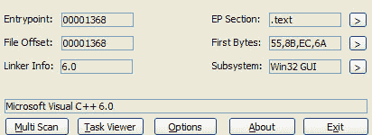
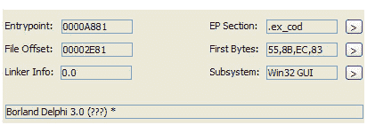

# eXPressor.V1.4.5.1 脱壳笔记

> 原文：[`www.pediy.com/kssd/pediy11/113263.html`](https://www.pediy.com/kssd/pediy11/113263.html)

学习破解有一段时间了，中间几多中断。没办法，要毕业了，需要忙的事太多了。今天逃了几节课，没事找个软件来练练。（前几天开始学脱壳，但都是照着教程来的，今天试了试不看教程，呵呵）初次脱壳，错误难免，高手飘过.........  
  
未加壳前：  
  
使用 eXPressor.V1.4.5.1 加壳  
  
然后 OD 载入，停在入口处:  
0040A881 >  55              PUSH EBP  
0040A882    8BEC            MOV EBP,ESP  
0040A884    83EC 58         SUB ESP,58  
  
初次一看，还以为没加过壳呢，入口怎么这个样子，跟我想的完全不一样。呵呵！（我以为入口会是 pushad 或者 call）。一路单步。  
0040A881 >  55              PUSH EBP                         //保护现场  
0040A882    8BEC            MOV EBP,ESP  
0040A884    83EC 58         SUB ESP,58  
0040A887    53              PUSH EBX  
0040A888    56              PUSH ESI  
0040A889    57              PUSH EDI  
0040A88A    8365 DC 00      AND DWORD PTR SS:\[EBP-24\],0  
0040A88E    F3:             PREFIX REP:                              ; 多余的前缀  
0040A88F    EB 0C           JMP SHORT 复件\_ncr.0040A89D  
0040A891    65:58           POP EAX                                  ; 多余的前缀  
0040A893    50              PUSH EAX  
0040A894    72 2D           JB SHORT 复件\_ncr.0040A8C3  
0040A896    76 2E           JBE SHORT 复件\_ncr.0040A8C6  
0040A898    312E            XOR DWORD PTR DS:\[ESI\],EBP  
0040A89A    34 2E           XOR AL,2E  
0040A89C    00A1 00A04000   ADD BYTE PTR DS:\[ECX+40A000\],AH  
0040A8A2    05 00A04000     ADD EAX,复件\_ncr.0040A000  
0040A8A7    A3 08A04000     MOV DWORD PTR DS:\[40A008\],EAX  
0040A8AC    A1 08A04000     MOV EAX,DWORD PTR DS:\[40A008\]  
0040A8B1    B9 81A84000     MOV ECX,复件\_ncr.<模块入口点>  
0040A8B6    2B48 18         SUB ECX,DWORD PTR DS:\[EAX+18\]  
0040A8B9    890D 0CA04000   MOV DWORD PTR DS:\[40A00C\],ECX //保存基址  
0040A8BF    833D 10A04000 0>CMP DWORD PTR DS:\[40A010\],0  
0040A8C6    74 16           JE SHORT 复件\_ncr.0040A8DE  
0040A8C8    A1 08A04000     MOV EAX,DWORD PTR DS:\[40A008\]  
0040A8CD    8B0D 0CA04000   MOV ECX,DWORD PTR DS:\[40A00C\]  
0040A8D3    0348 14         ADD ECX,DWORD PTR DS:\[EAX+14\]  
0040A8D6    894D CC         MOV DWORD PTR SS:\[EBP-34\],ECX  
0040A8D9    E9 97040000     JMP 复件\_ncr.0040AD75  
0040A8DE    C705 10A04000 0>MOV DWORD PTR DS:\[40A010\],1  
0040A8E8    6A 30           PUSH 30  
0040A8EA    68 54A04000     PUSH 复件\_ncr.0040A054                     ; ASCII "Nfo"  
0040A8EF    68 18A04000     PUSH 复件\_ncr.0040A018                     ; ASCII "This program was packed with a demo version of eXPressor"  
0040A8F4    6A FF           PUSH -1  
0040A8F6    FF15 E4A04000   CALL DWORD PTR DS:\[<&USER32.MessageBoxA>>; USER32.MessageBoxA  
0040A8FC    837D 0C 01      CMP DWORD PTR SS:\[EBP+C\],1  
0040A900    74 04           JE SHORT 复件\_ncr.0040A906  
0040A902    8365 08 00      AND DWORD PTR SS:\[EBP+8\],0  
0040A906    6A 04           PUSH 4  
0040A908    68 00100000     PUSH 1000  
0040A90D    68 04010000     PUSH 104  
0040A912    6A 00           PUSH 0  
0040A914    FF15 C4A04000   CALL DWORD PTR DS:\[<&KERNEL32.VirtualAll>; kernel32.VirtualAlloc                       //申请空间准备解压  
0040A91A    8945 EC         MOV DWORD PTR SS:\[EBP-14\],EAX  
0040A91D    68 04010000     PUSH 104  
0040A922    FF75 EC         PUSH DWORD PTR SS:\[EBP-14\]  
0040A925    FF75 08         PUSH DWORD PTR SS:\[EBP+8\]  
0040A928    FF15 DCA04000   CALL DWORD PTR DS:\[<&KERNEL32.GetModuleF>; kernel32.GetModuleFileNameA  
到这里有个回跳  
0040ABA0   .  8B45 DC       MOV EAX,DWORD PTR SS:\[EBP-24\]  
0040ABA3   .  6BC0 18       IMUL EAX,EAX,18  
0040ABA6   .  8B0D 08A04000 MOV ECX,DWORD PTR DS:\[40A008\]            ;  复件\_ncr.0040AF40  
0040ABAC   .  FF7401 7C     PUSH DWORD PTR DS:\[ECX+EAX+7C\]  
0040ABB0   .  FF35 34AF4000 PUSH DWORD PTR DS:\[40AF34\]               ;  复件\_ncr.00407000  
0040ABB6   .  E8 EDFBFFFF   CALL 复件\_ncr.0040A7A8  
0040ABBB   .  83C4 0C       ADD ESP,0C  
0040ABBE   >^ E9 47FFFFFF   JMP 复件\_ncr.0040AB0A                   //回跳  
0040ABC3   >  A1 08A04000   MOV EAX,DWORD PTR DS:\[40A008\]  
0040ABC8   .  8B0D 0CA04000 MOV ECX,DWORD PTR DS:\[40A00C\]            ;  复件\_ncr.00400000  
0040ABCE   .  0348 24       ADD ECX,DWORD PTR DS:\[EAX+24\]  
0040ABD1   .  894D B4       MOV DWORD PTR SS:\[EBP-4C\],ECX  
0040ABD4   >  8B45 B4       MOV EAX,DWORD PTR SS:\[EBP-4C\]  
0040ABD7   .  8378 0C 00    CMP DWORD PTR DS:\[EAX+C\],0  
0040ABDB   .  0F84 83010000 JE 复件\_ncr.0040AD64              //下断，F9 运行，停在这，继续单步  
  
又出现回跳  
0040AD3F   .  8B45 E8       MOV EAX,DWORD PTR SS:\[EBP-18\]  
0040AD42   .  83C0 04       ADD EAX,4  
0040AD45   .  8945 E8       MOV DWORD PTR SS:\[EBP-18\],EAX  
0040AD48   .  8B45 E0       MOV EAX,DWORD PTR SS:\[EBP-20\]  
0040AD4B   .  83C0 04       ADD EAX,4  
0040AD4E   .  8945 E0       MOV DWORD PTR SS:\[EBP-20\],EAX  
0040AD51   .^ E9 68FFFFFF   JMP 复件\_ncr.0040ACBE      //回跳  
0040AD56   >  8B45 B4       MOV EAX,DWORD PTR SS:\[EBP-4C\]  
0040AD59   .  83C0 14       ADD EAX,14  
0040AD5C   .  8945 B4       MOV DWORD PTR SS:\[EBP-4C\],EAX  
0040AD5F   .^ E9 70FEFFFF   JMP 复件\_ncr.0040ABD4        //回跳  
0040AD64   >  A1 08A04000   MOV EAX,DWORD PTR DS:\[40A008\]      //下断，F9 运行，停在这，单步继续  
  
以下回跳处理方法一样，然后来到这段代码处：  
0040AD75   \\68 00800000     PUSH 8000  
0040AD7A    6A 00           PUSH 0  
0040AD7C    FF75 FC         PUSH DWORD PTR SS:\[EBP-4\]  
0040AD7F    FF15 C0A04000   CALL DWORD PTR DS:\[<&KERNEL32.VirtualFre>; kernel32.VirtualFree  
0040AD85    68 00800000     PUSH 8000  
0040AD8A    6A 00           PUSH 0  
0040AD8C    FF75 EC         PUSH DWORD PTR SS:\[EBP-14\]  
0040AD8F    FF15 C0A04000   CALL DWORD PTR DS:\[<&KERNEL32.VirtualFre>; kernel32.VirtualFree        //释放申请的空间  
0040AD95    8B45 CC         MOV EAX,DWORD PTR SS:\[EBP-34\] //OEP 出现  
0040AD98    5F              POP EDI         //恢复现场  
0040AD99    5E              POP ESI  
0040AD9A    5B              POP EBX         
0040AD9B    83C4 5C         ADD ESP,5C  
0040AD9E    5D              POP EBP         
0040AD9F    50              PUSH EAX      //oep 入栈  
0040ADA0    A1 08A04000     MOV EAX,DWORD PTR DS:\[40A008\]  
0040ADA5    8378 14 00      CMP DWORD PTR DS:\[EAX+14\],0  
0040ADA9    75 05           JNZ SHORT 复件\_ncr.0040ADB0  
0040ADAB    58              POP EAX  
0040ADAC    33C0            XOR EAX,EAX  
0040ADAE    40              INC EAX  
0040ADAF    C3              RETN  
0040ADB0    58              POP EAX  
0040ADB1    FFE0            JMP EAX //跳到原入口  
  
至此工作基本结束，然后使用插件脱壳，工具修复，成功。  
最近一段时间偶会一直学习脱壳，争取多发文章，在毕业之前成为看雪的普通会员，hoho........