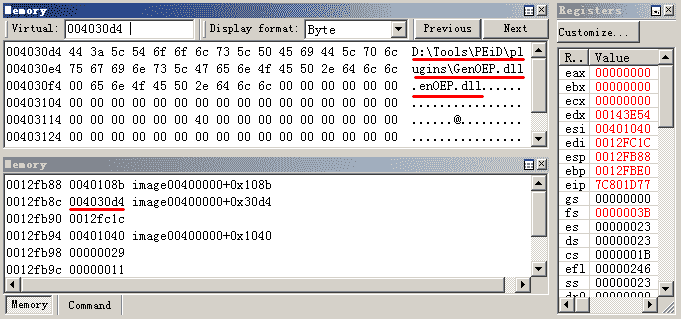
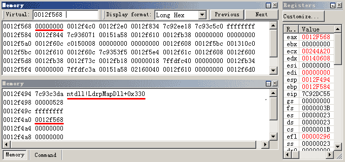

# 调试 DLL 时加载到不同地址的小技巧

> 原文：[`www.pediy.com/kssd/pediy08/pediy8-650.htm`](https://www.pediy.com/kssd/pediy08/pediy8-650.htm)

调试 DLL 时加载到不同地址的小技巧  
  
一块三毛钱  
2006.08.23  
  
  
给 DLL 脱壳时，有时需要把 DLL 加载到不同基地址。大概搜索了一下论坛好像没有看到简单的办法 :)，下面是我的办法，算做一个小技巧吧！  
  
使用 windbg 打开看雪的 DLL\_Loader.exe，选择要加载的 dll 文件，  
  
0:004> bp kernel32!LoadLibraryA  
0:004> g  
  
点“加载”按钮，中断在 kernel32!LoadLibraryA 处，可以通过堆栈参数看到正在加载我们的 dll 文件。  
  
  
  
清除断点，然后，  
  
0:000> bp ntdll!ZwMapViewOfSection  
0:000> g  
0:000> g  
  
第二次中断时，查看堆栈，发现该 ntdll!ZwMapViewOfSection 来自 ntdll!LdrpMapDll+0x330，此时就要分配内存加载 dll，查看 ntdll!ZwMapViewOfSection 的第三个参数 PVOID \*BaseAddress 发现所指 DWORD 为零，把这个 DWORD 改成你想要加载到的地址。可以先用 lm 命令查看已经加载了哪些 dll，哪些地址已经被占用。  
  
  
  
清除断点，修改刚才看到的 DWORD  
  
0:000> ed poi(@esp+0n12) 22000000  
  
此时如果运行就可以把 dll 加载到指定地址 22000000 处，但我们经常是需要从 dll 的入口点开始跟踪壳的代码，下断点，  
  
0:000> bu $iment(22000000)  
0:000> g  
  
断下来后就是 dll 的入口点。  

我用过貌似不保险，特别是有 threads 的时候。  
后来我在 load dll 处 bp RtlImageDirectoryEntryToData 暴力搜索 pe  
跟文件的 header 比较，但是也不是好方法。