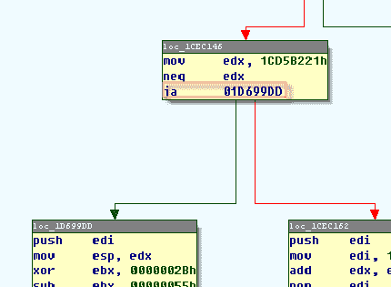
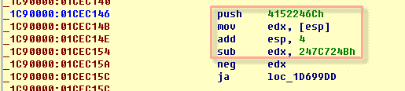
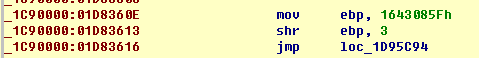
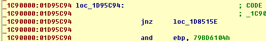

# 玩玩 IDA Graph View Fake Jcc 的清除

> 原文：[`www.pediy.com/kssd/pediy10/61241.html`](https://www.pediy.com/kssd/pediy10/61241.html)

玩玩 IDA Graph View  Fake Jcc 的清除

\_\_\_\_\_\_\_\_\_\_\_\_\_\_\_\_\_\_\_\_\_\_\_\_\_\_\_\_\_\_\_\_\_\_\_\_\_\_\_\_\_\_\_\_\_\_\_\_\_\_\_\_\_\_\_\_\_\_\_\_\_\_\_\_\_\_\_  
  
下面的部分与 IDA 本身没有多大关系了。另外，只是个 POC，能否做出有用的东西我也不清楚，Just for fun。  
  
1.  Fake Jcc 的搜索\_\_\_\_\_\_\_\_\_\_\_\_\_\_\_\_\_\_\_\_\_\_\_\_\_\_\_\_\_\_\_\_\_\_\_\_\_\_\_\_\_  
  
　　对变形代码的压缩分为 2 部分。首先是 Basic Block 内的压缩（这部分本文不包括，还有很多未解决的问题）。然后是 BB 之间参考关系的清理，即删除 Fake Jcc，合并 BB（并再次压缩合并后的结果）。  
  
　　Fake Jcc 之所以假是因为其跳转动作是预定的，我最早是在 ExeCryptor 里看到这种代码的。  
   
  
ja 指令即 fake jcc，这里永远也不会跳转，等同于 nop（要跳转则等于 jmp）。fake jcc 导致对代码递归分析时插入大量无关的 BB，生成虚假分枝。Themida 构造 fake jcc 时既使用寄存器也使用内存变量。另外，mov 指令有可能压缩后才出现，这也是要先在 BB 内压缩的原因。

  
  
   
前 4 句被合并为 mov edx,imm32。  
  
对 fake jcc 的搜索看起来很简单，逐个检测压缩过的 BB，若出口为 jcc 指令，则逆向搜索影响该 jcc 的指令。对于用寄存器实现的 fake jcc，其操作数为：  
  
RegImm:　 add | sub | and | or | xor | cmp | test…  
Reg:       not | neg  (inc|dec 用 add|sub 替换了)  
  
用内存变量时类似。如果找到，再继续搜索是否存在对应的 mov reg|mem，imm。符合条件时即可进行 emulate。  
  
在执行 Basic Block 内的压缩时，必须保留对 jcc 有影响的指令（图中的 neg），否则结果变成 mov + ja，无法判断 jcc 走向了。我现在的做法是写了个 GetLastInstr 函数，返回 BB 的“最后”指令（对于出口为 jcc 的 BB 即影响跳转的指令），在 BB 内压缩时不能超过这条指令。当然你也许有更好的办法。  
  
上面的搜索是在一个 BB 内进行的。下面看看更复杂的情况。  
  
 

  
   
  
这个 fake jcc 被 permutation jmp 分成了 2 段。第 2 段存在 2 个参考者，初始处理无法合并 2 块。第 1 块 BB 出口不是 jcc，于是在压缩 BB 过程中，第 1 块被处理为:  
  
mov   ebp, imm32  
jmp   loc\_1D95C94  
  
在处理 fake jcc 的过程中，第 2 块有个参考关系被删除了，于是 2 块可以合并了，变成：  
  
mov  ebp, imm32  
jnz  loc\_1D8515E  
  
这个问题的本质是影响 jcc 的指令与 jcc 不在同一个 BB，造成严重 bug。下面讨论可能的几种解决方式。将 2 个 BB 分别称为 A，B。  
  
1)  可考虑在 A 内对 mov reg,imm 的压缩保留 eflags，并传递给 B。但在压缩过程中 A 内可能有多个被压缩的 mov 指令，在不分析 B 的前提下无法判断应保留哪个(数量可变)。另外，B 可能有多个参考者。  
  
2)  将 B 合并到 A，即对于某个以 jcc 为出口的 BB，如果该块内不存在决定跳转方向的指令，则尽可能将该 BB 合并到其参考者。这是我一个同事的建议，有道理，以图说明。  
  
  
  
       A(jmp)  B(jcc)                  A+C(jcc)      B(jcc)  
        \\     / \\                        / \\           /  \\  
        c(jcc)   ?         =>          D   E      C(jcc)  ?  
          /  \\                                       /  \\  
         D    E                                     D    E  
       
  
C 包含无法确定跳转方向的 jcc。C 被 A，B 参考，其中 A 是 jmp 到 C，B 是 jcc 的一个分枝。这种做法是将 C（代码及参考关系）合并到 A。  
  
对于 A 而言，原来的 jmp 指令被删除，A 将使用 C 的出口。从语义上说，A 的出口指令实际变成：  
  
jcc  D  (假设 D 为 dst,E 为 ordinary flow)  
jmp  E   
  
当然，对 A 可以不必真正插入 1 条 jmp 指令，我们已经约定 BB 的 cref\_to 第 1 项保存 ordinary flow，只要替换这个数据即可。此时可以删除 A->C 的参考。  
  
对于 D 和 E，参考者原本只有 C，现在要加上 A。  
  
随着对 fake jcc 的处理，B->C 的参考可能被删除。此时 C 变成了永远不会执行的孤立节点，可以删除 C 及 C 对 DE 的参考。  
  
这想法不错，但我觉得有点太复杂了，编程要考虑的问题太多。  
  
3) 也是我现在的做法，即增强 GetLastInstr 函数，使 A 中保存下影响 jcc 的指令。  
  
需要增强的部分是，当 A 只有 1 个出口时（包括 jmp 和 ordinary flow），增加额外的检测：  
顺着 A 的被参考者搜索，直到遇见这样的节点：该节点没有被参考者（叶节点）或以 jcc 为出口。如果最后 1 个节点以 jcc 为出口，并且该 BB 内不存在决定跳转方向的指令，则逐块逆向搜索这样的指令，若直到 A 才找到，则应保留该指令，不能压缩。  
  
  
2. 反汇编引擎的修改\_\_\_\_\_\_\_\_\_\_\_\_\_\_\_\_\_\_\_\_\_\_\_\_\_\_\_\_\_\_\_\_\_\_\_\_\_\_\_\_\_\_\_\_\_\_  
  
显然，对 jcc 的处理需要 emulate。开始考虑把涉及的指令直接 copy 到 buffer 内，真正执行一下（只要调整一下 jcc 的操作数），但这样做需要把 pcode 再汇编为机器码，暂时不想搞这个，我也不大喜欢这种做法。实际用的是直接分析 pcode。  
  
将机器码反汇编为 pcode 时，我用的是 z0mbie 的 xde v1.02，没有直接使用 IDA 的结果。对 IDA 的数据结构不熟悉，另外部分代码是以前写的，换成用 IDA 要修改不少。而且 xde 开源，便于修改。  
  
Intel 的<Basic Architecture>附录有 2 张表，EFLAGS Cross-Reference 和 EFLAGS Condition Codes，说明了指令对 eflags 各标记位的影响及 jcc 指令的跳转条件。修改 xde，把这 2 张表加进去。在 xde\_instr 内增加成员：  
  
unsigned long   eflags;  
  
修改 xde\_disasm，将指令相关的 eflags 数据保存到该成员内（最终保存到 pcode 内）。  
对于 jcc 指令，保存的是 jcc 检测的标记位。对其他指令保存指令影响的标记位（嗯，我的表比较简单，也许不大可靠。Intel 作了详细的区分，对 eflags 的访问包括 T，M，0，1，R。我没做这样细的划分）。  
　　要搜索影响 jcc 走向的指令，只要从 jcc 回推，将各指令的 eflags 成员与 jcc 的 and 即可。  
  
2. emulate\_\_\_\_\_\_\_\_\_\_\_\_\_\_\_\_\_\_\_\_\_\_\_\_\_\_\_\_\_\_\_\_\_\_\_\_\_\_\_\_\_\_\_\_\_\_  
  
emulate 过程相对简单。定义以下结构：  
  
typedef struct \_EFlags  
{  
  ulong CF        : 1;  
  ulong unused1  : 1;  
  ulong PF        : 1;  
  ulong unused2  : 3;  
  ulong ZF        : 1;  
  ulong SF        : 1;  
  ulong unused3  : 3;  
  ulong OF        : 1;  
  ulong unused4  : 20;  
} EFlags, \*PEFlags;  
  
typedef union \_Status  
{  
  EFlags  eflags;  
  ulong  status;  
}Status, \*PStatus;  
  
union   
{   
uchar   r8;   
ushort  r16;  
  ulong   r32;  
}  r;     //emulator 的寄存器  
Status s;   //my "efalgs"  
  
搜索到 mov reg|mem, imm 后，将 imm 及当前的 eflags 保存。  
  
r.r32 = codes\[first\].operand.imm32; //first 即 mov  
\_\_asm   
{   
  pushfd  
  pop s.status    
}  
  
下面是对 add reg|mem,imm 的模仿：  
  
switch(opcode)  
{  
  case Op\_ADD\_RegImm: case Op\_ADD\_RegImm\_B8:   
  case Op\_ADD\_MemImm: case Op\_ADD\_MemImm\_B8:    
  
  if (InstrBit8Attr(i)) //是否为 8 位操作,这玩艺是个 macro,不必管它  
  {  
    \_\_asm {  
      push  s.status  
      popfd  
      mov   al, r.r8  
      add   al, imm8 //add 的操作数  
      pushfd  
      pop   s.status  
      mov   r.r8, al  
      }  
  }  
  else if (codes\[i\].p\_66) //16 位  
  {  
    \_\_asm {  
      push  s.status  
      popfd  
      mov   ax, r.r16  
      add   ax, imm16  
      pushfd  
      pop   s.status  
      mov   r.r16, ax  
      }  
  }  
  else //32 位  
  {  
    \_\_asm {   
      push  s.status  
      popfd  
      mov   eax, r.r32  
      add   eax, imm32  
      pushfd  
      pop   s.status  
      mov   r.r32, eax  
      }  
  }   
  break;  
  
完成模仿后，即已提取到 eflags，根据 jcc 类型判断跳转是否发生。  
  
bool CEmulate::IsJccTaken(Status status, PCode& pcode, bool& action)  
{  
  // status=决定 jcc 的 eflags  
  // pcode =jcc 指令  
  // 返回: true=成功,false=失败  
  // 出参数 action=true: jcc=jmp, false:jcc=nop  
  
  bool success=true;  
  
  switch(pcode.opcode)  
  {  
  case Op\_JO : action = (status.eflags.OF==1)? true:false; break;  
  case Op\_JNO: action = (status.eflags.OF==0)? true:false; break;  
  case Op\_JB : action = (status.eflags.CF==1)? true:false; break;  
  case Op\_JAE: action = (status.eflags.CF==0)? true:false; break;  
  case Op\_JE : action = (status.eflags.ZF==1)? true:false; break;  
  case Op\_JNE: action = (status.eflags.ZF==0)? true:false; break;  
  case Op\_JBE: action = (status.eflags.CF | status.eflags.ZF)?  true:false; break;  
  case Op\_JA : action = !(status.eflags.CF | status.eflags.ZF)? true:false; break;  
  case Op\_JS : action = (status.eflags.SF==1)? true:false; break;  
  case Op\_JNS: action = (status.eflags.SF==0)? true:false; break;  
  case Op\_JP : action = (status.eflags.PF==1)? true:false; break;  
  case Op\_JNP: action = (status.eflags.PF==0)? true:false; break;  
  case Op\_JL : action = (status.eflags.SF ^ status.eflags.OF)?  true:false; break;  
  case Op\_JGE: action = !(status.eflags.SF ^ status.eflags.OF)? true:false; break;  
  case Op\_JLE: action = ((status.eflags.SF ^ status.eflags.OF) | status.eflags.ZF)?   
                                                                             true:false; break;  
  case Op\_JG : action = !((status.eflags.SF ^ status.eflags.OF) | status.eflags.ZF)?   
true:false; break;  
  default: //不支持,jecxz?  
    success=false;  
      break;  
  }  
  return success;  
}  
如果 jcc=jmp，且 jcc 的 dst 只有这 1 个参考者，可合并 2 块。若存在其它参考者，将 jcc 替换为 jmp。删除对 ordinary flow bb 的参考。其余情况类似。  
  
附件的图 和前文处理的是同一 handler，原始 BB 数为 68082，结果为 125。代码的结构已经基本正确，只是 BB 内的处理有不少问题（那些看起来比较大的块垃圾成堆）。需要大幅度修改。 

  

\_\_\_\_\_\_\_\_\_\_\_\_\_\_\_\_\_\_\_\_\_\_\_\_\_\_\_\_\_\_\_\_\_\_\_\_\_\_\_\_\_\_\_\_\_\_\_\_\_\_\_\_\_\_\_\_\_\_\_\_\_\_\_\_\_\_\_  
  
下面的部分与 IDA 本身没有多大关系了。另外，只是个 POC，能否做出有用的东西我也不清楚，Just for fun。  
  
1.  Fake Jcc 的搜索\_\_\_\_\_\_\_\_\_\_\_\_\_\_\_\_\_\_\_\_\_\_\_\_\_\_\_\_\_\_\_\_\_\_\_\_\_\_\_\_\_  
  
　　对变形代码的压缩分为 2 部分。首先是 Basic Block 内的压缩（这部分本文不包括，还有很多未解决的问题）。然后是 BB 之间参考关系的清理，即删除 Fake Jcc，合并 BB（并再次压缩合并后的结果）。  
  
　　Fake Jcc 之所以假是因为其跳转动作是预定的，我最早是在 ExeCryptor 里看到这种代码的。  
   
  
ja 指令即 fake jcc，这里永远也不会跳转，等同于 nop（要跳转则等于 jmp）。fake jcc 导致对代码递归分析时插入大量无关的 BB，生成虚假分枝。Themida 构造 fake jcc 时既使用寄存器也使用内存变量。另外，mov 指令有可能压缩后才出现，这也是要先在 BB 内压缩的原因。

  
  
   
前 4 句被合并为 mov edx,imm32。  
  
对 fake jcc 的搜索看起来很简单，逐个检测压缩过的 BB，若出口为 jcc 指令，则逆向搜索影响该 jcc 的指令。对于用寄存器实现的 fake jcc，其操作数为：  
  
RegImm:　 add | sub | and | or | xor | cmp | test…  
Reg:       not | neg  (inc|dec 用 add|sub 替换了)  
  
用内存变量时类似。如果找到，再继续搜索是否存在对应的 mov reg|mem，imm。符合条件时即可进行 emulate。  
  
在执行 Basic Block 内的压缩时，必须保留对 jcc 有影响的指令（图中的 neg），否则结果变成 mov + ja，无法判断 jcc 走向了。我现在的做法是写了个 GetLastInstr 函数，返回 BB 的“最后”指令（对于出口为 jcc 的 BB 即影响跳转的指令），在 BB 内压缩时不能超过这条指令。当然你也许有更好的办法。  
  
上面的搜索是在一个 BB 内进行的。下面看看更复杂的情况。  
  
 

  
   
  
这个 fake jcc 被 permutation jmp 分成了 2 段。第 2 段存在 2 个参考者，初始处理无法合并 2 块。第 1 块 BB 出口不是 jcc，于是在压缩 BB 过程中，第 1 块被处理为:  
  
mov   ebp, imm32  
jmp   loc\_1D95C94  
  
在处理 fake jcc 的过程中，第 2 块有个参考关系被删除了，于是 2 块可以合并了，变成：  
  
mov  ebp, imm32  
jnz  loc\_1D8515E  
  
这个问题的本质是影响 jcc 的指令与 jcc 不在同一个 BB，造成严重 bug。下面讨论可能的几种解决方式。将 2 个 BB 分别称为 A，B。  
  
1)  可考虑在 A 内对 mov reg,imm 的压缩保留 eflags，并传递给 B。但在压缩过程中 A 内可能有多个被压缩的 mov 指令，在不分析 B 的前提下无法判断应保留哪个(数量可变)。另外，B 可能有多个参考者。  
  
2)  将 B 合并到 A，即对于某个以 jcc 为出口的 BB，如果该块内不存在决定跳转方向的指令，则尽可能将该 BB 合并到其参考者。这是我一个同事的建议，有道理，以图说明。  
  
  
  
       A(jmp)  B(jcc)                  A+C(jcc)      B(jcc)  
        \\     / \\                        / \\           /  \\  
        c(jcc)   ?         =>          D   E      C(jcc)  ?  
          /  \\                                       /  \\  
         D    E                                     D    E  
       
  
C 包含无法确定跳转方向的 jcc。C 被 A，B 参考，其中 A 是 jmp 到 C，B 是 jcc 的一个分枝。这种做法是将 C（代码及参考关系）合并到 A。  
  
对于 A 而言，原来的 jmp 指令被删除，A 将使用 C 的出口。从语义上说，A 的出口指令实际变成：  
  
jcc  D  (假设 D 为 dst,E 为 ordinary flow)  
jmp  E   
  
当然，对 A 可以不必真正插入 1 条 jmp 指令，我们已经约定 BB 的 cref\_to 第 1 项保存 ordinary flow，只要替换这个数据即可。此时可以删除 A->C 的参考。  
  
对于 D 和 E，参考者原本只有 C，现在要加上 A。  
  
随着对 fake jcc 的处理，B->C 的参考可能被删除。此时 C 变成了永远不会执行的孤立节点，可以删除 C 及 C 对 DE 的参考。  
  
这想法不错，但我觉得有点太复杂了，编程要考虑的问题太多。  
  
3) 也是我现在的做法，即增强 GetLastInstr 函数，使 A 中保存下影响 jcc 的指令。  
  
需要增强的部分是，当 A 只有 1 个出口时（包括 jmp 和 ordinary flow），增加额外的检测：  
顺着 A 的被参考者搜索，直到遇见这样的节点：该节点没有被参考者（叶节点）或以 jcc 为出口。如果最后 1 个节点以 jcc 为出口，并且该 BB 内不存在决定跳转方向的指令，则逐块逆向搜索这样的指令，若直到 A 才找到，则应保留该指令，不能压缩。  
  
  
2. 反汇编引擎的修改\_\_\_\_\_\_\_\_\_\_\_\_\_\_\_\_\_\_\_\_\_\_\_\_\_\_\_\_\_\_\_\_\_\_\_\_\_\_\_\_\_\_\_\_\_\_  
  
显然，对 jcc 的处理需要 emulate。开始考虑把涉及的指令直接 copy 到 buffer 内，真正执行一下（只要调整一下 jcc 的操作数），但这样做需要把 pcode 再汇编为机器码，暂时不想搞这个，我也不大喜欢这种做法。实际用的是直接分析 pcode。  
  
将机器码反汇编为 pcode 时，我用的是 z0mbie 的 xde v1.02，没有直接使用 IDA 的结果。对 IDA 的数据结构不熟悉，另外部分代码是以前写的，换成用 IDA 要修改不少。而且 xde 开源，便于修改。  
  
Intel 的<Basic Architecture>附录有 2 张表，EFLAGS Cross-Reference 和 EFLAGS Condition Codes，说明了指令对 eflags 各标记位的影响及 jcc 指令的跳转条件。修改 xde，把这 2 张表加进去。在 xde\_instr 内增加成员：  
  
unsigned long   eflags;  
  
修改 xde\_disasm，将指令相关的 eflags 数据保存到该成员内（最终保存到 pcode 内）。  
对于 jcc 指令，保存的是 jcc 检测的标记位。对其他指令保存指令影响的标记位（嗯，我的表比较简单，也许不大可靠。Intel 作了详细的区分，对 eflags 的访问包括 T，M，0，1，R。我没做这样细的划分）。  
　　要搜索影响 jcc 走向的指令，只要从 jcc 回推，将各指令的 eflags 成员与 jcc 的 and 即可。  
  
2. emulate\_\_\_\_\_\_\_\_\_\_\_\_\_\_\_\_\_\_\_\_\_\_\_\_\_\_\_\_\_\_\_\_\_\_\_\_\_\_\_\_\_\_\_\_\_\_  
  
emulate 过程相对简单。定义以下结构：  
  
typedef struct \_EFlags  
{  
  ulong CF        : 1;  
  ulong unused1  : 1;  
  ulong PF        : 1;  
  ulong unused2  : 3;  
  ulong ZF        : 1;  
  ulong SF        : 1;  
  ulong unused3  : 3;  
  ulong OF        : 1;  
  ulong unused4  : 20;  
} EFlags, \*PEFlags;  
  
typedef union \_Status  
{  
  EFlags  eflags;  
  ulong  status;  
}Status, \*PStatus;  
  
union   
{   
uchar   r8;   
ushort  r16;  
  ulong   r32;  
}  r;     //emulator 的寄存器  
Status s;   //my "efalgs"  
  
搜索到 mov reg|mem, imm 后，将 imm 及当前的 eflags 保存。  
  
r.r32 = codes\[first\].operand.imm32; //first 即 mov  
\_\_asm   
{   
  pushfd  
  pop s.status    
}  
  
下面是对 add reg|mem,imm 的模仿：  
  
switch(opcode)  
{  
  case Op\_ADD\_RegImm: case Op\_ADD\_RegImm\_B8:   
  case Op\_ADD\_MemImm: case Op\_ADD\_MemImm\_B8:    
  
  if (InstrBit8Attr(i)) //是否为 8 位操作,这玩艺是个 macro,不必管它  
  {  
    \_\_asm {  
      push  s.status  
      popfd  
      mov   al, r.r8  
      add   al, imm8 //add 的操作数  
      pushfd  
      pop   s.status  
      mov   r.r8, al  
      }  
  }  
  else if (codes\[i\].p\_66) //16 位  
  {  
    \_\_asm {  
      push  s.status  
      popfd  
      mov   ax, r.r16  
      add   ax, imm16  
      pushfd  
      pop   s.status  
      mov   r.r16, ax  
      }  
  }  
  else //32 位  
  {  
    \_\_asm {   
      push  s.status  
      popfd  
      mov   eax, r.r32  
      add   eax, imm32  
      pushfd  
      pop   s.status  
      mov   r.r32, eax  
      }  
  }   
  break;  
  
完成模仿后，即已提取到 eflags，根据 jcc 类型判断跳转是否发生。  
  
bool CEmulate::IsJccTaken(Status status, PCode& pcode, bool& action)  
{  
  // status=决定 jcc 的 eflags  
  // pcode =jcc 指令  
  // 返回: true=成功,false=失败  
  // 出参数 action=true: jcc=jmp, false:jcc=nop  
  
  bool success=true;  
  
  switch(pcode.opcode)  
  {  
  case Op\_JO : action = (status.eflags.OF==1)? true:false; break;  
  case Op\_JNO: action = (status.eflags.OF==0)? true:false; break;  
  case Op\_JB : action = (status.eflags.CF==1)? true:false; break;  
  case Op\_JAE: action = (status.eflags.CF==0)? true:false; break;  
  case Op\_JE : action = (status.eflags.ZF==1)? true:false; break;  
  case Op\_JNE: action = (status.eflags.ZF==0)? true:false; break;  
  case Op\_JBE: action = (status.eflags.CF | status.eflags.ZF)?  true:false; break;  
  case Op\_JA : action = !(status.eflags.CF | status.eflags.ZF)? true:false; break;  
  case Op\_JS : action = (status.eflags.SF==1)? true:false; break;  
  case Op\_JNS: action = (status.eflags.SF==0)? true:false; break;  
  case Op\_JP : action = (status.eflags.PF==1)? true:false; break;  
  case Op\_JNP: action = (status.eflags.PF==0)? true:false; break;  
  case Op\_JL : action = (status.eflags.SF ^ status.eflags.OF)?  true:false; break;  
  case Op\_JGE: action = !(status.eflags.SF ^ status.eflags.OF)? true:false; break;  
  case Op\_JLE: action = ((status.eflags.SF ^ status.eflags.OF) | status.eflags.ZF)?   
                                                                             true:false; break;  
  case Op\_JG : action = !((status.eflags.SF ^ status.eflags.OF) | status.eflags.ZF)?   
true:false; break;  
  default: //不支持,jecxz?  
    success=false;  
      break;  
  }  
  return success;  
}  
如果 jcc=jmp，且 jcc 的 dst 只有这 1 个参考者，可合并 2 块。若存在其它参考者，将 jcc 替换为 jmp。删除对 ordinary flow bb 的参考。其余情况类似。  
  
附件的图 和前文处理的是同一 handler，原始 BB 数为 68082，结果为 125。代码的结构已经基本正确，只是 BB 内的处理有不少问题（那些看起来比较大的块垃圾成堆）。需要大幅度修改。