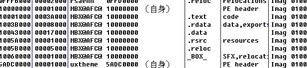
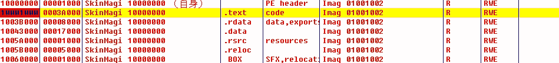
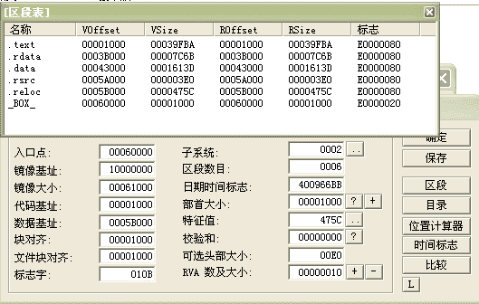

# Allok Video to 3GP Converter 脱壳+破解【原创】

> 原文：[`www.pediy.com/kssd/pediy08/pediy8-603.htm`](https://www.pediy.com/kssd/pediy08/pediy8-603.htm)

【破文标题】Allok Video to 3GP Converter 脱壳+破解  
【破文作者】FoBnN  
【作者邮箱】fobcrackgp\[at\]163.com  
【作者主页】www.hack58.com  
【破解工具】OD+LOPE+xxxxxxxxxxxxx  
【破解平台】XP+SP2  
【软件名称】Allok Video to 3GP Converter  
【软件大小】604K  
【原版下载】www.alloksoft.com  
【保护方式】MoleBox 2.5.x  
【破解声明】只是学习目的.  
\------------------------------------------------------------------------  
  
①。  
下载好安装后，用 DIT 查看为 MoleBox 2.5.x.  
\-----------------------------------------------------------------------------  
OD,载如 RUN,程序完全运行后,ALT+M 查看内存映射.如图  
  
   
  
发现有 MBX@XZXXXS 之类的名称,而且有\_BOX\_ 区段名，可以肯定这个就是被捆绑并参与程序运行的文件（DLL），  
我们下面就有把这个 DLL 给弄出来.  
\-----------------------------------------------------------------------------  
  
②抓取捆绑的 DLL。  
\-----------------------------------------------------------------------------  
再次载入  
0047EB53 >  E8 00000000     call Allok\_Vi.0047EB58              《停在 EP 处。  
0047EB58    60              pushad  
0047EB59    E8 4F000000     call Allok\_Vi.0047EBAD  
0047EB5E    FD              std  
0047EB5F    BE 208F9F0F     mov esi,0F9F8F20  
0047EB64    ED              in eax,dx  
0047EB65  ^ 7F 91           jg short Allok\_Vi.0047EAF8  
\-----------------------------------------------------------------------------------------------  
我们再验证下我刚才的猜想  
BP GetFileTime ,中断后取消断点返回到  
00484C92    C745 AC 0000000>mov dword ptr ss:\[ebp-54\],0  
00484C99    EB 09           jmp short Allok\_Vi.00484CA4  
00484C9B    8B4D AC         mov ecx,dword ptr ss:\[ebp-54\]  
00484C9E    83C1 01         add ecx,1  
00484CA1    894D AC         mov dword ptr ss:\[ebp-54\],ecx  
00484CA4    8B55 AC         mov edx,dword ptr ss:\[ebp-54\]  
00484CA7    3B55 9C         cmp edx,dword ptr ss:\[ebp-64\]  
00484CAA    0F83 E3000000   jnb Allok\_Vi.00484D93  
00484CB0    8B45 AC         mov eax,dword ptr ss:\[ebp-54\]  
00484CB3    C1E0 04         shl eax,4  
00484CB6    8B4D E0         mov ecx,dword ptr ss:\[ebp-20\]  
00484CB9    8B51 04         mov edx,dword ptr ds:\[ecx+4\]  
00484CBC    8B4D DC         mov ecx,dword ptr ss:\[ebp-24\]  
00484CBF    030C02          add ecx,dword ptr ds:\[edx+eax\]  
  
\--------------------------------------------------------------------------------------------------  
00484CA7    3B55 9C         cmp edx,dword ptr ss:\[ebp-64\]  
堆栈 ss:\[0012FBB8\]=00000001                           ；捆绑文件数 1  
edx=00000000  
\--------------------------------------------------------------------------------------------------  
00484CBC    8B4D DC         mov ecx,dword ptr ss:\[ebp-24\]  
堆栈 ss:\[0012FBF8\]=003C2330, (ASCII "SkinMagic.dll")            ；捆绑文件名  
ecx=003C2370  
\---------------------------------------------------------------------------------------------------  
现在我们要为下面的主程序脱壳做准备.  
查找字符可以找到 2 个”EXECUTABLE“双击来到  
0048596D    68 C40B4900     push Allok\_Vi.00490BC4                                                       ; ASCII "EXECUTABLE"  
00485972    8B0D 90184900   mov ecx,dword ptr ds:\[491890\]                                                ; Allok\_Vi.00400108  
00485978    51              push ecx  
00485979    8B55 E8         mov edx,dword ptr ss:\[ebp-18\]  
0048597C    52              push edx  
  
004859F0    8BE5            mov esp,ebp  
004859F2    5D              pop ebp  
004859F3    C3              retn                                               ;这里 F2 下个断  
\-----------------------------------------------------------------------------------------------------------------------  
知道文件名了，下面改知道怎么办了吧.  
BP CreateFileA  
中断 2 次后,堆栈中看到，取消断点  
0012FC48         0048763C     /CALL 到 CreateFileA 来自 Allok\_Vi.00487636  
0012FC4C         009C17E0     |FileName = "D:\\DOCUME~1\\FOBNN\\LOCALS~1\\TEMP\\MBX@540@3C2458.###"   ；创建文件，就是被捆绑的文件  
0012FC50         40000000     |Access = GENERIC\_WRITE  
0012FC54         00000000     |ShareMode = 0  
0012FC58         00000000     |pSecurity = NULL  
0012FC5C         00000002     |Mode = CREATE\_ALWAYS  
0012FC60         00000000     |Attributes = 0  
0012FC64         00000000     \\hTemplateFile = NULL  
\------------------------------------------------------------------------------------------------  
不是说把那个文件找到,改个名就可以用了.  
我们在数据窗口中跟随  
009C17E8            5C317E45  
009C17EC            4E424F46  
009C17F0            4F4C5C4E  
009C17F4            534C4143  
009C17F8            545C317E  
009C17FC            5C504D45  
009C1800            4058424D  
009C1804            40303435  
009C1808            34324333  
009C180C            232E3835  
009C1810            00002323  
009C1814            00000000  
  
改把 MBX@540@3C2458.###改成真正的文件名 SkinMagic.dll  
\--------------------------------------------------------------------------------------------------------  
好了文件名改好，改把文件拿出来  
BP GetModuleHandleA,中断后取消断点.ALT+M,弹出提示确定不用管.  
内存映射，项目 39  
 地址=10001000  
 大小=0003A000 (237568.)  
 物主=SkinMagi 10000000  
 区段=.text  
 包含=code  
 类型=Imag 01001002  
 访问=R  
 初始访问=RWE  
在 SkinMagic 的 CODE F2 下断 如图.  
  
   
\--------------------------------------------------------------------------  
F9 运行，直接断在了这个 DLL 的 OEP 处  
100010E9    55              push ebp  
100010EA    8BEC            mov ebp,esp  
100010EC    53              push ebx  
100010ED    8B5D 08         mov ebx,dword ptr ss:\[ebp+8\]  
100010F0    56              push esi  
100010F1    8B75 0C         mov esi,dword ptr ss:\[ebp+C\]  
100010F4    57              push edi  
100010F5    8B7D 10         mov edi,dword ptr ss:\[ebp+10\]  
\-------------------------------------------------------------------  
用 LORDPE 把这个 DLL ，DUMP 出来.  
现在用 PE 编辑，把 DUMP 下来的 DLL 的数据基址和大小，改为这个 DLL.reloc 区段的 RAV 的大小.  
如图.  
  
   
  
改完后修复输入表吧 OEP=10E9   
  
OK。已经把 DLL 拿出来了.  
\====================================  
③。程序脱壳  
F9 运行吧,  
在上面下的断点生效  
004859F0    8BE5            mov esp,ebp  
004859F2    5D              pop ebp  
004859F3    C3              retn                                  ;中断这里  
  
来到这里  
0047F2CB    8B4D EC         mov ecx,dword ptr ss:\[ebp-14\]                                                ; Allok\_Vi.0041F872  
0047F2CE    894D 08         mov dword ptr ss:\[ebp+8\],ecx  
0047F2D1    833D B4594900 0>cmp dword ptr ds:\[4959B4\],0  
0047F2D8    74 13           je short Allok\_Vi.0047F2ED  
0047F2DA    6A 00           push 0  
0047F2DC    6A 00           push 0  
0047F2DE    6A 00           push 0  
0047F2E0    8B15 B4594900   mov edx,dword ptr ds:\[4959B4\]  
0047F2E6    52              push edx  
0047F2E7    FF15 B8174900   call dword ptr ds:\[4917B8\]                                                   ; USER32.PostMessageA  
0047F2ED    33C0            xor eax,eax  
0047F2EF    5F              pop edi  
0047F2F0    5E              pop esi  
0047F2F1    5B              pop ebx  
0047F2F2    8BE5            mov esp,ebp  
0047F2F4    5D              pop ebp  
0047F2F5    C3              retn  
  
  
来到这里  
0047E72B    58              pop eax                                                                      ; Allok\_Vi.0041F872  
0047E72C    894424 24       mov dword ptr ss:\[esp+24\],eax  
0047E730    61              popad  
0047E731    58              pop eax  
0047E732    58              pop eax  
0047E733    FFD0            call eax                                                                      ;跳向 OEP  
0047E735    E8 A6C00000     call Allok\_Vi.0048A7E0  
\------------------------------------------------------------------------------------------------------------------------------------------  
0041F872    55              push ebp                                                         ;OEP 到了 DUMP。修复。  
0041F873    8BEC            mov ebp,esp  
0041F875    6A FF           push -1  
0041F877    68 68644200     push Allok\_Vi.00426468  
0041F87C    68 E8F94100     push Allok\_Vi.0041F9E8                                                       ; jmp to msvcrt.\_except\_handler3  
0041F881    64:A1 00000000  mov eax,dword ptr fs:\[0\]  
0041F887    50              push eax  
0041F888    64:8925 0000000>mov dword ptr fs:\[0\],esp  
0041F88F    83EC 68         sub esp,68  
0041F892    53              push ebx  
0041F893    56              push esi  
0041F894    57              push edi  
0041F895    8965 E8         mov dword ptr ss:\[ebp-18\],esp  
0041F898    33DB            xor ebx,ebx  
0041F89A    895D FC         mov dword ptr ss:\[ebp-4\],ebx  
0041F89D    6A 02           push 2  
\-----------------------------------------------------------------------------------------------  
④破解  
运行脱壳后的程序.  
破解相当简单，直接写入用户名，注册码，改下注册标志即可。  
  
\------------------------------------------------------------------------  
没啥技术含量。  
\------------------------------------------------------------------------  
【版权声明】原创，转载注名. 

 4dd466d0e1e0cc123afbe504da2462ca