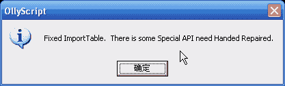
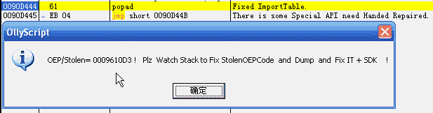

# Obsidium V1.3.0.0-V1.3.0.4 UnPacK Script

> 原文：[`www.pediy.com/kssd/pediy07/pediy7-666.htm`](https://www.pediy.com/kssd/pediy07/pediy7-666.htm)

**Obsidium V1.3.0.0-V1.3.0.4 UnPacK Script**  
  
  
  
//////////////////////////////////////////////////////////  
// FileName    :  Obsidium V1.3.0.0.osc  
// Comment     :  Obsidium V1.3.0.0-V1.3.0.4 UnPacK Script  
// Environment :  WinXP SP2,OllyDbg V1.10,OllyScript V0.92  
// Author      :  heXer & fly  
// WebSite     :  http://www.unpack.cn  
// Date        :  2005-11-01 16:00  
//////////////////////////////////////////////////////////  
#log  
dbh  
  
  
MSGYN "Plz Clear All BreakPoints  And  Set Debugging Option Ignore All Excepions Options  !"  
cmp $RESULT, 0  
je TryAgain  
  
#inc "Get.eXe.PE.Information.osc"  
  
var T0  
var T1  
var temp  
var FixCode1  
var FixCode2  
var FixCode3  
var FixCode4  
var FixCode5  
var FixCode6  
var Skip  
var EAX=0  
var EAX=1  
var EAX=2  
var EAX=3  
var EAX=4  
var IsDebuggerPresent  
var JmpAddress  
var SpecialFiXed  
var SpecialFiXedOver  
var bpcnt  
var VirtualAlloc  
var AllocMemory  
var AllocMemory2  
var AllocMemory2Size  
var AllocMemory3  
var AllocMemory3Size  
var LoadLibraryA  
var CreateRemoteThread  
var VirtualFree  
var DecodeFinal  
var StolenOEP  
  
  
//UnhandledExceptionFilter————————————————————————————————  
  
gpa "UnhandledExceptionFilter", "KERNEL32.dll"  
cmp $RESULT, 0  
je Only Win2K/XP  
WinXP:  
find $RESULT, #0F849600000064A1180000008B4030#  
cmp $RESULT, 0  
je Win2K  
log $RESULT  
mov \[$RESULT\],#E997000000#  
jmp CheckRemoteDebuggerPresent  
  
Win2K:  
gpa "UnhandledExceptionFilter", "KERNEL32.dll"  
find $RESULT, #395DC80F8549020000#  
cmp $RESULT, 0  
je Only Win2K/XP  
log $RESULT  
mov \[$RESULT\],#395DC8EB0490909090#  
jmp CreateToolhelp32Snapshot  
  
  
//CheckRemoteDebuggerPresent————————————————————————————————  
CheckRemoteDebuggerPresent:  
  
gpa "CheckRemoteDebuggerPresent", "KERNEL32.dll"  
cmp $RESULT, 0  
je CreateToolhelp32Snapshot  
find $RESULT, #33C040#  
cmp $RESULT, 0  
je CreateToolhelp32Snapshot  
mov \[$RESULT\], #33C090#  
  
  
//CreateToolhelp32Snapshot————————————————————————————————  
CreateToolhelp32Snapshot:  
  
gpa "CreateToolhelp32Snapshot", "KERNEL32.dll"  
cmp $RESULT, 0  
je NoFind  
mov \[$RESULT\], #B8FFFFFFFFC20800#  
  
  
//CreateRemoteThread————————————————————————————————  
  
gpa "CreateRemoteThread", "KERNEL32.dll"  
cmp $RESULT, 0  
je NoFind  
mov \[$RESULT\], #33C0C21C00#  
  
  
//FindWindowA————————————————————————————————  
  
gpa "FindWindowA", "USER32.dll"  
cmp $RESULT, 0  
je NoFind  
mov \[$RESULT\], #33C0C20800#  
  
  
//CloseHandle————————————————————————————————  
  
gpa "CloseHandle", "KERNEL32.dll"  
cmp $RESULT, 0  
je NoFind  
mov \[$RESULT\], #C20400#  
  
  
//VirtualAlloc————————————————————————————————  
  
gpa "VirtualAlloc", "KERNEL32.dll"  
cmp $RESULT, 0  
findop $RESULT,#C21000#  
cmp $RESULT, 0  
je NoFind  
mov VirtualAlloc,$RESULT  
  
eob VirtualAlloc  
bp VirtualAlloc  
esto  
GoOn0:  
esto  
VirtualAlloc:  
cmp eip,VirtualAlloc  
jne GoOn0  
inc bpcnt  
cmp bpcnt,2  
log bpcnt  
jb GoOn0  
ja AllocMemory3  
mov AllocMemory2,eax  
mov temp,esp  
add temp,08  
mov AllocMemory2Size,\[temp\]  
inc bpcnt  
log AllocMemory2  
log AllocMemory2Size  
jmp GoOn0  
  
AllocMemory3:  
mov AllocMemory3,eax  
mov temp,esp  
add temp,08  
mov AllocMemory3Size,\[temp\]  
log AllocMemory3  
log AllocMemory3Size  
  
bc VirtualAlloc  
mov bpcnt,0  
  
  
//LoadLibraryA————————————————————————————————  
  
FindChance:  
gpa "LoadLibraryA", "KERNEL32.dll"  
cmp $RESULT, 0  
je NoFind  
mov LoadLibraryA,$RESULT  
eob LoadLibraryA  
bpwm LoadLibraryA, 5  
esto  
LoadLibraryA:  
inc bpcnt  
find AllocMemory2,#66F7062000#  
cmp $RESULT, 0  
je FindChance  
  
  
//FixedImportingFunction————————————————————————————————  
  
  
log bpcnt  
bpmc  
mov FixCode1,$RESULT  
log FixCode1  
  
//jmp Final  
  
mov \[FixCode1\],#66F7060800#  
/\*  
FixCode1:  
00908035      66:F706 2000       test word ptr ds:\[esi\],20  
Modified:     66:F706 0800       test word ptr ds:\[esi\],8    ★  
\*/  
  
  
find FixCode1,#0F84??000000#  
cmp $RESULT, 0  
je NoFind  
mov FixCode2,$RESULT  
log FixCode2  
mov T0,$RESULT  
add T0,2  
mov T1,\[T0\]  
add T0,4  
add T0,T1  
mov JmpAddress,T0  
log JmpAddress  
eval "jne {JmpAddress}"  
asm FixCode2, $RESULT  
/\*  
FixCode2:  
00908040      0F84 ??000000      je 009080DB  
Modified:     0F85 95000000      jnz 009080DB  ★  
\*/  
  
  
find FixCode2,#0F84??000000#  
cmp $RESULT, 0  
je NoFind  
mov FixCode3,$RESULT  
log FixCode3  
eval "je {JmpAddress}"  
asm FixCode3, $RESULT  
mov temp,FixCode3  
add temp,2  
fill temp, 4, 90  
/\*  
FixCode3:  
00908085      0F84 88000000      je 00908113  
Modified:     7454 90909090      je 009080DB   ★  
\*/  
  
  
find FixCode3,#74??EB??#  
cmp $RESULT, 0  
je NoFind  
mov FixCode4,$RESULT  
log FixCode4  
eval "je {JmpAddress}"  
asm FixCode4, $RESULT  
/\*  
FixCode4:  
009080CE      74 43              je 00908113  
Modified:     74 0B              je 009080DB   ★  
\*/  
  
  
find FixCode2,#75??EB#  
cmp $RESULT, 0  
je NoFind  
mov Skip,$RESULT  
log Skip  
mov \[Skip\],#EB#  
/\*  
00908FAC         66:F706 0200       test word ptr ds:\[esi\],2  
00908FB1         EB 03              jmp short 00908FB6  
00908FB6         75 47              jnz short 00908FFF  
Modified:        EB 47              jmp short 00908FFF   ★  
00908FB8         EB 02              jmp short 00908FBC  
\*/  
  
  
find FixCode1,#891F83C30AE9#  
cmp $RESULT, 0  
je NoFind  
mov FixCode5,$RESULT  
log FixCode5  
fill FixCode5, 2, 90  
/\*  
00909127      891F               mov dword ptr ds:\[edi\],ebx  
Modified:     9090               NOP           ★  
00909129      83C3 0A            add ebx,0A  
0090912C      E9 49FFFFFF        jmp 0090907A  
\*/  
  
  
//IsDebuggerPresent————————————————————————————————  
  
  
gpa "IsDebuggerPresent", "KERNEL32.dll"  
cmp $RESULT, 0  
je NoFind  
find $RESULT,#C3#  
cmp $RESULT, 0  
je NoFind  
mov IsDebuggerPresent,$RESULT  
eob IsDebuggerPresent  
bp IsDebuggerPresent  
  
  
//SpecialImportingFunction————————————————————————————————  
  
  
find FixCode1,#C214008B#  
cmp $RESULT, 0  
je NoFind  
mov SpecialFiXed,$RESULT  
log SpecialFiXed  
  
find FixCode1,#FF501850#  
cmp $RESULT, 0  
je NoFind  
mov EAX=3,$RESULT  
log EAX=3  
  
find EAX=3,#FF5018EB1C#  
cmp $RESULT, 0  
je NoFind  
mov EAX=0,$RESULT  
log EAX=0  
  
find EAX=3,#FF5018EB0D#  
cmp $RESULT, 0  
je NoFind  
mov EAX=1,$RESULT  
log EAX=1  
  
find EAX=3,#FF5018C603#  
cmp $RESULT, 0  
je NoFind  
mov EAX=2,$RESULT  
log EAX=2  
  
EAX:  
eob SpecialImportingFunction  
bp SpecialFiXed  
bp EAX=0  
bp EAX=1  
bp EAX=2  
bp EAX=3  
  
  
esto  
GoOn1:  
log eip  
esto  
  
/\*  
009090FC     8B46 04            mov eax,dword ptr ds:\[esi+4\]  
009090FF     83F8 00            cmp eax,0  
00909102     74 45              je short 00909149  
00909104     83F8 01            cmp eax,1  
00909107     74 4F              je short 00909158  
00909109     83F8 02            cmp eax,2  
0090910C     74 59              je short 00909167  
0090910E     83F8 03            cmp eax,3  
00909111     74 12              je short 00909125  
00909113     83F8 04            cmp eax,4  
00909116     75 CA              jnz short 009090E2  
00909118     8B45 14            mov eax,dword ptr ss:\[ebp+14\]  
0090911B     8B90 E8000000      mov edx,dword ptr ds:\[eax+E8\]  
00909121     8917               mov dword ptr ds:\[edi\],edx  
00909123     EB BD              jmp short 009090E2  
00909125     8B45 14            mov eax,dword ptr ss:\[ebp+14\]  
00909128     68 C5B1662D        push 2D66B1C5  
0090912D     6A 00              push 0  
0090912F     FF50 18            call dword ptr ds:\[eax+18\]  
00909132     50                 push eax  
00909133     53                 push ebx  
00909134     E8 98020000        call 009093D1  
00909139     53                 push ebx  
0090913A     E8 19020000        call 00909358  
0090913F     8BCB               mov ecx,ebx  
00909141     8D5C03 01          lea ebx,dword ptr ds:\[ebx+eax+1\]  
00909145     8BC1               mov eax,ecx  
00909147     EB 2B              jmp short 00909174  
00909149     8B45 14            mov eax,dword ptr ss:\[ebp+14\]  
0090914C     68 0F1ACF4C        push 4CCF1A0F  
00909151     6A 00              push 0  
00909153     FF50 18            call dword ptr ds:\[eax+18\]  
00909156     EB 1C              jmp short 00909174  
00909158     8B45 14            mov eax,dword ptr ss:\[ebp+14\]  
0090915B     68 A41A86D0        push D0861AA4  
00909160     6A 00              push 0  
00909162     FF50 18            call dword ptr ds:\[eax+18\]  
00909165     EB 0D              jmp short 00909174  
00909167     8B45 14            mov eax,dword ptr ss:\[ebp+14\]  
0090916A     68 E313B41D        push 1DB413E3  
0090916F     6A 00              push 0  
00909171     FF50 18            call dword ptr ds:\[eax+18\]  
00909174     C603 B8            mov byte ptr ds:\[ebx\],0B8  
00909177     8943 01            mov dword ptr ds:\[ebx+1\],eax  
0090917A     8B45 14            mov eax,dword ptr ss:\[ebp+14\]  
0090917D     8B90 A4010000      mov edx,dword ptr ds:\[eax+1A4\]  
00909183     8D43 0A            lea eax,dword ptr ds:\[ebx+A\]  
00909186     2BD0               sub edx,eax  
00909188     C643 05 E9         mov byte ptr ds:\[ebx+5\],0E9  
0090918C     8953 06            mov dword ptr ds:\[ebx+6\],edx  
0090918F     90                 nop  
00909190     90                 nop  
00909191     83C3 0A            add ebx,0A  
00909194     E9 49FFFFFF        jmp 009090E2  
00909199     55                 push ebp  
0090919A     8BEC               mov ebp,esp  
0090919C     83EC 04            sub esp,4  
0090919F     53                 push ebx  
009091A0     56                 push esi  
009091A1     57                 push edi  
009091A2     EB 04              jmp short 009091A8  
\*/  
  
SpecialImportingFunction:  
  
log eip  
cmp eip,EAX=0  
je Luck  
cmp eip,EAX=1  
je Luck  
cmp eip,EAX=2  
je Luck  
cmp eip,EAX=3  
je Luck  
cmp eip,SpecialFiXed  
je SpecialFiXed  
cmp eip,SpecialFiXedOver  
je IsDebuggerPresent  
cmp eip,IsDebuggerPresent  
je IsDebuggerPresent  
jmp GoOn1  
  
Luck:  
mov temp,eip  
bc temp  
add temp,3  
eob temp  
bphws temp, "x"  
  
sti  
find eip,#FF5354EB04????????85C0EB#  
cmp $RESULT, 0  
je NoFind  
mov FixCode6,$RESULT  
log FixCode6  
add FixCode6,9  
mov \[FixCode6\],#8907EB#  
esto  
  
temp:  
cmp eip,temp  
jne SpecialImportingFunction  
bphwc temp  
mov \[FixCode6\],#85C0EB#  
jmp GoOn1  
  
  
SpecialFiXed:  
bc SpecialFiXed  
sti  
find eip,#33C0EB02#  
cmp $RESULT, 0  
je NoFind  
mov SpecialFiXedOver,$RESULT  
log SpecialFiXedOver  
bp SpecialFiXedOver  
jmp GoOn1  
  
  
IsDebuggerPresent:  
bc SpecialFiXedOver  
bc IsDebuggerPresent  
bc EAX=0  
bc EAX=1  
bc EAX=2  
bc EAX=3  
  
  
MSG "Fixed ImportTable.  There is some Special API need Handed Repaired.  "  
  
  
//DecodeFinal————————————————————————————————  
Final:  
  
bc SpecialFiXedOver  
log LastSectionVA  
mov temp,LastSectionVA  
add temp,2600  
  
find temp,#83????0F85#  
cmp $RESULT, 0  
je NoFind  
  
add $RESULT,9  
mov DecodeFinal,$RESULT  
log DecodeFinal  
eob DecodeFinal  
bp DecodeFinal  
esto  
GoOn2:  
esto  
DecodeFinal:  
cmp eip,DecodeFinal  
jne GoOn2  
bc DecodeFinal  
rtr  
sti  
  
  
//JmpEDI————————————————————————————————  
  
mov temp,eip  
and temp,0FFFF000  
log temp  
find temp,#FFE7EB#  
cmp $RESULT, 0  
je NoFind  
log $RESULT  
eob JmpEDI  
bp $RESULT  
esto  
GoOn3:  
esto  
JmpEDI:  
cmp eip,$RESULT  
jne GoOn3  
bc $RESULT  
sti  
  
  
//StolenOEPCode————————————————————————————————  
  
find eip,#035610EB02#  
cmp $RESULT, 0  
je NoFind  
/\*  
0090C237     0356 10            add edx,dword ptr ds:\[esi+10\]  
0090C23A     EB 02              jmp short 0090C23E  
\*/  
add $RESULT,3  
eob CountOEP  
bp $RESULT  
esto  
CountOEP:  
bc $RESULT  
mov StolenOEP,edx  
  
find eip,#61EB#  
cmp $RESULT, 0  
je NoFind  
/\*  
0090C25A     61                 popad  
0090C25B     EB 04              jmp short 0090C261  
\*/  
eob StolenOEP  
bp $RESULT  
esto  
StolenOEP:  
bc $RESULT  
mov temp,eip  
cmt temp,"Fixed ImportTable. "  
inc temp  
cmt temp,"There is some Special API need Handed Repaired.  "  
/\*  
0090C06E     E9 2A53AFFF        jmp 0040139D  
0090C073     EB 04              jmp short 0090C079  
\*/  
find eip,#E9????????EB#  
log $RESULT  
cmt $RESULT, "Jump StolenOEP !  Found by heXer & fly "  
  
  
//GameOver————————————————————————————————  
  
  
eval " OEP/Stolen= {StolenOEP} !   Plz  Watch Stack to Fix StolenOEPCode  and  Dump  and  Fix IT + SDK    !"  
MSG $RESULT  
ret  
  
NoFind:  
MSG "Error! Don't find.   Maybe It's not Obsidium V1.3.0.0-V1.3.0.4 !   "  
ret  
  
Only Win2K/XP:  
MSG "Error! This Script only Run on the Win2K.SP4/WinXP.SP2 !   "  
ret  
  
TryAgain:  
MSG " Plz  Try  Again   !   "  
ret

点击下载： Obsidium.V1.3.0.0.osc.rar

Obsidium V1.3.0.0-V1.3.0.4 UnPacK Script 演示  
  
  
还是写个简单的脚本演示吧。  
—————————————————————————————————  
一、PEiD Sign  
  
  
\[Obsidium V1.3.0.0 -> Obsidium Software\]  
signature = EB 04 ?? ?? ?? ?? E8 ?? 00 00 00  
ep\_only = true  
  
\[Obsidium V1.3.0.4 -> Obsidium Software\]  
signature = EB 02 ?? ?? E8 ?? 00 00 00  
ep\_only = true  
  
  
—————————————————————————————————  
二、脚本说明  
  
  
1、此脚本仅仅支持 Obsidium V1.3.0.0 和 V1.3.0.4 加壳程序，不支持其他版本  
  
2、可以在 Win2K.SP4/WinXP.SP2 上使用，其他 NT 系统平台需要修改相关函数地址，不支持 Win98  
  
3、Get.eXe.PE.Information.osc 为包含脚本，和 Obsidium V1.3.0.0.osc 必须放在相同目录下  
  
4、heXer & fly 合作完成。由于要修复部分特殊函数的分支处理，所以写得很乱,各位见笑了。  
  
5、SDK 和某分支处理的特殊函数需要手动修复。Obsidium V1.3 增强了输入表函数的加密，下次要换个思路来修复。  
  
6、最后用 Obsidium V1.3.0.4 加壳 Win98 记事本来简单演示一下如何使用此脚本。  
  
7、如果 Obsidium 重定位后的地址低于原 eXe 的基址，则需要手动处理 Obsidium 的重定位过程，不过这种情况很少见。  
  
8、脚本已经处理了反跟踪，可以使用 OllyDBG 原版来运行此脚本。  
  
—————————————————————————————————  
三、运行脚本  
  
  
清除掉以前的所有断点，设置 OllyDBG 忽略所有异常选项，虽然脚本已经对异常进行了处理，但还是要求忽略所有异常，免得麻烦。载入 Test.Obsidium V1.3.0.4.exe  
  
00407000    EB 02           jmp short Test\_Obs.00407004  
//暂停在壳入口    如果不是暂停在 EP，请设置 OllyDBG 事件选项  
00407002    94              xchg eax,esp  
  
运行脚本。Plugins->OllyScript->Run Script->Obsidium V1.3.0.0.osc  
  
  
选择“是”，脚本开始运行。弹出第 2 个对话框，提示某些 api 需要手动修复  
   
  
第 3 个对话框弹出后我们要准备修复 StolenOEPCode  
  
  
确定后脚本结束。F7  
  
0090D444    61              popad               ; Fixed ImportTable.  
//此时我们暂停在这里  
0090D445    EB 04           jmp short 0090D44B  ; There is some Special API need Handed Repaired.  
0090D44B    9D              popfd  
0090D44C    EB 03           jmp short 0090D451  
0090D451    E9 7D3C0500     jmp 009610D3        ; Jump StolenOEP !  Found by heXer & fly  
//飞向光明之颠  
  
看看堆栈：  
0012FF78   FFFFFFFF  
0012FF7C   00908BC4     
0012FF80   00908BC8  
  
寄存器：  
ESP=0012FF78  
EBP=0012FFC0  
ESI=FFFFFFFF  
  
找个 Visual C++ 6.0 的程序参考一下，Win98 的 WRITE.EXE  
  
0040100C    55              push ebp  
0040100D    8BEC            mov ebp,esp  
0040100F    83EC 44         sub esp,44  
00401012    56              push esi  
00401013    FF15 58204000   call dword ptr ds:\[402058\]   ; kernel32.GetCommandLineA  
  
Alt+M 设置 00960000 区段为完整权限，否则会提示：  
Unable to read memory of debugged process (00960000..00968FFF).  
  
修复 StolenOEPCode 如下：  
  
009610CC    55              push ebp  
009610CD    8BEC            mov ebp,esp  
009610CF    83EC 44         sub esp,44  
009610D2    56              push esi  
009610D3    FF15 E0639600   call dword ptr ds:\[9663E0\]    ; kernel32.GetCommandLineA  
009610D9    8BF0            mov esi,eax  
009610DB    8A00            mov al,byte ptr ds:\[eax\]  
009610DD    3C 22           cmp al,22  
009610DF    75 13           jnz short 009610F4  
  
用 LoadPE 完全 dump 出 Test.Obsidium V1.3.0.4.exe 进程，区域 dump 出 00960000-00969000 段，Load 入 dump.exe，修改新区段 VirtualAddress=00560000。只保留 Rebuilder 的 Validate PE 选项 Rebuild dump.exe  
  
  
—————————————————————————————————  
四、输入表  
  
  
在转存中察看输入表函数的开始和结束地址。  
运行 ImportRec，OEP=005610CC、RVA=005662E0、Size=0000023C  
会发现有几个无效指针，注意了，某些是填充在 DLL 之间的垃圾数据，而某些是待修复函数  
  
如 005662F4 处明显是填充在 DLL 之间的垃圾数据，直接 Cut 掉  
1  005662F0  advapi32.dll  01CE  RegCreateKeyA  
0  005662F4  ?  0000  0097070A  
1  005662F8  gdi32.dll  01A6  GetStockObject  
  
而下面这些则是需要修复的函数：  
1  00566368  kernel32.dll  0252  LocalUnlock  
0  0056636C  ?  0000  00970090  
1  00566370  kernel32.dll  024C  LocalFree  
1  00566374  kernel32.dll  0248  LocalAlloc  
0  00566378  ?  0000  009700B4  
1  0056637C  kernel32.dll  01EB  GlobalAlloc  
  
下面再说说如何修复这些函数吧。  
现在我们用 UEStudio 打开 Obsidium V1.3.0.0.osc，找到下面这行  
log FixCode1  
//jmp Final  
把//jmp Final 前的//去掉，这样脚本就不处理输入表，直接去 OEP 了  
  
新开一个 OllyDBG，载入 Test.Obsidium V1.3.0.4.exe，运行修改后的脚本，走至 StolenOEP  
设置目前代码所在区段为完整权限，找到那些调用待修复函数的地方。如搜索常数：96636C  
009634C6     FF15 6C639600      call dword ptr ds:\[96636C\]  
  
找到这里，Ctrl+\* 在 009634C6 处新建 EIP，跟进去看看处理  
  
00970090     60                 pushad  
00970091     66:BF A665         mov di,65A6  
00970095     B2 3A              mov dl,3A  
00970097     E9 4370F9FF        jmp 009070DF  
009070DF     EB 03              jmp short 009070E4  
  
一直 F7 走就能看见正确的 API 了，当然，不是每个处理都一样的  
0090166A     FFB6 A5050000      push dword ptr ds:\[esi+5A5\] ; kernel32.\_llseek  
00901670     FF93 84000000      call dword ptr ds:\[ebx+84\]  
所以 0056636C 应该修复成 kernel32.dll \_llseek  
  
看到 API 后就不必再 F7 了，搜索其他常数：00966378  
009632EA     FF15 78639600      call dword ptr ds:\[966378\]  
F7 跟踪会看到这里  
00901514     FFB6 FB060000      push dword ptr ds:\[esi+6FB\] ; kernel32.\_lclose  
  
  
找齐函数后就可以 FixDump  
Game Over  
  
  
—————————————————————————————————                                   
         ,     \_/   
        /| \_.-~/            \\\_     ,        青春都一晌  
       ( /~   /              \\~-.\_ |\\  
       \`\\\\  \_/                \\   ~\\ )          忍把浮名   
   \_-~~~-.)  )\_\_/;;,.          \\\_  //'  
  /'\_,\\   --~   \\ ~~~-  ,;;\\\_\_\_(  (.-~~~-.        换了脱壳轻狂  
 \`~ \_( ,\_..--\\ (     ,;'' /    ~--   /.\_\`\\   
  /~~//'   /' \`~\\         ) /--..\_, )\_  \`~  
  "  \`~"  "      \`"      /~'\`\\    \`\\\\~~\\     
                         "     "   "~'  ""  
      
           UnPacKed By :  heXer & fly  
               2005-11-01 16:00 

 4dd466d0e1e0cc123afbe504da2462ca