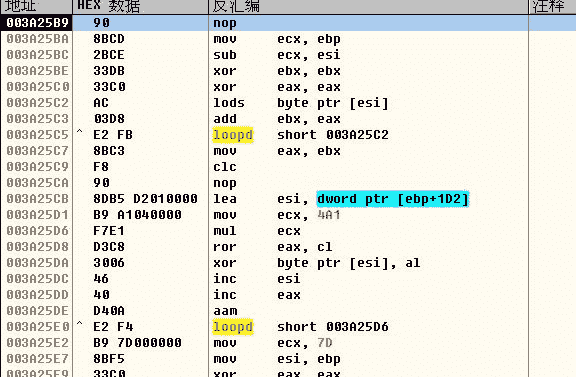
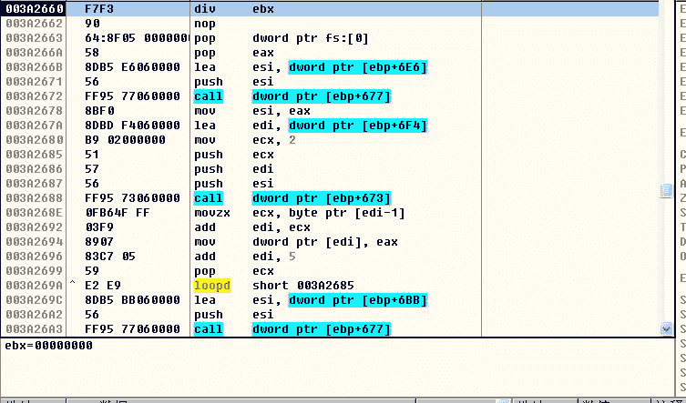
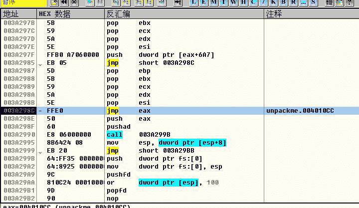
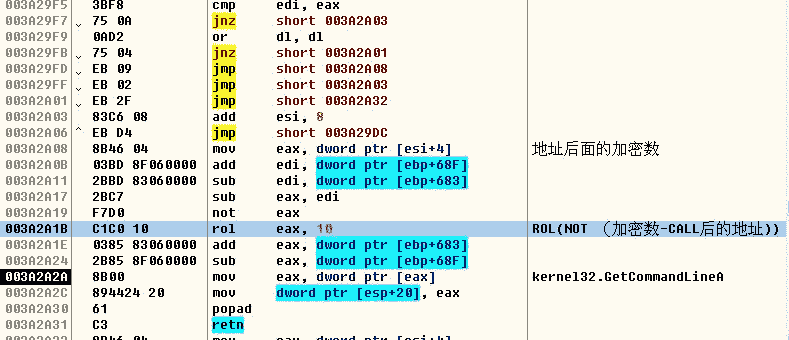
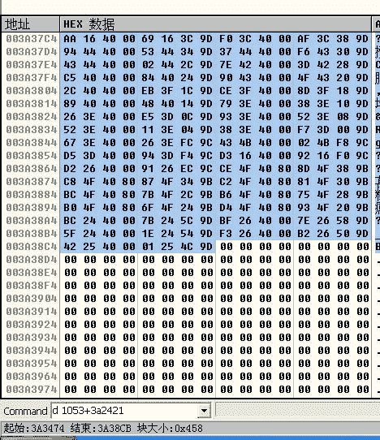
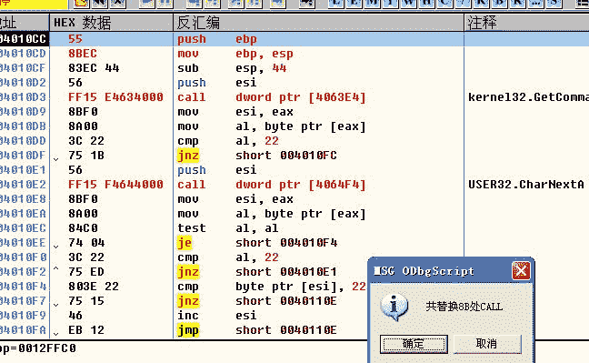
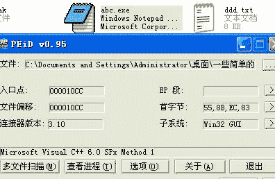

# 也谈 PE-Armor0.49 记事本的脱壳经历

> 原文：[`www.pediy.com/kssd/pediy11/107842.html`](https://www.pediy.com/kssd/pediy11/107842.html)

这两天研究这个壳，让我对壳的认识有了进一步的加深，特将脱壳的过程附上，与大家共勉，在此先得感谢每位指点我的人，学到新知识的确是让人开心的一件事！  
  
这个壳本身到 OEP 不难，主要是壳的修复比较麻烦，因为这个壳抽掉了 OEP,并且对 CALL \[XXX\]的一些地方进行了硬编码，变成了 CALL XXX，这样脱壳以后 CALL 的地址就不正确了！  
  
加载以后，运行的话会发现产生了 N 多的异常，这里借用 resty 的方法，并加上自己的心得,给出一个简单的到 OEP 的方法：  
  
1、  除 INT3 断点外，忽略所有异常。SHIFT+F9，运行：  
  
  
  
  
2、  不忽略整数除 0 异常，SHIFT+F9 运行：  
  
  
  
3、  CTRL+F 查找跳到 OEP 的命令 JMP EAX, 在其上 F2 下断点，SHIFT+F9 运行：  
  
  
  
这里就是跳向光明之巅！取消断点后，F8 到 OEP 处。  
然后就是体力劳动了，呵呵，正好这两天初学 OllyScript,也就想用脚本来恢复 CALL XXX！  
  
我们首先要知道的是 CALL XXX 处 (原来是 CALL \[XXX\])是如何还原：  
F4 到任意一个 CALL XXX，然后在代码段下内存访问断点，这样就能跟踪到壳的处理函数处：  
  
  
  
这在里，我们就知道了，原来壳是用一张表来处理 CALL XXX 的形式的。记下 ESI 的表头位址，不同的机器这个地址不一样，这张表以 0000 结束！在我这里这个地址就是  
  
0x3A3474 这个表的大小是 0X458，算一下壳一共处理了多少个函数？  
0x458/4/2 =0x8B=139 个！晕啊，想把人累死啊！！！！   
  
  
  
没办法，只好学学 OllyScript 了，用脚本来恢复 CALL，下面是自己写的恢复脚本，  
呵呵，大侠们别笑，有好多命令不会用…… 采用原壳的解密算法，直接读取密表进行解码后恢复,下面是脚本的原型，虽然很丑，不过确实起到了减轻劳力的作用，哈哈  
  
var passtableaddr  
var vaddr  
var nCount  
var caddr  
var encode  
  
mov nCount, 0  
  
lbFind:  
  
find eip, #90E8#  
cmp $RESULT, 0  
je lbEnd  
  
inc nCount  
mov eip, $RESULT  
add eip, 6  
mov caddr, eip  
mov passtableaddr, 3a3474  
  
lbstart:  
cmp passtableaddr, 3a38c4  
jg lbFind  
mov vaddr, \[passtableaddr\]  
cmp vaddr, caddr  
jne lbsearch  
mov encode, \[passtableaddr+4\], 4  
sub encode, vaddr  
not encode  
rol encode,10  
mov \[vaddr-6\], #FF15#  
mov \[vaddr-4\], encode  
  
lbsearch:  
add passtableaddr, 8  
jmp lbstart  
  
  
jmp lbFind  
  
lbEnd:  
   mov eip, 4010cc  
   eval "共替换{nCount}处 CALL"  
   msg $RESULT  
ret  
  
  
  
然后恢复下 OEP 为如图的情况，直接 DUMP 即可，无需修复 IAT，即可运行，PEID 查看已经成功脱壳：  
  
  
  
总结：以前以为到了 OEP 之后修复 IAT 成功了壳基本就脱完了，遇到这个壳让我觉得自己太浅薄了！