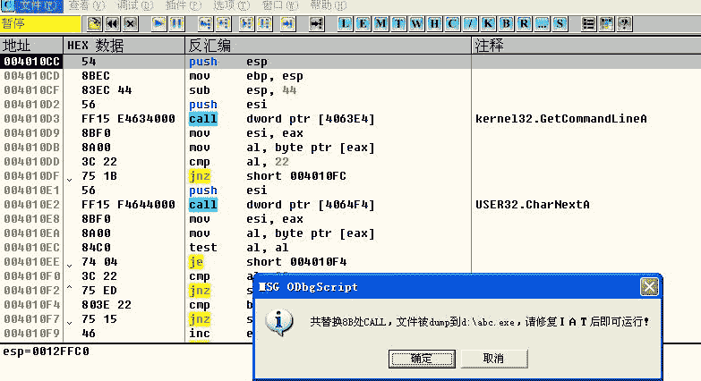
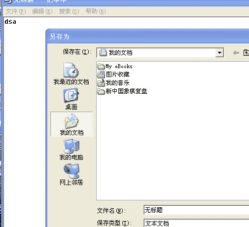

# PE-Armor 壳后继报道：从密码表逆向恢复策略！

> 原文：[`www.pediy.com/kssd/pediy11/107885.html`](https://www.pediy.com/kssd/pediy11/107885.html)

前面一篇里讲的办法是直接从代码中搜索并恢复，这样会存在ＪＭＰ　\[ＸＸＸ\]的代码硬抽取部分未被恢复，造成记事本的功能部分如打开、保存等直接崩溃……，那么如何才能保证此壳被完整的修复了，昨天我思考了很久，既然从代码搜索不好找，那么可以从壳的密表中采用逆向策略来修复，嘿嘿，正好符合逆向分析的思路：（简单易懂，原作者 resty 的思路我不是很明白……）  
  
接前面，直接从密码表中取数据，并根据壳的解密算法来进行恢复……。密表中的形式由于是：  
  
ＶＡＲ地址，　密值　（各占四字节的形式）  
  
对于特殊地址，此壳将ＶＡＲ的最高位置１,即 80ＸＸＸＸＸＸ的形式，　研究发现这是对应于  
ＪＭＰ \[ＸＸＸ\]的特殊形式，而且这样的里面的ＩＡＴ也被修改了，所以要修复ＩＡＴ。  
  
这样，能保证只要表中记录的地址，全部都能恢复，下面是自己研究的脚本，测试成功（注意，恢复以后得修复ＩＡＴ）然后就能成功运行了　下面是脱此壳的完整脚本：  
  
  
var passtableaddr  
var vaddr  
var nCount  
var encode  
  
msg "请设置忽略除 INT3 外的所有异常"  
setoption  
run  
msg "请去除整数除零的异常"  
setoption  
esto  
bp 38298c  
esto  
bc  
sto  
cmp eip, 4010cc  
asm eip, "push esp"  
inc eip  
asm eip, "mov ebp, esp"  
dec eip  
  
mov nCount, 0  
  
mov passtableaddr, 383474  //密码表的开始位置，每台电脑位置可能不一样，请自行修改  
  
lbstart:  
cmp passtableaddr, 3838c4  //密码表结束位置-4  
jg lbEnd  
mov vaddr, \[passtableaddr\]  
and vaddr, 80000000 //判断是 jmp 还是 call  
cmp vaddr, 0    //如果是 0，就是 call  
je lbcall  
mov vaddr, \[passtableaddr\]  
and vaddr, 00ffffff  //jmp  
sub vaddr,6  
mov eip, vaddr  //到表中指定的地址处  
add vaddr,6  
mov encode, \[passtableaddr+4\], 4  
sub encode, vaddr  
not encode  
rol encode,10  
mov \[vaddr-6\], #FF25#  
mov \[vaddr-4\], encode  
jmp lbCount  
  
lbcall:  
mov vaddr, \[passtableaddr\]  
mov eip, vaddr-6  
mov encode, \[passtableaddr+4\], 4  
sub encode, vaddr  
not encode  
rol encode,10  
mov \[vaddr-6\], #FF15#  
mov \[vaddr-4\], encode  
  
lbCount:  
inc nCount  
  
lbsearch:  
add passtableaddr, 8  
jmp lbstart  
  
lbEnd:  
   mov eip, 4010cc  
   dpe "d:\\abc.exe", eip  
   eval "共替换{nCount}处 CALL，文件被 dump 到 d:\\abc.exe，请修复ＩＡＴ后即可运行！"  
   msg $RESULT  
ret  
  
运行完脚本的效果：  
  
  
  
修复以后的效果如图：  
  
