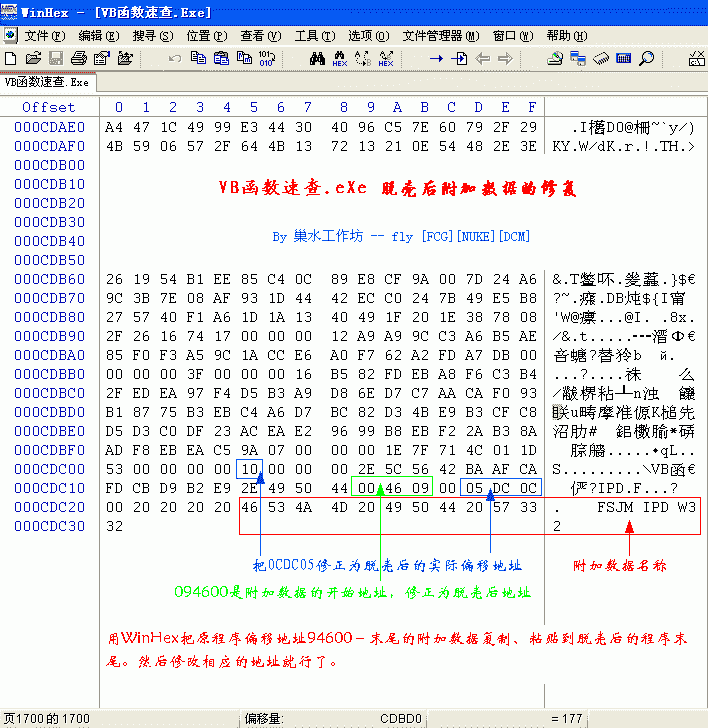

# VB 函数速查.eXe 脱壳后附加数据的修复

> 原文：[`www.pediy.com/kssd/pediy06/pediy6924.htm`](https://www.pediy.com/kssd/pediy06/pediy6924.htm)

ASPack 2.12 -> Alexey Solodovnikov \[Overlay\]，用 AsprStripper 自动脱壳，或者手动脱壳。  
用 WinHex 把原程序偏移地址 94600－末尾的附加数据复制、粘贴到脱壳后的程序末尾。  
  
可以对原程序下断：BP SetFilePointer  
看看读取哪些数据。修复很简单。  
附图解 1 张  
   
  
  

> ```
> 代码:
> 0058EB0C     8B45 F8               mov eax,dword ptr ss:\[ebp\-8\]
> 0058EB0F     BA 4CEC5800           mov edx,VB 函数速.0058EC4C; ASCII "FSJM IPD W32"
> 0058EB14     E8 675DE7FF           call VB 函数速.00404880//比较末尾有无 FSJM IPD W32 字符  ★
> 0058EB19     0F85 E4000000         jnz VB 函数速.0058EC03//没有则弹出需要 IPD 数据的窗口，是“搭建之星”
> 0058EB1F     8B03                  mov eax,dword ptr ds:\[ebx\]
> 0058EB21     8B10                  mov edx,dword ptr ds:\[eax\]
> 0058EB23     FF12                  call dword ptr ds:\[edx\]//取得文件长度=000CDC31
> 0058EB25     52                    push edx
> 0058EB26     50                    push eax
> 0058EB27     8B06                  mov eax,dword ptr ds:\[esi\]
> 0058EB29     99                    cdq
> 0058EB2A     290424                sub dword ptr ss:\[esp\],eax
> //长度－C=000CDC25   "FSJM IPD W32""字符串位置
> 0058EB2D     195424 04             sbb dword ptr ss:\[esp+4\],edx
> 0058EB31     58                    pop eax
> 0058EB32     5A                    pop edx
> 0058EB33     83E8 08               sub eax,8
> 0058EB36     83DA 00               sbb edx,0
> 0058EB39     52                    push edx
> 0058EB3A     50                    push eax
> 0058EB3B     8B03                  mov eax,dword ptr ds:\[ebx\]
> 0058EB3D     E8 A21BE9FF           call VB 函数速.004206E4
> //094600 处，即是附加数据的开始偏移地址 ★
> //把 094600 修改为脱壳后的附加数据的开始偏移地址
> 
> 0058EB42     8D55 F0               lea edx,dword ptr ss:\[ebp\-10\]
> 0058EB45     8B03                  mov eax,dword ptr ds:\[ebx\]
> 0058EB47     B9 04000000           mov ecx,4
> 0058EB4C     E8 9F1DE9FF           call VB 函数速.004208F0
> 0058EB51     8B45 F0               mov eax,dword ptr ss:\[ebp\-10\]
> //\[0012FF58\]=000CDC05  原版偏移 0CDC1D 处的数据 ★
> //把 000CDC05 修正为脱壳后附加数据的相应偏移地址
> 
> 0058EB54     99                    cdq
> 0058EB55     52                    push edx
> 0058EB56     50                    push eax
> 0058EB57     8B03                  mov eax,dword ptr ds:\[ebx\]
> 0058EB59     E8 861BE9FF           call VB 函数速.004206E4
> 0058EB5E     8BD6                  mov edx,esi
> 0058EB60     8B03                  mov eax,dword ptr ds:\[ebx\]
> 0058EB62     B9 04000000           mov ecx,4
> 0058EB67     E8 841DE9FF           call VB 函数速.004208F0
> 0058EB6C     8B06                  mov eax,dword ptr ds:\[esi\]
> 0058EB6E     3B45 F0               cmp eax,dword ptr ss:\[ebp\-10\]
> 0058EB71     74 37                 je short VB 函数速.0058EBAA
> 0058EB73     8D45 F8               lea eax,dword ptr ss:\[ebp\-8\]
> 0058EB76     8B16                  mov edx,dword ptr ds:\[esi\]
> 0058EB78     E8 435FE7FF           call VB 函数速.00404AC0
> 0058EB7D     8B55 F8               mov edx,dword ptr ss:\[ebp\-8\]
> 0058EB80     8B03                  mov eax,dword ptr ds:\[ebx\]
> 0058EB82     8B0E                  mov ecx,dword ptr ds:\[esi\]
> 0058EB84     E8 671DE9FF           call VB 函数速.004208F0
> 0058EB89     8BD6                  mov edx,esi
> 0058EB8B     8B03                  mov eax,dword ptr ds:\[ebx\]
> 0058EB8D     B9 04000000           mov ecx,4
> 0058EB92     E8 591DE9FF           call VB 函数速.004208F0
> 0058EB97     A1 48685900           mov eax,dword ptr ds:\[596848\]
> 0058EB9C     8B00                  mov eax,dword ptr ds:\[eax\]
> 0058EB9E     8B0E                  mov ecx,dword ptr ds:\[esi\]
> 0058EBA0     8B55 F8               mov edx,dword ptr ss:\[ebp\-8\]
> 0058EBA3     8B38                  mov edi,dword ptr ds:\[eax\]
> 0058EBA5     FF57 3C               call dword ptr ds:\[edi+3C\]
> 0058EBA8     EB B4                 jmp short VB 函数速.0058EB5E
> 0058EBAA     8D55 E4               lea edx,dword ptr ss:\[ebp\-1C\]
> 0058EBAD     A1 A8675900           mov eax,dword ptr ds:\[5967A8\]
> 0058EBB2     8B00                  mov eax,dword ptr ds:\[eax\]
> 0058EBB4     E8 DF52F0FF           call VB 函数速.00493E98
> 0058EBB9     8B45 E4               mov eax,dword ptr ss:\[ebp\-1C\]
> 0058EBBC     8D55 E8               lea edx,dword ptr ss:\[ebp\-18\]
> 0058EBBF     E8 08ABE7FF           call VB 函数速.004096CC
> 0058EBC4     8B55 E8               mov edx,dword ptr ss:\[ebp\-18\]
> 0058EBC7     A1 44665900           mov eax,dword ptr ds:\[596644\]
> 0058EBCC     E8 F758E7FF           call VB 函数速.004044C8
> 0058EBD1     8D4D DC               lea ecx,dword ptr ss:\[ebp\-24\]
> 0058EBD4     A1 48685900           mov eax,dword ptr ds:\[596848\]
> 0058EBD9     8B00                  mov eax,dword ptr ds:\[eax\]
> 0058EBDB     33D2                  xor edx,edx
> 0058EBDD     8B18                  mov ebx,dword ptr ds:\[eax\]
> 0058EBDF     FF53 0C               call dword ptr ds:\[ebx+C\]
> 0058EBE2     8B55 DC               mov edx,dword ptr ss:\[ebp\-24\]
> 0058EBE5     8D4D E0               lea ecx,dword ptr ss:\[ebp\-20\]
> 0058EBE8     A1 44665900           mov eax,dword ptr ds:\[596644\]
> 0058EBED     8B00                  mov eax,dword ptr ds:\[eax\]
> 0058EBEF     E8 1026F2FF           call VB 函数速.004B1204
> 0058EBF4     8B55 E0               mov edx,dword ptr ss:\[ebp\-20\]
> 0058EBF7     8B45 FC               mov eax,dword ptr ss:\[ebp\-4\]
> 0058EBFA     E8 C958E7FF           call VB 函数速.004044C8
> 0058EBFF     B3 01                 mov bl,1
> 0058EC01     EB 0D                 jmp short VB 函数速.0058EC10
> 0058EC03     8B03                  mov eax,dword ptr ds:\[ebx\]
> 0058EC05     E8 564AE7FF           call VB 函数速.00403660
> 0058EC0A     33C0                  xor eax,eax
> 0058EC0C     8903                  mov dword ptr ds:\[ebx\],eax
> 0058EC0E     33DB                  xor ebx,ebx
> 0058EC10     33C0                  xor eax,eax
> 0058EC12     5A                    pop edx
> 0058EC13     59                    pop ecx
> 0058EC14     59                    pop ecx
> 0058EC15     64:8910               mov dword ptr fs:\[eax\],edx
> 0058EC18     68 3AEC5800           push VB 函数速.0058EC3A
> 0058EC1D     8D45 DC               lea eax,dword ptr ss:\[ebp\-24\]
> 0058EC20     BA 05000000           mov edx,5
> 0058EC25     E8 6E58E7FF           call VB 函数速.00404498
> 0058EC2A     8D45 F8               lea eax,dword ptr ss:\[ebp\-8\]
> 0058EC2D     E8 4258E7FF           call VB 函数速.00404474
> 0058EC32     C3                    retn
> 
> ```
> 
>   

  
   
   
—————————————————————————————————    

> ```
> 代码:                              
>          ,     \_/ 
>         /| \_.-~/            \\\_     ,        青春都一晌
>        ( /~   /              \\~-.\_ |\\
>        \`\\\\  \_/                \\   ~\\ )          忍把浮名 
>    \_-~~~-.)  )\_\_/;;,.          \\\_  //'
>   /'\_,\\   --~   \\ ~~~-  ,;;\\\_\_\_(  (.-~~~-.        换了破解轻狂
>  \`~ \_( ,\_..--\\ (     ,;'' /    ~--   /.\_\`\\ 
>   /~~//'   /' \`~\\         ) /--..\_, )\_  \`~
>   "  \`~"  "      \`"      /~'\`\\    \`\\\\~~\\   
>                          "     "   "~'  ""
> 
> ```
> 
>   

      
  
     Cracked By 巢水工作坊——fly \[FCG\]\[NUKE\]\[DCM\]  
  
               2004-07-31  15:40  4dd466d0e1e0cc123afbe504da2462ca