# \[for newbabie\] PECompact v2.79 loader 分析.By winndy

> 原文：[`www.pediy.com/kssd/pediy09/pediy09-554.htm`](https://www.pediy.com/kssd/pediy09/pediy09-554.htm)

>  \[for newbabie\] PECompact v2.79 loader 分析.By winndy  
> 1.WHY？  
>    PECompact 是一款压缩壳，要脱很容易，但我的感觉是脱完了，啥感觉都没有，  
> 到达 OEP 之间，沿途的风景都看不到。勿在浮砂筑高台。于是用 IDA 详细分析了一下 loader。  
> 最好自己打开 idb 文件取看看，教材不可能那么详细。  
>    分析到这个样子之后，后来我发现居然有 PECompact 的 loader sdk，于是没兴趣分析下去了。  
> 原本还打算做个静态脱壳机的，有时间了也许再对照 loader sdk，拿来当编程的例子练手。  
>    这个 loader 分析我也没参考其他人的分析，后来在论坛搜了一把，发现 berglob 也有个分析。  
> 我是自己学习才这样分析一遍的。  
>   
> 2. HOW?  
> 2.1    
>   
> 入口处：  
>   
> 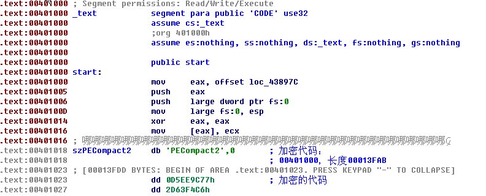  
>   
> SEH handler：0043897C  
>   
> 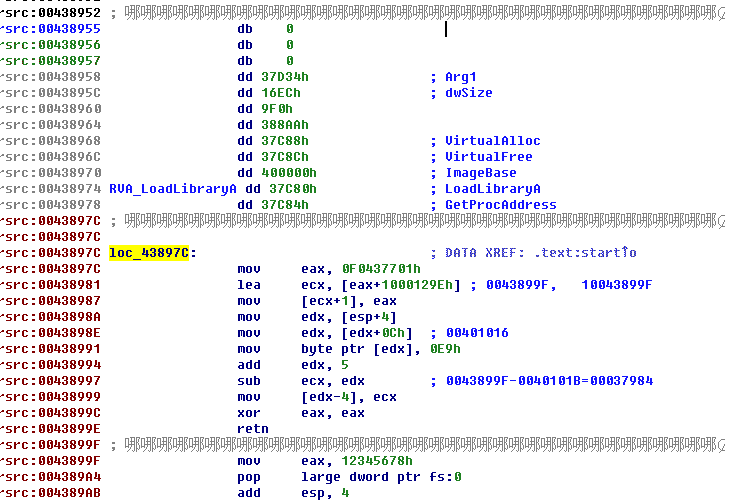  
>   
> 0043897C-0043899E 处的代码将 0043899F 处的代码为   
> Mov    eax，0F0437701h  
> 并将修改 00401016 处的代码为：  
> 00401016  - E9 84790300     jmp     0043899F  
> 将流程转到 0043899F，然后卸载 SHE handler。  
>   
> 然后分配一块内存，并解压 loader 的代码，解压算法为 aplib。分配内存的大小和待解压代码的 RVA 在  
> \_aP\_depack\_asm 和 SEH handler 之间，见注释。  
>   
> 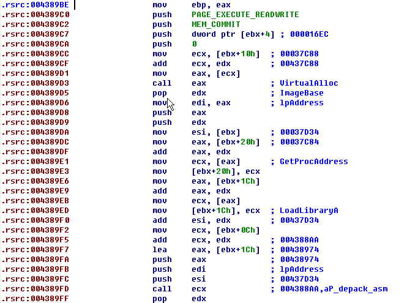  
>   
> aP\_depack\_asm 是根据源码对照识别出来的。  
>   
> Loader 用 aplib 解压出来后，然后去执行(call edi)，将主程序再用 LZMA 算法解压出来，并进行一些修复工作  
> 和填充 IAT 等的工作。最后算出 OEP，返回，用 jmp eax，调到 OEP。  
>   
>   
> 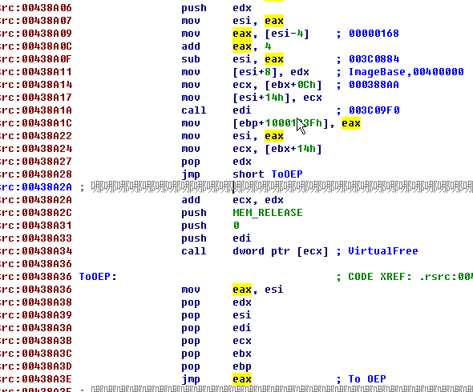  
>   
> 2.2 解压出来的 loader  
>   
> Loader 的代码如下：(call edi ,edi=003C09F0 进入)  
>   
> 003C0000 的代码部分 dump 出来之后，也用 IDA 进行分析，只要将载入偏移量设为 003C0000 进行了。  
>   
> 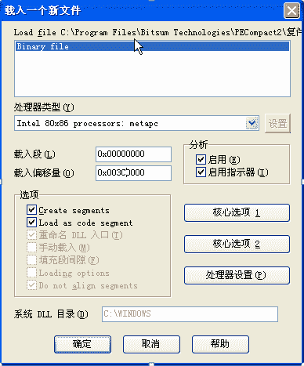  
>   
> loader 的主要代码如下：  
>   
> 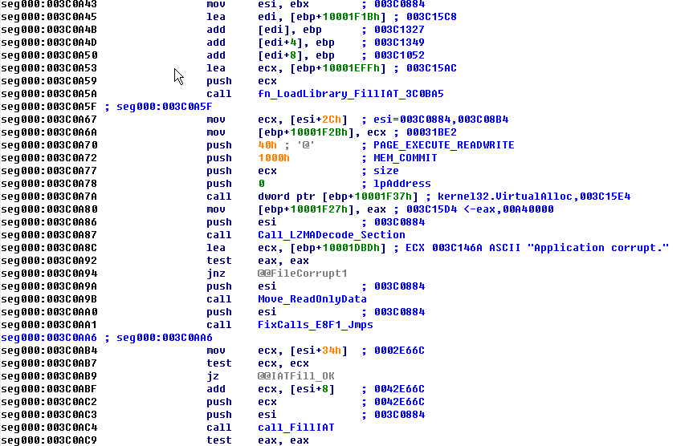  
>   
> 最后对解压出来得区段设置相应的内存属性：  
>   
> 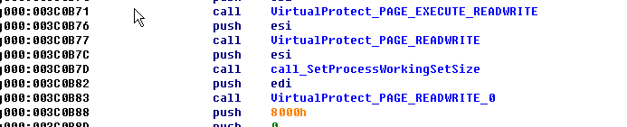  
>   
> 值得注意的是，后来我 PECompact 发现有 loader SDK，那些函数名都是自己定义的，不是很确切。但在 loader SDK 中是没有 aplib 和 LZMA 的解压部分的。  
>   
>   
> 调用 LZMA 解压的代码片段为：  
>   
> 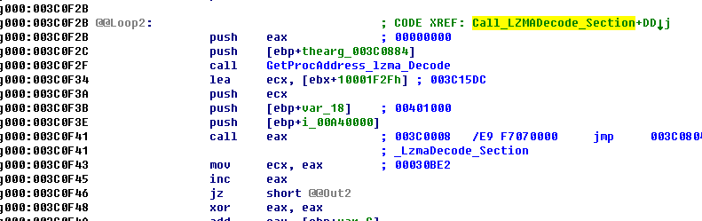  
>   
> 循环取\_LZMADecode\_Section 的地址，保存在 eax 中，然后 call eax 进行调用。  
> 抽出来的\_LZMA\_Decode 的 asm 代码我没能与 c 代码对应起来。  
>   
>   
> 还有比较有意思的一段代码，FixCalls\_E8F1\_Jmps：  
> 扫描 call 32bit，jmp 32bits，因为 call 和 jmp 之后的地址是加密了的，需要解密出来。  
> 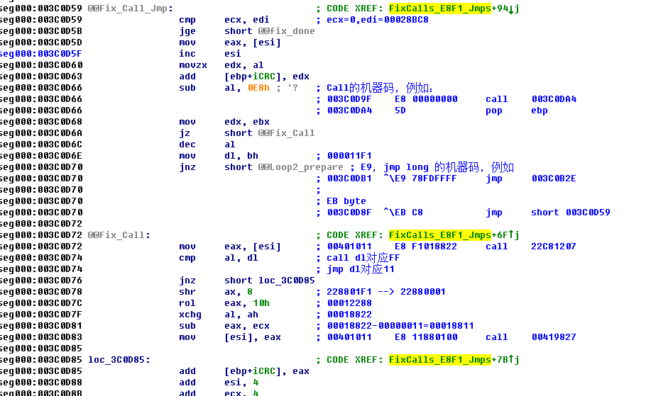  
>   
> 上面的 11F1 常数取自：  
> 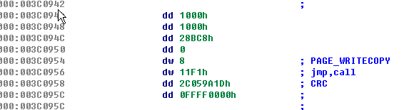  
>   
> 补上 E8F1 的代码片段为：FixCalls\_E8F1  
> 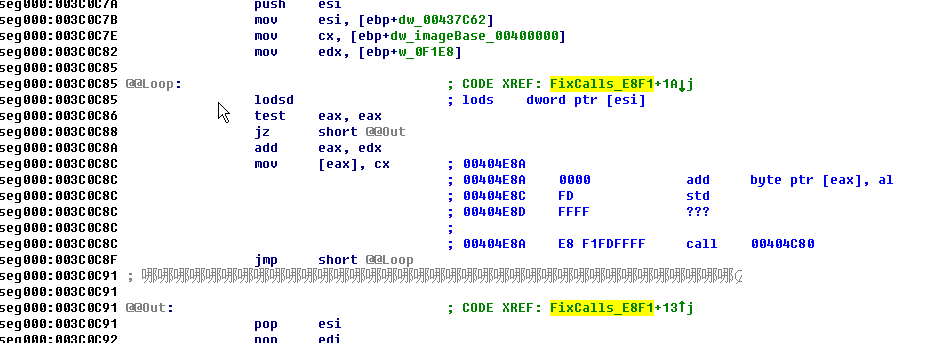  
>   
> 3.Summary  
>   
> 尽管后来找到 loader sdk，但 loader SDK 却没有 aplib 和 lzma 的解压函数，这个 PECompact 是不是在忽悠纳税人啊！  
> 不过这也是第一次这样分析一款压缩壳，收获颇多。  
> 详细的分析大家还是看 idb 去。要写静态脱壳机，还需要仔细对照 sdk 看，还有很多情况要考虑。  
> 高手不要笑啊！  
>   
> IDB 和抽出来的 LZMA\_Decode\_ASM.asm  
>   
> PECompact v2.79 loader 分析.By.winndy.zip

 4dd466d0e1e0cc123afbe504da2462ca