# SDProtector 1.1 保护脱壳

> 原文：`www.pediy.com/kssd/pediy12/sdprotector .html`

 

这是 RCE Message Board 上贴的一个 unpackme,留的 MSN 是 mm@digitalnuke.com,不会是骨灰 mm 吧 J。用 SDProtector 1.10 保护,从壳代码看好象不是注册版,但运行时并没有 Nag screen,也许是破解版本。

我是脱壳新手,这次好歹全程跟完了一回。壳的 anti-debug 比较强,在 OllyDbg 下不能运行,要是先运行再 attach,也会被杀掉。全程跟也是没办法。

    运行几步,就会解出完整的壳代码。用 WinHex 拷出来,贴回程序,用 IDA 编译。写了个 IDC 脚本,去掉大部分花指令。因为程序中充斥大量的自校验,跟的过程中没有改代码,对照着 IDA 跟的。另外,壳中反复检查运行时间,为了能在上一次停下的地方继续,写了 OllyScript 脚本。即使这样,有一处的检测有时候仍然通不过,多试两次就好了。

用的是自己修改过的 OD 110c 来调试。在 W2K 下脱的。

\[实例下载\]点击此处下载。

 

**1.    ****anti-debug**

 

**1) int 3 异常**

 

大部分 int 3 异常都是用来 anti-debug 的。除了清调试寄存器,SHE 中还对代码做个 patch,结束异常处理后检查,以测试是否执行了 SHE。

\[if gte vml 1\]><v:shapetype id="\_x0000\_t75" coordsize="21600,21600" o:spt="75" o:preferrelative="t" path="m@4@5l@4@11@9@11@9@5xe" filled="f" stroked="f"> <v:stroke joinstyle="miter"/> <v:formulas> <v:f eqn="if lineDrawn pixelLineWidth 0"/> <v:f eqn="sum @0 1 0"/> <v:f eqn="sum 0 0 @1"/> <v:f eqn="prod @2 1 2"/> <v:f eqn="prod @3 21600 pixelWidth"/> <v:f eqn="prod @3 21600 pixelHeight"/> <v:f eqn="sum @0 0 1"/> <v:f eqn="prod @6 1 2"/> <v:f eqn="prod @7 21600 pixelWidth"/> <v:f eqn="sum @8 21600 0"/> <v:f eqn="prod @7 21600 pixelHeight"/> <v:f eqn="sum @10 21600 0"/> </v:formulas> <v:path o:extrusionok="f" gradientshapeok="t" o:connecttype="rect"/> <o:lock v:ext="edit" aspectratio="t"/> </v:shapetype><v:shape id="\_x0000\_i1025" type="#\_x0000\_t75" style='width:481.5pt; height:191.25pt'> <v:imagedata src="sdprotector.files/image001.jpg" o:title="1"/> </v:shape><!\[endif\]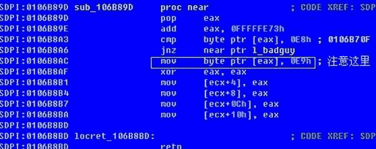

 

检查:

\[if gte vml 1\]><v:shape id="\_x0000\_i1026" type="#\_x0000\_t75" style='width:481.5pt;height:72.75pt'> <v:imagedata src="sdprotector.files/image003.jpg" o:title="1"/> </v:shape><!\[endif\]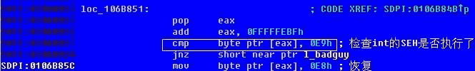

 

有部分 int 3 在 SHE 中恢复异常处理结构,不再返回异常位置:  
\[if gte vml 1\]><v:shape id="\_x0000\_i1027" type="#\_x0000\_t75" style='width:395.25pt; height:99pt'> <v:imagedata src="sdprotector.files/image004.jpg" o:title="1"/> </v:shape><!\[endif\]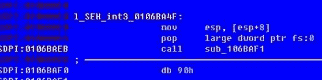

 

**2) int 1 异常**

 

只出现了一次。与 int 3 相似,只用于 anti-debug。

 

\[if gte vml 1\]><v:shape id="\_x0000\_i1028" type="#\_x0000\_t75" style='width:481.5pt;height:78pt'> <v:imagedata src="sdprotector.files/image006.jpg" o:title="1"/> </v:shape><!\[endif\]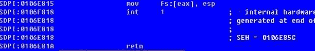

 

 

**3) 单步陷阱**

 

修改 EFLAGS 寄存器,引发异常。

\[if gte vml 1\]><v:shape id="\_x0000\_i1029" type="#\_x0000\_t75" style='width:481.5pt;height:276pt'> <v:imagedata src="sdprotector.files/image008.jpg" o:title="1"/> </v:shape><!\[endif\]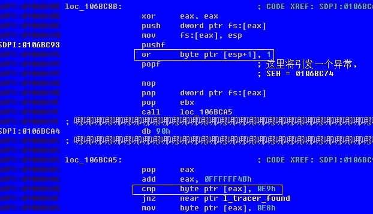

 

在 OD 中如果 F7 单步执行,SHE 不会执行,下面的检查通不过。

 

**4) API 断点检测**

 

\[if gte vml 1\]><v:shape id="\_x0000\_i1030" type="#\_x0000\_t75" style='width:481.5pt;height:114.75pt'> <v:imagedata src="sdprotector.files/image009.jpg" o:title="1"/> </v:shape><!\[endif\]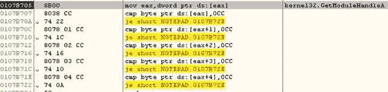

 

 

 

**5) debugger 检测( ****ZwQuerySystemInformation ****)**

 

用 ZwQuerySystemInformation 检测 NTICE.SYS,ICEEXT.SYS。

IsDebuggerPresent 检测 ring 3 调试器。

 

\[if gte vml 1\]><v:shape id="\_x0000\_i1031" type="#\_x0000\_t75" style='width:481.5pt;height:183.75pt'> <v:imagedata src="sdprotector.files/image011.jpg" o:title="1"/> </v:shape><!\[endif\]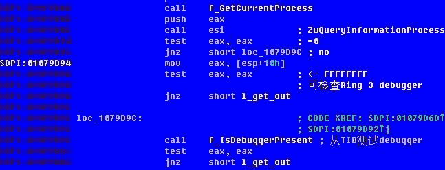

 

 

**6) 从注册表检查是否安装 IceExt**

 

\[if gte vml 1\]><v:shape id="\_x0000\_i1032" type="#\_x0000\_t75" style='width:481.5pt;height:210pt'> <v:imagedata src="sdprotector.files/image012.jpg" o:title="1"/> </v:shape><!\[endif\]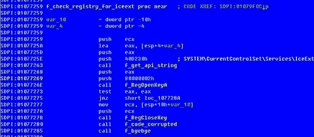

 

 

**7) debugger 检测( CreateToolHelp32Snapshot,ProcessFirst,Process32Next )**

  
黑名单:

\[if gte vml 1\]><v:shape id="\_x0000\_i1033" type="#\_x0000\_t75" style='width:481.5pt;height:205.5pt'> <v:imagedata src="sdprotector.files/image014.jpg" o:title="1"/> </v:shape><!\[endif\]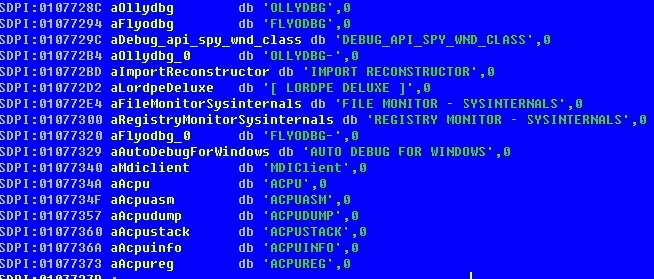

fly 的 OD 也在 J。找到自己退出,用 TerminateProcess 干掉坏人。

 

 

**8) debugger 检测( CreateFile )**

\[if gte vml 1\]><v:shape id="\_x0000\_i1034" type="#\_x0000\_t75" style='width:414pt;height:320.25pt'> <v:imagedata src="sdprotector.files/image015.jpg" o:title="1"/> </v:shape><!\[endif\]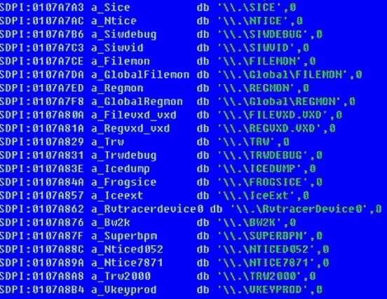

 

 

**9) 执行时间检查**

 

一般在异常处理前后。这样如果以在 OD 中拦截异常的方式切入,通不过检查。有 3 种方式:  
  

两次调用 rdtsc,检查差值。

两次调用 GetTickCount,检查差值。

 

另外还有一种,只用了一次:

\[if gte vml 1\]><v:shape id="\_x0000\_i1035" type="#\_x0000\_t75" style='width:481.5pt;height:312pt'> <v:imagedata src="sdprotector.files/image017.jpg" o:title="1"/> </v:shape><!\[endif\]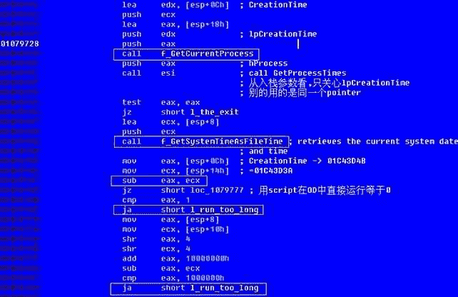

 

 

**10) SMC 反单步跟踪**

\[if gte vml 1\]><v:shape id="\_x0000\_i1036" type="#\_x0000\_t75" style='width:481.5pt;height:66.75pt'> <v:imagedata src="sdprotector.files/image019.jpg" o:title="1"/> </v:shape><!\[endif\]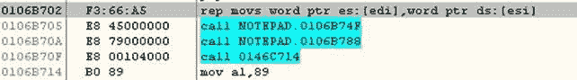

 

执行 rep 指令时 ecx=3,如果在这里 F7,这句 rep 会修改自己(此时 ecx 减 1,即只 mov 了一个字节),变成 jmp 到下面的 0106B705。这个 call 执行就下课了。这一招用了无数次 L。在执行到 rep 以前,直接在第 2 个 call(这里是 106B70A)用 F4。

 

F7 的结果:  
\[if gte vml 1\]><v:shape id="\_x0000\_i1037" type="#\_x0000\_t75" style='width:481.5pt; height:96.75pt'> <v:imagedata src="sdprotector.files/image021.jpg" o:title="1"/> </v:shape><!\[endif\]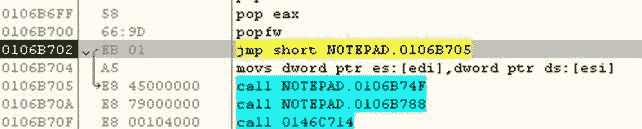

 

这是正确的结果:  
\[if gte vml 1\]><v:shape id="\_x0000\_i1038" type="#\_x0000\_t75" style='width:392.25pt; height:105.75pt'> <v:imagedata src="sdprotector.files/image023.jpg" o:title="1"/> </v:shape><!\[endif\]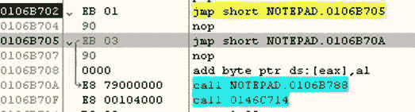

 

 

**11) 多线程 anti-debug**

 

除了主线程,另外运行 2 个专门执行 anti-debug 的线程(线程中会随机引发不同种类的异常),二者相互检查是否一直在运行,以及是否被修改。这也是 attach 失败的原因。

 

\[if gte vml 1\]><v:shape id="\_x0000\_i1039" type="#\_x0000\_t75" style='width:481.5pt;height:54pt'> <v:imagedata src="sdprotector.files/image025.jpg" o:title="1"/> </v:shape><!\[endif\]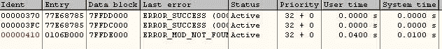

 

 

\[if gte vml 1\]><v:shape id="\_x0000\_i1040" type="#\_x0000\_t75" style='width:481.5pt;height:328.5pt'> <v:imagedata src="sdprotector.files/image026.jpg" o:title="1"/> </v:shape><!\[endif\]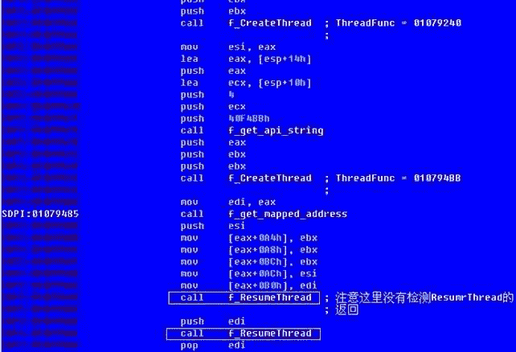

在 OllyScript 脚本中跳过 2 句 ResumeThread,使其处于 suspended 状态。

 

 

**2\. 寻找 OEP**

 

在回到原程序前,在原程序中查找若个 C3(即 ret)一一调用,此时还没有到 OEP。

\[if gte vml 1\]><v:shape id="\_x0000\_i1041" type="#\_x0000\_t75" style='width:481.5pt;height:360.75pt'> <v:imagedata src="sdprotector.files/image028.jpg" o:title="1"/> </v:shape><!\[endif\]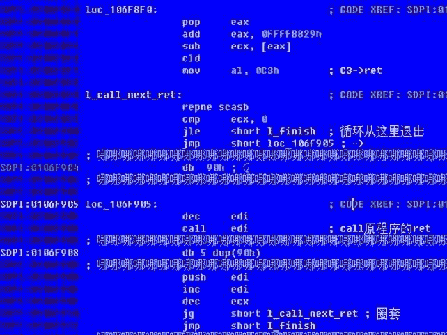

 

跟到最后一个 int 3,结束后就到 OEP 了。

 

\[if gte vml 1\]><v:shape id="\_x0000\_i1042" type="#\_x0000\_t75" style='width:383.25pt;height:92.25pt'> <v:imagedata src="sdprotector.files/image030.jpg" o:title="1"/> </v:shape><!\[endif\]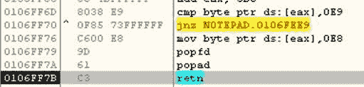

 

此时的 stack:  
\[if gte vml 1\]><v:shape id="\_x0000\_i1043" type="#\_x0000\_t75" style='width:413.25pt; height:342.75pt'> <v:imagedata src="sdprotector.files/image032.jpg" o:title="1"/> </v:shape><!\[endif\]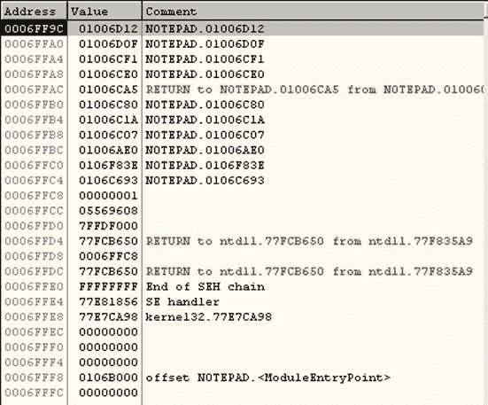

 

前面找的 ret 所在地址,压了几个在栈中。回原程序后连续执行几个 ret 才到 OEP:  
  

\[if gte vml 1\]><v:shape id="\_x0000\_i1044" type="#\_x0000\_t75" style='width:481.5pt;height:184.5pt'> <v:imagedata src="sdprotector.files/image034.jpg" o:title="1"/> </v:shape><!\[endif\]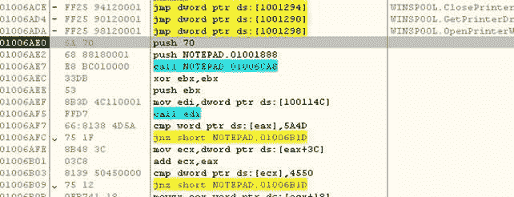

 

对比一下 WinXP 的 Notepad,可以看到这里并没有 stolen code。

 

**3\. anti-dump**

 

壳代码在解出原程序时,把内存属性设为 PAGE\_NOACCESS,使在 OEP 处 dump 失败。修改一下脚本,改属性为 PAGE\_READWRITE|PAGE\_EXECUTE。

\[if gte vml 1\]><v:shape id="\_x0000\_i1045" type="#\_x0000\_t75" style='width:481.5pt;height:304.5pt'> <v:imagedata src="sdprotector.files/image036.jpg" o:title="1"/> </v:shape><!\[endif\]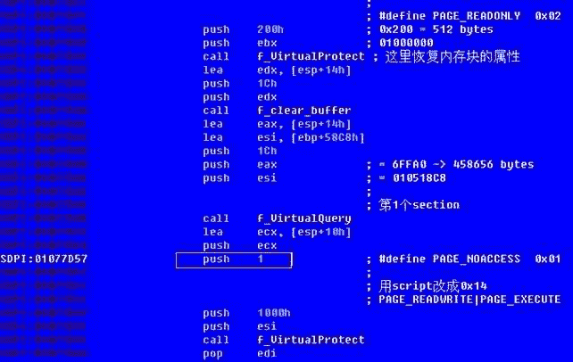

 

 

**4\. 修复 IAT**

 

在这里处理 IAT。

\[if gte vml 1\]><v:shape id="\_x0000\_i1046" type="#\_x0000\_t75" style='width:481.5pt;height:5in'> <v:imagedata src="sdprotector.files/image038.jpg" o:title="1"/> </v:shape><!\[endif\]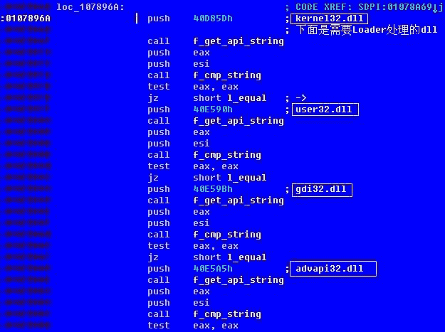

 

这里检查当前处理的 dll 名。如果匹配,会得到特殊照顾。包括 kernel32,user32,gdi32,advadi32,

shell32 以及 sdprotector.dll。在这里手工使 dll 都不满足检测。这里会置标记(Magic JumpJ)。

 

\[if gte vml 1\]><v:shape id="\_x0000\_i1047" type="#\_x0000\_t75" style='width:481.5pt;height:111.75pt'> <v:imagedata src="sdprotector.files/image039.jpg" o:title="1"/> </v:shape><!\[endif\]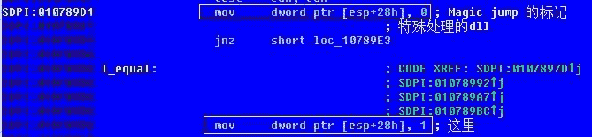

 

sdprotector.dll 还有另一个标记:  
\[if gte vml 1\]><v:shape id="\_x0000\_i1048" type="#\_x0000\_t75" style='width:404.25pt; height:39.75pt'> <v:imagedata src="sdprotector.files/image040.jpg" o:title="1"/> </v:shape><!\[endif\]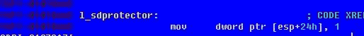

 

前面手工使所有的 dll 都不匹配,到这里 esi->IAT:  
\[if gte vml 1\]><v:shape id="\_x0000\_i1049" type="#\_x0000\_t75" style='width:450pt; height:84.75pt'> <v:imagedata src="sdprotector.files/image041.jpg" o:title="1"/> </v:shape><!\[endif\]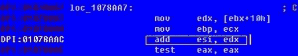

 

这里还有两处检查。当处理的是 user32.dll 时,注意 MessageBoxA 和 MessageBoxW 必须跳走,否则 IAT 被破坏,想必是用 emulated API 替代。

 

\[if gte vml 1\]><v:shape id="\_x0000\_i1050" type="#\_x0000\_t75" style='width:481.5pt;height:349.5pt'> <v:imagedata src="sdprotector.files/image043.jpg" o:title="1"/> </v:shape><!\[endif\]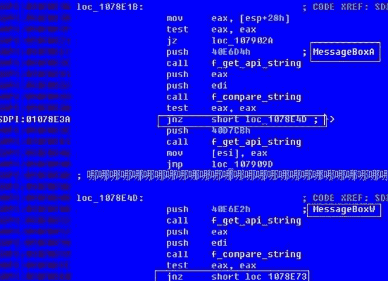

 

 

对于不在列表中的 dll,直接取出 API 地址送到 IAT(这正是我想要的 J):

  
\[if gte vml 1\]><v:shape id="\_x0000\_i1051" type="#\_x0000\_t75" style='width:481.5pt; height:171.75pt'> <v:imagedata src="sdprotector.files/image045.jpg" o:title="1"/> </v:shape><!\[endif\]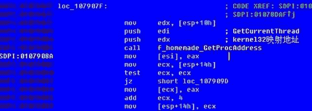

 

这样得到的 IAT 全部有效。

 

\[if gte vml 1\]><v:shape id="\_x0000\_i1052" type="#\_x0000\_t75" style='width:413.25pt;height:393pt'> <v:imagedata src="sdprotector.files/image047.jpg" o:title="1"/> </v:shape><!\[endif\]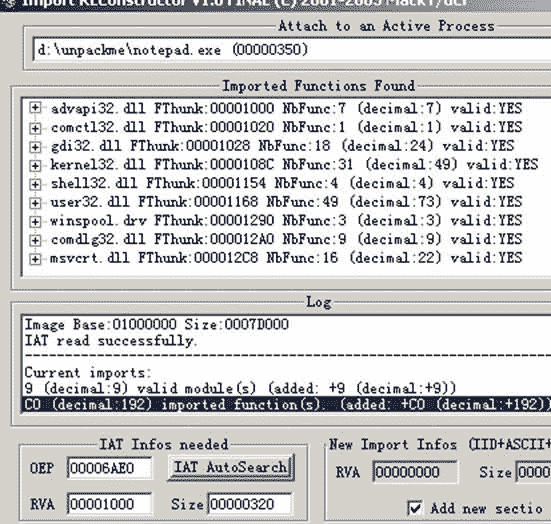

 

 

**5\. 最后,作者的 love letter ****J**

 

\[if gte vml 1\]><v:shape id="\_x0000\_i1053" type="#\_x0000\_t75" style='width:425.25pt;height:20.25pt'> <v:imagedata src="sdprotector.files/image049.jpg" o:title="1"/> </v:shape><!\[endif\]