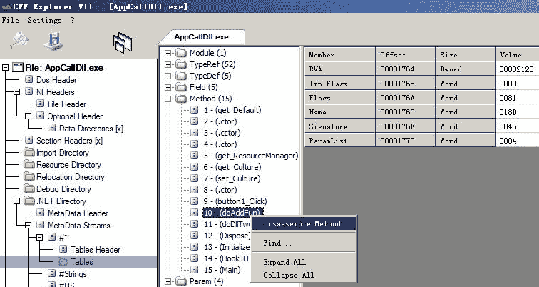
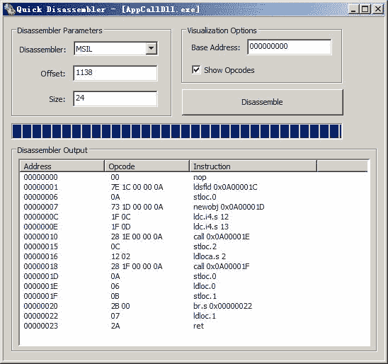
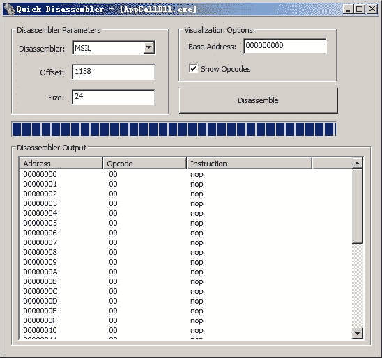

# .Net 程序集基于方法的保护原理(HookJIT 篇)

> 原文：[`www.pediy.com/kssd/pediy11/116218.html`](https://www.pediy.com/kssd/pediy11/116218.html)

**.Net 程序集基于方法的保护原理(HookJIT 篇)**  
  

**作者：RZH     网名：看雪\_grassdrago   2010-7-4**  
**引言**  
  
   &nbspDOTNET 程序集的保护由混淆、整体加密、基于方法保护到参与伪 IL 指令本地化,逐步由纯.NET 领域走向传统 WIN32 加密领域。相应，解密的主体工作也由过去的 IL 代码分析走向了 ASM 代码分析。我们留恋过去的“开源盛世”，但不得不正视现实。基于方法的保护是这一过渡中关键的一环，可见的实例代码太少了，本文将通过手动实践学习它的基本原理  
  
**JIT 及相关内容简介**  
  
      JIT Compiler(Just-in-time Compiler) 即时编译。.net 中当一个方法第一次被调用时，虚拟机会调用 JIT 来编译生成本地代码。也就是说.net 的即时编译是基于每个方法的，它的具体实现由 MSCORJIT.DLL 提供。当方法第一次被调用时，调用方从 MethodTable 中读取指向一个代码块的地址，也就是方法的描述（MethodDesc），然后调用这个块,块接着调用 JIT。当 JIT 完成了编译后,将改变 MethodTable，使其直接指向已经被 JIT 编译过的代码，也就是说无论代码是否被 JIT 编译,对方法的调用都是通过调用 MethodTable 中方法地址来实现的。  
  
    这正是我们要关注的两个地方，MSCORJIT.DLL 中的编译函数 CILJit::compileMethod 以及 PE 格式文件中的 MethodTable。MethodTable 以后再提及，先让我们看看 JIT 的方法调用流程：  
  
1.  MSCORJIT.DLL 只提供了唯一一个导出函数 getJit()，它返回一个虚表指针，而这个虚表的第一项就是 CILJit::compileMethod 函数指针。  
  
2.  CILJit::compileMethod 函数不做任何工作，直接调用了 jitNativeCode 方法。而 jitNativeCode 则会调用 Compiler::compCompile 完成实质工作。  
  
3.  需要注意的是这和 SSCLI 并不完全相同，但上述方法中使用的接口和结构 SSCLI 已经给出:corinfo.h 和 corjit.h，挂勾时需要它们。  
  
     下面我们来看看 getJit()方法在 MSCORJIT.DLL 和 SSCLI 中的实现，因为我们要调用 getJit()得到 CILJit::compileMethod 函数指针，并通过替换它完成我们的挂勾，这是个稳妥的方法，不需要根据不同操作系统和运行时版本去找内存地址，加密程序需要稳定：  
  
**MSCORJIT 中：**  
  
代码:

```
int \*\_\_cdecl getJit()
{
int \*result; // eax@1
result = (int \*)dword\_790B7260;
if ( !dword\_790B7260 )
{
result = &dword\_790B7268;
dword\_790B7268 = (int)&CILJit\_\_\_vftable\_;
dword\_790B7260 = (int)&dword\_790B7268;
}
return result;
}

```

**SSCLI 中：**  
  
代码:

```
extern "C" 
ICorJitCompiler\* \_\_stdcall getJit()
{
    static char FJitBuff\[sizeof(FJitCompiler)\];
    if (ILJitter == 0)
    {
        // no need to check for out of memory, since caller checks for return value of NULL
        ILJitter = new(FJitBuff) FJitCompiler();
        \_ASSERTE(ILJitter != NULL);
    }
    return(ILJitter);
}
class FJitCompiler : public ICorJitCompiler
{
public:

    /\* the jitting function \*/
    CorJitResult \_\_stdcall compileMethod (
            ICorJitInfo\*            comp,               /\* IN \*/
            CORINFO\_METHOD\_INFO\*    info,               /\* IN \*/
            unsigned                flags,              /\* IN \*/
            BYTE \*\*                 nativeEntry,        /\* OUT \*/
            ULONG  \*                nativeSizeOfCode    /\* OUT \*/
            );
    
    /\* notification from VM to clear caches \*/
    void \_\_stdcall clearCache();
    BOOL \_\_stdcall isCacheCleanupRequired();

    static BOOL Init();
    static void Terminate();

private:
    /\* grab and remember the jitInterface helper addresses that we need at runtime \*/
    BOOL GetJitHelpers(ICorJitInfo\* jitInfo);
};

```

       现在我们给出 MSCORJIT.DLL 中将要挂勾的 CILJit::compileMethod 的声明：  
  
代码:

```
int \_\_stdcall CILJit::compileMethod(ULONG\_PTR classthis, ICorJitInfo \*comp,
               CORINFO\_METHOD\_INFO \*info, unsigned flags,         
               BYTE \*\*nativeEntry, ULONG  \*nativeSizeOfCode)

```

  
（这和上面 FjitCompiler:: compileMethod 的声明几乎一样）  
  
在 CILJit::compileMethod 的入参中让我们盯住一个让人眼馋的结构  
CORINFO\_METHOD\_INFO：  
  
**CORINFO\_METHOD\_INFO 结构:**  
  
代码:

```
struct CORINFO\_METHOD\_INFO
{
    CORINFO\_METHOD\_HANDLE       ftn;
    CORINFO\_MODULE\_HANDLE       scope;
    BYTE \*                      ILCode;
    unsigned                    ILCodeSize;
    unsigned short              maxStack;
    unsigned short              EHcount;
    CorInfoOptions              options;
    CORINFO\_SIG\_INFO            args;
    CORINFO\_SIG\_INFO            locals;
};

```

  
  
*ILCode：指向方法的 IL 代码体；       ILCodeSize：方法 IL 代码体的大小（字节为单位）；  
maxStack：方法最大堆栈数；scope:使用另一个入参 IcorJitInfo 中的方法是要用到的 MODULE 句柄。  
Ftn：使用另一个入参 IcorJitInfo 中的方法是要用到的 METHOD 句柄。*  
  
  
    正是这个 CORINFO\_METHOD\_INFO 结构中的 ILCODE，当我们加密时可以将真正的 IL 字节码赋给它交由 JIT 编译本地码，当我们解密时通过它得到正确的 IL 字节码填回 MethodTable。  
  
  
**保护样例的实现及说明**  
  
     首先，我们需要一个 C#的样例程序，我仍用前几篇文章中用过的 APPCALLDLL.exe.它非常简单，只有一个按钮，按钮中调用了两个方法：doAddFun()、doDllTwoFun()；  
代码:

```
MessageBox.Show(doAddFun());
MessageBox.Show(doDllTwoFun());

```

      这两个方法则调用了两个 DLL 中的相应方法。我们的任务是对这两个方法进行保护，并在运行时解密。（样例程序见附件）  
  
  
**一、获得控制权**  
  
     为了方便地启动解码程序，也即 HookDll，加密程序通常会在<Module>中加入静态构造函数.cctor();并在其中调用 HookDll 的某个方法，作为实验和惯例我们采用先期在 Progrom 类和 Main 方法中加入如下代码：  
  
代码:

```
//加入 Program 类
\[DllImport("HookJitPrj.dll", CallingConvention = CallingConvention.Cdecl)\]
 private static extern void HookJIT();
//加入 Main()方法
try{HookJIT();}catch { }//保证有没有 hookdll 都正常运行

```

//注：代码中的 HookJitPrj.dll 和 HookJIT()就是我们将要编写的 hookdll 和启动方法。  
  
当然，这一步你可以通过 Mono.Cecil 或 ildasm/ilasm 来完成。  
  
**二、提取要保护方法的方法体并用乱码填充原方法体**  
  
     现在我们用 CFF Explore 打开我们的样例程序 APPCALLDLL.exe 并提取出上述两个方法的方法体来，然后用 NOP 填充，也即 0。这步工作在程序中可用 Mono.Cecil 求出方法 RVA 和 CodeSize 后通过我们自己的 PE 读写完成。（需要注意的是：别偷赖让 Mono 代为完成写 NOP 操作，因为它会重构 PE，之后很多资源索引都可能变化，我们提取出的代码体就失效了.别外：方法的 CodeSize 属性只有在 Mono.Cecil.0.6.9.0 后才有,之前的只好用 RVA 指出的方法头算一下了），这里我们用 CFF Explore 手动完成：  
  
  
1.  打开 MetaDataStreams->Tables->Method(15)->doAddFun,反键 Disassamble Method.如下图：  
  
  
  
  
2.  记下 Opcode 列的字节码，然后每行都用反键 NOP Instruction 替换。   
  
  
  
3.  同样另一个方法也同样记下后替换，然后保存。现在看看吧：  
  
  
  
  
  
4.  如果用 reflector.exe 察看你会发现方法为空，如果你只替换了一部分，则更有意想不到的结果。  
  
  
**三、HOOKjit 并还原保护的方法体**  
  
**关键代码：**  
  
代码:

```
extern "C" \_\_declspec(dllexport) void HookJIT()
{
  if (bHooked) return;

  LoadLibrary(\_T("mscoree.dll"));

  HMODULE hJitMod = LoadLibrary(\_T("mscorjit.dll"));

  if (!hJitMod)
    return;

  p\_getJit = (ULONG\_PTR \*(\_\_stdcall \*)()) GetProcAddress(hJitMod, "getJit");

  if (p\_getJit)
  {
    JIT \*pJit = (JIT \*) \*((ULONG\_PTR \*) p\_getJit());

    if (pJit)
    {
      DWORD OldProtect;
      VirtualProtect(pJit, sizeof (ULONG\_PTR), PAGE\_READWRITE, &OldProtect);
      compileMethod =  pJit->compileMethod;
      pJit->compileMethod = &my\_compileMethod;
      VirtualProtect(pJit, sizeof (ULONG\_PTR), OldProtect, &OldProtect);
      bHooked = TRUE;
    }
  }
}

```

说明：  
compileMethod =  pJit->compileMethod;//保存虚表指针指向的原函数指针；  
pJit->compileMethod = &my\_compileMethod;//虚表指针指向我的的替换函数；  
  
  
**    我们的代换函数里做了什么？很简单，判断方法名并替换方法体为我们刚才记下来的字节码，然后调用原函数返回：**  
  
代码:

```
int \_\_stdcall my\_compileMethod(ULONG\_PTR classthis, ICorJitInfo \*comp,
                 CORINFO\_METHOD\_INFO \*info, unsigned flags,         
                 BYTE \*\*nativeEntry, ULONG  \*nativeSizeOfCode)
{
   const char \*szMethodName = NULL;
   const char \*szClassName = NULL;
   szMethodName = comp->getMethodName(info->ftn, &szClassName);
    if (strcmp(szMethodName, "doAddFun") == 0)
  {
    info->ILCode=doAddFunCode;
  }
   if (strcmp(szMethodName, "doDllTwoFun") == 0)
  {
    info->ILCode=doDllTwoFunCode;
  }

  // call original method
  
  int nRet = compileMethod(classthis, comp, info, flags, nativeEntry, nativeSizeOfCode);
   return nRet;
}

```

请参见随文档提供的代码及项目文件。  
  
**运行情况**  
  
    现在把编译好的 HookJitPrj.dll 和改造完成的 AppCallDll.exe 放在一起，对了，还那两个没什么用的 dll(方法里要调用，原是上篇文章用来做整体打包实验的)，运行良好。而删除 HookJitPrj.dll 后试试，出错了，如果你在刚才的替换中把最后一个 RET 也即字节码 2A 留下，虽然没了功能，但依然不会有运行错误。  
    现在核心在 HookJitPrj.dll 中了，你可以用 win32 的任何方式加密它。而改造过的 AppCallDll.exe 中已经没有真的方法体了。  
**结语**  
  
     这仅仅是个简单的原理性实验，你可以通过程序的方式实现所有的步骤，并把真正的字节码加密保存在一个新的节区里。通过自定义的结构描述每个方法所使用的加密方式等，甚至在自己的替换函数中多次调用原函数传递虚假值并拦截错误和只有你才知道的时候传递真值，但这一切仍逃不过挂勾，所以 IL 指令的替换和取代是更进一步的保护，因为当它的解码不再依赖 MSJIT 时，我们要分析的一切都会是未知的！  
    下篇文章我们将通过挂勾 jitNativeCode 完成解密？或者用代码实现本文的内容？或者。。。现在唯一能决定的是：谢谢网络上提供技术资料的每位网友！  
  
  
         代码及 PDF:hookjit\_rzh.rar