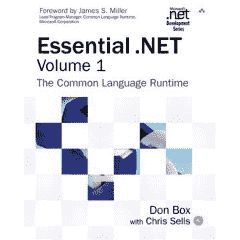
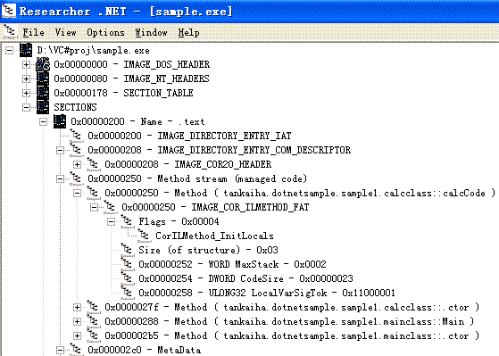
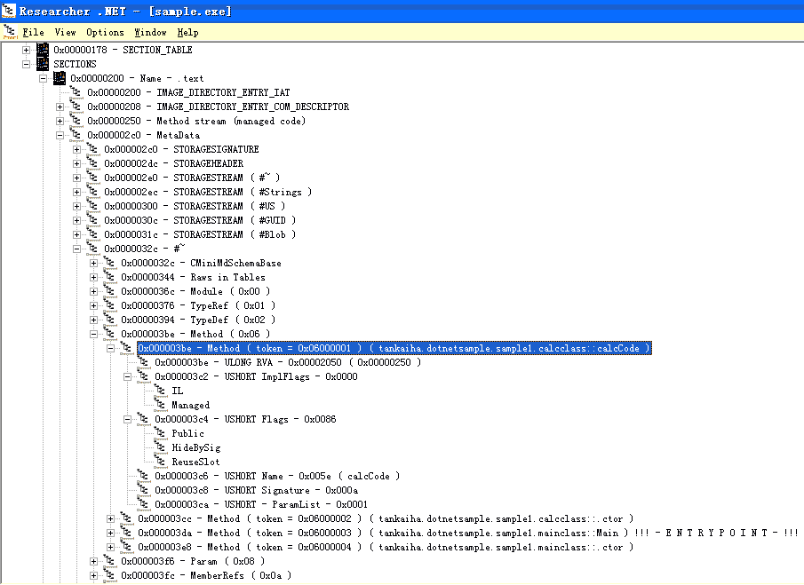
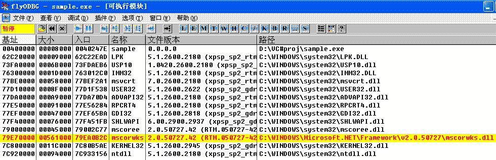
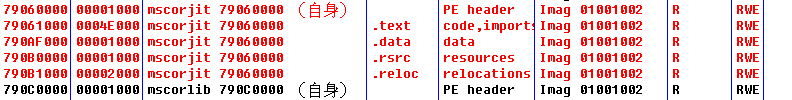
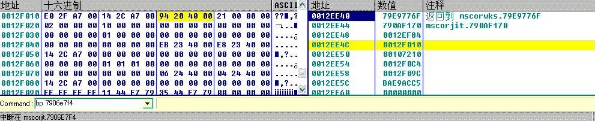
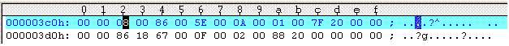
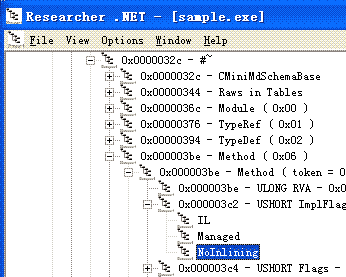
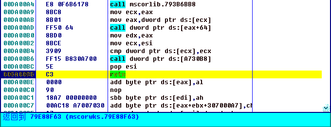

# 从逆向的角度看.NET 的几个基本概念

> 原文：[`www.pediy.com/kssd/pediy08/pediy8-315.htm`](https://www.pediy.com/kssd/pediy08/pediy8-315.htm)

从逆向的角度看几个.NET 的基本概念  
  
    在英文版发了一篇，发现人气实在是低（人数＝喜欢.net 的 ＆ 喜欢用英语看文章的），又想起了 lccracker 说过的，语言的障碍害死人啊，于是决定还是用母语写续篇。考虑到大多数人没看过前篇，因此一并写成中文，并加上新的内容。  
    最近我在看《Essential .NET》，因为在玩了一段时间逆向后，我觉得有必要从大局和根本上了解一下.NET（学习－实践－再学习吗）。这本书虽主要从程序开发的角度上来讲.NET，但对基本概念解释的比较清楚，也让我理清了脑中一些曾经模糊的概念。下文有的是直接引用原文（或翻译），有的则是我的总结。下面开始。  
  
**Assembly**：这个词用中文还不大好翻译，有的地方叫组合件，也算是表达它的意思。它比较容易和 Module 这个词混淆。来看书中怎么说：*An assembly is a logical collection of one or more modules*。这里有个词很关键，就是 logical，说明 assembly 只是一个逻辑上的概念。它由一个或多个 Module 组成，其中只有一个 Module 含有 manifest information。在程序中引用 Assembly 时，不需要加扩展名和路径（因为它不是文件），但调用它的最终结果是在一个文件路径（或网络地址）上找到组成它的 Modules。比如，.NET 系统最基础的 mscorlib 就是一个 Assembly，这里也没加扩展名。现在，你可以往下看 Module 的定义，两个结合起来理解就很容易了。  
  
**Module**：书中对 Module 的解释很到位：*A CLR module is a byte stream, typically stored as a file of the local file system or on Web server. In contrast, module is physical and assembly is logical*。很明显，我们通常说的文件就可以看成 Module，它是物理的概念。这里文件有多种：一是不包含 Manifest Information 的，这种文件没法直接运行，只能被主程序调用；一种是含有 Manifest，但是是 Class Library，由于扩展名通常是 dll，所以你可以把它看作 win32 的下的动态链接库，不同就是 win32 下的 dll 有入口程序 DllMain，但是 Class Library 不含 Entry Point；第三种就是我们用的最多的，含有 Manifest，也定义了入口程序的 exe 文件。（记住，定义了 Manifest 的 module 已经升级成为 assembly 了）下面通过命令行看一下三种文件各是怎么生成的：  
  

> ```
> 代码:
> 
> * * *
> 
> Csc.exe /t:module md.cs
> (创建名叫 md.netmodule 的 Module，当然，它不含 ManifestInfo)
> Csc.exe /t:library /addmodule:md.netmodule lib.cs
> (用一个等式来解释吧：lib.dll+md.netmodule->lib.dll assembly。这时 lib.dll 升级为 assembly)
> Csc.exe /r:lib.dll main.cs
> (创建 main.exe，它是个 assembly。它引用了（reference） lib.dll assembly，后者包含两个 Module: md and lib.)
> 
> * * *
> 
> 
> ```
> 
>     

  
  
  
**Type**：Type（类型）是.NET 程序最基本的构成元素，要不也不会有 CTS（Common Type Sytem）这个说法。最常用的 Type 就是 Class（类），然后是 struct 和 enum（结构和枚举）。Type 的成员最基本的有三类：field、method 和 nested type（就是类型中定义的类型）。还有两个常见的是 property 和 event，但这两个成员只是特殊的方法，比如 property 是实现了 get 和 set 的方法。看了这些，你应该会对.NET PE 结构中 Metadata 数据的那几十个表，每个表是干啥的有个大体了解了，至少对我是这样。  
  
**Interface**：这个中文应该叫作接口。我在看 Profiler 和 Debugger 的源代码时，里面出现了很多接口，.NET 与 COM 的互操作也离不开接口。我非常想知道接口到底是什么，这本书给出的答案简单明了：*In the CLR, those categories of types are referred to as interfaces. Interfaces are always implicitly “abstract”*。可以这样理解，接口就是一类 Type，被归为该类的 Type 都具有一些功能。看一下代码片段，帮助我们理解：  
  

> ```
> 代码:
> 
> * * *
> 
> public interface IEnglishWriter {}
> public class    Person {}
> 
> public class ChineseWriter1 : Person, IEnglishWriter {}
> public class ChineseWriter2 : Person {}
> class PediyForumEnglishColumn
> {
>    void ReadPost(Person person) {}
>    void PostNew (IEnglishWriter eperson) {}
> } 
> 
> * * *
> 
> 
> ```
> 
>     

  
  
接口是 IEnglishWriter，代表可以写英文贴子的人，然后 ChineseWriter1 是既懂中文又懂英文的版友，ChineseWriter2 就是只懂中文不懂英文的版友。看雪的英文版块(PediyForumEnglishColumn)里，只要是注册会员都可以看贴，相应代码是 ReadPost(Person person)，但由于英文版块只能发英文贴，代码是 PostNew(IEnglishWriter eperson)，所以 ChineseWriter1 可以发贴，而 ChineseWriter2 就没办法发贴了。  
这里定义时用的“ : IEnglishWriter ”不叫“继承”，而叫兼容（compatible）。只要你兼容了某些接口，你就有了它的功能。  
  
**hidebysig**：这个词在 ILDASM 的反编译代码中经常出现的某些方法的前面，虽然和破解关系不大，但是理解它没什么坏处。假设基类和继承类中都有一个方法叫 name1，但参数不同。如果定义了 hidebysig，你就两个 name1 都可以调用，因为它的的 signature 是不同的。但如果定义了 hidebyname，完全按名字来区分的话，基类的 name1 方法就被“屏蔽”了。  
  
**Reflection**：这个中文叫反射，其实说白了就是对 Metadata 进行的操作。因为它能对元数据直接操作，所以相对来说它是比较低层的，也是比较有意思的。书中对它的描述在我看来比较详细。由于这是个大题目（大家可以参考 rick 在脱壳版里对某壳进行分析的代码），这里不多说了，网上资料很多。就提一下，在 C#等托管代码中进行编程时可调用 System.Reflection 中的方法，在 C++等 win32 平台下直接编程时，可调用 IMetaData\*的一系列接口进行操作，效果一样。而这种操作分为两大类，取得数据和生成数据。  
  
**Property 和 Event**：没啥多讲的，不难，略过。嘿嘿！  
  
  
**CustomAttribute**：自定义属性。这玩意是.NET 比传统的编程语言先进之处的典型表现之一。说白了自定义属性就是给 Type（或 Method 等）添加额外的 Metadata，运行的时候可以动态的得到这些属性的值。自定义属性是存储在 PE 文件的 BLOB 中的。有两种自定义属性，一种是系统预定义的，一种完全是编程者自己定义的。剩下的和破解关系不大，不再赘述。  
  
  
**Equivalent and identical**：（暂且翻译为“相等”和“相同”）这是.NET 中相等比较的两种方法，可能和破解有点关，因为很多程序将注册信息编为一个类，而不再是简单的字符串或数字。Equivalent 指的是数值相等，两个类，只要其中的各项 field 的数值相等就是 equivalent。但两个类永远不可能相同，这很简单，因为它们是两个类。更简单的理解方法，win32 下的指针，两个不同的类指针肯定不一样，这就是不相同。  
  
  
**Method**：（方法）这算是最重要的一个概念了，但我还没看完，简单说一点。注册码比较肯定是在某个方法中执行的，如果作者安全意识差点或者没用混淆程序，说不定方法的名称反编译出来还包含一些敏感字符串，比如 register 和 activate 等。.NET 是在第一次要调用一个方法时，开始即时编译的(JIT)。如果一个类中定义了方法的话，该类的结构中会含有一个方法指针，在 JIT 前，指针指向 mscorwks.dll 中，在编译后指针就指向 asm 代码了。这里没法贴图，建议大家去 CSDN 看一下这篇文章，就会对 JIT 的工作原理有个简单的了解。《深入理解.NET 的 JIT 编译方式》  
  
今天到这，下次继续，有错拍砖。  
  
忘了，最后把我看的书的封面贴下，有兴趣阅读者可与我交流。  


从逆向的角度看.NET 的几个基本概念（续）——.NET 中的 Method  
    上篇讲了很多概念，但没有针对任何一个进行深入。这次我们来讲讲最有趣的 Method，它在.NET 中的作用相当于 win32 下的 function。Method 之所以有趣正是因为它和 JIT 引擎及其它.NET 内核的关系最为密切：JIT 得到 Method 的 IL 代码并把它编译成本机代码，如果在编译过程中遇到调用新的类，JIT 可能转到新类的编译中，内核要根据 Method 定义的属性决定代码是否能够调用一个 Method（当然，这个工作大多数在静态编译阶段完成），.NET 中的 inline 是怎样实现的。最关键的是，我们要寻找的敏感代码，肯定隐藏在某个（或数个）Method 中。  
    我们会从一个简单例子着手，通过动态调试的方法走进.NET 的内核。

附件下载

例子代码如下：  
using System;  
  
namespace tankaiha.dotnetsample.sample1  
{  
    public sealed class calcclass  
    {  
        public void calcCode(string strCode)  
        {  
            if(strCode=="tankaiha")  
            {  
                Console.WriteLine("You got it");  
            }  
            else  
            {  
                Console.WriteLine("You are wrong!");  
            }  
            return;  
        }  
    }  
  
    class mainclass  
    {  
        static void Main()  
        {  
            Console.WriteLine("Please enter you code:");  
            calcclass cs\=new calcclass();  
            cs.calcCode(Console.ReadLine());  
            return;  
        }  
    }  
}  
  
    代码有两个类，mainclass 类中只包含了 Main()这个入口方法，并从命令行读入用户的输入。另一个类 calcclass 中只有一个方法 calcCode()，用来计算用户的输入是否等于 tankaiha，然后分别输出信息。  
    先来看看 PE 文件的 Metadata，特别是 calcCode 方法。.NET PE 头中，紧接着 IMAGE\_COR20\_HEADER 的就是 Method Stream，程序中的方法及其 IL 代码全部在这里。共有四个方法，除了我们写的 main 和 calcCode 外，还有系统自已加上的默认.ctor 初始化方法。  
   
    这里并没有定义 Method 的属性，只是 Method Body 和 Method Head。还记得过去讲过的 Method Head 分 Tiny 和 Fat，这里显示 calcCode()方法为 IMAGE\_COR\_ILMETHOD\_FAT，说明它是个 Fat 方法。  
    对于 Method 的定义，则是存储在 Metadata 的 MethodDef 表中。如下：  
  
  
      
  
    这里有两项很有意思，一是 ImplFlags，另一个是 Flags。  
    Flags 分为三大类，一类是控制放问的 Access，比如你在程序中定义的 public、private 等。图中的 ReuseSlot 是牵涉到类在继承时方法的调用属性。第二类是控制 InterOp 的，第三类是额外属性。  
    ImplFlags 则分为两大类，一类是 InterOp 相关的，在我们的例子中不存在。另一类描述代码属性的，比如：  
IL  0x0000  Method impl is CIL.  
Native  0x0001  Method impl is native.  
Managed  0x0000  Method impl is managed.  
NoInlining  0x0008  Method may not be inlined.  
NoInlining  0x0008  Method may not be inlined.  
    从图中看出我们代码属性很简单，就是 IL 托管代码。刚才表中最后一项 NoInling 说明该方法不可以被内联，本例中并没有这个属性。后面会看到它的作用。  
  
    看一下 Main 方法的 IL 代码，看一下 C#编译到 IL 的大体情况。Main 方法的代码如下：  
.method private hidebysig static void  Main() cil managed  
{  
  .entrypoint  
  // Code size       33 (0x21)  
  .maxstack  2  
  .locals init (class tankaiha.dotnetsample.sample1.calcclass V\_0)  
  IL\_0000:  nop  
  IL\_0001:  ldstr      "Please enter you code:"  
  IL\_0006:  call       void \[mscorlib\]System.Console::WriteLine(string)  
  IL\_000b:  nop  
  IL\_000c:  newobj     instance void tankaiha.dotnetsample.sample1.calcclass::.ctor()  
  IL\_0011:  stloc.0  
  IL\_0012:  ldloc.0  
  IL\_0013:  call       string \[mscorlib\]System.Console::ReadLine()  
  IL\_0018:  callvirt   instance void tankaiha.dotnetsample.sample1.calcclass::calcCode(string)  
  IL\_001d:  nop  
  IL\_001e:  br.s       IL\_0020  
  IL\_0020:  ret  
} // end of method mainclass::Main  
  
     代码流程非常清楚，其中编译器为我们加上了一个局部变量用来保存对 calcclass 实例化的值，通过 stloc.0 和 ldloc.0。  
.locals init (class tankaiha.dotnetsample.sample1.calcclass V\_0)  
而且代码中存在两种调用方式 call 和 callvirt。在本地代码中我们会看到它实现方法的不同。  
  
     下面开始动态调试，这里我们用 OllyDbg，这样可以直接跟踪 JIT 生成的本机代码。由于 OD 不能直接中断在.NET 程序的入口处，所以在我们第一次运行时是无法中断的。这没事，我们可以在 IL 代码被第一次读取时中断。因此，先设置程序在载入新的模块时中断，当 mscorwks 被载入后，我们中断在它的 79E9776D 处。  
  
  
此处的代码如下  
.text:79E9776D  call    dword ptr \[ecx\] ; call mscorjit.dll compMethods  
这是调用 mscorjit.dll 并对 Method 进行编译。为什么？这是我跟出来的。当然，这个地址在各个机器上可能不同，这没事，你只要在 mscorwks 的反汇编中找到这个函数就可以了  
enum  CorJitResult \_\_stdcall invokeCompileMethodHelper(……)  
这时再看模块，mscorjit.dll 已经载入了。（不知为什么，OD 没法在它加载时中断，只好用这个麻烦一点的方法了）  
   
    mscorjit.dll 载入后，便可以中断在它的 private: virtual enum  CorJitResult \_\_stdcall CILJit::compileMethod 处，在我机器上的地址是：bp 7906e7f4。  
    F9 运行后，程序中断。在 xenocode 的文章中我讲过了这时椎栈里的参数，我们要根据这个参数来看看是哪个方法被 JIT 了。  
第一次的椎栈如下:  
  
    其中被编译的 IL 代码的偏移在 00402094 处，这是 mainclass::main 方法。（为什么？自已想想）我们就是要看它的本地代码。F8 步进，直到程序执行完一个 call。  
7906E82C  |.  E8 10000000     call mscorjit.7906E841  
7906E831  |.  85C0            test eax,eax  
7906E833  |.  75 08           jnz short mscorjit.7906E83D  
7906E835  |.  8B4D 18         mov ecx,dword ptr ss:\[ebp+18\]  
7906E838  |.  8B55 FC         mov edx,dword ptr ss:\[ebp\-4\]  
7906E83B  |.  8911            mov dword ptr ds:\[ecx\],edx  
7906E83D  |>  C9              leave  
7906E83E  \\.  C2 1800         retn 18  
  
此时，edx 中存储的就是本地代码，在 00DA0070 处。我们中断：bp edx，再次 F9 运行。这时程序果然中断在 00DA0070 处了。完整代码如下：  
00DA0070    56                push esi  
00DA0071    833D 84103B02 00  cmp dword ptr ds:\[23B1084\],0  
00DA0078    75 0A             jnz short 00DA0084  
00DA007A    B9 01000000       mov ecx,1  
00DA007F    E8 88D75A78       call mscorlib.7934D80C  
00DA0084    8B0D 84103B02     mov ecx,dword ptr ds:\[23B1084\]  
00DA008A    8B15 3C303B02     mov edx,dword ptr ds:\[23B303C\]  
00DA0090    8B01              mov eax,dword ptr ds:\[ecx\]  
00DA0092    FF90 D8000000     call dword ptr ds:\[eax+D8\]  
00DA0098    B9 8030A700       mov ecx,0A73080  
00DA009D    E8 7A1FCCFF       call 00A6201C  
00DA00A2    8BF0              mov esi,eax  
00DA00A4    E8 0F6B6178       call mscorlib.793B6BB8  
00DA00A9    8BC8              mov ecx,eax  
00DA00AB    8B01              mov eax,dword ptr ds:\[ecx\]  
00DA00AD    FF50 64           call dword ptr ds:\[eax+64\]  
00DA00B0    8B15 40303B02     mov edx,dword ptr ds:\[23B3040\]  
00DA00B6    8BC8              mov ecx,eax  
00DA00B8    E8 33B85A78       call mscorlib.7934B8F0  
00DA00BD    25 FF000000       and eax,0FF  
00DA00C2    0F94C0            sete al  
00DA00C5    0FB6C0            movzx eax,al  
00DA00C8    85C0              test eax,eax  
00DA00CA    75 27             jnz short 00DA00F3  
00DA00CC    833D 84103B02 00  cmp dword ptr ds:\[23B1084\],0  
00DA00D3    75 0A             jnz short 00DA00DF  
00DA00D5    B9 01000000       mov ecx,1  
00DA00DA    E8 2DD75A78       call mscorlib.7934D80C  
00DA00DF    8B0D 84103B02     mov ecx,dword ptr ds:\[23B1084\]  
00DA00E5    8B15 44303B02     mov edx,dword ptr ds:\[23B3044\]  
00DA00EB    8B01              mov eax,dword ptr ds:\[ecx\]  
00DA00ED    FF90 D8000000     call dword ptr ds:\[eax+D8\]  
00DA00F3    5E                pop esi  
00DA00F4    C3                retn  
    当程序执行到 00DA0092 时，我们看 edx 指向什么？  
013B1A04  E0 A3 0F 79 17 00 00 00 16 00 00 00 50 00 6C 00  啵 y ... ...P.l.  
013B1A14  65 00 61 00 73 00 65 00 20 00 65 00 6E 00 74 00  e.a.s.e. .e.n.t.  
013B1A24  65 00 72 00 20 00 79 00 6F 00 75 00 20 00 63 00  e.r. .y.o.u. .c.  
013B1A34  6F 00 64 00 65 00 3A 00 00 00 00 00              o.d.e.:.....  
    这正是我们在 Main 方法中输入的”Please enter your code”的 Unicode 形式。看来这个 call 就是调用 mscorlib.WriteLine 方法。再往下走，怪了，在 00DA00AD 处调用 ReadLine 后，程序没有像我们设计的那样，跳转到 calcclass 的 calcCode 方法中，而是直接在 00DA00B8 处进行比较了。为什么呢？还记得前面提到的 inline 的问题吗？calcCode 函数被自动内联了。  
    来看一下 C＃里对 inline 的描述（摘自 Professional C#）：A method or property whose implementation simply calls another method or returns a field will almost certainly be inlined. 也就是说 CLR 在动态编译时自己决定哪些函数应该被内联，而没有 inline 类似的关键词来定义。  
下面再做个试验，手动将 calcCode 的 ImpleFlag 加上 NoInline。将 0x3C2 处的 0 改为 8，  
  
   
  
    再次打开 sample.exe，发现头文件已经改变了，calcCode 已有了 NoInline 的属性。  
  
  
      
    下面同样用 OD 进行调试，看 JIT 后的代码发生了哪些改变。按前文所说的方法中断下来以后，这次本地代码的地址仍然是 00DA0070。中断后，我们来到 Main 方法的本地代码处：  
00DA0070    56                push esi  
00DA0071    833D 84103B02 00  cmp dword ptr ds:\[23B1084\],0  
00DA0078    75 0A             jnz short 00DA0084  
00DA007A    B9 01000000       mov ecx,1  
00DA007F    E8 88D75A78       call mscorlib.7934D80C  
00DA0084    8B0D 84103B02     mov ecx,dword ptr ds:\[23B1084\]  
00DA008A    8B15 3C303B02     mov edx,dword ptr ds:\[23B303C\]  
00DA0090    8B01              mov eax,dword ptr ds:\[ecx\]  
00DA0092    FF90 D8000000     call dword ptr ds:\[eax+D8\]  
00DA0098    B9 8030A700       mov ecx,0A73080  
00DA009D    E8 7A1FCCFF       call 00A6201C  
00DA00A2    8BF0              mov esi,eax  
00DA00A4    E8 0F6B6178       call mscorlib.793B6BB8  
00DA00A9    8BC8              mov ecx,eax  
00DA00AB    8B01              mov eax,dword ptr ds:\[ecx\]  
00DA00AD    FF50 64           call dword ptr ds:\[eax+64\]  
**00DA00B0    8BD0              mov edx,eax  
00DA00B2    8BCE              mov ecx,esi  
00DA00B4    3909              cmp dword ptr ds:\[ecx\],ecx  
00DA00B6    FF15 B830A700     call dword ptr ds:\[A730B8\]**  
00DA00BC    5E                pop esi  
00DA00BD    C3                retn  
    光从数量上看，这次的代码只有 21 行，比上次少了十来行。我们的重点放在粗体的最后四行上面。  
mov edx,eax：把输入的字符串地址传给 edx  
mov ecx,esi：还记得我们的 MSIL 代码中调用 calcCode()方法是 callvirt 吗？对于 virt 方法的调用，CLR 要求将调用对象的 Refrence 传给 ecx。这里也看出，JIT 产生的代码是\_\_fastcall 形式，如果参数较多，可能 edx,ecx,甚至 eax 都会被用来传递参数。  
call dword ptr ds:\[A730B8\]：调用 calcCode()方法。  
    看一下第二句，mov ecx,esi，也就是说上面有一句是将 calcClass 初始化后，将它的 refrence 一直保存在 esi 中。就是这三句：  
00DA0098    B9 8030A700       mov ecx,0A73080  
00DA009D    E8 7A1FCCFF       call 00A6201C  
00DA00A2    8BF0              mov esi,eax  
    很明显，calcClass 的 refrence 保存在 00A73080 处，而相对这个地址的 0x38 处就是 calcCode()方法的地址（00A730B8-00A73080=0x38）。那么下面是最有趣的部分，我们看一下在系统对 calcClass 进行初始化前和初始化后，refrence 中的内容都有哪些改变。实际上，00A73080 处为一个 CORINFO\_CLASS\_STRUCT 结构，只是这个结构的具体参数微软未公开。在 IA－32 的机器上，这个结构有个 40 字节长的头部，紧跟着是各个方法的地址。（类的继承中，方法的各种属性就体现在这个地址表 VTable 中，这里不多说，有兴趣的自已查看相关文献。）  
    初始化前，内容为：  
00A73080  00 00 04 00 0C 00 00 00 02 04 06 00 04 00 00 00  .. .....   . ...  
00A73090  18 9C 0F 79 14 2C A7 00 C0 30 A7 00 58 13 A7 00   ?y ,???X ?  
00A730A0  00 00 00 00 00 00 00 00 EC 4B 35 79 C0 39 35 79  ........霮 5y?5y  
00A730B0  B0 39 35 79 C0 A4 34 79 C8 30 A7 00 D4 30 A7 00  ?5y 坤 4y????  
00A730C0  80 00 00 00 00 00 00 00 B8 70 30 A7 00 89 ED E9  €.......竝 0?夗  
00A730D0  38 EE 91 FF B8 78 30 A7 00 89 ED E9 2C EE 91 FF  8 顟�竫 0?夗?顟�  
00A730E0  00 00 00 00 00 00 00 00 00 00 00 00 00 00 00 00  ................  
    红体的部分就是\[00A730B8\]，也就是下面将调用的 calcCode 的地址，这时的值是 00A730C8，有意思，这个地址就指向本结构内。  
00A730C8    B8 70 30 A7 00 89 ED E9  
    这其实是一段反汇编代码，我们看一下它的 asm 指令。  
**00A730C8    B8 7030A700     mov eax,0A73070  
00A730CD    89ED            mov ebp,ebp  
00A730CF  - E9 38EE91FF     jmp 00391F0C**  
00A730D4    B8 7830A700     mov eax,0A73078  
00A730D9    89ED            mov ebp,ebp  
00A730DB  - E9 2CEE91FF     jmp 00391F0C  
    就是一个跳转。跳转到 00391F0C 处的内容是：  
00391F0C    50              push eax  
00391F0D    52              push edx  
00391F0E    68 A01BE779     push 79E71BA0  
00391F13    55              push ebp  
00391F14    53              push ebx  
00391F15    56              push esi  
00391F16    57              push edi  
00391F17    8D7424 10       lea esi,dword ptr ss:\[esp+10\]  
00391F1B    FF76 0C         push dword ptr ds:\[esi+C\]  
00391F1E    55              push ebp  
00391F1F    89E5            mov ebp,esp  
00391F21    51              push ecx  
00391F22    52              push edx  
00391F23    64:8B1D 380E000>mov ebx,dword ptr fs:\[E38\]  
00391F2A    8B7B 0C         mov edi,dword ptr ds:\[ebx+C\]  
00391F2D    897E 04         mov dword ptr ds:\[esi+4\],edi  
00391F30    8973 0C         mov dword ptr ds:\[ebx+C\],esi  
00391F33    68 7CC52A05     push 52AC57C  
00391F38    56              push esi  
**00391F39    E8 8C9BAE79     call mscorwks.79E7BACA**  
00391F3E    897B 0C         mov dword ptr ds:\[ebx+C\],edi  
00391F41    8B4E 08         mov ecx,dword ptr ds:\[esi+8\]  
00391F44    8946 08         mov dword ptr ds:\[esi+8\],eax  
00391F47    8BC1            mov eax,ecx  
00391F49    83C4 04         add esp,4  
00391F4C    5A              pop edx  
00391F4D    59              pop ecx  
00391F4E    89EC            mov esp,ebp  
00391F50    5D              pop ebp  
00391F51    83C4 04         add esp,4  
00391F54    5F              pop edi  
00391F55    5E              pop esi  
00391F56    5B              pop ebx  
00391F57    5D              pop ebp  
00391F58    83C4 08         add esp,8  
00391F5B    C3              retn  
    好，下面我们让代码对 calcClass 进行初始化，再看 refrence 处的内容（执行到最后的 retn 处停住）：  
00A73080  00 00 04 00 0C 00 00 00 02 04 06 00 04 00 00 00  .. .....   . ...  
00A73090  18 9C 0F 79 14 2C A7 00 C0 30 A7 00 58 13 A7 00   ?y ,???X ?  
00A730A0  00 00 00 00 00 00 00 00 EC 4B 35 79 C0 39 35 79  ........霮 5y?5y  
00A730B0  B0 39 35 79 C0 A4 34 79 D0 00 DA 00 D4 30 A7 00  ?5y 坤 4y????  
00A730C0  80 00 00 00 00 00 00 00 B8 70 30 A7 00 89 ED E9  €.......竝 0?夗  
00A730D0  38 EE 91 FF B8 78 30 A7 00 89 ED E9 2C EE 91 FF  8 顟�竫 0?夗?顟�  
00A730E0  00 00 00 00 00 00 00 00 00 00 00 00 00 00 00 00  ................  
    
  
    注意，00A730B8 处的内容已经改变，这正是 calcCode 的本地代码地址。  
    把整个过程小结一下。在第一次调用还没有进行 JIT 的方法时，VTable 的地址总是指向一个 prework，它会调用 mscorwks，继而是 JIT 引擎，对该方法进行编译。编译完后的地址代码地址被直接写入方法表中，这样下次再调用该方法就是直接跳转到该地址，而不用再次进行编译。CLR 中的方法调用大多数是\_\_fastcall 形式，利用寄存器来传递参数。而内联，在.NET 中由 JIT 引擎在动态编译时自行决定的。  
    本文利用 OllyDbg 对.NET 下方法的调用和 JIT 进行一些跟踪，其中提到的一些中断的位置和技巧对 Crack Fans 们是很有用的，而了解.NET 内部的一些运行机制，也会对我们的逆向过程有所帮助。 

 4dd466d0e1e0cc123afbe504da2462ca