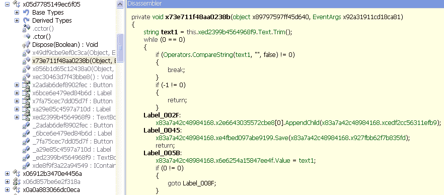

# \].Net 下的保护和逆向工程

> 原文：[`www.pediy.com/kssd/pediy09/pediy09-293.htm`](https://www.pediy.com/kssd/pediy09/pediy09-293.htm)

> 原文链接：http://www.codebreakers-journal.com/content/view/123/97/  
>   
> 这份刊物主要讨论一些微软.Net 框架下流程行的保护方法，包括 强名称(StrongName), 名称混淆(name obfuscation)， 流程混淆(flow obfuscation)，元数据加密(metadata encryption), 加壳以及一些反分析手段。对于每一种保护，我也将会提供一些建议怎样去逆向它们。这份刊物并不是新手教程，它的目标是哪些已经有.Net 编程和逆向经验的人。 
> 
> 说明 
> 
> 信不信由你, 时至今日微软的.Net 框架变得越来越受欢迎。 自从 2002 年发布了第一个版本，现在我们能得到.net 运行于 windows 上的 4 个主要版本, 就是 1.0 版本, 1.1 版本, 2.0 版本以及 3.0 版本。随着.net 框架自身的改进, 保护技术也取得了很大的进步。 
> 
> 稍后，我将讨论一些.Net 应用程序的保护方式，但是在我们深入主题之前，确保你理解哪些基本概念，例如汇编，模块， 类型，成员，CLR(常见语言运行时,原文 common language runtime), CTS(常见类型系统,原文 common type system), JIT(及时编译,原文 Just in-time compile) 等等。对于哪些不知道没有保护的.Net 程序是多么容易被逆向的人，请到 http://www.accessroot.com 查看逆向教程. 
> 
> 现在，让我们开始吧。 
> 
> 强名称
> 
> 什么是强名称？你可以在 MSDN(微软开发者网络)找到许许多多的文档。 事实上, 强名称 并不是一种保护方法，而是一种验证。它是对 PE 文件做哈希计算，所以系统和应用程序能够检查哈希值从而得知文件是否是原始的哪个。如果文件被改动过，验证失败，则系统将会拒绝运行。 
> 
> 当.net 刚诞生之时， 强名称被广泛用来保护文件免于被打补丁。 但是强名称很轻容易就被移除，替换，或者绕过。 经典的方法就是用 ildasm 把 PE 文件反编译为 il 源代码，然后移除.assembly 范围内的.publickey 节， 再用 ilasm 重编译为 PE。 搜索 google 你就明白为什么我说这种方法是经典。 现在，我们有更方便的方式, 直接使用工具。检查 http://www.andreabertolotto.net/ 你将会找到强名称移除。或者，最暴力的一个，补丁系统动态链接库文件来使强名称检查总是成功。有时验证是由应用程序本身而不是系统。哪么你需要多做一些工作，补丁应用程序。
> 
> 对于强名称我就不多说了，就此打住。更有趣的东西还在等着我们呢。但是对于菜鸟来说，再深入挖掘强名称会更有用些。只要搜索因特网资料库。
> 
> 名称混淆 
> 
> 混淆可能是伴随.net 而来的第一个正式保护方法， 因为发行的 Visual Studio 附带了免费版 DotFuscator。名称混淆是怎样保护你的应用程序的呢？ 众所周知，.net 保存所有的名称(包括汇编，模块，方法，字段，OK, 几乎一切名称)到元数据中， 所有这些元数据被保存到 PE 文件里。 使用反编译器(我更喜欢说反编译这个词语, 而不是反汇编, 因为和汇编相比而言 msil 本身是一种高级语言)，你可以得到比传统的 win32 exe/dll 文件更多的信息。 结果就是，它是如此的可读， 就像读原始的源码一样。 
> 
> 名称混淆器把名称混淆为不可读字符 (或者不可打印)字符。 怎样混淆名称有好几个方向：转化为无意义字符串，转化为不可打印字符串，转化为“相似”字符串， 转化为超长字符串，或者只是删除字符串。图 1 演示使用 Reflector (.net 下最流行的反编译器)反编译一个用商业混淆器保护的应用程序， 当阅读这些代码的时候你有什么感觉？ (图 1 也展示了流程混淆，这是下一节的主题) 
> 
> 
> 
> 图 1 使用 reflector 反编译被商业混淆器保护的应用程序
> 
> 怎样对付名称混淆? 你可以反混淆名称为有意义字符串，例如 Class1, Method1, TextBox1。这儿有意义意味着更具有可读性, 因为名称混淆是单向变形，我们不能变为原始的名称。 Dis# 有反混淆功能，让这个工作更轻松。但是大多时候，没有必要哪样做。代码都在哪了，仅仅是有点难读，我们需要的只是耐心， 时间，以及一些技能(使用 reflector 的分析功能， 等等)。 
> 
> 流程混淆 
> 
> 非常明显，名称混淆并不足够。 为了让 msil 更难于阅读，人们发明了流程混淆。 流程混淆意味着改变代码流程，但是不改变代码结果。流程混淆最少有两个功能：让 msil 更难阅读，让反编译到高级语言失败。第一个功能显而易见，至少逆向者不得不花时间在阅读垃圾代码上。第二个功能基于大多数反编译器能翻译 msil 为高级语言，例如 C#, C++/CLI 这个事实。 逆向者发现高级语言比低级的 msil 更具可读性。 
> 
> 流程混淆器通过几种方式来实现。首先，插入虚假代码，例如计算一个说明, 添加总是真或者假的布尔判断。 其次，分隔源码为许多段，使用分支或者布尔分支来连接它们。 再次，包装系统调用到新的类，改变所有的系统方法引用到新的类方法。最后，使用反编译器 BUG。 
> 
> 一个简单的例子将会演示反编译器是多么的脆弱当它们试着变形 msil 到高级语言。输入下面的代码并使用 ilasm 汇编。单独使用 4 个反编译器单独打开： Reflector, Dis#, Decompiler .Net 2005, 和 Xenocode Fox 2007。
> 
> .assembly extern mscorlib { } 
> 
> .assembly extern System{} 
> 
> .assembly sample {} 
> 
> .method public hidebysig void Main() 
> 
> { 
> 
> .entrypoint 
> 
> br.s start\_here 
> 
> pop 
> 
> start\_here: 
> 
> ldstr "hello!" 
> 
> call void \[mscorlib\]System.Console::WriteLine(string) 
> 
> ret 
> 
> } 
> 
> Reflector 报告一个异常当反编译 Main()方法到高级语言，其它的三个甚至不反编译。原因很简单，msil 是基于堆栈的语言， 这意味着它不允许堆栈不平衡。这些反编译器使用堆栈变量作为反编译的办法， 但它们都失败于识别出永远不会运行的虚假代码“pop”。当然，这个小技巧对 msil 反编译没有作用。但这正是流程混淆器所需要的，让代码更难阅读：现在逆向者不得不对高级语言说再见了，然后对付令人厌烦的 il 指令。
> 
> 怎么样对付流程混淆呢? 每个人马上想到一个答案：流程反混淆。对于简单的流程混淆和没多少代码的小程序，你能够手动反混淆，移除虚假代码，连接代码段。但对于大的来说，这是不可能的。然后，优秀的程序员可能编码一个反混淆器来让工作自动化。是的，这是个办法，但是我不知道现在是否有这么实际的反混淆器存在，(我曾经编写了一个玩具反混淆器, 它对一些混淆代码有用，但是实际上需要做许多工作) 一些编译器工具/框架有优化功能，能移除虚假代码，例如 MONO.CECIL, Microsoft phoenix RDK。
> 
> 元数据加密 
> 
> 有时候字符串引用是逆向工程的关键。这是基本原则应用程序应该隐藏字符串线索。字符串引用 (.net 中叫用户字符串)作为元数据被保存在被管理的 PE 文件里。 这一节我们将只谈论字符串加密，更多的元数据加密技术被合并到加密/加壳， 在后面的节里再作讨论。
> 
> 本质上，只有一种方式来隐藏用户字符串：加密它们，然后解码当需要的时候。但是不同的保护者以不同的方式实现隐藏。一些以一个唯一的钥匙加密每个字符串, 然后运行时使用钥匙解码。下面是代码样本。 
> 
> IL\_666e: ldstr "moacpphccapcmpfdhkmdepdedpkenobfpnifnopfingggongpi" 
> 
> \+ "ehbnlhpncihmjipmajfnhjolojomfkammkdmdlplklogbmllimnkpmhlgnlknnokeoakloj" 
> 
> \+ "fcpojjpejaadkhaneoapifbpjmbejdckikcajbdaiidmhpdgdge" 
> 
> IL\_6673: ldc.i4 0x7a122093 
> 
> IL\_6678: call string xb9d8bb5e6df032aa.x7840e3d83ad1c299::\_bc24e513a5229081(string,int32) 
> 
> 这个调用的结果字符串是”你的产品试用期已经过！”。其它的可能合并所有用户字符串到一个加密的字节数组里，在数组中赋给每个字符串一个偏移量。当需要字符串的时候，使用偏移量长度来定位原始的字符串。
> 
> 字符串加密很容易处理，为什么呢？因为加密是双向的。 但是，每个程序员应该在他们的产品中使用字符串加密,这是基本原则。
> 
> 好了，让我们在这休息一会。可能你们中的一些已经厌烦了： .net 下的保护并不太难，我很容易对付。请有点耐心，真正的挑战来了。 
> 
> 加壳 /加密
> 
> 当面对 win32 应用程序的时候加壳是如此的流行。现在是.net 新时代，它也是个强大的保护方法。很难清楚的找出加壳和加密的分界线，我喜欢在一节里一起讨论它们。让我们开始最简单的加壳：压缩。 
> 
> 压缩
> 
> 压缩意味着使用压缩算法来压缩 PE 文件。当运行的时候，解压整个文件到内存然后调用入口的汇编方法。这是一种全部汇编保护， 因为在运行时内存中可以看到整个原始文件。 很容易转储汇编代码，手动或者用工具，例如 http://www.ntcore.com 出品的.Net 通用脱壳机(原文.net Generic Unpacker)。
> 
> 全部汇编保护的典型代码是调用 System.Reflection.Assembly::Load()，这个时候这个指令告诉我们，全部汇编被解码并准备运行。跟随在后面的代码总是定位入口点方法或者一个特殊的方法，然后调用它。
> 
> 加密过的汇编代码保存在哪里有个小技巧。它能被保存为程序代码中的一个字节数组, 或者作为.rsrc 节中的资源。一旦你定位到位置和大小，然后就可以得到清楚的加密算法，你可以直接获取到原始的汇编而不必运行程序。静态解码或者动态转储，你可以作出选择。 
> 
> 包装器(Wrapper)
> 
> 有时候当你使用 reflector 加载一个.net PE 文件，你得到一个警告说没有 CLI 头。哪意味着它是一个原生的 exe/dll 文件。但是阅读系统要求，仍然需要安装.net 框架。为什么呢？因为 PE 文件已经由一个原生的包装器加壳(通常同时加密)。
> 
> 有几种类型的包装器。一种是只压缩/加密包装器，鼠标双击之后，它仅仅释放全部汇编代码到内存中。其它的更加高级，它们接管.net 系统动态链接库调用。如果你用传统的工具检查一个.net PE 文件，你将发现仅仅一条指令在入口点：跳转到 CorExeMain 或者 CorDllMain。壳能接管这个跳转，只有当它准备好了（汇编代码已经被解码）才会跳转。
> 
> 现在我们在新的段落里介绍一个更高级点的包装器. 它们的包装目标是 JIT。我们知道为了让.net 程序正常运行，所有我们需要去做的就是提供给 JIT 正确的 msil 代码和元数据。 JIT 并不关心你在及时编译前后做什么。 .net 框架 2.0 中 JIT 的关键代码位于 mscorjit.dll，在我的机器上是如下代码。
> 
> .text:7906E7F4 private: virtual enum CorJitResult \_\_stdcall 
> 
> CILJit::compileMethod(class ICorJitInfo \*, 
> 
> struct CORINFO\_METHOD\_INFO \*, 
> 
> unsigned int, 
> 
> unsigned char \* \*, 
> 
> unsigned long \*) proc near 
> 
> The second parameter, a pointer to CORINFO\_METHOD\_INFO, is a structure as follows. 
> 
> struct CORINFO\_METHOD\_INFO 
> 
> { 
> 
> CORINFO\_METHOD\_HANDLE ftn; 
> 
> CORINFO\_MODULE\_HANDLE scope; 
> 
> BYTE \* ILCode; 
> 
> unsigned ILCodeSize; 
> 
> unsigned short maxStack; 
> 
> unsigned short EHcount; 
> 
> CorInfoOptions options; 
> 
> CORINFO\_SIG\_INFO args; 
> 
> CORINFO\_SIG\_INFO locals; 
> 
> }; 
> 
> 结构体的第 3 和第 4 字段是 JIT 需要的关键信息。所有哪些壳需要做的就是解码 msil 并改变参数到正确的哪个，然后调用 compileMethod()， 让 JIT 高兴。
> 
> 这有个技巧，壳怎么会知道什么时候 CLR 要调用 JIT？如果我们检查 mscorjit.dll 的输出表， 我们将会得到函数： getJit()。调用这个我们会得到什么呢？检查代码。
> 
> .text:7907EA7A \_\_stdcall getJit() proc near 
> 
> .text:7907EA7A mov eax, dword\_790AF168 
> 
> .text:7907EA7F test eax, eax 
> 
> .text:7907EA81 jnz short locret\_7907EA97 
> 
> .text:7907EA83 mov eax, offset dword\_790AF170 
> 
> .text:7907EA88 mov dword\_790AF170, offset const CILJit::\`vftable' 
> 
> .text:7907EA92 mov dword\_790AF168, eax 
> 
> .text:7907EA97 
> 
> .text:7907EA97 locret\_7907EA97: ; CODE XREF: getJit()+7j 
> 
> .text:7907EA97 retn 
> 
> .text:7907EA97 \_\_stdcall getJit() endp 
> 
> 显明地，它返回 0x790AF170， CILJit::'vftable'的地址，这个表是关于什么的呢？
> 
> .text:7907EA98 const CILJit::\`vftable' dd offset CILJit::compileMethod(ICorJitInfo \*,CORINFO\_METHOD\_INFO \*,uint,uchar \* \*,ulong \*) 
> 
> .text:7907EA98 ; DATA XREF: getJit()+Eo 
> 
> .text:7907EA9C dd offset CILJit::clearCache(void) 
> 
> .text:7907EAA0 dd offset CILJit::isCacheCleanupRequired(void) 
> 
> CILJit::'vftable'第一个成员正好指向 compileMethod，我们已经讨论过的。在一个固定的.net 框架和机子上这个 vtable 永远不会改变。壳可以要么使用 getJit() 要么直接补丁双字到内存中。 
> 
> 钩住 JIT(Hook JIT )
> 
> 我们已经检查了壳怎样包装 JIT 和动态解码 msil。但是一些壳并不包装 , 它们钩住 JIT 的特殊方法和 EE(执行引擎)。一个流行的钩子在 RuntimeMethodHandle::GetMethodBody 中。
> 
> .text:7A120C88 public: static class MethodBody \* \_\_fastcall RuntimeMethodHandle::GetMethodBody(class MethodDesc \* \*, void \*) proc near 
> 
> .text:7A120C88 ; DATA XREF: RuntimeMethodHandle::GetMethodBody(MethodDesc \* \*,void \*)+29o 
> 
> .text:7A120C88 ; .data:7A384EE4o 
> 
> .text:7A120C88 
> 
> .text:7A120C88 var\_B0 = dword ptr -0B0h 
> 
> ? 
> 
> ? 
> 
> .text:7A120DDF mov ecx, \[ebp-34h\] 
> 
> .text:7A120DE2 call MethodDesc::GetILHeader(void) 
> 
> .text:7A120DE7 mov \[ebp-7Ch\], eax 
> 
> ? 
> 
> ? 
> 
> 注意黑体的指令调用 GetILHeader，壳能在这做工作。跳转到它们自己的代码，解码 msil 代码和元数据，然后继续 GetMethodBody。
> 
> 这些使用钩子方法的壳几乎每个方法都解码。那意味着它永远不会一次解码出全部的汇编代码。而是解码需要的方法。这让直接转储内存中的全部汇编代码变得不可能，因为没有全部的汇编代码在内存中。 
> 
> 为了逆向这些壳保护的应用程序(更精确地，转储全部的汇编代码)，你需要一些技能来欺骗壳，让它相信 JIT 需要代码，然后给我们提供解码出的代码。 为什么不静态的解码？因为大多数的壳使用超过一个的加密算法， 并且在这些算法中随机选择来加密不同的方法。我喜欢欺骗 J。 
> 
> 感觉怎么样? 好了， 我将告诉你其中一个方法我欺骗哪些壳。使用.net 框架的反射机制，枚举所有的类，方法，字段等等，在内存中扫描解码出的元数据，然后重建汇编代码。有时候我们不需要汇编代码和原始的一模一样，或者甚至不需要它运行，我们仅仅需要它能被反编译。但是，所我所知，没有通用的脱壳机对.net 下的每种保护都有用。
> 
> 一些反分析手段 
> 
> 这个节将会很简单，只介绍一些小技巧让分析你的程序更加困难。 它们绝大多数是借鉴于 win32 反逆向工程。我将仅仅提及它们的名字，因为没有必要解释。
> 
> 怎样反剖析器（profiler）？你可以设置环境变量 COR\_ENABLE\_PROFILING 来让每次你的程序运行时禁用剖析器。或者，直接在内存中补丁标志。 下面的代码将给你提供一些线索.net 怎样转换信息给剖析器。
> 
> .text:79E972AD ; MethodDesc::MakeJitWorker(COR\_ILMETHOD\_DECODER \*,ulong)+267972j ... 
> 
> .text:79E972AD test byte ptr ProfilerStatus g\_profStatus, 6 
> 
> .text:79E972B4 jnz loc\_7A0FEB52 
> 
> .text:79E972BA 
> 
> .text:79E972BA loc\_79E972BA: 
> 
> 如果剖析器被禁用，哪么管理调试也被禁用。 但是逆向者仍然能使用 OllyDBG 来执行原生调试。只要使用.net 提供的 System.Diagnostics.Debugger::get\_IsAttached 或者使用 kenel32.dll 中的 IsDebuggerPresent 来检测它。System.Diagnostics.DebuggerHiddenAttribute 也可以阻止新手的步伐通过释放关键方法(在管理调试中)。
> 
> 枚举所有的窗口名并检查是否有一些不应该存在的程序在运行。Process32First 和 Process32Next 也不失为一种好的方法。 
> 
> 在关键方法中使用时间跨度检查来欺骗逆向者。如果时间跨度太大的别仅仅是退出运行， 只需要给他们错误的注册码。 
> 
> 使用因特网认证。但是我不喜欢使用需要因特网强制认证的软件，因为大部分时间我没法访问因特网。
> 
> 别在你的网站上提供试用版本。 
> 
> 总结
> 
> 我们已经讨论了一些（可能不是所有）.net 下流行的保护方法，介绍了它们的实现和怎样逆向它们。你能为你的应用程序选择最适合的一个或者一些。.net 下的逆向工程和保护之战才刚刚开始，随着 Vista 的到来。谁才是赢家呢？就像历史一样，你可能赢得一场战役，但没有人能赢得战争。

 4dd466d0e1e0cc123afbe504da2462ca