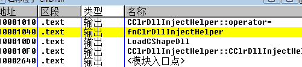

# 向其他程序注入托管程序集

> 原文：[`www.pediy.com/kssd/pediy09/pediy09-199.htm`](https://www.pediy.com/kssd/pediy09/pediy09-199.htm)

> 高手略过,谢谢.  
>   
> 上帝都知道托管程序集,那就必然就是托付管理…没有自主权了.  
> 托管程序调用非托管程序集不外乎通过 PInvoke 或者 COM 接口调用.但是托管程序集调用非托管程序集貌似也只能够通过 COM 了,至少在现行 NET 文档是这样子介绍的.虽然 NET 类库十分强大,大可不必操作平台 API 即可完成一个出色的程序或者说程序集,不过有的时候我们还是需要的,特别是我们要操作其他程序行为的时候.  
> 包括实现 APi Hook.  
> 穿透防火墙.  
> 甚至是实现无进程.当然这些在 WIN32 编程中是非常容易实现的.dotNet 要带上一个数十 MB 的 NET 包裹,确实难…而且其实际意义…恐怕等到 09 年 Vista 大范围普及的时候用处方能够显著.毕竟 Net 开发尤其是搞点窗体数据库这些是非常非常容易的.我本人也是非常喜欢 dotNet 的.  
> 读者仔细看我的标题会发现我说的是 C#代码,而非 dotNet 代码.为什么呢?因为 C#有一个特殊的地方在于它是纯粹的面向对象的语言.根本不提供全局方法.其次在于.C#我个人或者数大多数人比较喜欢,有一定的代表性,最次的是,我确实无法忍受 C++/Clr 的开发方式…真的想吐的感觉.当然 Vb.net 也不是本文讨论的重点.毕竟我个人还是不太喜欢 Nothing 这种语法.其实 null 看起来更专业.  
> 好了废话就不说了.  
> 在 WIN32 中比较独立的就算是进程了,当然这里没有说 COM 这些乱七八糟的东西.所以说我们所说的注入莫非也就是注入到别的进程中.  
> 思考一下有些什么方法可以让别的进程加载我们的程序集:  
> 1.  COM,很好的办法.微软在 NET 对 COM 的支持还是比较好的  
> 2.  利用 C++的 Exports DLL 功能,这个听起来还不错.  
> 我这里就用第二种方法.第一种为什么不用呢?考虑到 WIN32 调用 COM 我不是很熟悉,其次感觉注册过来注册过去的不够环保,也不利于调试.  
> 当然第二种方法偶其实也不算很喜欢…毕竟必须要用 C++/Clr 的代码.但毕竟还是有一点 C++基础也不算太复杂.  
> 实现的基本思路就是利用 C++/Clr 或者其他语言甚至是 WIN32 建立一个注入机程序,然后利用注入机把另一个写好的 C++/Clr 的 DLL 注入到目标进程并初始化调用,其中这个 DLL 负责调用 CShape 的 DLL.其实关键就在于中间的那个 C++/Clr 的 DLL.其实整个过程理解起来非常容易.  
> 我用的远程线程插入的方法注入 DLL(这种代码讨论太多了我就略过了),,顺便说说为什么我必须要用一个中转 DLL.原因是这样的:在 Visual C++ 2005 中 MSDN 里面有一段话,大概意思是如果托管代码中用混合编程即含有本机代码,那么 EntryPoint 必须为本机函数.这样子无法在初始化的时候调用托管代码,而我的窗体界面已经弄好,,,为了俭省就不去重新写本机的了,本身就算 MFC 画个窗体也是容易把脑壳搞大…希望对后人有点帮助这句.  
> 我们的 C++/Clr 就填充一个输出表  
> LIBRARY   ClrDllInjectHelper  
> EXPORTS  
> LoadCShapeDll  
> 大概就像这个样子,  
> 然后在注入的本机代码中调用  
> void WINAPI RemoteMain(void \* Data)  
> {  
>   \_\_try  
>   {  
>   LPVOID pProc;  
>   pProc = ::GetProcAddress(LoadLibraryW(DllPath),"LoadCShapeDll");  
>   if(pProc == NULL)  
>   {  
>     ::MessageBoxA(NULL,"无法载入动态连接库，请检查文件完整性;\\r\\n 注入进程退出","错误",MB\_ICONERROR);  
>     ::ExitProcess(NULL);  
>   }  
>   \_\_asm  
>   {  
>     lea eax,CShapeDllPath  
>     push eax  
>     call \[pProc\]  
>   }  
>   }  
>   \_\_except(EXCEPTION\_EXECUTE\_HANDLER)  
>   {  
>     ::MessageBoxA(NULL,"SEH 异常 Handlered!!!",NULL,MB\_ICONERROR);  
>   }  
> //装载自己以加载托管代码  
> }大概代码就像这样子,我们以正常方式载入一个 DLL.这样子这个 DLL 就可以调用托管程序集  
> 在公开的 DLL 输出函数中调用  
> void \_\_stdcall LoadCShapeDll(WCHAR \* CShapeDllPath)  
> {  
>   String ^ str;  
>   try  
>   {  
>   
>     Assembly ^ assembly;  
>     str = ::System::Runtime::InteropServices::Marshal::PtrToStringAuto(System::IntPtr::IntPtr(CShapeDllPath));  
>     assembly = ::Assembly::LoadFile(str);  
>     Type ^ type = assembly->GetType("CShapeDll.AppMain");  
>     System::Reflection::MethodInfo ^ mi = type->GetMethod("Main");  
>     mi->Invoke(nullptr,nullptr);  
>   }  
>   catch (Exception ^ e)  
>   {  
>     System::Windows::Forms::MessageBox::Show(e->Message + "\\r\\n DllPath:" + str,"Error Occured When in injection Code");  
>     ::ExitProcess(NULL);  
>   }  
>    // System::Windows::Forms::MessageBox::Show("DEBUG");  
> }  
> 这样子就可以装载 C#程序集  
> C#程序集我们只需要新建一个类库并且初始化一个静态类  
> 代码向这样.  
> using System;  
> using System.Collections.Generic;  
> using System.Text;  
> using System.Windows.Forms;  
> namespace CShapeDll  
> {  
>     public static class AppMain  
>     {  
>         public static void Main()  
>         {  
>             MessageBox.Show("Loaded");  
>             Application.EnableVisualStyles();  
>             Application.SetCompatibleTextRenderingDefault(false);  
>             Application.Run(new FormMain());  
>         }  
>     }  
>     public class Class1  
>     {  
>     }  
> }  
>   
> 即可.理论上非常简单的.这样子我们的任务就完成了.  
> 现在我们来讨论一下为什么可以用 C++/Clr 输出一个 DLL.  
> 我们用 OllyDbg 加载有全局输出表的 DLL.  
> 我们会’惊讶’的发现有标准的输出表
> 
>   
>    
> 这就意味着我们是完全可以通过这种方式装载托管/非托管代码的.当然我想这是 C++之所以强大的原因之一吧.  
> 我们在 DLL 没有初始化完成之前双击这个函数  
> 会发现  
> 100010D0 C> $- FF25 24800010        jmp dword ptr ds:\[10008024\]  
> 100010D6       CC                   int3  
> 100010D7       CC                   int3  
> 它会跳到数据段中.而此时代码段中的数据是一个无效指针.当我们初始化 DLL 完成以后.  
> 这个数据就会被填充.进而转到了 Jitter 中  
> 79013370     58                     pop eax  
> 79013371     55                     push ebp  
> 79013372     8BEC                   mov ebp,esp  
> 79013374     51                     push ecx  
> 79013375     52                     push edx  
> 79013376     50                     push eax  
> 79013377     E8 87920000            call mscoree.7901C603  
> 7901337C     5A                     pop edx  
> 7901337D     59                     pop ecx  
> 7901337E     5D                     pop ebp  
> 7901337F     50                     push eax  
> 79013380     C3                     retn  
> .因此.一旦我们用标准的 LoadLibraryA/W 方式载入了这个动态链接库.用 GetProcAddress 就可以平常 WIN32 的形式调用托管代码.这无疑是非常方便的.尤其是非托管要调用托管代码的话.  
> 文章没有任何技术含量.各位看官全当儿戏即可.  
>   
>   
> By fOx

 4dd466d0e1e0cc123afbe504da2462ca