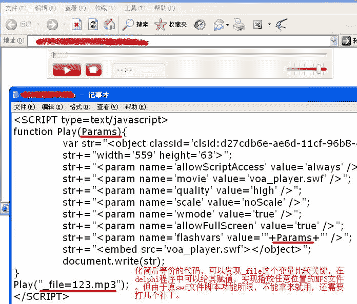
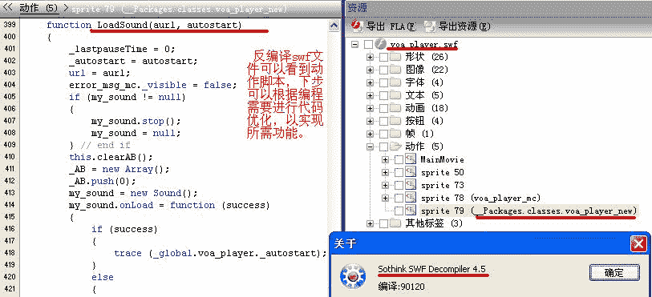
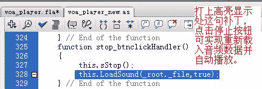
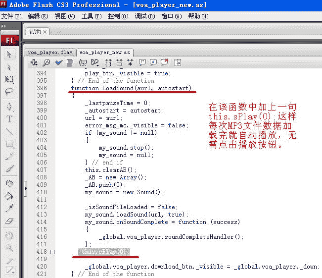
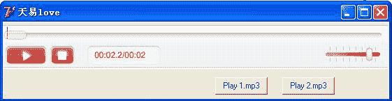

# swf 逆向可以这么玩

> 原文：[`www.pediy.com/kssd/pediy12/132379.html`](https://www.pediy.com/kssd/pediy12/132379.html)

起因：看到沪江听写网站上的一款 flash 在线播放器比较实用，就打算占为己有。其间遇到了一些问题，用了一天时间彻底解决，使梦想变成了现实。  
    沪江听写网站简化后的关键代码如下：  
         
     
    具体过程：  
    首先是发现问题。通过编程发现如果直接使用该 swf 文件，即使改变 mp3 文件路径，播放的仍是先前的音频。  
  
    其次是分析解决。  
  
    第一步：使用 SWFDecompiler4.5.exe 反编译 voa\_player.swf 得到 voa\_player.fla(flash 源文件)、voa\_player\_new.as(动作脚本)这两个文件。  
      
          
  
    第二步：使用 Flash CS3 Pro 打开 voa\_player.fla，对脚本进行补丁从而增强其功能，最后编译生成新的 swf 文件。   
  
      
  
      
  
   第三步：使用 delphi 编写应用软件，在 flash 控件中载入新生成的 swf。  
  
        程序界面如下：  
           
  
         其中的关键代码：Flash1.SetVariable('\_file','D:\\xxx\\123.mp3');  
             以上代码语句再配上修改后的 voa\_player.swf 就可以随心所欲的播放 MP3 文件了。  
  
具体 dephi 实现代码如下：  
unit Unit1;  
  
interface  
  
uses  
Windows, Messages, SysUtils, Classes,Controls, Forms, Dialogs,StdCtrls, OleCtrls, ShockwaveFlashObjects\_TLB;  
  
type  
  TForm1 = class(TForm)  
    Flash1: TShockwaveFlash;  
    Button1: TButton;  
    Button2: TButton;  
    procedure FormCreate(Sender: TObject);  
    procedure Button1Click(Sender: TObject);  
    procedure Button2Click(Sender: TObject);  
  private  
    { Private declarations }  
  public  
  
  end;  
  
var  
  Form1: TForm1;  
  path:string;  
  
implementation  
  
{$R \*.dfm}  
  
procedure TForm1.FormCreate(Sender: TObject);  
begin  
    path:=ExtractFilePath(ParamStr(0));  
    flash1.Movie :=path+'player.swf';  
end;  
  
procedure TForm1.Button1Click(Sender: TObject);  
var  
    targetWnd:Thandle;  
    r :TRect;  
    point:TPoint;  
begin  
      Flash1.SetVariable('\_file',path+'1.mp3');  
      targetWnd := FindWindow('TForm1','天易 love');  
      if targetWnd <> 0 then  
        begin  
          GetWindowRect(targetWnd,r);  
          getcursorpos(point);  
          setcursorpos(r.Left+96,r.Top+80);  
          mouse\_event(MOUSEEVENTF\_LEFTDOWN,0,0,0,0);  // 模拟鼠标双击 stop\_btn  
          mouse\_event(MOUSEEVENTF\_LEFTUP,0,0,0,0);  
          mouse\_event(MOUSEEVENTF\_LEFTDOWN,0,0,0,0);  
          mouse\_event(MOUSEEVENTF\_LEFTUP,0,0,0,0);  
          setcursorpos(point.x,point.y);  
        end;  
end;  
  
procedure TForm1.Button2Click(Sender: TObject);  
var  
    targetWnd:Thandle;  
    r :TRect;  
    point:TPoint;  
begin  
      Flash1.SetVariable('\_file',path+'2.mp3');  
      targetWnd := FindWindow('TForm1','天易 love');  
      if targetWnd <> 0 then  
        begin  
          GetWindowRect(targetWnd,r);  
          getcursorpos(point);  
          setcursorpos(r.Left+96,r.Top+80);  
          mouse\_event(MOUSEEVENTF\_LEFTDOWN,0,0,0,0);  
          mouse\_event(MOUSEEVENTF\_LEFTUP,0,0,0,0);  
          mouse\_event(MOUSEEVENTF\_LEFTDOWN,0,0,0,0);  
          mouse\_event(MOUSEEVENTF\_LEFTUP,0,0,0,0);  
          setcursorpos(point.x,point.y);  
        end;  
end;  
  
end.  
  
完整工程文件见附件

上传的附件
|  || 源程序.rar  
 |