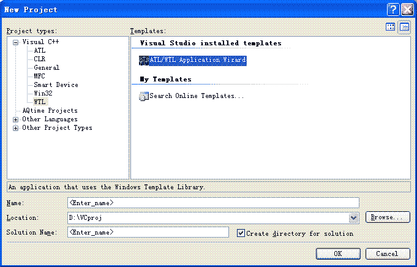
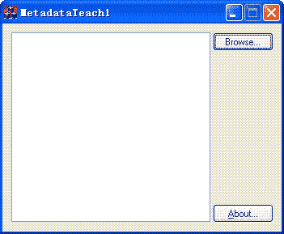
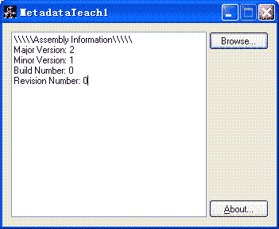

# 让我们一起学 Metadata API（1）

> 原文：[`www.pediy.com/kssd/pediy08/pediy8-718.htm`](https://www.pediy.com/kssd/pediy08/pediy8-718.htm)

让我们一起学 Metadata API（1）  
  
    Metadata API 是.NET 提供的一系列用于读取和生成 Metadata（元数据）的接口方法，它与 ICorDebug 和 ICorProfiler 接口相辅相成，构成了.NET 提供给用户的核心功能。这篇文章是本系列第一篇，主要介绍一下 Metadata API 的背景和基本使用常识，并手把手的带你写出一个最基本的程序用来显示.NET 文件的元数据信息，后续的文章将不断地完善这个程序，同时学习该接口提供的各种功能。（但我不能保证有时间写出一个完善的工具，而且类似工具已经有不少，因此可以留给各位自己实践。）

附件：metadatateach1.rar  
  
    首先给出参考文献。  
1、.NET Framework SDK/ToolDevelopGuide/Doc/Unmanaged Metadata API（这是 V1.1 的文档所有地址，V2.0 已经被移至 MSDN。）  
2、本文所参考的代码主要是 SDK V1.1 中 Samples 里的 Metainfo 例子。  
3、由于我用的是 win32 下的 VC+WTL 编写界面，所以如果你对 WTL 一无所知，可以参考 CodeProject 上的关于 WTL 的 Tutorial。  
  
**一、  什么是 Metadata API？**  
要说清这个问题，恐怕首先得了解什么是元数据。从知其然的角度上讲，元数据就是数据的数据，或者说，它的存在就是为了描述已有的数据（比如代码，属性等）。从知其所以然的角度讲，正是因为有了元数据，.NET 才有可能做到跨平台。针对不同的平台（Windows,Unix,etc），微软只需要改变.NET 面向平台的部分，而由于程序中包含了自我描述的元数据，因此它便可以在不同的但都装有.NET Framework 的机器上运行。  
    上面那段可能有点抽象，说白了，从逆向的角度看，元数据就是我们要得到的 PE 文件信息，其中包含了文件头，代码，资源，各种表，各种字符串，各种数据。就像 win32 下，如果我们要汉化一个程序，或者想分析一个程序的注册流程，必须要了解该程序的资源和反汇编代码一样，在.NET 下想分析一个程序，也要了解它的元数据。  
  
**二、  Metadata API 的实现方式**  
Win32 下，我们可以编写软件读取文件头，然后定位到.text 节，然后用反汇编引擎得到 asm 代码，既而分析之。在.NET 下要达到这个目的，有三种方式。最传统的方法就是自已编写程序读取文件头，自已编写引擎进行 MSIL 的反汇编。这不是不可取，只是你必须对.NET PE 结构有不一般的了解，而且，你必须有相当的时间和精力。但是.NET 为我们提供了两种现成的方法，一是在托管代码（VB.NET，VC.NET，C＃）中调用 System.Reflection 空间的方法，二是在 win32 程序中调用一系列 IMetadata 接口。今天我们要学的是第二种，也就是在 win32 下通过调用一系列 COM 接口来读取 Metadata。  
  
**三、  COM 基础**  
虽然这节叫 COM 基础，我却不准备多讲。一是本身学艺不精，二是没有必要将 COM 的理论全盘托出。我们只看几个最基本的概念。  
1、  COM 要求所有的方法都会返回一个 HRESULT 类型的错误号，而 HRESULT 其实就是一个类型定义：typedef LONG HRESULT。我们在代码中经常使用下面的代码来判断运行结果：  
  
HRESULT hr;  
if (FAILED(hr))  
{  
Goto exit;  
  
2、COM 中所有的接口都要求从 IUnknown 接口继承，我们的 IMetadata\*也不例外。当然，我们不用直接继承 IUnknown，但是它提供了一个方法是我们程序中经常用的，也是最基本的：  
HRESULT QueryInterface(\[in\] REFIID riid,\[out\] void \*\*ppv);  
顾名思义，就是取得某个特点的接口。也只有取得了这些接口后，我们才能调用其中的方法。  
  
（COM 的东西就想讲多，想多了解的新手可以参考 VC 知识库在线杂志第 26 期的文章《COM 技术初探》。）  
  
**四、  第一个例子**  
不多说了，直接看例子是最容易明白的，下面我们进入第一个例子，功能就是简单地显示一个 PE 文件的版本。  
    首先在 VS 中新建 VC WTL 工程。如果你没有 WTL 也没关系，新建一个 win32 app，然后自已添加如下的控件。主要是一个 EDIT 控件，用来显示 Metadata 信息。  
  
   
  
    另外，对于 WTL 用户，由于要使用 CString，必须在 stdafx.h 中加上  
#define \_WTL\_USE\_CSTRING  
#include <atlmisc.h>  
    还有三个.NET 核心头文件  
#include <cor.h>  
#include <winerror.h>  
#include <corhlpr.h>  
  
下面开始添加代码。首先在对话框初始化中添加  
  
cEdit.Attach(GetDlgItem(IDC\_EDIT\_MAIN));  
  
    这只是便于后面调用 EDIT 控件方便，对于普通 win32 API 编程来说，没有必要了。如果用 MFC，请自行添加，因为我不会 MFC。  
  
    然后在 Browse 控件中添加代码，主要实现的功能是：打开文件，初始化接口，调用显示信息的函数，最后注销 COM。代码如下：  
LRESULT CMainDlg::OnOpenFile(WORD /\*wNotifyCode\*/, WORD wID, HWND /\*hWndCtl\*/, BOOL& /\*bHandled\*/)  
{  
      
    HRESULT hr = 0;  
    CFileDialog dlgOpen(TRUE,NULL,NULL,OFN\_FILEMUSTEXIST,L".NET PE File\\0\*.\*\\0",m\_hWnd);  
  
  
    CoInitialize(0);      
  
    hr = CoCreateInstance(CLSID\_CorMetaDataDispenser, NULL, CLSCTX\_INPROC\_SERVER,   
        IID\_IMetaDataDispenserEx, (void \*\*) &g\_pDisp);  
  
    if(FAILED(hr))  
    {  
        ShowErrorMsg("CoCreateInstance Fail!",hr);  
        goto exit;  
    }  
  
    dlgOpen.m\_ofn.lpstrTitle=L"Please choose .NET PE files";  
    if (dlgOpen.DoModal()==IDOK)  
    {  
        csFile=dlgOpen.m\_szFileName;  
        ShowFile();  
    }  
  
exit:  
    CoUninitialize();  
    return 0;  
}  
  
    注意首先要调用 CoInitialize(0)来告诉系统我要使用 COM 了，然后创建 IMetaDataDispenserEx 的实例（这个说法可能不恰当），取得它的指针。这样就可以利用该指针调用它提供的各种方法。参考中告诉该接口的功能如下“The dispenser API is used to map existing metadata so that it can be inspected (and added to), or to create a fresh in-memory area to define new metadata. ”。很明显，我们需要调用它来将 PE 文件的元数据信息映射入内存，并进行读取（或生成）操作。它提供了以下方法：  
2 IMetadataDispenserEx .........................................................................21  
2.1 DefineScope ..................................................................................21  
2.2 OpenScope....................................................................................21  
2.3 OpenScopeOnMemory.....................................................................22  
2.4 SetOption......................................................................................22  
2.5 GetOption .....................................................................................24  
    我们暂时只需要用 OpenScope，功能就是 Open an existing file, and map its metadata into memory，打开现有文件并将 Metadata 映射入内存。  
    接上述代码，在打开文件成功后，我们便开始显示信息。这里，还有几个接口要获得：  
  
//
  
//最基本的几个接口  
//
  
IMetaDataImport \*g\_pImport = NULL;  
IMetaDataAssemblyImport \*g\_pAssemblyImport=NULL;  
IMetaDataDispenserEx \*g\_pDisp = NULL;  
IMetaDataTables \*g\_pTables=NULL;  
  
    也就是说在我们获得了 IMetaDataDispenserEx 后，还有三个接口要用，下面的代码就是分别获取这三个接口，如果错误，会在 EDIT 控件中显示错误信息。  
  
void    CMainDlg::ShowFile()  
{  
    HRESULT     hr = S\_OK;  
    CString        csSpec=L"file:"+csFile;  
  
    hr = g\_pDisp->OpenScope((LPCWSTR)csSpec, 0, IID\_IMetaDataImport, (IUnknown\*\*)&g\_pImport);  
      
    if (FAILED(hr))  
    {  
        ShowErrorMsg("OpenScope failed", hr);  
        goto exit;  
    }  
  
     hr = g\_pImport->QueryInterface(IID\_IMetaDataAssemblyImport, (void\*\*) &g\_pAssemblyImport);  
     if (FAILED(hr))  
     {  
         ShowErrorMsg("QueryInterface failed for IID\_IMetaDataAssemblyImport.", hr);  
         goto exit;  
     }  
  
  
     if (g\_pImport)  
         hr = g\_pImport->QueryInterface(IID\_IMetaDataTables, (void\*\*)&g\_pTables);  
     else if (g\_pAssemblyImport)  
         hr = g\_pAssemblyImport->QueryInterface(IID\_IMetaDataTables, (void\*\*)&g\_pTables);  
       
     if (FAILED(hr))  
     {  
         ShowErrorMsg("QueryInterface failed for IID\_IMetaDataTables.", hr);  
         goto exit;  
     }  
  
       
    ShowAssemblyInfo();  
  
exit:  
    return;  
  
}  
  
    看一下顺序，首先是 OpenScope 进行映射，然后通过 Dispenser 接口获取 IMetaDataImport，再是通过 IMetaDataImport 得到 IMetaDataAssemblyImport，最后是通过 IMetaDataImport 或者 IMetaDataAssemblyImport 得到 IMetadataTables。几个接口都正确得到后，开始显示 PE 文件版本信息的源代码：  
  
//
  
//显示 Assembly 基本信息  
//
  
void    CMainDlg::ShowAssemblyInfo()  
{  
    HRESULT hr=S\_OK;  
    CString csResult;  
    mdAssembly    mda;  
    ASSEMBLYMETADATA MetaData;  
  
    hr = g\_pAssemblyImport->GetAssemblyFromScope(&mda);  
    if (hr == CLDB\_E\_RECORD\_NOTFOUND)  
        return;  
    else if (FAILED(hr))  
    {  
        ShowErrorMsg("GetAssemblyFromScope() failed.", hr);  
        return;  
    }  
      
    ZeroMemory(&MetaData, sizeof(ASSEMBLYMETADATA));  
  
    hr = g\_pAssemblyImport->GetAssemblyProps(mda,   
        NULL, NULL,    // Public Key.  
        NULL,          // Hash Algorithm.  
        NULL, 0, NULL, // Name.  
        &MetaData,  
        NULL);         // Flags.  
  
  
    if (FAILED(hr))   
    {  
        ShowErrorMsg("GetAssemblyProps() failed.", hr);  
        return;  
    }  
      
    csResult.Format((LPCWSTR)L"\\\\\\\\\\\\\\\\\\\\Assembly Information\\\\\\\\\\\\\\\\\\\\\\r\\nMajor Version: %d\\r\\nMinor Version: %d\\r\\nBuild Number: %d\\r\\nRevision Number: %d\\r\\n",  
                    MetaData.usMajorVersion,MetaData.usMinorVersion,MetaData.usBuildNumber,MetaData.usRevisionNumber);  
  
    ShowMetaMsg(csResult);  
    return;  
}  
  
    过程很清楚，代码也很少，首先是 AssemblyImport->GetAssemblyFromScope 的调用，得到 mdAssembly mda，这是 Assembly 的 token 值。（在.NET 中，token 是非常基本也是非常重要的概念。）然后利用该 token，并调用 g\_pAssemblyImport->GetAssemblyProps，得到一个基本结构 ASSEMBLYMETADATA。ASSEMBLYMETADATA 的结构如下：  
  
typedef struct  
{  
    USHORT      usMajorVersion;         // Major Version.     
    USHORT      usMinorVersion;         // Minor Version.  
    USHORT      usBuildNumber;          // Build Number.  
    USHORT      usRevisionNumber;       // Revision Number.  
    LPWSTR      szLocale;               // Locale.  
    ULONG       cbLocale;               // \[IN/OUT\] Size of the buffer in wide chars/Actual size.  
    DWORD       \*rProcessor;            // Processor ID array.  
    ULONG       ulProcessor;            // \[IN/OUT\] Size of the Processor ID array/Actual # of entries filled in.  
    OSINFO      \*rOS;                   // OSINFO array.  
    ULONG       ulOS;                   // \[IN/OUT\]Size of the OSINFO array/Actual # of entries filled in.  
} ASSEMBLYMETADATA;  
  
    它的定义在 cor.h 中，其实就包含了两个 version 和两个 Number，这就是我们今天要取得的信息。最后就是输出版本信息了。程序运行后的结果如图：  
   
  
    今天就介绍这个简单的例子，下次我们会利用这个非常有趣的接口取得一些更深入的信息。你对这篇文章有什么看法，或本文有什么纰漏，请不吝赐教！ 

 4dd466d0e1e0cc123afbe504da2462ca