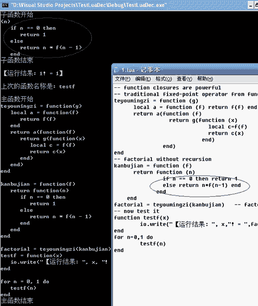

# 用 LuaDec 逆回 LUA 脚本内容

> 原文：[`www.pediy.com/kssd/pediy10/90963.html`](https://www.pediy.com/kssd/pediy10/90963.html)

在收集 LUA 资料进行学习时，其中有个叫 LuaDec 的，能把 LUA 编译出来的代码解回去(逆回脚本内容)，官方网站是：  
http://luadec.luaforge.net/  
它最后支持 LUA5.0 版本的代码,不过 LUA 也是开源的，个人可修改源码，这很难应对所有版本。  
LuaDec 的示例，只是用 luaL\_loadfile 把脚本文件载入，然后就进行解码了，没有在 LUA 中运作时，LUA 执行脚本的哪部分内容。没有这样的例子。  
  
本人不会写文章，直接贴源码及分析时的经验。  
主要 HOOK 上 luaV\_execute 以及 luaV\_execute 函数里边的 luaD\_poscall 地方  
如果是 HOOK 别人的程序,需要注意对 LUA 源码进行修改，达到和别人的 LUA 进行同步。  
我接触过 2~3 个程序，目前发现其比较相同处  
1，枚举型 OpCode 的指令顺序要对应  
2，lua\_TObject 的结构大小，以及其成员 value，tt 的上下位置  
3，LUA5.1 版本时，Proto 结构的变化  
4，LUA5.1 版本是，LClosure 的结构变化  
  
  
LUA 源码好多宏，好多 union 类型，看着头疼，最后是用 OD 跟踪看内存，再拿源码对比得出些经验的  
  
  

代码:

```
// TestLuaDec.cpp : Defines the entry point for the console application.
//

#include "stdafx.h"
#include "windows.h"
#include "stdlib.h"


DWORD dwSubLuaRet = 0;
DWORD dwLuaRet = 0;
BOOL bMainLuaStart = FALSE;
lua\_State\* luaHookHandle = NULL;
DWORD fnluaV\_execute = NULL;
DWORD fnluaD\_precall = NULL;
void hookluaEx()
{
  \_\_try{
    char\* code = lua\_Dec(luaHookHandle, -1);
    if (code)
    {
      printf("主函数开始\\n");
      printf(code);
      printf("主函数结束\\n\\n");
      free(code);
    }
    
  }\_\_except (EXCEPTION\_EXECUTE\_HANDLER) {
    printf("lua fail");
    return;
  }
}
\_\_declspec(naked) void hooklua(DWORD lua)
{
  \_\_asm
  {
    push ebp
    mov ebp, esp
    push eax
    mov eax, lua
    mov luaHookHandle, eax
    pop eax
    push lua
    call fnluaV\_execute
    mov dwLuaRet, eax
    call hookluaEx
    add esp, 4
    mov eax,dwLuaRet
    pop ebp
    retn
  }
}
void hookSubluaEx()
{
  \_\_try{
    char\* code = lua\_DecSub(luaHookHandle, -1);
    if (code)
    {
      printf("子函数开始\\n");
      printf(code);
      printf("子函数结束\\n\\n");
      free(code);
    }
    
  }\_\_except (EXCEPTION\_EXECUTE\_HANDLER) {
    printf("lua fail");
    return;
  }
}
\_\_declspec(naked) void hookSublua(DWORD lua, DWORD lua2)
{
  \_\_asm
  {
    push ebp
    mov ebp, esp
    push lua2
    push lua
    call fnluaD\_precall
    mov dwSubLuaRet, eax
    call hookSubluaEx
    add esp, 8
    mov eax,dwSubLuaRet
    pop ebp
    retn
  }
}

void HookLua()
{
  HMODULE ImageBase = GetModuleHandle(NULL);
  
  PIMAGE\_DOS\_HEADER dos\_stub = (PIMAGE\_DOS\_HEADER)ImageBase;
  PIMAGE\_NT\_HEADERS PEHead = (PIMAGE\_NT\_HEADERS)((DWORD)ImageBase + dos\_stub->e\_lfanew);

  DWORD f\_luaV\_execute = 0x0000E13D;
  BOOL  b\_luaV\_execute = FALSE;
  DWORD f\_luaD\_precall = 0xFED8BD83;
  BOOL  b\_luaD\_precall = FALSE;
  
  DWORD i = 0;
  DWORD OldProtect, tOld;
  for (int NOS=0; NOS<PEHead->FileHeader.NumberOfSections; NOS++)
  {
    PIMAGE\_SECTION\_HEADER pSecHeader = (PIMAGE\_SECTION\_HEADER)((DWORD)PEHead + NOS \* sizeof(IMAGE\_SECTION\_HEADER)+sizeof(IMAGE\_NT\_HEADERS));
    if (IMAGE\_SCN\_CNT\_CODE & pSecHeader->Characteristics)
    {
      char\* pFile = (char\*)((DWORD)ImageBase+pSecHeader->VirtualAddress);
      for (i=0; i<pSecHeader->SizeOfRawData-0x10; i++)
      {
        if (b\_luaD\_precall && b\_luaD\_precall)
          break;
        if (b\_luaV\_execute == FALSE && !memcmp(&pFile\[i\], &f\_luaV\_execute, 4))
        {
          if (\*(PBYTE)(pFile+i+0x32) == 0xE8)
          {
            b\_luaV\_execute = TRUE;
            DWORD t = (DWORD)ImageBase + i + pSecHeader->VirtualAddress + 0x32;
            VirtualProtect((void\*)t, 5, PAGE\_EXECUTE\_READWRITE, &OldProtect);
            fnluaV\_execute = t + 5 +  \*(PDWORD)(t+1);
            (\*(PDWORD)(t+1)) = (DWORD)hooklua - t - 5;
            VirtualProtect((void\*)i, 5, OldProtect, &tOld);
          }
        }
        if (b\_luaD\_precall == FALSE && !memcmp(&pFile\[i\], &f\_luaD\_precall, 4))
        {
          if (\*(PBYTE)(pFile+i-0x0E) == 0xE8)
          {
            b\_luaD\_precall = TRUE;
            DWORD t = (DWORD)ImageBase + i + pSecHeader->VirtualAddress - 0x0E;
            VirtualProtect((void\*)t, 5, PAGE\_EXECUTE\_READWRITE, &OldProtect);
            fnluaD\_precall = t + 5 + \*(PDWORD)(t+1);
            (\*(PDWORD)(t+1)) = (DWORD)hookSublua - t - 5;
            VirtualProtect((void\*)i, 5, OldProtect, &tOld);
          }
        }
      }
    }
  }
}
int main(int argc, char\* argv\[\])
{
#ifdef \_DEBUG //代码特征在 DEBUG 版本有效
  HookLua();
#endif

  lua\_State\* L;
  L=lua\_open();
  luaopen\_base(L);
  luaopen\_io(L);
  luaopen\_math(L);
  luaopen\_string(L);
  luaopen\_table(L); 
  
  lua\_dofile(L, "test.lua");
  system("pause");
  return 0;
}

```

上传的附件
|  || TestLuaDec.rar  
 |
|  || LuaBuild5.rar  
 |