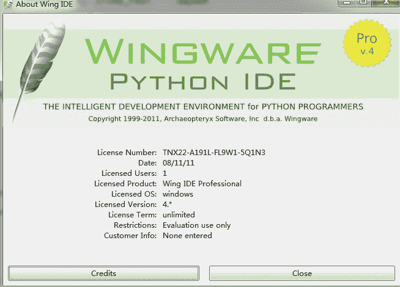

# 如何破解 python 程序破解 WingIDE v4

> 原文：[`www.pediy.com/kssd/pediy12/138599.html`](https://www.pediy.com/kssd/pediy12/138599.html)

来源 [`hi.baidu.com/vessial/blog/ite...c08244dd9.html`](http://hi.baidu.com/vessial/blog/item/4a2d2cfdafcd0c0c08244dd9.html)  
  
好久没上来了，发一篇共享下。  
  
对于 python 程序员来说 WingIDE 肯定不陌生，强大的功能成为我一直钟爱的 python development IDE,  
  
不过这个软件需要注册，之前一直在用 wing IDE 3.2 版,用的一直是网上的 10 天试用注册机，今天研究  
  
了一下，破解成无时间限制版了，此方法适用 wing IDE 的所有版本，把此方法记录下来，希望能够对  
  
大家有用，不过我最终还是希望大家能够购买正版软件，毕竟也不是很贵，不废话了。  
  
   
  
此过程是暴力破解，不涉及注册算法，有兴趣的可以自己研究一下，到时候可以给我分享一份。  
  
从[`wingware.com/pub/wingide/4.0....de-4.0.3-1.exe`](http://wingware.com/pub/wingide/4.0.3/wingide-4.0.3-1.exe)下载安装最新的版本，  
  
安装后获取一个 10 天试用版的 License, 打开你的 wingide 安装目录 C:\\Program Files (x86)\\Wing IDE 4.0\\bin\\2.5，  
  
注册验证的方法都在这个 src.zip 包里面，解压出里面 process 目录下的 abstract.pyo 文件，我的目的就是 crack 这个  
  
文件了，abstract.pyo 是被 python 优化编译过的文件，里面都是 bytecode，需要进行反汇编来分析它，关键问题  
  
就在这儿了，如何分析它，进而破解它，下面我将慢慢来描述如何进行分析。  
  
首先如何反汇编：  
  
去[`pypi.python.org/pypi/unpyclib/0.8.1`](http://pypi.python.org/pypi/unpyclib/0.8.1)下载  
  
这个 unpyclib python 库，解压出来后，进行反汇编，  
  
python application.py -d abstract.pyo > abstract.txt  
  
这儿需要分析这个反汇编结果了 abstract.txt, 我们需要关注的函数是\_GetTermDaysLeft  
  
如何阅读和分析 bytecode 的反汇编指令我就不赘叙了，自己查阅些资源进行学习，  
  
      STR: '\_GetTermDaysLeft' (10 00 00 00 5F 47 65 74 54 65 72 6D...)  
  
     .............................................  
  
                                         0000015B     64 - LOAD\_CONST          0  
  
                                         0000015E     74 - LOAD\_GLOBAL         'config'  
  
                                         00000161     5F - STORE\_ATTR          '\_locale\_valid'  
  
                                         00000164     74 - LOAD\_GLOBAL         'control'  
  
                                         00000167     69 - LOAD\_ATTR           'validate'  
  
                                         0000016A     7C - LOAD\_FAST           'lichash'  
  
                                         0000016D     7C - LOAD\_FAST           'lic'  
  
                                         00000170     64 - LOAD\_CONST          'os'  
  
                                         00000173     19 - BINARY\_SUBSCR         
  
                                         00000174     7C - LOAD\_FAST           'lic'  
  
                                         00000177     64 - LOAD\_CONST          'version'  
  
                                         0000017A     19 - BINARY\_SUBSCR         
  
                                         0000017B     7C - LOAD\_FAST           'lic'  
  
                                         0000017E     64 - LOAD\_CONST          'version'  
  
                                         00000181     19 - BINARY\_SUBSCR         
  
                                         00000182     69 - LOAD\_ATTR           'find'  
  
                                         00000185     64 - LOAD\_CONST          '.'  
  
                                         00000188     83 - CALL\_FUNCTION         
  
                                         0000018B     20 - SLICE+2               
  
                                         0000018C     7C - LOAD\_FAST           'hexact'  
  
                                         0000018F     83 - CALL\_FUNCTION         
  
                                         00000192     7D - STORE\_FAST          'valid'  
  
                                         00000195     74 - LOAD\_GLOBAL         'config'  
  
                                         00000198     69 - LOAD\_ATTR           '\_locale\_valid'  
  
                                         0000019B     7D - STORE\_FAST          'valid'  
  
                                         0000019E     57 - POP\_BLOCK             
  
                                         0000019F     6E - JUMP\_FORWARD        -> 000001AF  
  
                                         000001A2     01 - POP\_TOP               
  
                                         000001A3     01 - POP\_TOP               
  
                                         000001A4     01 - POP\_TOP               
  
                                         000001A5     64 - LOAD\_CONST          0  
  
                                         000001A8     7D - STORE\_FAST          'valid'  
  
                                         000001AB     6E - JUMP\_FORWARD        -> 000001AF  
  
                                         000001AE     58 - END\_FINALLY           
  
                                         000001AF     7C - LOAD\_FAST           'valid'  
  
                                         000001B2     70 - JUMP\_IF\_TRUE        -> 000001C9  
  
                                         000001B5     01 - POP\_TOP               
  
                                         000001B6     74 - LOAD\_GLOBAL         'kLicenseCorrupt'  
  
                                         000001B9     74 - LOAD\_GLOBAL         '\_'  
  
                                         000001BC     64 - LOAD\_CONST          'Invalid license activation'  
  
                                         000001BF     83 - CALL\_FUNCTION         
  
                                         000001C2     66 - BUILD\_TUPLE           
  
                                         000001C5     53 - RETURN\_VALUE          
  
                                         000001C6     6E - JUMP\_FORWARD        -> 000001CA  
  
                                         000001C9     01 - POP\_TOP               
  
                                         000001CA     7C - LOAD\_FAST           'self'  
  
                                         000001CD     69 - LOAD\_ATTR           '\_GetTermDaysLeft'  
  
                                         000001D0     7C - LOAD\_FAST           'lic'  
  
                                         000001D3     83 - CALL\_FUNCTION         
  
                                         000001D6     7D - STORE\_FAST          'daysleft'  
  
                                         000001D9     7C - LOAD\_FAST           'daysleft'  
  
                                         000001DC     64 - LOAD\_CONST          -1  
  
                                         000001DF     6A - COMPARE\_OP          "=="  
  
                                         000001E2     6F - JUMP\_IF\_FALSE       -> 000001F9  关键点在，修改 6F 成 70 就好了，这里为了判断时间是否不受限制。 这个地址在偏移 0x5425 修改这个字节  
  
                                         000001E5     01 - POP\_TOP               
  
                                         000001E6     74 - LOAD\_GLOBAL         '\_'  
  
                                         000001E9     64 - LOAD\_CONST          'unlimited'  
  
                                          000001EC     83 - CALL\_FUNCTION         
  
好了，把 abstract.pyo 再复制到这个 src.zip 文件中去，用 7zip 最方便了，先用 7zip 把 src.zip 里面 process 里面的 abstract.pyo 删除，然后把这个  
  
修改好的 abstract.pyo 添加进去，放到原来那个 C:\\Program Files (x86)\\Wing IDE 4.0\\bin\\2.5 目录，重启 wingide,再去看一下你的 Help->About  
  
 里面的 License，上面的时间已经是 unlimited 了，可以不受时间限制使用了。  
  
  
  
我把 src.zip 上传到 http://skyme.tk 上面，在下面的地址下载，替换原来安装目录  
  
C:\\Program Files (x86)\\Wing IDE 4.0\\bin\\2.5 下的 src.zip 即可。  
  
[`skyme.tk/tools/src.zip`](http://skyme.tk/tools/src.zip)  
  
   
  
enjoy it:-)