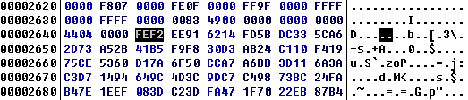
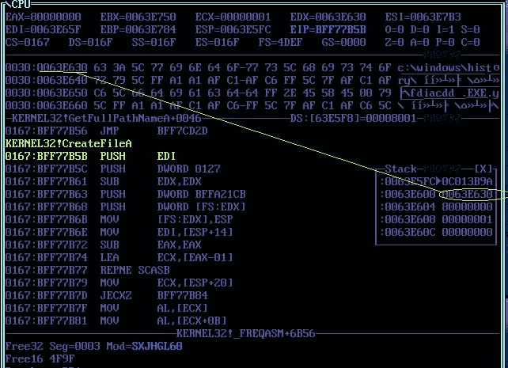
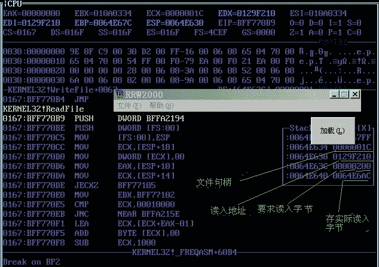
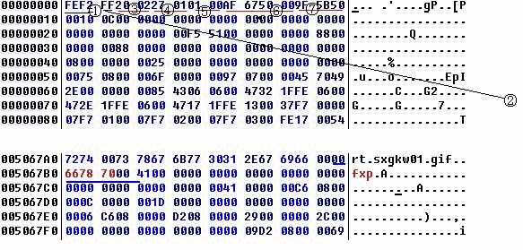
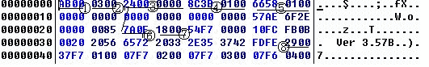
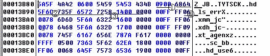
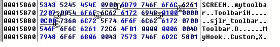

# 谈谈 vfp 程序的解密

> 原文：[`www.pediy.com/kssd/pediy05/pediy50514.htm`](https://www.pediy.com/kssd/pediy05/pediy50514.htm)

用了几个晚上的时间,将我破解 vfp 程序的心得用抓图的方式总结了一下,希望对  
爱好 vfp 程序的朋友能有所帮助,其中的错误也请大家指正。  
  
Visual Foxpro 做为一种面向对象的数据库语言，有其简单易用的特点，虽然经常受到各种各样的批评，微软发布 6.0 版后，也曾声明版本不再更新，但现在看来，VFP 程序还是有一定的生命力的，微软自 6.0 版以后开发了 7.0 版，目前 8.0beta 版在微软的官方网站已有下载。尤其在我国，早期 DOS 时代 DBaseIII 曾被广泛运用，VFP 出现后，源程序稍加改动就能变成可在 Window 平台运行的 VFP 版本，可以节省大量的资源，减少人员的二次培训。因此在我国 VFP 程序的用量还是较大的，专门开发此类程序的公司也不在少数。  
  
由于 VFP 程序的编译是一种伪编译过程，经过一定的处理，可以得到完整的源代码。自从 ReFox、UnFoxAll 等反编译软件出现后，为保护作者自己的利益，软件的加密保护就显得十分重要，相应的，VFP 程序的加密也越来越严。但由于 VFP 固有的特点—即解释执行，VFP 的解释器必须要得到可识别的代码，所以 VFP 程序的破解相对其他语音编译的程序来说，还是比较简单的。  
  
一、VFP EXE 程序的特点  
  
VFP 标准的编译 EXE 文件是如下一种格式：  
  
**可执行部分+APP 文件+结构说明**  
  
其中可执行部分是标准的 PE 文件，APP 部分就是 VFP 编译的应用程序代码，最后的结构为 14 个字节，用来描述 APP 文件，其中重要的是最后 4 个字节，反映的是 APP 文件的大小。  
  
头部的可执行部分只是简单地加载 VFP 的解释器（解释器名称为 vfp6r.dll、vfp7r.dll、vfp8r.dll 分别对应 6.0、7.0、8.0.版本）执行 app 文件。现在的加密软件大多利用这个特点，自己构造一个 PE 头，利用各种壳的技术保护 APP 代码。  
  
因此我们可以这样认为，对于 VFP 的可执行文件，除 APP 文件以外的可执行部分，都可认为是壳。  
  
二 APP 文件的结构  
  
1.app 文件结构  
  
app 文件是 vfp 生成的应用程序或 Active Document  
  
其结构为:  
  
字节偏移     说明  
  
0-1         文件标识 &Hf2fe 为 vfp 的 app  
  
2           加密标识 bit 0 为 1,未加密  
  
                     bit 0 为 0,加密,此时 bit 4(0 或 1)区分为两类  
  
3-4         编译版本 &H0220 -vfp 6.0/7.0  
  
                     &H021f -vfp 5.0  
  
5-6         文件数目  
  
7-8         主文件位置(从 0 开始)  
  
9-12        文件名列表地址  
  
13-16       文件说明结构列表地址  
  
17-20       文件名列表长度  
  
21-36       加密类型密码表  
  
37-38       解密 key  
  
39-40       文件校验和  
  
   
  
文件名列表地址  
  
\[目录名\],00,文件名,00,文件名,00,...  
  
   
  
文件说明结构列表地址  
  
每个文件占用 25 个 byte,总长度为文件数\*25  
  
0          文件类型 0 为代码 其他数据  
  
1-4        文件开始地址  
  
5-8        文件结束地址  
  
9-12       文件名相对文件名列表的首地址  
  
其他不详  
  
   
  
   
  
三、VFP 的加密特点及脱壳  
  
VFP 的加密基本上可以分为两种—文件型加密和内存型加密，这两种加密的区分主要在 APP 文件的存放位置，存放在某个文件中就为文件型，存放在内存中就叫内存型。但对解密者来说，关心的是算法。以上的分类加不加以区别问题不大。

  
  
1、文件头简单替换型  
  
这种加密方式是比较早期的一种加密方式，能够阻止反编译软件，但 APP 代码在文件中以明码出现，如 xx 王 5.05B([`www.cxsw168.com`](http://www.cxsw168.com))  
  
脱壳方法：  
  
打开 HEX，查找 FEF2 找到后与 APP 文件的结构对比一下，发现没有问题，把从 FEF2 开始到文件尾的数据存成一个文件，取名 XXX.app，脱壳完成。  
  
   
  
2、文件隐藏型  
  
这类加密在 exe 文件中已经没有 app 的明码了，app 文件是由主程序运行过程中动态生成的，以文件形式存在硬盘的某处。如 xx 通用计划管理系统 6.02([`www.sx168.com`](http://www.sx168.com))  
  
用 TRW2000 加载程序  
  
下断 bpx createfilea  
  
createfilea 的定义为：  
  
HANDLE CreateFile(  
  LPCTSTR lpFileName,          // pointer to name of the file  
  DWORD dwDesiredAccess,       // access (read-write) mode  
  DWORD dwShareMode,           // share mode  
  LPSECURITY\_ATTRIBUTES lpSecurityAttributes,    // pointer to security attributes  
  DWORD dwCreationDisposition,  // how to create  
  DWORD dwFlagsAndAttributes,  // file attributes  
  HANDLE hTemplateFile         // handle to file with attributes to copy  
);  
每次中断后观察打开的文件名，经过两次 foxpro.int 下面一个就是脱壳后的文件名了。  
  
   
  
文件放在 c:\\windows\\history\\…\\…exe  
因为 c:\\windows\\history\\是 windows 的系统目录,下面的文件不可显示,程序运行结束后又会删除这个文件,所以必须在程序没有结束前得到这个文件  
方法一:用 suspend 将程序挂起,用 procdump kill 现有进程,回 dos 利用 xcopy /s 将所有文件考出,处理  
方法二、利用 copyfilea 函数  
BOOL CopyFile(  
  LPCTSTR lpExistingFileName,  
                          // pointer to name of an existing file  
  LPCTSTR lpNewFileName,  // pointer to filename to copy to  
  BOOL bFailIfExists      // flag for operation if file exists  
);  
在上图的位置 r eax 0   r ebx 63e630  r edx 63e660  
将 63e660 地址的内容改成目的文件如 d:\\ab\\s.exe  
然后编一段代码  
a eip  
  push eax  
  push edx  
  push ebx  
  call copyfilea  
最后一句不能直接输入,要用 exescope 找到 import 中 copyfilea 的位置,计算相对地址用 ff 15 xx xx xx xx 填入  
单步运行完 copyfilea 后,隐藏的文件就被考出来了。  
考出的文件是 exe 文件,用 1 的方法就能得到 app 文件,但这个 app 文件可运行,用 unfoxall 反编译会出错,后面会讲到 app 文件的标准化处理。  
3 改变解释器动态解码  
这种加密方式采用了狗的方式，用 trw2000 加载跟踪时，在文件开始运行的代码部分会看到大量的花指令，再将主文件加密的同时，它把解释动态连接库也进行了加壳，运行时用壳中的代码将 app 文件解码后执行。因 vfp6r.dll 被改动,无法放到系统目录下，因此文件安装目录下能看到 vfp6r.dll，用 exescope 文件观察此文件，能看到 gtide 段，这就是这种文件的特征。  
例如：xx 建筑工程预结算系统 6.6 版([`fjjlsoft.yeah.net`](http://fjjlsoft.yeah.net))  
 处理方法:采用 2 的方法下断 createfilea，得到调用文件后，下断 readfile，  
readfile 定义如下：  
BOOL ReadFile(  
  HANDLE hFile,                // handle of file to read  
  LPVOID lpBuffer,             // pointer to buffer that receives data  
  DWORD nNumberOfBytesToRead,  // number of bytes to read  
  LPDWORD lpNumberOfBytesRead, // pointer to number of bytes read  
  LPOVERLAPPED lpOverlapped    // pointer to structure for data  
);  
第 3 次读 200byte 时中断，在读出的代码处下断，bpm xxxxxxxx，观察程序如何解码  
  
   
  
解码部分的指令  
0167:0C2FA505  INC      DWORD \[EBP-04\]         已处理字节数  
  
0167:0C2FA508  MOV      EAX,\[EBP+0C\]           要处理字节数  
  
0167:0C2FA50B  CMP      \[EBP-04\],EAX  
  
0167:0C2FA50E  JNC      0C2FA53A  
  
0167:0C2FA510  MOV      EAX,\[EBP-04\]  
  
0167:0C2FA513  MOV      ECX,\[EBP+08\]           要处理数据的首地址  
  
0167:0C2FA516  XOR      EDX,EDX  
  
0167:0C2FA518  MOV      DL,\[ECX+EAX\]           要处理的数据送 DL  
  
0167:0C2FA51B  MOV      AL,\[EDX+0C3352E2\]    0C3352E2—0C3354E2 512 个字节为密钥  
  
0167:0C2FA521  MOV      \[EBP-08\],AL  
  
0167:0C2FA524  XOR      EAX,EAX  
  
0167:0C2FA526  MOV      AL,\[EBP-08\]  
  
0167:0C2FA529  MOV      AL,\[EAX+0C3353E2\]  
  
0167:0C2FA52F  MOV      ECX,\[EBP-04\]  
  
0167:0C2FA532  MOV      EDX,\[EBP+08\]  
  
0167:0C2FA535  MOV      \[EDX+ECX\],AL  
  
                JMP      0C2FA505  
W 0C3352E2 0C3354E2  key.bin  
记下读出的内容,用 hex workshop 在主文件中查找,将到文件尾的内容写入另一个文件 code.bin  
用 VB 的语言，上述的解密算法为  
Dim keyfiledata(0 to 511) As Byte  
Dim codefiledata() As Byte  
Dim middata() As Byte  
Dim keyfilelen As Long  
 Open " Key.bin" For Binary As #1  
      Get #1, 1, keyfiledata()  
  Close #1  
keyfilelen = FileLen("code.bin")  
Redim keyfiledata(0 to keyfilelen-1) as byte  
Redim middata(0 to keyfilelen-1) as byte  
    
  Open "code.bin" For Binary As #2  
Get #2, i, codefiledata  
Close #2  
For I=0 to keyfilelen-1  
Middata(i) = keyfiledata(keyfiledata(codefiledata (i)) + 256)  
Next i  
 Open "code.app" For Binary As #2  
     Put #2, 1, middata()  
  Close #2  
   MsgBox "finish"  
得到 app 文件  
4 改变解释器的加密方式  
这种文件的加密方式的 app 文件是以加密 app 的方式出现,加密者将 vfp6r.dll 的解密部分代码和文件头标志加以改变，变成自己的动态连接库,这个库文件同样放在文件的安装目录下,但有的程序采用了一定的手段让用户看不到这个文件。  
例如：xx 工程造价软件 6.6 版([`www.ztys.com`](http://www.ztys.com))  
这个软件安装后,改变注册表 HKEY\_LOCAL\_MACHINE\\software\\Microsoft\\windows\\currentversion\\explorer\\advanced\\folder\\hidden\\showall\\checkedvalue  
将键值由 0 改为 1,这样隐含系统文件你就看不到了，我认为这种方法是不可取得，文件加密的同时不应干扰用户其他的功能，利用这种方法有点缺德之嫌。  
就以这个程序为例，首先比较一下正规的 vfp6r.dll 和程序用的 vfp6r.dll 有何不同  
0167:0C02102E  MOV      ECX,02  
  
0167:0C021033  MOV      EDI,0C2F24C8              \[edi\]为 c4c5 正常为 fef2  
  
0167:0C021038  MOV      ESI,EBX  
  
0167:0C02103A  XOR      EDX,EDX  
  
0167:0C02103C  REPE CMPSB   
  
0167:0C02103E  JNZ      NEAR 0C0EF608             不等则跳,与其它值比较  
  
0167:0C021044  MOV      AL,\[EBX+02\]  
  
0167:0C021047  NOT      EAX  
  
0167:0C021049  TEST     AL,01  
  
0167:0C02104B  JNZ      0C021096                  是加密的则跳  
  
0167:0C02104D  MOV      ESI,01  
  
0167:0C021052  MOV      BYTE \[0C30D2FC\],00  
  
0167:0C021059  MOVZX    CX,\[EBX+04\]  
  
0167:0C02105E  MOVZX    AX,\[EBX+03\]  
  
0167:0C021063  SHL      ECX,08  
  
0167:0C021066  ADD      EAX,ECX  
  
0167:0C021068  MOV      ECX,\[0C2F24C4\]  
  
0167:0C02106E  AND      EAX,FFFF  
  
0167:0C021073  CMP      EAX,ECX                     比较文件的版本  
  
0167:0C021075  JNZ      NEAR 0C0EF5E8  
  
0167:0C02107B  MOV      ECX,EBX  
  
0167:0C02107D  CALL     0C0210C6  
  
0167:0C021082  CMP      AX,\[EBX+27\]  
  
0167:0C021086  JNZ      NEAR 0C0EF5FB  
  
0167:0C02108C  MOV      EAX,ESI  
  
0167:0C02108E  POP      EDI  
  
0167:0C02108F  POP      ESI  
  
0167:0C021090  POP      EBP  
  
0167:0C021091  POP      EBX  
  
0167:0C021092  POP      ECX  
  
0167:0C021093  RET      0C  
  
0167:0C021096  MOV      ECX,EBX  
  
0167:0C021098  CALL     0C0A863D                        解密部分 0  
  
0167:0C02109D  MOV      ECX,EBX  
  
0167:0C02109F  CALL     0C0A8727                 解密部分 1  
  
0167:0C0210A4  MOV      ESI,\[ESP+1C\]  
  
0167:0C0210A8  MOV      ECX,\[ESI\]  
  
0167:0C0210AA  CALL     0C005392                 解密部分 2  
  
0167:0C0210AF  MOV      ECX,EBX  
  
0167:0C0210B1  CALL     0C0A879D                   解密部分 3  
  
0167:0C0210B6  MOV      \[ESI\],EAX  
  
0167:0C0210B8  MOV      BYTE \[0C30D2FC\],01  
  
0167:0C0210BF  MOV      ESI,02  
  
0167:0C0210C4  JMP      SHORT 0C021059  
  
   
  
   
  
0167:0C0A863D  SUB      ESP,BYTE +10  
  
0167:0C0A8640  MOV      AL,\[ECX+02\]  
  
0167:0C0A8643  PUSH     EBX  
  
0167:0C0A8644  NOT      EAX  
  
0167:0C0A8646  SHR      EAX,04  
  
0167:0C0A8649  MOV      BX,\[ECX+25\]                 25-26 位解密的密钥  
  
0167:0C0A864D  AND      EAX,BYTE +01  
  
0167:0C0A8650  MOV      \[ESP+10\],EAX  
  
0167:0C0A8654  LEA      EAX,\[ECX+25\]  
  
0167:0C0A8657  PUSH     EBP  
  
0167:0C0A8658  PUSH     ESI  
  
0167:0C0A8659  XOR      ESI,ESI  
  
0167:0C0A865B  AND      EBX,FFFF  
  
0167:0C0A8661  PUSH     EDI  
  
0167:0C0A8662  MOV      \[ESP+14\],ECX  
  
0167:0C0A8666  MOV      \[ESP+18\],EAX  
  
0167:0C0A866A  MOV      \[0C3171EE\],SI  
  
0167:0C0A8671  MOV      \[ESP+10\],EBX  
  
0167:0C0A8675  MOV      EBP,0F  
  
0167:0C0A867A  MOV      EAX,ESI  
  
0167:0C0A867C  CDQ       
  
0167:0C0A867D  XOR      EAX,EDX  
  
0167:0C0A867F  SUB      EAX,EDX  
  
0167:0C0A8681  AND      EAX,BYTE +07  
  
0167:0C0A8684  XOR      EAX,EDX  
  
0167:0C0A8686  MOV      EDI,EAX  
  
0167:0C0A8688  MOV      AL,\[ESI+ECX+15\]  
  
0167:0C0A868C  SUB      EDI,EDX  
  
0167:0C0A868E  MOV      EDX,01  
  
0167:0C0A8693  MOV      ECX,EDI  
  
0167:0C0A8695  SHL      EDX,CL  
  
0167:0C0A8697  MOV      ECX,EBP  
  
0167:0C0A8699  AND      DL,AL  
  
0167:0C0A869B  NEG      DL  
  
0167:0C0A869D  SBB      EDX,EDX  
  
0167:0C0A869F  NEG      EDX  
  
0167:0C0A86A1  SHL      EDX,CL  
  
0167:0C0A86A3  MOV      ECX,ESI  
  
0167:0C0A86A5  OR       \[0C3171EE\],DX              计算的 key1,以后还要用到  
  
0167:0C0A86AC  MOV      EDX,01  
  
0167:0C0A86B1  SHL      EDX,CL  
  
0167:0C0A86B3  MOV      ECX,EDI  
  
0167:0C0A86B5  AND      EDX,EBX  
  
0167:0C0A86B7  MOV      BL,01  
  
0167:0C0A86B9  NEG      EDX  
  
0167:0C0A86BB  SBB      EDX,EDX  
  
0167:0C0A86BD  SHL      BL,CL  
  
0167:0C0A86BF  NEG      EDX  
  
0167:0C0A86C1  SHL      DL,CL  
  
0167:0C0A86C3  MOV      ECX,\[ESP+14\]  
  
0167:0C0A86C7  NOT      BL  
  
0167:0C0A86C9  AND      BL,AL  
  
0167:0C0A86CB  OR       DL,BL  
  
0167:0C0A86CD  MOV      \[ESI+ECX+15\],DL  
  
0167:0C0A86D1  INC      ESI  
  
0167:0C0A86D2  DEC      EBP  
  
0167:0C0A86D3  CMP      EBP,BYTE -01  
  
0167:0C0A86D6  JNG      0C0A86DE  
  
0167:0C0A86D8  MOV      EBX,\[ESP+10\]  
  
0167:0C0A86DC  JMP      SHORT 0C0A867A  
  
0167:0C0A86DE  MOV      EDI,\[ESP+18\]  
  
0167:0C0A86E2  LEA      EAX,\[ECX+03\]  
  
0167:0C0A86E5  CMP      EAX,EDI  
  
0167:0C0A86E7  MOV      DL,FE  
  
0167:0C0A86E9  JNC      0C0A871F  
  
0167:0C0A86EB  MOV      ESI,\[ESP+1C\]  
  
0167:0C0A86EF  MOV      CX,\[0C3171EE\]  
  
0167:0C0A86F6  MOV      BL,\[EAX\]  
  
0167:0C0A86F8  XOR      DL,CL  
  
0167:0C0A86FA  XOR      BL,DL  
  
0167:0C0A86FC  TEST     ESI,ESI  
  
0167:0C0A86FE  MOV      \[EAX\],BL  
  
0167:0C0A8700  MOV      DL,BL  
  
0167:0C0A8702  JZ       NEAR 0C0D34C6  
  
0167:0C0A8708  IMUL     CX,CX,273D                 ** 正常为 184d**  
  
0167:0C0A870D  ADD      ECX,236D                   **  正常为 347d**   
  
0167:0C0A8713  INC      EAX  
  
0167:0C0A8714  CMP      EAX,EDI  
  
0167:0C0A8716  JC       0C0A86F6  
  
0167:0C0A8718  MOV      \[0C3171EE\],CX  
  
0167:0C0A871F  POP      EDI  
  
0167:0C0A8720  POP      ESI  
  
0167:0C0A8721  POP      EBP  
  
0167:0C0A8722  POP      EBX  
  
0167:0C0A8723  ADD      ESP,BYTE +10  
  
0167:0C0A8726  RET       
  
其他几处 call 中也有改动,这里就不细说了,因为这部分代码很短写个解密程序处理最为方便,处理前首先用 hex workshop 查找 c4c5ee,将从这开始到最后的代码存成一个文件,处理完后将 app 文件中的 c4c5 全部改为 fef2,注意这时文件的 checksum 值会变动,运行时会报告不是 vfp 的对象文件,动态跟踪一下,在上面第一段代码 ret 之后就是 chexksum 的比较,按正确的改过来就可以了.  
5 vfpexenc 内存加密  
vfpexenc 的加密方式比较特殊,它把动态解出的加密 app 文件放在内存中而不是放在一个文件里,但这对解密者没有什么不同,难度是 vfpexenc 在代码中增加了 anti-debug 代码,发现有跟踪立即停止运行,报告”文件无法打开”,结束。可是幸运的是，加密的 vfp 程序中并没有采用 vfpexenc 中的 seh、sidt 判断 int1 的技术，而只是简单地判断内存进程标题名，这种厚己薄彼的做法给破解者带来了极大的方便。  
先看看程序是如何反跟踪的（vfpexenc3.7）  
0167:0041994A  PUSH     DWORD FF  
  
0167:0041994F  PUSH     EDI  
  
0167:00419950  PUSH     EBX  
  
0167:00419951  CALL     \`USER32!GetClassNameA\`  
  
0167:00419956  TEST     EAX,EAX  
  
0167:00419958  JNG      004199BC  
  
0167:0041995A  LEA      EDX,\[EBP+FFFFFEF8\]  
  
0167:00419960  MOV      EAX,EDI  
  
0167:00419962  CALL     00407E90  
  
0167:00419967  MOV      EAX,\[EBP+FFFFFEF8\]  
  
0167:0041996D  LEA      EDX,\[EBP-04\]  
  
0167:00419970  CALL     00407684  
  
0167:00419975  MOV      EAX,\[EBP-04\]  
  
0167:00419978  MOV      EDX,00419A70        edx 是要判断的文件名  
  
0167:0041997D  CALL     00404620  
  
0167:00419982  JZ       004199B1             相等就结束了  
  
0167:00419984  MOV      EAX,\[EBP-04\]  
  
0167:00419987  MOV      EDX,00419A80           比较第二个   
  
0167:0041998C  CALL     00404620  
  
0167:00419991  JZ       004199B1  
  
0167:00419993  MOV      EAX,\[EBP-04\]  
  
0167:00419996  MOV      EDX,00419A98           比较第 3 个  
  
0167:0041999B  CALL     00404620  
  
0167:004199A0  JZ       004199B1  
  
0167:004199A2  MOV      EAX,\[EBP-04\]  
  
0167:004199A5  MOV      EDX,00419AA8           比较第 4 个  
  
0167:004199AA  CALL     00404620  
  
0167:004199AF  JNZ      004199BC  
  
0167:004199B1  PUSH     BYTE +00  
  
0167:004199B3  PUSH     EBX  
  
0167:004199B4  CALL     \`USER32!EnableWindow\`  
  
0167:004199B9  OR       ESI,BYTE -01  
  
0167:004199BC  PUSH     DWORD FF  
  
0167:004199C1  PUSH     EDI  
  
0167:004199C2  PUSH     EBX  
  
  
0167:004199C3  CALL     \`USER32!GetWindowTextA\`            取 WindowText  
  
0167:004199C8  TEST     EAX,EAX  
  
0167:004199CA  JNG      00419A1D  
  
0167:004199CC  LEA      EDX,\[EBP+FFFFFEF4\]  
  
0167:004199D2  MOV      EAX,EDI  
  
0167:004199D4  CALL     00407E90  
  
0167:004199D9  MOV      EAX,\[EBP+FFFFFEF4\]  
  
0167:004199DF  LEA      EDX,\[EBP-04\]  
  
0167:004199E2  CALL     00407684  
  
0167:004199E7  MOV      EDX,\[EBP-04\]  
  
0167:004199EA  MOV      EAX,00419AB4  
  
0167:004199EF  CALL     004047BC  
  
0167:004199F4  TEST     EAX,EAX  
  
0167:004199F6  JG       00419A1A  
  
0167:004199F8  MOV      EDX,\[EBP-04\]  
  
0167:004199FB  MOV      EAX,00419AC4  
  
0167:00419A00  CALL     004047BC  
  
0167:00419A05  TEST     EAX,EAX  
  
0167:00419A07  JG       00419A1A  
  
0167:00419A09  MOV      EDX,\[EBP-04\]  
  
0167:00419A0C  MOV      EAX,00419AE4  
  
0167:00419A11  CALL     004047BC  
  
0167:00419A16  TEST     EAX,EAX  
  
0167:00419A18  JNG      00419A1D  
  
0167:00419A1A  OR       ESI,BYTE -01  
  
0167:00419A1D  PUSH     BYTE +02  
  
0167:00419A1F  PUSH     EBX  
  
0167:00419A20  CALL     \`USER32!GetWindow\`           
  
0167:00419A25  MOV      EBX,EAX  
  
0167:00419A27  TEST     EBX,EBX  
  
0167:00419A29  JNZ      NEAR 0041994A  
  
用 d 00419A70 就能看到要比较的文件,分别是 whxmdi0、filemonclass、ollydbg、trw2000、import reconstructor、prodump  
我用的是 trw2000，只要将内存中的 trw2000 改为其他的名字就不会有问题了，为了一劳永逸，我用 hex workshop 将 trw2000.exe 及.sys 中的 ansi、unicode 码的 trw 都改成了 trd  
再运行时这段反跟踪代码就不起作用了。  
反跟踪解决了，下一步就是脱壳了  
例子：xx 大师 3.57b ([`www.cnytsoft.com/`](http://www.cnytsoft.com/))  
这个软件是由 vfpexenc 加密的, vfpexenc 加密的软件会有一个 vfpnc 段，是这种加密方式的一个重要标志。下面看看它的动态解密算法：  
0167:0041D79A  MOV      EAX,\[00421AC8\]  
  
0167:0041D79F  SUB      EAX,BYTE +0E  
  
0167:0041D7A2  CMP      EDI,EAX  
  
0167:0041D7A4  JNZ      0041D7AA  
  
0167:0041D7A6  XOR      EBX,EBX  
  
0167:0041D7A8  JMP      SHORT 0041D7B5  
  
0167:0041D7AA  MOV      EBX,EDI  
  
0167:0041D7AC  SUB      EBX,\[00421AC8\]  
  
0167:0041D7B2  ADD      EBX,BYTE +0E  
  
0167:0041D7B5  MOV      EAX,\[00421AC0\]  
  
0167:0041D7BA  SUB      EAX,EBX  
  
0167:0041D7BC  CMP      EAX,\[EBP+10\]  
  
0167:0041D7BF  JC       0041D7C6  
  
0167:0041D7C1  MOV      ESI,\[EBP+10\]  
  
0167:0041D7C4  JMP      SHORT 0041D7C8  
  
0167:0041D7C6  MOV      ESI,EAX  
  
0167:0041D7C8  MOV      EDX,\[EBP+0C\]                 目的地址  
  
0167:0041D7CB  MOV      EAX,\[00421ACC\]  
  
0167:0041D7D0  ADD      EAX,EBX                     \* 源地址—从此地址开始内存放的是加密的 app 文件  
  
0167:0041D7D2  MOV      ECX,ESI                      个数  
  
0167:0041D7D4  CALL     0040282C                     将源地址内容移动到目的地址  
  
0167:0041D7D9  CMP      BYTE \[00421AD6\],00           flag 1 成功  
  
0167:0041D7E0  JZ       0041D7EE                     
  
0167:0041D7E2  LEA      EAX,\[EBP+0C\]                解密数据地址  
  
0167:0041D7E5  MOV      EDX,ESI                     数据个数  
  
0167:0041D7E7  CALL     0041D5A0                    解密算法  
  
0167:0041D7EC  JMP      SHORT 0041D7FA  
  
0167:0041D7EE  LEA      EAX,\[EBP+0C\]  
  
0167:0041D7F1  MOV      ECX,EBX  
  
0167:0041D7F3  MOV      EDX,ESI  
  
0167:0041D7F5  CALL     0041D5DC  
  
0167:0041D7FA  MOV      EAX,\[EBP+14\]  
  
0167:0041D7FD  MOV      \[EAX\],ESI  
  
0167:0041D7FF  OR       EDI,BYTE -01  
  
0167:0041D802  MOV      EAX,EDI  
  
0167:0041D804  POP      EDI  
  
   
0167:0041D5A0  PUSH     EBX  
  
0167:0041D5A1  PUSH     ESI  
  
0167:0041D5A2  MOV      EBX,EDX  
  
0167:0041D5A4  MOV      ESI,EAX  
  
0167:0041D5A6  CALL     0041D578          处理解密的密钥，得到正确的密钥  
  
0167:0041D5AB  MOV      EDX,EBX  
  
0167:0041D5AD  DEC      EDX  
  
0167:0041D5AE  TEST     EDX,EDX  
  
0167:0041D5B0  JL       0041D5D2  
  
0167:0041D5B2  INC      EDX  
  
0167:0041D5B3  XOR      EAX,EAX  
  
0167:0041D5B5  MOV      ECX,\[ESI\]           加密数据地址  
  
0167:0041D5B7  MOV      CL,\[ECX+EAX\]        取加密数据  
  
0167:0041D5BA  AND      ECX,FF  
  
0167:0041D5C0  MOV      EBX,\[00421AD0\]      密钥的地址  
  
0167:0041D5C6  MOV      CL,\[EBX+ECX\]        得到正确的数据  
  
0167:0041D5C9  MOV      EBX,\[ESI\]  
  
0167:0041D5CB  MOV      \[EBX+EAX\],CL  
  
0167:0041D5CE  INC      EAX  
  
0167:0041D5CF  DEC      EDX  
  
0167:0041D5D0  JNZ      0041D5B5  
  
0167:0041D5D2  CALL     0041D578             将密钥重新加密  
  
0167:0041D5D7  POP      ESI  
  
算法有了，首先要得到密钥，0041D5C0  MOV  EBX,\[00421AD0\]  ebx 开始的 512 个字节就是了，按 3 的方法存成一个文件。因为程序用完密钥后，会再次加密，只能在这部分代码处得到正确的 key。  
关键是得到 app，看这一句 0167:0041D7D0  ADD      EAX,EBX ，这时 eax 就是 app 的开始地址，文件的长度可通过在此设断，eax 会逐渐增大，得到最大值+长度就是 app 的末尾。同样按 3 的方法存成一个文件，再编个程序处理，就能得到正确的 app。   
   
四、 App 文件的标准化处理  
用上面的方法得到的 app 文件可以在 vfp 的解释环境下运行，但加密者利用 vfp 程序动态运行和静态调试的不同，将 app 文件的结构加以改变，用来阻止 unfoxall 等软件得到源码。其主要的方法有如下几种：  
1． 改变文件描述表的起始地址数据  
  
   
  
①文件头标志  
  
②FF 未加密  
  
③0220 VFP6.0/7.0 版本  
  
④文件数 295  
  
⑤主文件位置 第 2 个(0 为第一个)  
  
⑥文件名列表位置 505B9F  
  
⑦文件描述表位置 5067AF  
  
看 5057AF 内容 00—可执行程序  00707866—文件开始地址 00000041—文件结束地址  
  
文件的结束地址小于文件的开始地址，文件的长度为负值，UNFOXALL 反编译时一定出错，但运行时为何不出错呢？因为这个文件是加入的一个垃圾文件，运行是永远用不到它，当然不会出错了，它的用途就是对付反编译的。将 66 78 70 改成 29 00 00 就不会有问题了。  
  
2.改变 fxp mpx vct sct 文件结构  
  
fxp 具有与 app 文件相同的结构,0-40 字节定义同上,不同的是其文件数目为 1  
  
从第&h29 开始为 fxp 文件的定义  
  
字节偏移     说明  
  
0-1         自定义过程和函数数目  
  
2-3         自定义类数目  
  
4-7         指向代码开始位置  
  
8-11        自定义过程和函数定义开始位置  
  
12-15       自定义类定义开始位置  
  
16-19       与调试有关,具体不详  
  
20-23       调试信息数量  
  
24-27       调试信息开始地址  
  
   
  
自定义过程或函数定义  
  
0-1        过程名长度  
  
2-n+1      过程名  
  
n+2-n+5    过程代码开始位置  
  
n+6-n+9    状态  
  
   
  
自定义类定义  
  
0-1        类名长度  
  
2-n+1      类名  
  
n+2-n+3    父类名长度 m  
  
n+3-n+m+3  父类名  
  
~4 byte    类代码开始地址  
  
~2 byte    状态  
  
下面举个例子，这个是 xx 大师的主文件。  
  
  
①自定义函数或过程数量 171 个  
②自定义类数量 3 个  
③程序开始地址  
④自定义函数或过程描述表地址  
⑤自定义类描述表地址  
⑥文件代码总长度  
⑦第 1 行代码长  
⑧第 2 行代码长  
标准结构③应为 25，UNFOXALL 反编译时如果③不是 25 就会反编译出一些乱码，将③变成 25，在 85 前插入一个 0,这样还得修正各种指针，包括自定义函数或过程、自定义类描述表中的地址指针  
自定义函数或过程  
  
   
  
①第 1 个自定义函数或过程名称长度 9  
②第 1 个自定义函数或过程名称 hd\_is\_errX  
③代码开始地址 1458  
④第 2 个自定义函数或过程名称长度 6  
  
   
  
①第一个自定义类名称长度 9  
②第一个自定义类名称 mytoolbar  
③第一个自定义类父类名称长度 7  
④第一个自定义类父类名称 Toolbar  
⑤第一个自定义类代码位置 014869  
⑥第 2 个自定义类名称长度 12  
将相应的全部指针按移动的字节数加以修正,如果子程序特别多,最好写个程序处理比较方便  
另外 vct sct 中保存的代码也可以按如上方式处理。但必须要保证长度不能改变。  
3 改变 scx vcx 结构  
加密者将 scx vcx 文件最后去掉若干个 0，这样 modi form 是会告知不是表。因为 scx vcx 是结构固定的表，可参照 vfp 关于表结构的帮助加以修订，修订比较简单，这里就不多说了。  
   
五、 总结  
目前 vfp 文件的加密强度不是很大，主要是壳与解释库之间的界限还比较分明，vfpexenc 在模糊它们之间的界限方面做了些工作，我想这可能是今后 vfp 文件加密的方向。  
Vfp 文件的破解与其他语言编写文件的破解不同，vfp 文件一旦被破，得到的将是文件的源代码，因此，希望破解者能最大限度地保护作者的著作权。  
   
Sway \[CCG\]  
2003．03．28 

<  4dd466d0e1e0cc123afbe504da2462ca