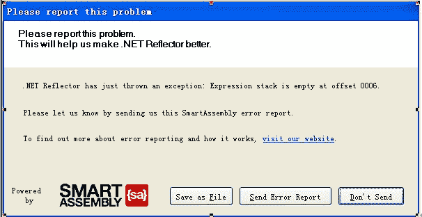
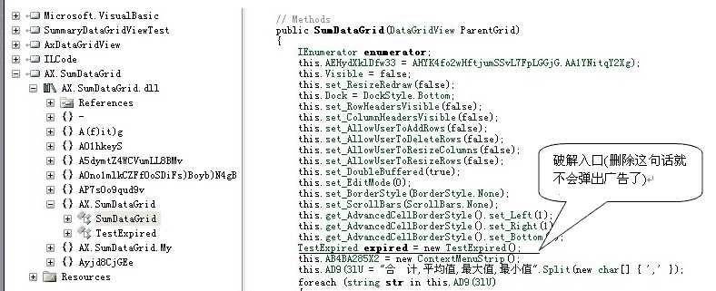

# 破解合计行控件 AX.SumDataGrid.dll

> 原文：[`www.pediy.com/kssd/pediy12/131499.html`](https://www.pediy.com/kssd/pediy12/131499.html)

破解合计行控件 AX.SumDataGrid.dll(仅供大家学习交流,勿用于商业用途)  
  
主程序调用 AX.SumDataGrid.dll 时会先出现下面界面,下面开始破解这个 dll  
  先用 Reflector 分析,可以加载,但程序是被混淆(加密)过的,可以看到类名(大部分被改成无序的名称了),但要打开类,看类里的代码时会出现  “Expression stack is empty at offset 0006”  
   
照着上面的错误提示 google 了一下,找到了”看雪”, 看雪大牛如是说:  
程序是用 .Net Reactor 混淆过的  
用 dotnet helper 反编译得到 IL 文件，  
用文本编辑器删除以下的文本段：  
    IL\_0000:  br         IL\_0007  
  
    IL\_0005:  pop  
    IL\_0006:  ldc.i4.0  
，再编译。  
得到的文件可以用 reflector 看 C#源码  
  
我照作了,果然 OK,可以看到函数内部代码了  
  
于是找到底是哪段代码让上面那个广告弹出来的,刚开始想从反混淆着手破解,先用 reflector 把 AX.SumDataGrid.dll 反成 C#代码,然后再根据自己 2 个月的 C#学习经验来调试,但是看啊看,实在太累人了,代码里有好多”asdfsdf(“  和  ” Adse)jou”之类的字符串变量,查找替换了老半天,里面还是有很多错误的地方,还是不能编译成 DLL,可能这条路行不通.  
后来换了思路,找程序的破解入口,也就是说哪句话让那个广告窗口出来了(当时想着找关键字 show()),后来在 reflector 中看代码,分析出来了,是下面这句,后来验证果真不错,哈哈,这两个月的 C#也不是白学的  
  
破解前  
   
但是知道是这句代码了,还有一个问题没解决:怎么把这句话给去掉(或注释掉)???   现在有的可只是一个 DLL 文件啊,没有源码啊,自己又不懂 IL 语言,不会修改,后来临时补了下 IL 语言(在网上找了一点儿,临时抱佛脚),学了老半天,也还是找不到上面的这个破解入口点所对应的 IL 代码部分.  
下午下班吃完饭,内急,去蹲厕所, 蹲着蹲着,嘿灵感来了,我顿时有种预感破解就要成功了,果真如是  
  
新建一个工程,什么也不要往里边加,就只在一个新定义的函数中添加(还得在工程里新添加一个空类 TestExpired)  
public void ABC()  
        {  
            TestExpired expired = new TestExpired();  
        }  
把这个 EXE 转成 IL 代码,这样 IL 代码就会很短,更容易查找目标,经验证把 IL 代码中的  
    .maxstack  1  
    .locals init (class ILCode.TestExpired V\_0)  
    IL\_0000:  nop  
    IL\_0001:  newobj     instance void ILCode.TestExpired::.ctor()  
    IL\_0006:  stloc.0  
    IL\_0007:  ret  
部分去掉,再用 dotnet helper 编译回 EXE 文件,可以正常运行, 加载到 reflector 后, public void ABC()部分就变成了  
public void ABC()  
        {   
        }  
在 AX.SumDataGrid.dll 的 IL 代码里去掉下面两行(或注释这两行)  
    IL\_0093:  newobj     instance void AX.SumDataGrid.TestExpired::.ctor()  
    IL\_0098:  stloc.0  
,然后再用 dotnet helper 编译得到 DLL 文件,再加载到 reflector 中后如下,没有 TestExpired expired = new TestExpired();这句了,如下图所示.  
再用主程序调用 AX.SumDataGrid.dll 也没有广告窗口了,OK………………..完!!!!!!!!!!!!!!!!!!!!!!