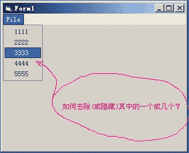

# 关于 VB 程序的菜单

> 原文：[`www.pediy.com/kssd/pediy12/136657.html`](https://www.pediy.com/kssd/pediy12/136657.html)

 

VB 程序真让人头痛，实在没办法了，向大家请教，谢谢。  
  
  
  
VBMenu.rar  
  
  
[`u.115.com/file/bh5cqbwx#`](http://u.115.com/file/bh5cqbwx#)     文件名：VBMenu.rar 

在网上找到这篇文章，你可以看一下  
[`www.vb-decompiler.org/forms\_editing.htm`](http://www.vb-decompiler.org/forms_editing.htm)  
  
对应的你可以在程序菜单字节中加 05 00 字节，05 表示 Enable 属性， 00 表示不显示。或者直接把相应的菜单节删除掉。当然，这些都影响到整个菜单区间的大小，要改相应的属性。  
如第一个“1111”的属性字节如下  
  
0040123C  19 00 00 80 02 00 00 02 00 77 6A 00 13 01 00 00  .....wj...  
0040124C  03 04 00 31 31 31 31 00 FF 02                    .1111. 

00401283   .  33 33 33 33 0>ascii "3333",0  
00401288      FF            db FF  
00401289      02            db 02  
0040128A      19            db 19  
0040128B      00            db 00  
0040128C      00            db 00  
0040128D      80            db 80  
0040128E      02            db 02  
0040128F      02            db 02       //3 改为 2，就可以屏蔽掉 3 这个菜单。因为没有菜单的具体功能，  
                                                    //不知道功能实际有无变化。暂不影响其它菜单。但功能不清楚。  
00401290      00            db 00  
00401291      02            db 02  
00401292      00            db 00  
  
  
  
// 以下为 VB 的两个，一个设置为不可见，一个为正常。可以看到区别。不可见的，会多两个字节，不知道如果把正常的，改为不可见的。因为，正常的会比不可见的少字节。不知道楼上的那个大牛是如何做到的？当然要保证菜单自己的功能  
  
//正常的。  
00402396   .  6D 6E 75 48 6>ascii "mnuHelpb",0  
0040239F      13            db 13  
004023A0      03            db 03  
004023A1      01            db 01  
004023A2      00            db 00  
004023A3      32            db 32                                     ;  CHAR '2'  
004023A4      00            db 00  
004023A5      FF            db FF  
004023A6      02            db 02  
004023A7      17            db 17  
004023A8      00            db 00  
004023A9      00            db 00  
004023AA      00            db 00  
004023AB      04            db 04  
004023AC      08            db 08  
004023AD      00            db 00  
  
//不正常的。  
00402396   .  6D 6E 75 48 6>ascii "mnuHelpb",0  
0040239F      13            db 13  
004023A0      02            db 02   //多了  
004023A1      00            db 00  //这两个字节。  
004023A2      03            db 03  
004023A3      01            db 01  
004023A4      00            db 00  
004023A5      32            db 32                                     ;  CHAR '2'  
004023A6      00            db 00  
004023A7      FF            db FF  
004023A8      02            db 02  
004023A9      17            db 17  
004023AA      00            db 00  
004023AB      00            db 00  
004023AC      00            db 00  
004023AD      04            db 04  
004023AE      08            db 08  
004023AF      00            db 00 

引用: *最初由 **fairynull**发布*  00401283   .  33 33 33 33 0>ascii "3333",0  
00401288      FF            db FF  
00401289      02            db 02  
0040128A      19            db 19  
00401... 

第一：为什么 vb 生成的程序正常的比不可见（或无效）的少两个字节？  
因为，vb 控件默认为可见/有效，所以，如果属性为可见/有效都在编译时优化掉了。  
  
第二：如何添加 visible 属性与 Enabled 属性为 FALSE?  
如果控件没有 visible 属性与 Enabled 属性字节，可以手工添加，  
  
如此程序：  
添加 visible 属性为不可见  
原数据  
00401270  19 00 00 80 02 02 00 02 00 77 6A 00 13 01 02 00    
00401280  03 04 00 33 33 33 33 00 FF 02  
  
插入 visible 属性为不可见 02 00，同时要把控件 size 从 19 00 改成 1B 00  
00401270  1B 00 00 80 02 02 00 02 00 77 6A 00 13 01 02 00    
00401280  02 00 03 04 00 33 33 33 33 00 FF 02  
  
还要改两个属性：  
1、窗体 size 从 F7 改成 F9  
  
00401170  FF CC 31 00 02 B8 48 C8 1E 00 51 07 4D B0 B9 9E  ?.?.QM 肮  
00401180  94 7B 66 0D F0 41 FE C5 BE FB 47 39 41 9B 38 EA  f.钧 G9A?  
00401190  2D 54 EA 3F 4D 3A 4F AD 33 99 66 CF 11 B7 0C 00  -T?M:O???.  
004011A0  AA 00 60 D3 93 00 00 00 00 00 00 00 00 00 00 00  ?\`...........  
004011B0  00 00 00 00 00 00 00 00 00 00 00 00 00 00 00 00  ................  
004011C0  00 00 00 00 00 00 00 00 00 F9 00 00 00           .........?..R  
  
2、把整个 gui 的 size 从 50 01 改成 52 01  
  
004012C0  50 00 00 00 B8 48 C8 1E 00 51 07 4D B0 B9 9E 94  P...?.QM 肮  
004012D0  7B 66 0D F0 00 00 00 00 00 00 00 00 00 00 00 00  {f.?...........  
004012E0  00 00 00 00 00 00 00 00 10 01 00 00 00 00 00 00  ..............  
004012F0  00 00 00 00 00 00 00 00 00 00 00 00 00 00 00 00  ................  
00401300  52 01 00 00 00 00 00 00 70 11 40 00 4C 00 00 00  P......p@.L...  
  
最后，程序多加了两个字节，在之间删除两个字节，我选中 gui 结构后面 （这步应该还要研究一个更好的位置）  
  
004012C0  50 00  B8 48 C8 1E 00 51 07 4D B0 B9 9E 94  
  
全整的步骤：  
1、加属性 02 00  
2、改控件长度  
3、改当前窗体长度  
4、改整个 gui 结构体长度  
5、在后面适当的位置删除两个字节  
  
第二：如何把 visible 属性与 Enabled 属性为 FALSE 改成 TRUE?  
很简单，把 02 00 或 05 00 后面的 00 改成 FF 如 02 FF。  
  
总结来说，改属性好改，但加属性不好加。 

引用: *最初由 **XPoy**发布*  支持，学习! 推荐给喜欢玩 VB 程序的朋友一个好网站，红尘岁月老兄找到的只差一个.com 啊  
http://www.vb-decompiler.com/index.php  
这个论坛的结构和 P-CODE 全的人想自杀啊，真的是太厉害了啊 /:^\].. 

我是在百度上随便搜索的。看了一下你给的网址，确实比较全。  
  
不过，没有整体的说明所有结构之间的关系，初学者我推荐看本论坛的的  
  
VB6 反编译详解（一）   
[`bbs.pediy.com/showthread.php?t=28715`](http://bbs.pediy.com/showthread.php?t=28715)  
  
VB6 反编译详解（二）  
[`bbs.pediy.com/showthread.php?s=&threadid=29307`](http://bbs.pediy.com/showthread.php?s=&threadid=29307)