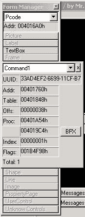

# VB P-code -- 调试器的革命

> 原文：[`www.pediy.com/kssd/pediy06/pediy6882.htm`](https://www.pediy.com/kssd/pediy06/pediy6882.htm)

\*岁末大盘点\*  
VB P-code -- 调试器的革命  
作者:cyclotron  
  
   在上一篇《VB P-code -- 虚拟机的艺术》的最后，专业的 VB P-code 调试器 WKTVBDebugger 隆重登场了。这个具有划时代意义的 VB P-code 调试器，掀开了解释型语言程序调试策略的崭新一页，它不仅仅给 VB P-code 程序的调试带来了极大的方便，其编写思想和运作机制也给人以深刻启发。在本篇中，我将为大家简要介绍这一调试器的各种特性和使用方法。  
  
   WKTVBDebugger 出现以前，VB P-code 程序的跟踪和逆向是一件令人烦恼的工作。我在上一篇中详细介绍了 VB P-code 虚拟机的运作机制以及用 OllyDBG 跟踪 P-code 程序的过程，相信大家对跟踪之困难深有体会--我们不得不花费大量的时间跟踪虚拟机的解释行为，难以将注意力集中到 P-code 程序本身。然而，在当时，OllyDBG 和 SoftICE 是我们唯一的选择。  
WKTVBDebugger 的出现，使我们摆脱了困境。这一调试器完全以单个伪代码指令为执行单元，包括跟踪、设断、修改等各个方面都完全以伪代码为基础，彻底屏蔽了虚拟机的解释细节，使我们感觉就像是在直接调试 P-code 可执行文件的功能一样。举例来说，假如程序执行了一条 Variant 型变量的加法伪指令，我们在调试器中跟踪的不是我在上一篇文章中列出的冗长的虚拟机指令，而是 AddVar 这一句指令（严格地说，AddVar 只是助记符），不仅操作码如此，每一条伪指令的操作数我们也可以方便地通过堆栈来观察。  
  
   WKTVBDebugger 的实现，同 VB P-code 虚拟机运作机制以及伪指令的研究是密不可分的。  
大多数朋友都知道基于本地机器码的调试器实现的基本原理，在这类调试器中，通过设置单步跟踪标志位，可以在每执行一句指令以后就产生单步调试断点，将控制权转移给调试器，于是调试器在执行下一句指令前按照特定的意图观察寄存器的状态并修改程序的执行流程；此外，调试器可以通过在指定的指令位置插入 CC（int 3），在该处引起断点，捕获异常并取得控制权。特别地，在 Win32 环境下，这类断点在 Ring 3 下形成异常，由 Windows 系统向调试器发送异常处理信息，调试器由此获得处理异常的优先权。然而，对于由虚拟机解释执行的伪代码，因为系统并未给程序开发人员特意留出标准的调试接口，异常的处理对用户而言也是透明的，传统的调试器原理便无法在此应用。  
   明显地，WKTVBDebugger 的作者 Mr. Silver 和 Mr. Snow 并没有就此止步，他们使用了一种类似于 Hook 的方法，把调试器代码插入到虚拟机和 VB P-code 伪代码之间，巧妙地解决了如何让调试器取得控制权的问题，这也就是我在本文开头谈到的具有启发意义的地方。大家应该还记得我曾介绍过的 VB P-code 虚拟机伪代码读取引擎：  
  

> ```
> 代码:
> XOR EAX,EAX
> MOV AL,BYTE PTR DS:\[ESI+2\]
> ADD ESI,3
> JMP DWORD PTR DS:\[EAX\*4+6A37DA58\]
> 
> ```
> 
>   

  
  
   Esi 始终指向伪指令流，虚拟机读取下一句伪指令的操作码以后，又把 esi 指向次级操作码（如果是具有多级操作码的伪指令的话）或者操作数，每一句 jmp 指令都通过跳转地址表跳向下一句伪指令的解释单元……等等，聪明的你也许已经想到了--如果让这里的跳转地址指向我们自己的调试代码，不就可以在下一句伪指令执行前取得控制权了吗？这个想法真是绝妙，事实上，我们只要把 6A37DA58 指向的跳转地址表的所有地址指向我们自己的调试器代码，就可以在所有的 P-code 伪指令前取得控制权了！取得控制权以后，我们能干什么呢？al 此时保存着伪指令的操作码，esi 指向伪指令的操作数，我们可以把对应的伪指令助记符在调试器窗口中显示出来，可以判断当前的地址是否需要中断……总之，程序的流程已经尽在掌握。一旦调试器的任务完成，就恢复现场的寄存器环境，根据原来的跳转地址表跳向下一句指令的解释单元。这就是 WKTVBDebugger Hook 的基本原理。  
调试器的基本框架有了，随之而来的是伪指令的解释问题。Microsoft 定义了 VB P-code 指令规范，但却没有把它们公开。这不是一个大问题，无论如何，这套指令规范是可以获得的。这里要感谢 Josephco，他的 VB P-code 反编译器 Exdec 在这方面做了许多先驱性的工作。另外，我推荐两款相当不错的国产 VB P-code 反编译器：万涛编写的 VBExplorer 和 ljtt 编写的 VBParser。严格地说，VBExplorer 并不是一个纯粹的反编译器，它还可以编辑修改 VB 控件的各种属性，但反编译功能做得还不精。相比之下，VBParser 就是一个专业的反编译器了。  
  
   WKTVBDebugger 是逆向工程领域的专家们共同努力的结果，当我们借助这一工具窥探 VB P-code 程序的精髓时，不能不心怀感激。  
  
说了这么多，现在是我们见识一下这一强大工具的时候了。运行 WKTVBDebugger，加载一个 VB P-code 文件，我们就可以看到这些调试窗口了。  
   左上角就是最重要的 P-code 反汇编窗口，就像 OllyDBG 的 CPU 窗口一样，它是我们跟踪 P-code 伪指令的基础。正如我们所看到的，这个窗口显示了伪指令的位置、操作码以及相应的助记符，在这里我们已经看不到虚拟机的影子了。这个窗口唯一的缺点就是不能像其他调试器一样上下翻页，虽然瑕不掩瑜，但总是给调试带来一些不便，目前较好的解决办法就是在边上同时打开一个 P-code 反编译器，对照完整的反编译代码进行调试。  
   调试器的右上角是堆栈窗口。我们知道，VB P-code 虚拟机是一个基于堆栈的解释执行引擎，所有的操作数和操作结果都是通过堆栈来传递的，堆栈在 P-code 中的作用就相当于寄存器，所以堆栈窗口在调试器中的地位举足轻重。  
   位于调试器左下角的是注释窗口。这个窗口给出部分伪指令的执行结果以及相关的字符串，虽然功能不是很全面，但是对调试也有相当的帮助，往往这里出现的字符串能引起调试者的注意。  
   下面我来介绍一下这个调试器主要的控制面板系统，我们看到 WKTVBDebugger 的右下方有两个系列的调试键，一个是 Trace Commands，这个系列实现了包括单步跟踪，执行到返回等调试器的基本流程控制功能，并提供了相应的热键，用法与其他的调试器无甚区别；另外一个是 Breakpoints，这个系列几乎涵盖了 VB P-code 程序中所有的断点设置方法。API 表示对 VB 封装的 API 函数设断；Opcodes 表示对 P-code 伪指令设断，如果你对 P-code 的伪指令比较熟悉，可以直接对它们设断。上述两种方法与普通 Win32 调试器中的对 API 设断和对特定的指令设断是相对应的。On Execution 提供了断点编辑功能，对于已经设好的断点，可以禁止或者激活。除此之外，WKTVBDebugger 还有一个最常用的断点设置方法--对控件设置断点。我们知道，VB 程序是以各种控件的触发事件为单元进行编写的，这种模式使程序设计员可以从用户的角度来设计程序，而用户也很容易得知程序的某段动作是对那个控件的响应。WKTVBDebugger 利用了这一点对事件的响应代码进行设断，极大地方便了对特定功能代码的定位。下面我以上次编写的试验程序 VB P-code.exe 为例说明这种设断方法。  
   在这个小程序中，我们只为 Command\_Click 事件编写了响应代码，所以我们就对这个按钮控件进行设断。用 WKTVBDebugger 加载 VB P-code.exe，开始执行后点击注释窗口下面的 Form Manager 按钮，会弹出如图二所示的列表窗口。我们选择 Command 控件，在列表中选择 Command1，点击 BPX 按钮，就完成了控件设断。现在按下 F5 让程序运行起来，试着点击 OK--BOOM！WKTVBDebugger 窗口就弹出来了，中断在事件相应代码的第一句。  
   
   事实上，由于大多数软件在输入注册码以后都要求点击确认按钮以验证注册码的合法性，所以注册判断过程通常都位于按钮点击事件的响应代码中，所以……呵呵，明白了吧？  
   除了上述功能之外，还有一个比较重要的功能就是 Memory Dump，可别小看了这个功能哦，由于 VB P-code 程序的特殊性，往往我们观察堆栈窗口只能获得一些类似于地址的东西，这时我们就要通过 Dump 窗口在内存中嗅探我们需要的信息；同时在内存编辑窗口，我们可以修改 P-code 程序的数据和伪代码，达到修改程序流程的目的。  
  
   WKTVBDebugger 还有不少强大的辅助调试功能，限于篇幅，这里不能一一介绍，如果读者感兴趣的话可以自己写一些简单的 VB P-code 程序进行调试，毕竟实践是最好的老师。  
  
   关于 VB 调试利器的介绍至此也差不多告一段落了，现在我们还剩最后一个问题：如何判别各个伪指令的功能？调试普通的本地机器码编译的程序时，我们可以随处找到一本 80X86 汇编语言指令集作为参考，但是 VB P-code 呢？尽管 Microsoft 为 VB P-code 定义了一整套伪指令助记符（当然不是公开的），其中的大多数也可以通过字面意思猜出其大致的功能，但是并没有权威的技术文档解释这些伪指令执行的细节（大部分伪指令的名称只能概要地说明其动作，但是由于伪指令相对于汇编代码更像一个函数，我们不得不从函数的各个角度来对它们进行考察）。这个问题在调试过程中是很令人头痛的，没有细节，就无从了解程序的整体功能。Cracker 总是富有想象力的，没有现成的，我们可以自力更生，敬请关注《VB P-code--伪代码的奥秘》为您揭开 P-code 伪代码最后的面纱。  4dd466d0e1e0cc123afbe504da2462ca