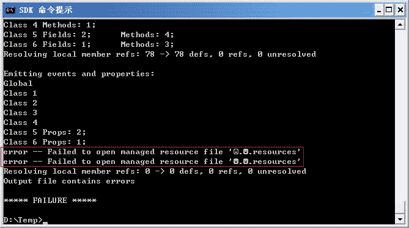
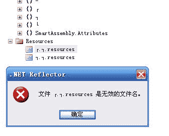
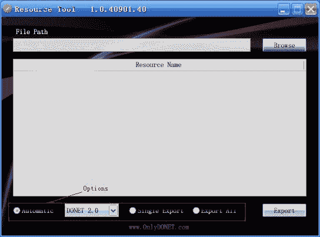
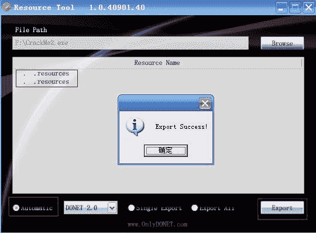
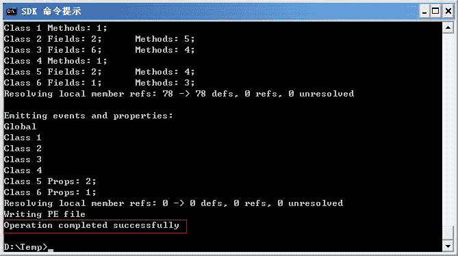
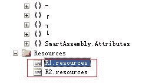

# 解决 ilasm.exe 无法编译 IL 代码一例

> 原文：[`www.pediy.com/kssd/pediy10/97204.html`](https://www.pediy.com/kssd/pediy10/97204.html)

众所周知，ildasm.exe 和 ilasm.exe 是破解 DONET 常用工具之一，但是有时候我们会发现有的程序可以用 ildasm 反编译，却无法用 ilasm 编译回去。其中部分是由于包含非托管代码而引起的，这种混合类的程序用 ilasm 是 100%不会成功的，本文也不会讨论这种情况。或许更多的时候你会遇到这样的情况：  
  
错误是：Failed to open managed resource file 'xxx.resource'这类程序大多是被{SA}混淆过的。为什么会找不到这些资源文件呢？结果我们发现这些资源文件根本没有被反编译程序导出来，于是我们用 Reflector 手动来导出看看。  
  
结果提示无效的文件名。原来程序经过混淆后，将资源名更改成了 windows 不支持的文件名，那么当然无法导出这些文件了。那么解决此问题的办法就是我们可以在导出的时候将其更改为一个合法的新资源文件名就行了。但是不要忘了，我们同时还应该在导出后的 IL 代码中将调用的旧资源名的地方也要修改成新的资源文件名。代码方面可以通过 GetManifestResourceNames()和 GetManifestResourceStream(xxxx)实现。但是为了把傻瓜精神进行到底，我特别写了一个程序来方便大家。  
  
第一个选项是自动导出，自动修改 IL 代码，正常情况下，被导出的 IL 代码是可以被直接编译成功的，但是程序毕竟是程序，不可能预见到所有的突发情况。那么大家可以使用第二或者第三个选项自己导出资源文件，自己修改 IL 代码了。  
耳听为虚，眼见为实，我们拿刚才那个无法编译回去的程序试一试。  
导出 IL 代码后，我们再用 ilasm.exe 编译回去看看。  
  
怎么样，还不错吧。  
  
用 Reflector 打开看看。资源名已经被修正了。  
  
附件提供了不能被反编译回去的 crackme。  
如果有更好的意见，欢迎一起讨论。另外这个程序是用 WPF 写的，需要安装 DONET Framework3.5 SP1 或以上版本。  
  
  
http://bbs.pediy.com/attachment.php?attachmentid=33525&d=1256485356