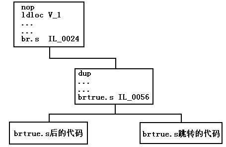
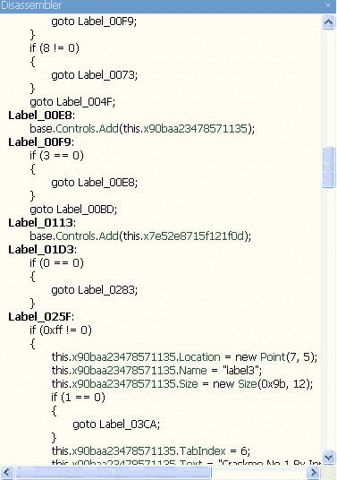
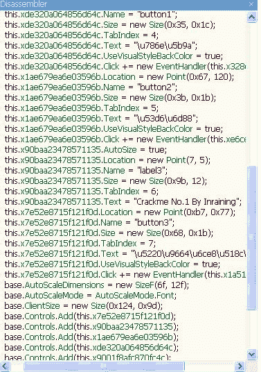

# 数据结构在.net 反流程混淆中的应用\[看雪学院 2006 金秋读书季\]

> 原文：[`www.pediy.com/kssd/pediy08/pediy8-470.htm`](https://www.pediy.com/kssd/pediy08/pediy8-470.htm)

数据结构是计算机专业的必修课，但抽象的概念有时让人觉得它难以运用，也有人认为它太基础而不去重视。下面就来看看数据结构在解决实际问题中的作用。

附件下载。  
  
**问题描述：**  
    .net 平台下的一种软件保护方式叫流程混淆，类似 win32 下的花指令，主要功能是改变程序流程，添加垃圾代码，增大分析难度。.net 中的许多反编译软件可以直接将源代码解码成高级语言（如 C#、VB.net）格式，而流程混淆可以使解码失败，或者解码出的结果错误百出。  
    先看一个被混淆的 crackme 的代码片段，Reflector 直接解码为 C#，输出如下：  
  
private void x85601834555fb7d5()  
{  
      this.x3d9c937c1f3cf311 = new TextBox();  
      if (-1 != 0)  
      {  
      Label\_0652:  
            this.x6020c4e7a1cc0f6b = new TextBox();  
            this.xf5622c25220a6c23 = new Label();  
            if (0 != 0)  
            {  
                  goto Label\_0490;  
            }  
            this.x9001f8afc870fc4c = new Label();  
            if (0 != 0)  
            {  
                  goto Label\_0342;  
            }  
            if (0xff != 0)  
            {  
                  if (0 == 0)  
                  {  
                        do  
                        {  
                              if (0 != 0)  
                              {  
                                    goto Label\_0113;  
                              }  
                              if (0 != 0)  
                              {  
                                    goto Label\_02BF;  
                              }  
                              if (-2147483648 == 0)  
                              {  
                                    goto Label\_05D3;  
                              }  
                              this.xde320a064856d64c = new Button();  
                              this.x1ae679ea6e03596b = new Button();  
                        }  
                        while (0 != 0);  
                  }  
            }  
            else  
            {  
                  goto Label\_0652;  
            }  
            if (0x7fffffff != 0)  
            {  
                  goto Label\_05F2;  
            }  
            goto Label\_0578;  
      }  
  
**问题分析：**  
    看一下被混淆方法的 IL 代码会更清楚原理，IL 代码片段如下：  
      L\_0668: br.s L\_0634  
      L\_066a: ldc.i4.0   
      L\_066b: brfalse.s L\_0624  
      L\_066d: ldc.i4 2147483647    //恒成立的跳转  
      L\_0672: brtrue L\_05f2  
      L\_0677: br L\_0578    //直接跳转  
      L\_067c: br L\_0015    //直接跳转  
      L\_0681: ret   
  
    代码中被添加了很多 br（跳转），以及恒成立的判断跳转。这样，程序就被拆分成很多小块，执行时跳来跳去，造成静态分析的困难。试想一个上万行的函数，被拆分成数百个小块，执行时前后跳转，静态分析还如何进行？  
  
**解决方法：**  
    怎么反流程混淆，很自然地，我们想到将 br 进行连接，将恒成立的跳转去除。（不同的流程混淆软件有不同的特征，注意收集。）对于代码很多的方法，手工进行处理是不现实的，因此必须编程实现。一个简单的反混淆器，无须用到编译原理的知识，我们需要的是数据结构，下面就介绍下怎么将数据结构的知识用在反混淆器的编写上。  
  
**树的构造：**  
    分析一下 IL 代码，我们可以将其分为三大类（暂不考虑 switch 指令）：不跳转（继续运行），判断跳转（如 brtrue,brfalse）和直接跳转（br 和 br.s）。  
  
public enum JumpType  
{  
      NoJump,  
      BooleanJump,  
      DirectJump  
}  
    很自然地，我们想到了二叉树。每个结点代表一条（和多条）指令，对于直接跳转和非跳转指令，该结点只有一个子结点；对于判断跳转，每个结点有两个子结点，分别代表跳转目标和下一条指令。基本构造如下：  
   
  
程序中，我们可以为结点构造如下的类：  
public class ILNode  
{  
      public ILNode();  
  
      public List<ILLine> ilblk;    //代码块  
      public ILNode left;    //指向左结点  
      public ILNode right;    //指向右结点  
}  
  
**程序的实现：**  
    附件中给出我编写的简单反混淆器，可以用 Reflector 直接查看源码。程序工作流程：  
  
**1.产生指令表：**既产生一张包含所有 IL 指令的表，用于读入源代码时进行比较。表中每个 IL 指令的格式用一个结构表示。  
  
public struct OpCodeTypeInfo  
{  
      public string name;        //指令名称  
      public JumpType jumptype;    //跳转类型  
      public bool hasoprand;        //是否有操作数  
      public OpCodeTypeInfo(string n, JumpType jtp, bool oprand);//初始化方法  
}  
  
**2.读入所有的源代码。**（由于没有实现完整的词法，语法和语义分析，因此只读入标准的 ildasm 反编译代码，且必须包含行号。）  
private static bool ReadSource(string src)  
  
每一行源代码，用一个结构来表示：  
public struct ILLine  
{  
      public int lable;        //行号  
      public string opcode;    //指令  
      public string oprand;    //操作数  
      public int size;        //大小（用于计算行号，未使用）  
      public JumpType jumpType;    //（代码的类型）  
}  
  
**3.构建二叉树：**将有读入的源码进行树构造，结果是产生如上图的二叉树，所有的代码都在树结点中。  
private static bool MakeBTree()  
private static ILNode ReadSrcIntoNode(int idx)  
    在这一步中已经完成了对恒成立判断跳转的处理。  
  
**4.对树结点进行优化：**主要是边接 br 块。  
private static bool SecondOptimise(ILNode ilnode)  
  
**5.输出反混淆结果：**按一定顺序遍历二叉树，生成代码。这是这种反混淆方法的通用之处所在，也是其弱点。编译器将高级语言编译成 IL 时，通常有一定的顺序。如果要完全还原源程序，必须对不同编译器生成的不同代码块有所了解（比如 if、while 的编码方法），而我们直接按照先右子树，后左子树的顺序进行输出，既无法完全还原源代码，但在一定程度上又做到了通用，因为无论是 MS 还是别的编译器生成的 IL 代码，都可以解决。  
private static string OutputTree(ILNode ilnode)  
  
**反混淆结果：**  
    使用时，将某个方法的 IL 代码全部复制到 DeFlowOb.exe 中，输出后将反混淆代码覆盖源程序。在 SDK 中用 ilasm 编译。  
    用 Reflector 载入附件中的 crackme，分别对比反混淆前后的 x85601834555fb7d5 方法，可以看到效果。  
  
      
  
**小结：**  
    这个小程序还有很多可扩展的地方，比如加入 try-catch-finally 块的处理（同样可以利用树，不过不是二叉树），加入特定编译块的处理（比如判断 while(){}块）。  
    数据结构在程序开发中的运用很广泛，在逆向工程中也是一样。只要多想，便可以学有所用。抛砖引玉，希望更多人将自己的知识灵活运用，编写出更好的工具。 

 4dd466d0e1e0cc123afbe504da2462ca