# {samartassembly}4.1.39 分析(加解密)

> 原文：[`www.pediy.com/kssd/pediy11/113094.html`](https://www.pediy.com/kssd/pediy11/113094.html)

**2009-11-21       作者：rzh  网名：看雪\_grassdrago**  
  
**目标**：样例程序 AppCllDll.exe (引用 MyDll、TestDll),见样例程序全部样例.rar  
  
  
**环境**：.net2.0  
   
**工具**：Reflector5.1.6.0  
      Visual Strdio2005  
      CFF Explorer.exe  
      UltraEdit32  
      WinDbg6.11.0001.404 x86  
      PeBrowseDbg9.1.3.0   
      ILasm/ILdasm  
      {samartassembly}4.1.39  
  
分析方式：按照{ samartassembly }功能 （以下简称{sa}），采用先分解最后综合的方式逐步分析。  
  
分析内容：原理、算法、反向工程的方法和步骤。  
  
  
** 一、错误元数据的修正**  
  
**准备**：使用{sa}对样例程序 AppCllDll.exe 添加错误元数据后，保存为 AppCllDll.ErrData.Exe 进行分析。  
      {sa}设置如下：  
       1）选择添加错误流数据  
       2）选择添加错误元数据  
       3）选择添加致 ILdasm 出错的数据  
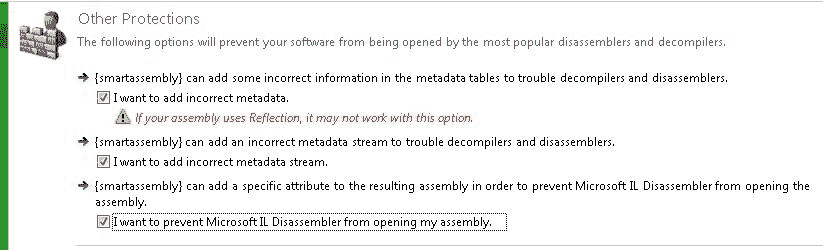  
  
**Reflector 打开效果**：  
  
  
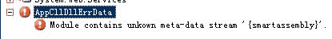  
  
  
**分析：**  
  
 第一个被发现的错误为：错误的数据流。  
  
CFF Explorer 察看结果：  
  
 MetaData Header 的 NumberOfStreams 为 6 ,应为 5;  
 MetaData Streams 增加了一个名为{smartassembly}的流并排在第一位，其它流是正确的。  
 元数据变化情况为：  
   增加了部分类型、引用、属性、方法。（包括正确和错误的两种）  
  
  
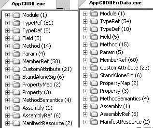  
  
  
上述存在的错误都会导致 Reflector 出错。  
  
**修正步骤如下：**  
  
**1）修正错误流**  
  
我们的目的是为了把正确的数据搬移上来，然后把流的数量改回 5,也即去掉最后的一个。  
  
 **a)    CFF Explorer 中对 MetaData Streams 进行察看： **  
  
  
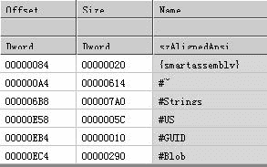  
  
  
**b) 使用 UltraEdit32 二进制编辑，把下面五项搬到上面来，第六项则不用理会**  
  
   b1) UltraEdit32 打开文件，搜索#Strings 串儿,大至定位  
   b2)在其上面一行处，刚好是要改的数据，如下：  
  
  
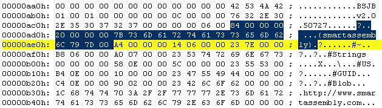  
  
也即：offset 00000084 size 00000020 和名称：{smartassembly}  
  
现在我们一小块一小块地把它们覆盖上来，不能增不能减，不能错位。从 A4 00 00 00 14 06 00 00 等等的 A4 开始覆盖在 84 00 00 00 的 84 开始处，结果如下：  
  
  
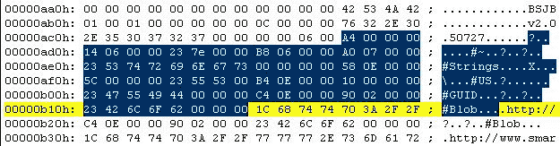  
  
  
**现在用 CFF Explorer 看看，已搬上来了,对比原来的数据，前五个都是正确的了：**  
  
  
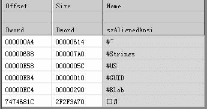  
  
  
**b3)用 CFF Explorer 把 MetaData Header 的 NumberOfStreams 改为 5,保存。重新打开看看，已修好了**：  
  
  
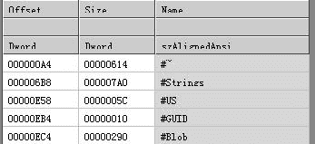  
  
  
现在可以用 Reflector 打开了，但还存在错误元数据的问题，继续。  
  
**2)修正错误元数据**  
  
   a)方法一：ILdasm 反编译，再用 ilasm 编译回来。(ilasm 帮助修复)  
     b)方法二：用 Reflector 的插件 Reflexil 保存一下，再打开。  
   c)方法三：写几行码调用 Mono.Cecil.dll 保存一下。（原理同方法二，请 Mono 帮助修复）  
  
 结果验证：  
  
**Reflector 打开及查看：**  
  
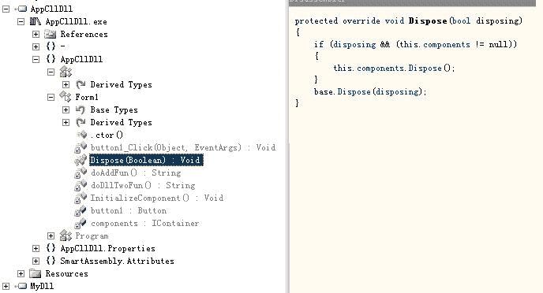  
  
**运行情况：**  
  
  
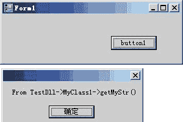  
  
  
  
**二、程序集打包功能的分析**  
  
      {sa}的程序集打包功能分为两种，一种为将几个程序集合成为一个程序集，就如我们编写了一个大的程序集一样，含有不同的命名空间及其一不同的类。第二种方式是将 DLL 作为加密后的资源嵌入，使用时解压解密释放到内存中。  
  
      **1、程序集的合并：**  
        
**准备**：依旧采用上面的样例程序 AppCllDll.exe，用{sa}将其引用的两个 DLL 文件打包进来，如下图配置生成。  
  
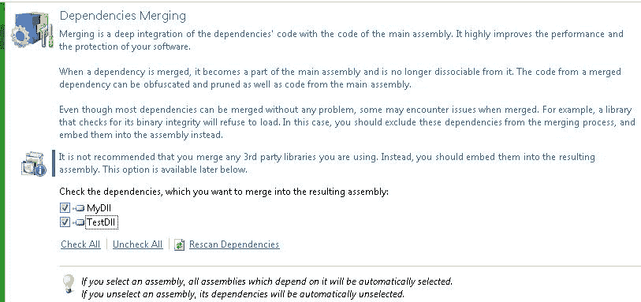  
  
  
**Reflector 打开效果**：  
  
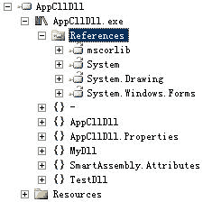  
  
  
**分析**：  
  
打包后去掉了原来 exe 对 dll 的外部引用，并使原引用的 DLL 成为程序集的一部分。  
反向：没有必要再还原回来，如果需要用 Reflector+Visual Strdio200X 或 ildasm/ilasm 手动节选吧。  
  
  
**2、程序集的压缩和内存释放**：  
  
**准备**：依旧采用上面的样例程序 AppCllDll.exe，用{sa}将其引用的两个 DLL 文件打包进来，如下图配置生成。  
  
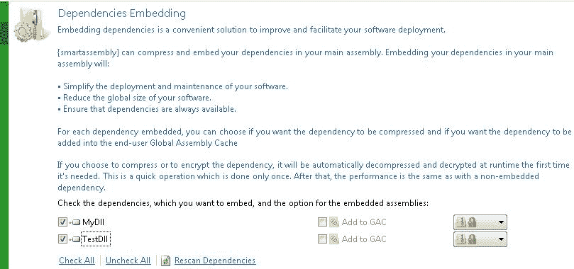  
  
  
**Reflector 打开效果**：  
  
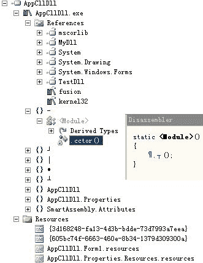  
  
  
  
**分析**：能够看出主程序集对两个 DLL 的引用仍在，增加的那两个以 GUID 串儿为名的资源就是它们。此外增加了一些解压释放用的类和方法，全为不可见字符命名。一个关键点是：增加了一个全局静态方法（<Module>下的.cctor()），并在其中调用其它类中的方法完成 DLL 适当时机的内存释放。  
  
**释放时机**：  
          // AppDomain.CurrentDomain.AssemblyResolve 为对程序集的解析失败时  
            // rType15.rMethod31 就是释放方法了  
AppDomain.CurrentDomain.AssemblyResolve += new ResolveEventHandler(rType15.rMethod31);  
                  
                  //当前程序集从全局缓冲集加载并且主模块名"w3wp.exe"或"aspnet\_wp.exe"时（rMethod29()得出）  
if (Assembly.GetExecutingAssembly().GlobalAssemblyCache && rMethod29())  
                {  
                   //释放 DLL  
}  
              这就是<Module>下的.cctor()最终调用的内容。  
  
  
 ** 算法分析**：  
      简单调整：为了明确说明问题，此处对上述生成的程序进行了名称反混淆，并导出成 C#。如下图：  
      由于 C#中没有全局方法，这里为 Form1 增加一静态构造类，并把原全局方法放入，达成相同效果。  
  
  
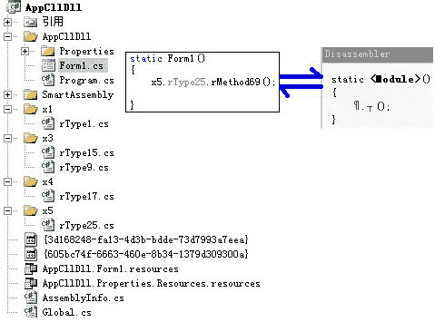  
  
  
  
**1、先看解析不成功的释放情况**：  
  
   x5.rType25.rMethod69()-rType15.rMethod30()解析不成时 rType15.rMethod31  
  
  
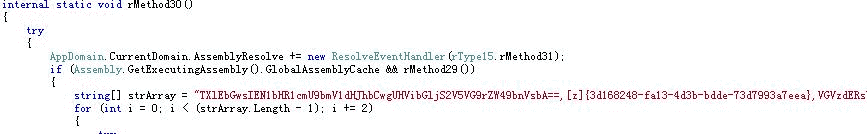  
  
  
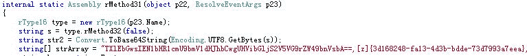  
以 MyDll, Version=1.0.0.0, Culture=neutral, PublicKeyToken=null 为例：  
  
当其解析不成时，rType15.rMethod31 将其变换成：MyDll, Culture=neutral, PublicKeyToken=null，当其有 PK 时不变。  
然后对其进行 Base64 编码，结果就是一个串儿” TXlEbGwsIEN1bHR1cmU9bmV1dHJhbCwgUHVibGljS2V5VG9rZW49bnVsbA==”,根据这个串儿从原程序中硬编码的字符串儿集合中找出对应的资源文件名和压缩方式。在上图中已看到了那个硬编码的串儿集合。其格式为：  
DLL 全名称的 Base64 编码，\[ 压缩方式\] ，资源文件名（多个 DLL 则为多个串儿）  
接下来其据压缩方式对资源文件解压放入 byte\[\],然后 assembly2 = Assembly.Load(buffer);返回 assembly2。  
  
**2、当前程序集从全局缓冲集加载时的释放情况**：  
  
   同上，但把资源文件解压后放入系统临时文件目录，用其创建程序集缓冲后删除。  
     
压缩及解压代码请参见符件，也即调整后的程序代码。  
  
**反向**：  
  
 运行程序后把它们从内存中 dump 出来就可以了，然后用 CFF Explorer 看一下它的名字，改为原名。  
  
对于第二种情况，也可以 WinDbg 或 PeBrowseDbg 在文件删除前断点，从临时目录中拷出来。再就是利用它的解压代码写出文件来。  
  
**最后总结**：  
  
  其实这种整体加密整体解密的方式用 KDD，NETUnpack.exe 这类工具在其运行后直接从内存 dump 就可以了。  
  当然，我们也可以调用.NET profiling API,Hook mscorjit.dll,或者简单地用进程注入+反射的方法把它 dump 出来，作为学习我们在下面的文档中来动手一步步完成这样的工作。  
  这里并没有探讨混淆，一个似乎简单又令人头痛的问题，特别是超大代码块让你的递归溢出后急于借助数据库又不得不嘲笑自己的那种滋味，所以还埋头学习吧。