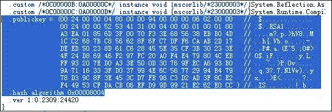
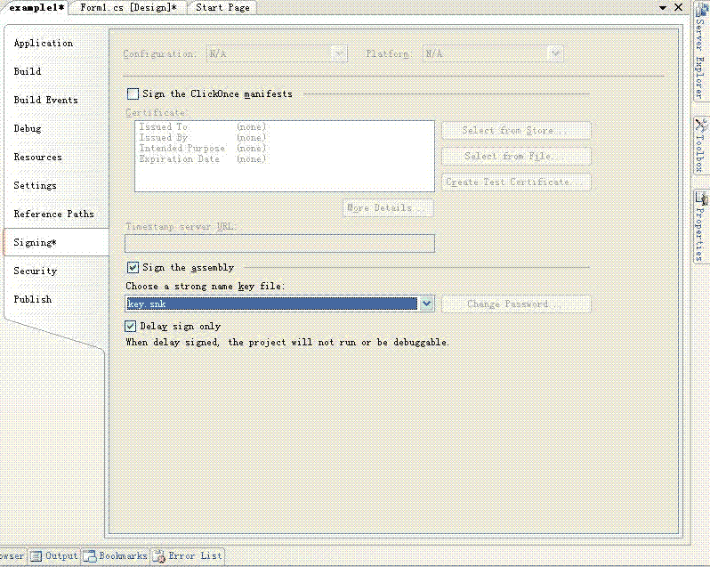
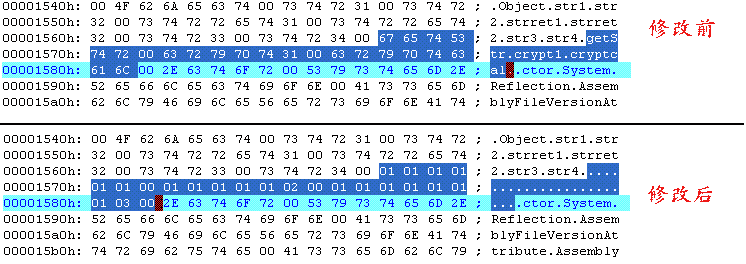
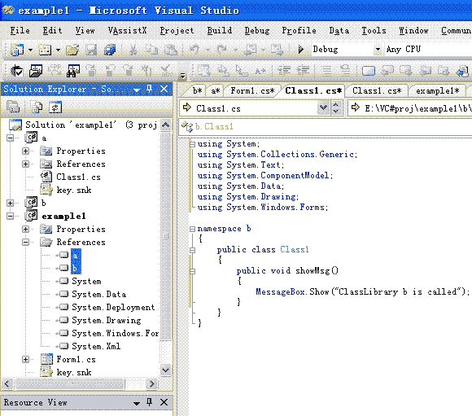
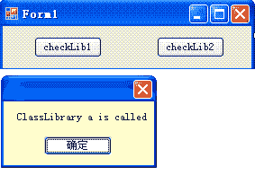
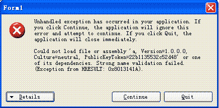
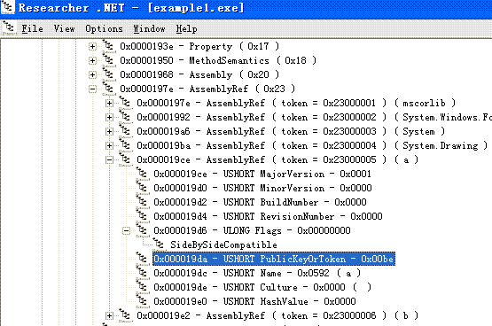
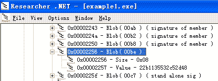
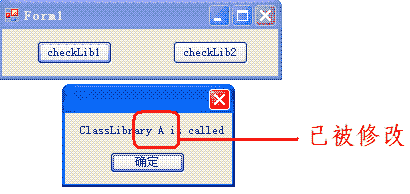

# 强命名的延迟与关联在.net 程序集保护中的作用及其逆向方法

> 原文：[`www.pediy.com/kssd/pediy08/pediy8-478.htm`](https://www.pediy.com/kssd/pediy08/pediy8-478.htm)

**强命名的延迟与关联在.net 程序集保护中的作用及其逆向方法**  
tankaiha@vxer.cn  
2006-9-15  
  
**一、老调重谈强命名**  
    强命名的定义这里就不重复了，不妨就把他看作一个文件的 hash，而如果文件被修改的话，计算出的 hash 将与最被程序设计者给定的强命名不一致，程序将拒绝加载。这可怜的一点点安全特性被人用多种方法证实原来靠强命名保护程序集只是纸老虎。  
至少有三种方法可以去除单独的可执行文件的强命名：  
**1、**  ildasm 反编译，在 il 源代码中删除该 assembly 对强命名的引用，再编译回去。在.net 初期时，这种方法还是很好用的，codeproject 上也介绍过。但是现在的程序对于 ildasm 的 anti 越来越强，想完整的反编译再完整地编译回去，有时还不太容易。  
   
  
**2、**  利用工具，原理是将 CLI Header 的标志置 0  
CLI Header 的结构如下：  
  
RVA  Field                       Contents  
0x2008  Cb（结构的大小）            0x48  
0x200C  MajorRuntimeVersion            2  
0x200E  MinorRuntimeVersion            0  
0x2010  MetaData                       0x2060  
0x2014  Size of the Metadata            0x148 =(RVA of Import Table) – (RVA of MetaData)  
0x2018  Flags                       1  
0x201C  EntryPointToken             0x06000001 (Method #1 in TypeDef table)  
0x2020  Resources                        0  
0x2028  StrongNameSignature             0  
0x2030  CodeManagerTable             0  
0x2038  VTableFixups             0  
0x2040  ExportAddressTableJumps  0  
0x2048  ManagedNativeHeader             0  
  
包括 flags 标志要减去 COMIMAGE\_FLAGS\_STRONGNAMESIGNED (0x00000008) ，以及 StrongNameSignature 处表示的强命名的偏移位置和大小要置 0。这还没完，还要将 Metadata 表中 AssemblyDef 处的强命名标志删除。  
来看一下 AssemblyDef 的定义：  
  
• HashAlgId (a 4-byte constant of type AssemblyHashAlgorithm).  
• MajorVersion, MinorVersion, BuildNumber, RevisionNumber  
(2-byte constants).  
• Flags (a 4-byte bit mask of type AssemblyFlags).  
• PublicKey (index into Blob heap).  
• Name (index into String heap).  
• Culture (index into String heap).  
  
其中 Flags 项要减去 afPublicKey = 0x0001。  
  
**3、**就是利用 Patch 系统文件的形式。这种形式不推荐，毕竟强命名还有判别版本差异及文件完整性的作用，整个 Patch 了不大方便。  
  
  
**二、延迟强命名**  
    现在的.net 程序都被混淆过了。比如你原来写了个计算注册码的程序叫 CalRegCode()，但是混淆过的程序名可能是 x0ab23ff10()，或者干脆是不可打印的 ASCII 字符。但如果你在程序中使用了强命名，混淆不会出错吗？这里其实就要用到延迟强命名。  
    在 VisualStudio 中，点击项目的属性的 sign 选项，选择延迟强命名：  
   
  
如果不想在窗口中设置，可以直接在 AssemblyInfo.cs 中设置如下：  
   \[assembly:AssemblyKeyFileAttribute("key.snk")\]  
    \[assembly:AssemblyDelaySignAttribute(true)\]  
    延迟强命名就是在编译程序时设置好标志，并将存储空间留出，在编译完成后人工加上。比如，我们可以将 strings 流中的一些敏感名称，比如 crypt()、crypcal()改为不可见：  
  
  
  
    保存后在命令行用：sn –Ra xxxx.exe key.snk 重新给文件签属强命名便 OK 了。  
    修改名称有个注意事项，如果你修改的方法名称，在别的程序集中对此方法有调用的话，必须在调用的文件中也把相应的方法改为相同的名字，应为这种调用是按名称来的，否则会报找不到 method 的错误。但总的来说，如果仅仅对一个文件使用这种延迟强命名的方法，仍然是非常容易修改的。但如果一个主程序 a.exe 要调用 b.dll 和 c.dll 时（甚至更多，或者 b 与 c 间存在调用），而 b.dll 和 c.dll 都被加上强命名的话，这样如果修改 b.dll（比如网络验证在 b.dll 中，我们要对其进行 patch），整个程序则会报错。下面一节就讲讲这种整个程序中存在多个文件，且每个文件都有强命名的情况，看看他的保护强度和破解。我暂时给它起名叫关联强命名。  
  
  
**三、关联强命名**  
    我们来建一个 C#工程，名叫 example，其中存在两个 dll（a.dll 和 b.dll），主程序对这两个程序分别存在调用，dll 的代码只是弹出窗口显示被调用了，且每个 dll 都被加上强命名。并在主项目中添加对 a 和 b 的引用。  
  
  
    a 与 b 中的代码如图所示。主程序中建两个 button 控件，分别调用这两个 Class Library 中的方法。  
  
代码如下：  
         

>  
> 
> ```
> 代码:
> 
> * * *
> 
> private void button1\_Click(object sender, EventArgs e)
>         {
>             a.Class1 newa=new a.Class1();
>             newa.showMsg();
>         }
> 
>         private void button2\_Click(object sender, EventArgs e)
>         {
>             b.Class1 newb=new b.Class1();
>             newb.showMsg();
>         }
> 
> * * *
> 
> 
> ```

  
  
单击不同的 button 会显示不同的窗口，提示当前是哪个 lib 被调用。如，单击 checkLib1 的窗口如下：  
    
  
    由于 a.dll 与 b.dll 中已被加上强命名，我们试着修改一下，看看能否运行。比如将 a.dll 中窗口的显示字符改为“ClassLibrary A is called”（UserString 的存储格式为 Unicode）：  
00001590h: 53 68 6F 77 00 00 00 00 00 31 43 00 6C 00 61 00 ; Show.....1C.l.a.  
000015a0h: 73 00 73 00 4C 00 69 00 62 00 72 00 61 00 72 00 ; s.s.L.i.b.r.a.r.  
000015b0h: 79 00 20 00 41 00 20 00 69 00 73 00 20 00 63 00 ; y. .A. .i.s. .c.  
000015c0h: 61 00 6C 00 6C 00 65 00 64 00 00 00 E5 79 88 40 ; a.l.l.e.d...鍄園  
  
运行后单击 checkLib1，会报错无法载入 a.dll：  
   
  
    这样看来，如果我们将关键代码分布在多个 dll 中，且每个 dll 加上强命名，并且存在一定的相互调用，就可以保护我们的程序集了。是不是这样呢？我们来看看 example.exe 中对 a.dll 的引用，看为什么它会认出我们修改了文件。  
    Example.exe 中的 AssemblyRef 表中存储了关于 a.dll 和 b.dll 的信息，AssemblyRef 表的结构如下：  
The AssemblyRef table has the following columns:  
•  MajorVersion, MinorVersion, BuildNumber, RevisionNumber (2-byte constants)  
•  Flags (a 4-byte bitmask of type AssemblyFlags; see Partition II, section 22.1.2)  
•  PublicKeyOrToken (index into Blob heap—the public key or token that identifies the author of this assembly)  
•  Name (index into String heap)  
•  Culture (index into String heap)  
•  HashValue (index into Blob heap)  
  
    其中第三项就规定了是否有 PublicKeyOrToken，也就是是否有强命名。看看 example.exe 中的数据：  
  
  
  
其中 PublicKeyOrToken 项清清楚楚地写的 0x00be，这就是有强命名的标志，强命名存储在#Blog 表中第 0x00be 项。再来看一下#Blog 表，第 0x00be 项如下：  
  
   
  
到这一步，我们就应该知道怎么修改了。首先，将 example.exe 中对 a 的引用表中的 PublicKeyOrToken 项的值改为 0，然后第二步是去除 a.dll 中的强命名。修改完成后，我们再运行，果然，系统已经不再报错，并正确显示我们所修改的字符串了：  
  
   
  
四、小结  
    到这里，强命名的几种应用形式基本介绍完。试想，如果一个有数十个文件的程序每个文件都被加个强命名，其保护强度也是很一般的。我们只须编写程序自动去除每个文件的本身强命名定义与 AssemblyRef 中的强命名定义（注意，不要把系统文件包含在内），就可以很方便地进行修改。因此，用 StrongName 做为程序的保护手段实在是不可取，还应另寻别路。  
  
附件中是 example.exe、a.dll 和 b.dll，其中 a.dll 已经修改过，而剩下的修改 b.dll 留给各位自己动手实践一下。   
  
单击此处下载附件 

.  
关联强名（程序集强名称）并不是这样就可以破解掉的，  
  
单个程序文件如果没有了强名，就无法加载到 CLR 运行了，而整个程序就报废了，没法在 CLR 中运行起来。  
  
如果程序因混淆或者 Native Code 而不能重新反编再编译一次的话，  
文中的方法还是不能解决程序集的强名认证问题。只是绕了一圈又回来了。  
再就是，商业软件很多自己设置了必须通过强名认证，即强制强名。  
  
解决的方法应该是重新签署新的强名，而不是抹掉强名。  
签署新的强名，如果爆破的话，算法不是一般的难，因为不可逆。  
  
个人观点，请指正，贻笑大方了。 

引用:  *最初由** tankaiha **发布*  
多谢 lccracker，一直想和你联系，你一直没上  
  
你说的有的地方我也不明白，比如：单个程序文件如果没有了强名，就无法加载到 CLR 运行了，而整个程序就报废了，没法在 CLR 中运行起来。  
单个程序文件（比如就一个文件的 exe），直接用工具去除就可以运行啊。  
  
还有，强制强命名？没接触过。除非程序中有代码进行检测，可这也是能 patch 的。  
  
lccracker 请和我联系，把 QQ 号发到 dotnetreverseteam\[at\]126\[.\]com 中。

  
  
根据.NET Framework 环境的运行机制，程序员编程时可以给一组相关联的文件签发一个“集体强名称”，大概叫 Group Stronge Signature Name，用来保证这一系列存在调用关系的文件版本能够协调一致，同时可以拒绝不属于该程序集的外部代码调用其内部的未授权私有过程函数来达到非常规之目的。拥有强名的程序集在运行时，必须被加载到 CLR 中运行。只有具有强名的 Assembly 才能够被加载到 CLR 里面去，或者说，运行在 CLR 中的程序不能调用处在 CLR 之外的模块。对于单个文件，和这种程序集是不一样的。  
  
强制强名是程序员人为加上了一个对程序进行强制性强名验证的 Method，具体忘了，大家可以去 MSDN 查查，使用强制验证强名后，通过注册表设定的忽略强名验证设置不再有效。同时加大了反向的难度。当然，这个应该是几个字节就能搞掉的功能。  
  
上面这些不知能不能读明白，因为当时看的是大堆大堆的英文，很多东西都忘得差不多了，有的用汉语不知表达准不准确。其实这些应该都有中文资料，很早了，当时写给程序员学编程的。  
  
还有，  

引用:  *最初由** tankaiha **发布*  
3、就是利用 Patch 系统文件的形式。这种形式不推荐，毕竟强命名还有判别版本差异及文件完整性的作用，整个 Patch 了不大方便。

  
Patch 系统的方法只是去掉了因强名验证加载不到 CLR 的限制，版本识别机制不会被破坏。如果是商务性应用，机器不会装几个.NET 的程序，文件完整性大可不必担心。至于被你破解的程序本身，完整不完整自己都知道。 

 4dd466d0e1e0cc123afbe504da2462ca