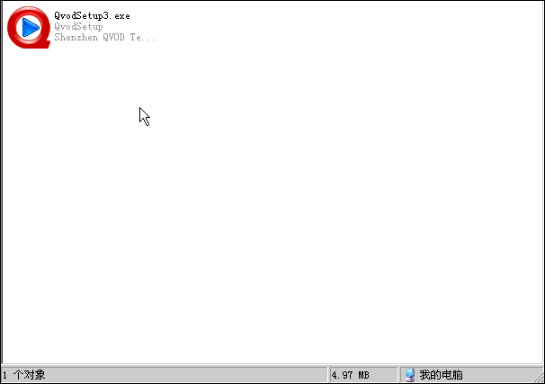
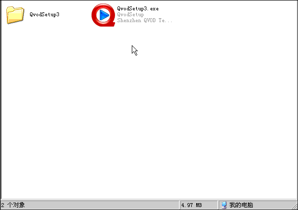
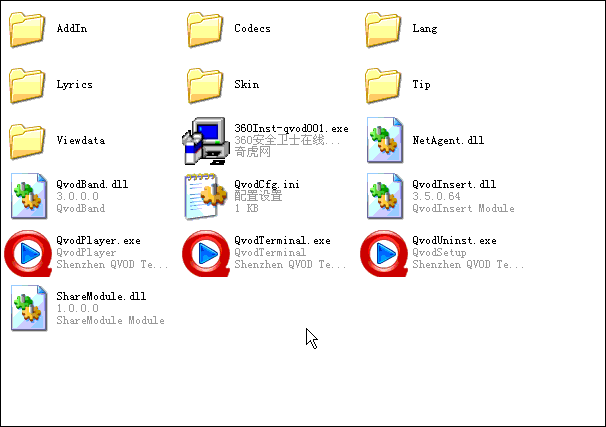
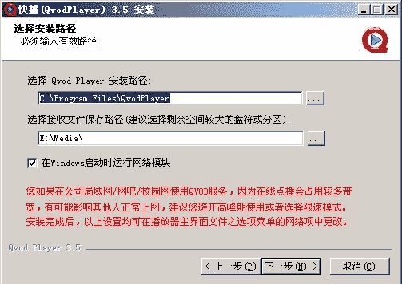
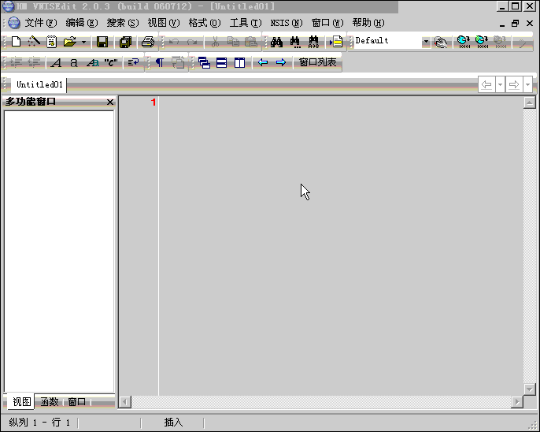
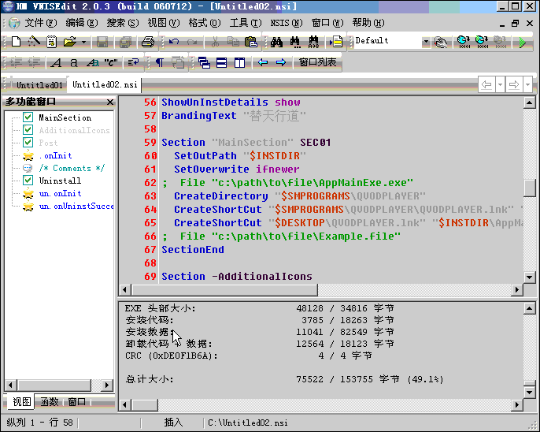

# QvodPlayer 播放器的封包研究

> 原文：[`www.pediy.com/kssd/pediy11/124903.html`](https://www.pediy.com/kssd/pediy11/124903.html)

【文章标题】: QvodPlayer 播放器的封包研究  
【文章作者】: 替天行道  
【作者主页】: http://www.nesoy.com  
【作者 QQ 号】: 123356398  
【软件名称】: Qvod 播放器  
【使用工具】: 7zip，OD，NSIS 等  
【操作平台】: 盗版 XPSP3  
【软件介绍】: 快播(QvodPlayer)是一款基于准视频点播(QVOD)内核..  
【作者声明】: 只是感兴趣，没有其他目的。失误之处敬请诸位大侠赐教!  
\--------------------------------------------------------------------------------  
【详细过程】  
近日，朋友说想搞个 QVodPlayer 的安装包，看那么多地方都是自己改的，他也想了解下，别人是怎么样打包制作的，  
因为很多绿化版或绿色，免安装版的打开在线播的网站都不可以播放，只有电影网自己本身的安装包和官方的才可  
以，在屡遭失败之后，索性就想研究下，所以在此之下，就帮他研究研究。其实 QVodplyer 打包的文章到处可以，这  
也不是什么先例，但只是要到到尽善尽美的话，可能没有几个会认真的去做，因为我搜了下，没有搜到，或许有，我  
不知道而已，因为我搜到的大部分是出钱别人帮做的，无耐之下，只好自己研究。做一个高仿的官方版 QVodPlayer，  
并且可以播在线播放电影的。。  
   
   
此次研究的目的就是为了了解 QVODPLYER 是怎么解包和卸载及其为什么安装版的就可以播放快播在线的电影，而其它  
非安装版的就不可以，研究后自己做一个高仿的 QVodPlayer 的安装包，这不仅要高仿，而且要能用，像官方的一样可用，  
呵呵，话不多说，开工。。。  
   
一、下载官方网的播放器  
官方地址：http://www.qvod.com/  
我下载的是默认的标准版的那个，地址为：http://dl.qvod.com/QvodSetup3.exe  
   
二、用 7zip 或 UniExtract 解包，并获取它的 ICO 图标，在制作脚本时要用到  
在解包完后，我们可以看到，有这么几个文件夹，如下图  
  
1.我们把有有文件夹前面有$符号的这个$去掉，因为这是我脚本里的变量，我们不能用$带头做文件夹，所以只好去掉  
2.这些文件里面有些是.new 结尾的，我们都不用管它。  
3.用资源提取工具把里面的图标提取出来  
   
   
   
三、用 OD 载入 QvodSetup3.exe 运行安装  
这一步的主要目的是获取它的安装日志，看它是如何安装的，做了些什么  
这个就不说了，有点经验的人都知道如何去获取了，后面我会附上我获取的安装日志  
  
   
   
四、用 SPY 获取它的卸载日志  
因为它在卸载完之后会有提示，提示已经卸载成功了，而它的日志我们可以看到，要想复制下来就要自己想办法啦，哈  
哈，在附件中我也会附上我获取的卸载日志  
  
   
五、下载安装 NSIS  
这个就不用说啦，自己搞定，至于为什么是用这个呢，我们在分析解包的时候就可以知道  
   
六、制作安装脚本  
我们可以先用向导生成一个基本的脚本，这个也不多说，这里主要说下我写脚本的方法和过程  
安装脚本分析  
   
1.安装包的安装分析  
\-----------------------------------------------  

代码:

```
00000: 此为安装日志
00001:   输出目录: C:\\Program Files\\QvodPlayer                     ;输出一个目录
00002:   抽取: QvodInit.exe                                        ;提取文件
00003:   运行: "C:\\Program Files\\QvodPlayer\\QvodInit.exe" setup    ;提取文件后以参数运行，通过分析这个参数运行是为了删除原来的
00004:   QVOPLAYER 及其核心文件，如 QvodTerminal.exe 及其相应的 DLL 等，所以在这里我们在用脚本写的时候要用 ExecWait 这个函数，也就是
00005:   说等你用这个参数运行完这个程序后你才能安装其它的文件，要不然它会把你安装进去的删掉
00006:   抽取: QvodTerminal.exe
00007:   抽取: QvodPlayer.exe
00008:   输出目录: C:\\Program Files\\QvodPlayer
00009:   抽取: Baidu-Toolbar-utf8kb\_cb.exe                         ;这个不用官它，一看就知道是安装的百度插件的安装程序
00010:   抽取: 360Inst-qvod001.exe                                 ;同上，360 的
00011:   抽取: KuaiwanSetup\_kb.exe                                 ;同上，快玩的，这些都是插件
00012:   抽取: NetAgent.dll.new                                    ;提取一个文件，并重命名
00013:   重命名: NetAgent.dll.new->NetAgent.dll
00014:   抽取: QvodInsert.dll.new                                
00015:   重命名: QvodInsert.dll.new->QvodInsert.dll
00016:   正在注册: C:\\Program Files\\QvodPlayer\\QvodInsert.dll      ;注册一个 DLL 控件，下同
00017:   正在注册: C:\\Program Files\\QvodPlayer\\QvodBand.dll
00018:   正在注册: C:\\Program Files\\QvodPlayer\\ShareModule.dll
00019:   输出目录: C:\\Program Files\\QvodPlayer\\Codecs              ;改变输出目录
00020:   抽取: asfsplliter.ax.new
00021:   重命名: asfsplliter.ax.new->asfsplliter.ax                ;提取一个文件，并重命名，然后注册这个解码控件，下同
00022:   正在注册: C:\\Program Files\\QvodPlayer\\Codecs\\asfsplliter.ax
00023:   抽取: RealMediaSplitter.ax.new
00024:   重命名: RealMediaSplitter.ax.new->RealMediaSplitter.ax
00025:   正在注册: C:\\Program Files\\QvodPlayer\\Codecs\\RealMediaSplitter.ax
00026:   删除文件: C:\\Program Files\\QvodPlayer\\Codecs\\ColorFilter.ax
00027:   抽取: ColorFilter.ax.new
00028:   重命名: ColorFilter.ax.new->ColorFilter.ax
00029:   正在注册: C:\\Program Files\\QvodPlayer\\Codecs\\ColorFilter.ax
00030:   抽取: cook.dll.new
00031:   重命名: cook.dll.new->cook.dll
00032:   抽取: drvc.dll.new
00033:   重命名: drvc.dll.new->drvc.dll
00034:   抽取: raac.dll.new
00035:   重命名: raac.dll.new->raac.dll
00036:   抽取: atrc.dll.new
00037:   重命名: atrc.dll.new->atrc.dll
00038:   抽取: f4v.swf.new
00039:   重命名: f4v.swf.new->f4v.swf
00040:   输出目录: C:\\Program Files\\QvodPlayer\\Skin                ;改变输出目录,下同
00041:   抽取: Default.xml
00042:   抽取: Logo.bmp
00043:   抽取: Mini.xml
00044:   输出目录: C:\\Program Files\\QvodPlayer\\Skin\\MiNi
00045:   抽取: back.bmp
00046:   抽取: info.bmp
00047:   抽取: mute.bmp
00048:   抽取: mute2.bmp
00049:   抽取: next.bmp
00050:   抽取: open.bmp
00051:   抽取: pause.bmp
00052:   抽取: play.bmp
00053:   抽取: pre.bmp
00054:   抽取: processp.bmp
00055:   抽取: progress.bmp
00056:   抽取: progress\_thumb.bmp
00057:   抽取: progressd.bmp
00058:   抽取: volume.bmp
00059:   抽取: volumeb.bmp
00060:   抽取: volumep.bmp
00061:   输出目录: C:\\Program Files\\QvodPlayer\\Skin
00062:   输出目录: C:\\Program Files\\QvodPlayer\\Skin\\Default
00063:   抽取: back.bmp
00064:   抽取: backleft.bmp
00065:   抽取: backmid.bmp
00066:   抽取: backright.bmp
00067:   抽取: bgline.bmp
00068:   抽取: bleft1.bmp
00069:   抽取: bottom.bmp
00070:   抽取: bottomleft.bmp
00071:   抽取: bottomright.bmp
00072:   抽取: bright1.bmp
00073:   抽取: caption.bmp
00074:   抽取: close.bmp
00075:   抽取: full.bmp
00076:   抽取: icon.bmp
00077:   抽取: info.bmp
00078:   抽取: infofull.bmp
00079:   抽取: left.bmp
00080:   抽取: left1.bmp
00081:   抽取: listbutton.bmp
00082:   抽取: listbutton2.bmp
00083:   抽取: listsplit.bmp
00084:   抽取: lsearchb1.bmp
00085:   抽取: lsearchb2.bmp
00086:   抽取: lsearchbg.bmp
00087:   抽取: lsearchbg1.bmp
00088:   抽取: max.bmp
00089:   抽取: media\_del.bmp
00090:   抽取: media\_files.bmp
00091:   抽取: media\_files\_2.bmp
00092:   抽取: media\_fill.bmp
00093:   抽取: media\_info.bmp
00094:   抽取: media\_search.bmp
00095:   抽取: media\_sham.bmp
00096:   抽取: media\_sham\_2.bmp
00097:   抽取: mediaeditdel.bmp
00098:   抽取: mediare.bmp
00099:   抽取: mediatolist.bmp
00100:   抽取: mediatree.bmp
00101:   抽取: menu.bmp
00102:   抽取: min.bmp
00103:   抽取: mtk.bmp
00104:   抽取: mute.bmp
00105:   抽取: mute2.bmp
00106:   抽取: next.bmp
00107:   抽取: nowplay.bmp
00108:   抽取: open.bmp
00109:   抽取: pause.bmp
00110:   抽取: play.bmp
00111:   抽取: playlist\_toolbar.bmp
00112:   抽取: pre.bmp
00113:   抽取: processp.bmp
00114:   抽取: progress.bmp
00115:   抽取: progress\_point\_a.bmp
00116:   抽取: progress\_point\_b.bmp
00117:   抽取: progress\_thumb.bmp
00118:   抽取: reold.bmp
00119:   抽取: right.bmp
00120:   抽取: right1.bmp
00121:   抽取: scroll\_back.bmp
00122:   抽取: scroll\_back\_h.bmp
00123:   抽取: scroll\_down.bmp
00124:   抽取: scroll\_left.bmp
00125:   抽取: scroll\_limit.bmp
00126:   抽取: scroll\_limit\_h.bmp
00127:   抽取: scroll\_right.bmp
00128:   抽取: scroll\_up.bmp
00129:   抽取: search\_botton.bmp
00130:   抽取: search\_icon.bmp
00131:   抽取: stop.bmp
00132:   抽取: tab.bmp
00133:   抽取: tab1.bmp
00134:   抽取: tabs\_fill.bmp
00135:   抽取: tabs\_left.bmp
00136:   抽取: tabs\_mid.bmp
00137:   抽取: tabs\_right.bmp
00138:   抽取: tabs\_search\_fill.bmp
00139:   抽取: tabs\_search\_left.bmp
00140:   抽取: top.bmp
00141:   抽取: topleft.bmp
00142:   抽取: topleft1.bmp
00143:   抽取: topright.bmp
00144:   抽取: topright1.bmp
00145:   抽取: volume.bmp
00146:   抽取: volumeb.bmp
00147:   抽取: volumep.bmp
00148:   输出目录: C:\\Program Files\\QvodPlayer\\Skin
00149:   输出目录: C:\\Program Files\\QvodPlayer\\Tip
00150:   抽取: QvodTip.exe
00151:   抽取: QvodTips.dll
00152:   抽取: close.bmp
00153:   抽取: PopMessage.xml
00154:   抽取: maintext.bmp
00155:   抽取: view.bmp
00156:   抽取: back.bmp
00157:   输出目录: C:\\Program Files\\QvodPlayer\\Lang
00158:   抽取: zh\_TW.dll.new
00159:   重命名: zh\_TW.dll.new->zh\_TW.dll
00160:   抽取: en\_US.dll.new
00161:   重命名: en\_US.dll.new->en\_US.dll
00162:   输出目录: C:\\Program Files\\QvodPlayer\\Viewdata
00163:   输出目录: C:\\Program Files\\QvodPlayer\\AddIn
00164:   抽取: VisLrc.dll
00165:   抽取: QvodAddr.dll
00166:   抽取: ASBarBroker.exe
00167:   抽取: conf.xml
00168:   输出目录: C:\\Program Files\\QvodPlayer\\Lyrics
00169:   输出目录: C:\\Program Files\\QvodPlayer
00170:   输出目录: C:\\WINDOWS\\system32                            ;提取了一个 DLL 到系统目录
00171:   抽取: pncrt.dll
00172:   正在注册: C:\\WINDOWS\\system32\\quartz.dll                 ;注册系统目录下的这几个控件
00173:   正在注册: C:\\WINDOWS\\system32\\msxml.dll
00174:   正在注册: C:\\WINDOWS\\system32\\msxml2.dll
00175:   正在注册: C:\\WINDOWS\\system32\\msxml3.dll
00176:   输出目录: C:\\Program Files\\QvodPlayer
00177:   输出目录: C:\\Program Files\\QvodPlayer
00178:   "创建文件夹: " C:\\Documents and Settings\\Administrator\\「开始」菜单\\程序\\快播软件   ;在程序组中建立快捷方式及程序组   
00179:   创建快捷方式: C:\\Documents and Settings\\Administrator\\「开始」菜单\\程序\\快播软件\\快播(QvodPlayer).lnk
00180:   创建快捷方式: C:\\Documents and Settings\\Administrator\\「开始」菜单\\程序\\快播软件\\卸载 QvodPlayer.lnk
00181:   输出目录: C:\\Program Files\\QvodPlayer
00182:   输出目录: C:\\Program Files\\QvodPlayer\\Viewdata
00183:   抽取: \*\*中心.swf
00184:   抽取: 节目推荐.swf
00185:   抽取: 热门游戏.swf
00186:   抽取: 网上购物.swf
00187:   输出目录: C:\\Program Files\\QvodPlayer
00188:   运行: "C:\\Program Files\\QvodPlayer\\KuaiwanSetup\_kb.exe" /S  ;安装快玩插件
00189:   输出目录: C:\\Program Files\\QvodPlayer
00190:   创建解除安装程序: C:\\Program Files\\QvodPlayer\\QvodUninst.exe;创建卸载程序

```

\--------------------------  
2.卸载程序的卸载分析  
安装容易，卸载可别小看它，写的不好，你卸载不完全，要不就卸不干净，所以卸载我们也要看下，它是如何实现的  
\---------------------------  
代码:

```
00000: 正在解除注册: C:\\Program Files\\QvodPlayer\\Codecs\\asfsplliter.ax                   ;反注册几个播放器的解码组件
00001:   正在解除注册: C:\\Program Files\\QvodPlayer\\Codecs\\RealMediaSplitter.ax
00002:   正在解除注册: C:\\Program Files\\QvodPlayer\\Codecs\\ColorFilter.ax
00003:   输出目录: C:\\DOCUME~1\\ADMINI~1\\LOCALS~1\\Temp                                       ;把输出目录改为临时文件夹，以免删了不该删的文件，也可以防止卸载时出错
00004:   运行: "C:\\Program Files\\QvodPlayer\\QvodPlayer.exe" u\_unbzb                         ;先运行程序目录里的 QvodPlayer.exe，以 u\_unbzb 这个参数运行，这个照猜是自动结束进行及其相关的附加程序等
00005:   抽取: QvodInit.exe                                                                 ;从卸载程序里面提取 QvodInit.exe 这个文件
00006:   运行: "C:\\DOCUME~1\\ADMINI~1\\LOCALS~1\\Temp\\QvodInit.exe" del                        ;提取后以 del 这个参数运行，这里应该就是删相关程序级删不掉的组件了
00007:   删除文件: C:\\DOCUME~1\\ADMINI~1\\LOCALS~1\\Temp\\QvodInit.exe                          ;上面几个参数的运行都要用到 ExecWait,也就是说要等到这个程序运行完后才能执行下一步的动作，要不然这样会出错,下同。
00008:   运行: "C:\\Program Files\\QvodPlayer\\AddIn\\ASBarBroker.exe" /runasAdmin /SVCUninstall /QvodAddr.dll
00009:   删除文件: E:\\Backup\\桌面\\快播 QvodPlayer.lnk                                        ;删除桌面及程序组中的快捷方式，并把程序组中建立的文件及文件夹删除
00010:   删除文件: C:\\Documents and Settings\\Administrator\\「开始」菜单\\程序\\快播软件\\快播(QvodPlayer).lnk
00011:   删除文件: C:\\Documents and Settings\\Administrator\\「开始」菜单\\程序\\快播软件\\卸载 QvodPlayer.lnk
00012:   移除目录: C:\\Documents and Settings\\Administrator\\「开始」菜单\\程序\\快播软件\\
00013:   删除文件: C:\\Program Files\\QvodPlayer\\Codecs\\asfsplliter.ax
00014:   删除文件: C:\\Program Files\\QvodPlayer\\Codecs\\atrc.dll
00015:   删除文件: C:\\Program Files\\QvodPlayer\\Codecs\\ColorFilter.ax
00016:   删除文件: C:\\Program Files\\QvodPlayer\\Codecs\\cook.dll
00017:   删除文件: C:\\Program Files\\QvodPlayer\\Codecs\\drvc.dll
00018:   删除文件: C:\\Program Files\\QvodPlayer\\Codecs\\f4v.swf
00019:   删除文件: C:\\Program Files\\QvodPlayer\\Codecs\\raac.dll
00020:   删除文件: C:\\Program Files\\QvodPlayer\\Codecs\\RealMediaSplitter.ax
00021:   移除目录: C:\\Program Files\\QvodPlayer\\Codecs\\
00022:   重新启动后删除: C:\\Program Files\\QvodPlayer\\Data\\AD\\                                ;有些文件或文件夹删不掉，重启后删除，那么这里要用到 /REBOOTOK 这个参数，后面在制作脚本中会说到。后面的就是递规删除文件及目录啦，所以要把输入文件夹设成临时文件夹，就是这个原因，要不然，一不小心，在递规删除时把你电脑所有文件 over 了，呵呵，所以要千万小心
00023:   重新启动后删除: C:\\Program Files\\QvodPlayer\\Data\\
00024:   删除文件: C:\\Program Files\\QvodPlayer\\Favorite\\Desktop.ini
00025:   移除目录: C:\\Program Files\\QvodPlayer\\Favorite\\
00026:   删除文件: C:\\Program Files\\QvodPlayer\\Lang\\en\_US.dll
00027:   删除文件: C:\\Program Files\\QvodPlayer\\Lang\\zh\_TW.dll
00028:   移除目录: C:\\Program Files\\QvodPlayer\\Lang\\
00029:   删除文件: C:\\Program Files\\QvodPlayer\\Playlist\\Channel.xml
00030:   删除文件: C:\\Program Files\\QvodPlayer\\Playlist\\Keywords.xml
00031:   删除文件: C:\\Program Files\\QvodPlayer\\Playlist\\Mediacenter.xml
00032:   删除文件: C:\\Program Files\\QvodPlayer\\Playlist\\Playlist.xml
00033:   删除文件: C:\\Program Files\\QvodPlayer\\Playlist\\QvodSearch.xml
00034:   移除目录: C:\\Program Files\\QvodPlayer\\Playlist\\
00035:   删除文件: C:\\Program Files\\QvodPlayer\\Skin\\Default\\back.bmp
00036:   删除文件: C:\\Program Files\\QvodPlayer\\Skin\\Default\\backleft.bmp
00037:   删除文件: C:\\Program Files\\QvodPlayer\\Skin\\Default\\backmid.bmp
00038:   删除文件: C:\\Program Files\\QvodPlayer\\Skin\\Default\\backright.bmp
00039:   删除文件: C:\\Program Files\\QvodPlayer\\Skin\\Default\\bgline.bmp
00040:   删除文件: C:\\Program Files\\QvodPlayer\\Skin\\Default\\bleft1.bmp
00041:   删除文件: C:\\Program Files\\QvodPlayer\\Skin\\Default\\bottom.bmp
00042:   删除文件: C:\\Program Files\\QvodPlayer\\Skin\\Default\\bottomleft.bmp
00043:   删除文件: C:\\Program Files\\QvodPlayer\\Skin\\Default\\bottomright.bmp
00044:   删除文件: C:\\Program Files\\QvodPlayer\\Skin\\Default\\bright1.bmp
00045:   删除文件: C:\\Program Files\\QvodPlayer\\Skin\\Default\\caption.bmp
00046:   删除文件: C:\\Program Files\\QvodPlayer\\Skin\\Default\\close.bmp
00047:   删除文件: C:\\Program Files\\QvodPlayer\\Skin\\Default\\full.bmp
00048:   删除文件: C:\\Program Files\\QvodPlayer\\Skin\\Default\\icon.bmp
00049:   删除文件: C:\\Program Files\\QvodPlayer\\Skin\\Default\\info.bmp
00050:   删除文件: C:\\Program Files\\QvodPlayer\\Skin\\Default\\infofull.bmp
00051:   删除文件: C:\\Program Files\\QvodPlayer\\Skin\\Default\\left.bmp
00052:   删除文件: C:\\Program Files\\QvodPlayer\\Skin\\Default\\left1.bmp
00053:   删除文件: C:\\Program Files\\QvodPlayer\\Skin\\Default\\listbutton.bmp
00054:   删除文件: C:\\Program Files\\QvodPlayer\\Skin\\Default\\listbutton2.bmp
00055:   删除文件: C:\\Program Files\\QvodPlayer\\Skin\\Default\\listsplit.bmp
00056:   删除文件: C:\\Program Files\\QvodPlayer\\Skin\\Default\\lsearchb1.bmp
00057:   删除文件: C:\\Program Files\\QvodPlayer\\Skin\\Default\\lsearchb2.bmp
00058:   删除文件: C:\\Program Files\\QvodPlayer\\Skin\\Default\\lsearchbg.bmp
00059:   删除文件: C:\\Program Files\\QvodPlayer\\Skin\\Default\\lsearchbg1.bmp
00060:   删除文件: C:\\Program Files\\QvodPlayer\\Skin\\Default\\max.bmp
00061:   删除文件: C:\\Program Files\\QvodPlayer\\Skin\\Default\\mediaeditdel.bmp
00062:   删除文件: C:\\Program Files\\QvodPlayer\\Skin\\Default\\mediare.bmp
00063:   删除文件: C:\\Program Files\\QvodPlayer\\Skin\\Default\\mediatolist.bmp
00064:   删除文件: C:\\Program Files\\QvodPlayer\\Skin\\Default\\mediatree.bmp
00065:   删除文件: C:\\Program Files\\QvodPlayer\\Skin\\Default\\media\_del.bmp
00066:   删除文件: C:\\Program Files\\QvodPlayer\\Skin\\Default\\media\_files.bmp
00067:   删除文件: C:\\Program Files\\QvodPlayer\\Skin\\Default\\media\_files\_2.bmp
00068:   删除文件: C:\\Program Files\\QvodPlayer\\Skin\\Default\\media\_fill.bmp
00069:   删除文件: C:\\Program Files\\QvodPlayer\\Skin\\Default\\media\_info.bmp
00070:   删除文件: C:\\Program Files\\QvodPlayer\\Skin\\Default\\media\_search.bmp
00071:   删除文件: C:\\Program Files\\QvodPlayer\\Skin\\Default\\media\_sham.bmp
00072:   删除文件: C:\\Program Files\\QvodPlayer\\Skin\\Default\\media\_sham\_2.bmp
00073:   删除文件: C:\\Program Files\\QvodPlayer\\Skin\\Default\\menu.bmp
00074:   删除文件: C:\\Program Files\\QvodPlayer\\Skin\\Default\\min.bmp
00075:   删除文件: C:\\Program Files\\QvodPlayer\\Skin\\Default\\mtk.bmp
00076:   删除文件: C:\\Program Files\\QvodPlayer\\Skin\\Default\\mute.bmp
00077:   删除文件: C:\\Program Files\\QvodPlayer\\Skin\\Default\\mute2.bmp
00078:   删除文件: C:\\Program Files\\QvodPlayer\\Skin\\Default\\next.bmp
00079:   删除文件: C:\\Program Files\\QvodPlayer\\Skin\\Default\\nowplay.bmp
00080:   删除文件: C:\\Program Files\\QvodPlayer\\Skin\\Default\\open.bmp
00081:   删除文件: C:\\Program Files\\QvodPlayer\\Skin\\Default\\pause.bmp
00082:   删除文件: C:\\Program Files\\QvodPlayer\\Skin\\Default\\play.bmp
00083:   删除文件: C:\\Program Files\\QvodPlayer\\Skin\\Default\\playlist\_toolbar.bmp
00084:   删除文件: C:\\Program Files\\QvodPlayer\\Skin\\Default\\pre.bmp
00085:   删除文件: C:\\Program Files\\QvodPlayer\\Skin\\Default\\processp.bmp
00086:   删除文件: C:\\Program Files\\QvodPlayer\\Skin\\Default\\progress.bmp
00087:   删除文件: C:\\Program Files\\QvodPlayer\\Skin\\Default\\progress\_point\_a.bmp
00088:   删除文件: C:\\Program Files\\QvodPlayer\\Skin\\Default\\progress\_point\_b.bmp
00089:   删除文件: C:\\Program Files\\QvodPlayer\\Skin\\Default\\progress\_thumb.bmp
00090:   删除文件: C:\\Program Files\\QvodPlayer\\Skin\\Default\\reold.bmp
00091:   删除文件: C:\\Program Files\\QvodPlayer\\Skin\\Default\\right.bmp
00092:   删除文件: C:\\Program Files\\QvodPlayer\\Skin\\Default\\right1.bmp
00093:   删除文件: C:\\Program Files\\QvodPlayer\\Skin\\Default\\scroll\_back.bmp
00094:   删除文件: C:\\Program Files\\QvodPlayer\\Skin\\Default\\scroll\_back\_h.bmp
00095:   删除文件: C:\\Program Files\\QvodPlayer\\Skin\\Default\\scroll\_down.bmp
00096:   删除文件: C:\\Program Files\\QvodPlayer\\Skin\\Default\\scroll\_left.bmp
00097:   删除文件: C:\\Program Files\\QvodPlayer\\Skin\\Default\\scroll\_limit.bmp
00098:   删除文件: C:\\Program Files\\QvodPlayer\\Skin\\Default\\scroll\_limit\_h.bmp
00099:   删除文件: C:\\Program Files\\QvodPlayer\\Skin\\Default\\scroll\_right.bmp
00100:   删除文件: C:\\Program Files\\QvodPlayer\\Skin\\Default\\scroll\_up.bmp
00101:   删除文件: C:\\Program Files\\QvodPlayer\\Skin\\Default\\search\_botton.bmp
00102:   删除文件: C:\\Program Files\\QvodPlayer\\Skin\\Default\\search\_icon.bmp
00103:   删除文件: C:\\Program Files\\QvodPlayer\\Skin\\Default\\stop.bmp
00104:   删除文件: C:\\Program Files\\QvodPlayer\\Skin\\Default\\tab.bmp
00105:   删除文件: C:\\Program Files\\QvodPlayer\\Skin\\Default\\tab1.bmp
00106:   删除文件: C:\\Program Files\\QvodPlayer\\Skin\\Default\\tabs\_fill.bmp
00107:   删除文件: C:\\Program Files\\QvodPlayer\\Skin\\Default\\tabs\_left.bmp
00108:   删除文件: C:\\Program Files\\QvodPlayer\\Skin\\Default\\tabs\_mid.bmp
00109:   删除文件: C:\\Program Files\\QvodPlayer\\Skin\\Default\\tabs\_right.bmp
00110:   删除文件: C:\\Program Files\\QvodPlayer\\Skin\\Default\\tabs\_search\_fill.bmp
00111:   删除文件: C:\\Program Files\\QvodPlayer\\Skin\\Default\\tabs\_search\_left.bmp
00112:   删除文件: C:\\Program Files\\QvodPlayer\\Skin\\Default\\top.bmp
00113:   删除文件: C:\\Program Files\\QvodPlayer\\Skin\\Default\\topleft.bmp
00114:   删除文件: C:\\Program Files\\QvodPlayer\\Skin\\Default\\topleft1.bmp
00115:   删除文件: C:\\Program Files\\QvodPlayer\\Skin\\Default\\topright.bmp
00116:   删除文件: C:\\Program Files\\QvodPlayer\\Skin\\Default\\topright1.bmp
00117:   删除文件: C:\\Program Files\\QvodPlayer\\Skin\\Default\\volume.bmp
00118:   删除文件: C:\\Program Files\\QvodPlayer\\Skin\\Default\\volumeb.bmp
00119:   删除文件: C:\\Program Files\\QvodPlayer\\Skin\\Default\\volumep.bmp
00120:   移除目录: C:\\Program Files\\QvodPlayer\\Skin\\Default\\
00121:   删除文件: C:\\Program Files\\QvodPlayer\\Skin\\Default.xml
00122:   删除文件: C:\\Program Files\\QvodPlayer\\Skin\\Logo.bmp
00123:   删除文件: C:\\Program Files\\QvodPlayer\\Skin\\MiNi\\back.bmp
00124:   删除文件: C:\\Program Files\\QvodPlayer\\Skin\\MiNi\\info.bmp
00125:   删除文件: C:\\Program Files\\QvodPlayer\\Skin\\MiNi\\mute.bmp
00126:   删除文件: C:\\Program Files\\QvodPlayer\\Skin\\MiNi\\mute2.bmp
00127:   删除文件: C:\\Program Files\\QvodPlayer\\Skin\\MiNi\\next.bmp
00128:   删除文件: C:\\Program Files\\QvodPlayer\\Skin\\MiNi\\open.bmp
00129:   删除文件: C:\\Program Files\\QvodPlayer\\Skin\\MiNi\\pause.bmp
00130:   删除文件: C:\\Program Files\\QvodPlayer\\Skin\\MiNi\\play.bmp
00131:   删除文件: C:\\Program Files\\QvodPlayer\\Skin\\MiNi\\pre.bmp
00132:   删除文件: C:\\Program Files\\QvodPlayer\\Skin\\MiNi\\processp.bmp
00133:   删除文件: C:\\Program Files\\QvodPlayer\\Skin\\MiNi\\progress.bmp
00134:   删除文件: C:\\Program Files\\QvodPlayer\\Skin\\MiNi\\progressd.bmp
00135:   删除文件: C:\\Program Files\\QvodPlayer\\Skin\\MiNi\\progress\_thumb.bmp
00136:   删除文件: C:\\Program Files\\QvodPlayer\\Skin\\MiNi\\volume.bmp
00137:   删除文件: C:\\Program Files\\QvodPlayer\\Skin\\MiNi\\volumeb.bmp
00138:   删除文件: C:\\Program Files\\QvodPlayer\\Skin\\MiNi\\volumep.bmp
00139:   移除目录: C:\\Program Files\\QvodPlayer\\Skin\\MiNi\\
00140:   删除文件: C:\\Program Files\\QvodPlayer\\Skin\\Mini.xml
00141:   移除目录: C:\\Program Files\\QvodPlayer\\Skin\\
00142:   删除文件: C:\\Program Files\\QvodPlayer\\Viewdata\\\*\*中心.swf
00143:   删除文件: C:\\Program Files\\QvodPlayer\\Viewdata\\热门游戏.swf
00144:   删除文件: C:\\Program Files\\QvodPlayer\\Viewdata\\网上购物.swf
00145:   删除文件: C:\\Program Files\\QvodPlayer\\Viewdata\\节目推荐.swf
00146:   移除目录: C:\\Program Files\\QvodPlayer\\Viewdata\\
00147:   删除文件: C:\\Program Files\\QvodPlayer\\AddIn\\ASBarBroker.exe
00148:   删除文件: C:\\Program Files\\QvodPlayer\\AddIn\\QvodAddr.dll
00149:   删除文件: C:\\Program Files\\QvodPlayer\\AddIn\\VisLrc.dll
00150:   移除目录: C:\\Program Files\\QvodPlayer\\AddIn\\
00151:   移除目录: C:\\Program Files\\QvodPlayer\\Lyrics\\
00152:   删除文件: C:\\Program Files\\QvodPlayer\\Tip\\back.bmp
00153:   删除文件: C:\\Program Files\\QvodPlayer\\Tip\\close.bmp
00154:   删除文件: C:\\Program Files\\QvodPlayer\\Tip\\maintext.bmp
00155:   删除文件: C:\\Program Files\\QvodPlayer\\Tip\\PopMessage.xml
00156:   删除文件: C:\\Program Files\\QvodPlayer\\Tip\\QvodTip.exe
00157:   删除文件: C:\\Program Files\\QvodPlayer\\Tip\\QvodTips.dll
00158:   删除文件: C:\\Program Files\\QvodPlayer\\Tip\\view.bmp
00159:   移除目录: C:\\Program Files\\QvodPlayer\\Tip\\
00160:   删除文件: C:\\Program Files\\QvodPlayer\\NetAgent.dll
00161:   删除文件: C:\\Program Files\\QvodPlayer\\Qvod.cfg
00162:   删除文件: C:\\Program Files\\QvodPlayer\\QvodCfg.ini
00163:   重新启动后删除: C:\\Program Files\\QvodPlayer\\QvodInsert.dll
00164:   删除文件: C:\\Program Files\\QvodPlayer\\QvodPlayer.exe
00165:   删除文件: C:\\Program Files\\QvodPlayer\\QvodPlayer.xml
00166:   删除文件: C:\\Program Files\\QvodPlayer\\QvodTerminal.exe
00167:   删除文件: C:\\Program Files\\QvodPlayer\\ShareModule.dll
00168:   删除文件: C:\\Program Files\\QvodPlayer\\agent.ini
00169:   已完成
 

```

\---------------------------------  
3.安装程序里的自定义界面分析  
在我们对 QvodSetup3.exe 解完包后，里面的$PLUGINSDIR 里，我们可以看到有几个奇怪的 dll,ini 及其它一些文件，看目录  
我们就可以知道这是个插件目录，那么它有个自定义界面，如下图：  
  
这个是怎么做出来的呢，其实就是通过这个文件夹里的 qvod1.ini 文件实现的，我们可以分析下其它的几个文件，它们都是  
用来装插件的，呵呵，我们这里就不研究如何打包我们不想装的这种插件啦，这东西自己发挥吧！  
  
4.脚本的写作  
我们先用向导生成一个基本框架的脚本文件，如图  
  
然后对自己想要的功能进行设置和修改  
  
  
附上脚本：  
\-----------------------  
代码:

```

00000: 
00001:   ; 该脚本替天行道（QQ：123356398）编写制作
00002:   ; 请尊重作者的劳动成果 www.nesoy.com
00003:   
00004:   !include "FileFunc.nsh"
00005:   !include "LogicLib.nsh"
00006:   
00007:   ; 安装程序初始定义常量
00008:   !define PRODUCT\_NAME "快播(QvodPlayer)"
00009:   !define PRODUCT\_VERSION "3.5"
00010:   ;下面这句是应用程序出版人
00011:   !define PRODUCT\_PUBLISHER "替天行道"
00012:   !define PRODUCT\_WEB\_SITE "http://www.nesoy.com"
00013:   !define PRODUCT\_UNINST\_KEY "Software\\Microsoft\\Windows\\CurrentVersion\\Uninstall\\${PRODUCT\_NAME}"
00014:   !define PRODUCT\_UNINST\_ROOT\_KEY "HKLM"
00015:   
00016:   
00017:   
00018:   SetCompressor lzma
00019:   
00020:   ; ------ MUI 现代界面定义 (1.67 版本以上兼容) ------
00021:   !include "MUI.nsh"
00022:   
00023:   ; MUI 预定义常量
00024:   !define MUI\_ABORTWARNING
00025:   !define MUI\_ICON "ICO.ico"
00026:   !define MUI\_UNICON "ICO.ico"
00027:   
00028:   ; 语言选择窗口常量设置
00029:   !define MUI\_LANGDLL\_REGISTRY\_ROOT "${PRODUCT\_UNINST\_ROOT\_KEY}"
00030:   !define MUI\_LANGDLL\_REGISTRY\_KEY "${PRODUCT\_UNINST\_KEY}"
00031:   !define MUI\_LANGDLL\_REGISTRY\_VALUENAME "NSIS:Language"
00032:   
00033:   ; 欢迎页面
00034:   !insertmacro MUI\_PAGE\_WELCOME
00035:   ; 许可协议页面
00036:   !insertmacro MUI\_PAGE\_LICENSE "说明文件.txt"
00037:   ; 组件选择页面
00038:   !insertmacro MUI\_PAGE\_COMPONENTS
00039:   ;自定义页面
00040:   Var hwnd ; 自定义页面的窗口句柄
00041:   Page custom PageInitFunc PageLeaveFunc # 自定义页面,设定了两个函数
00042:   
00043:   ; 该脚本替天行道（QQ：123356398）编写制作
00044:   ; 请尊重作者的劳动成果
00045:   ; 安装目录选择页面
00046:   ;!insertmacro MUI\_PAGE\_DIRECTORY
00047:   ; 安装过程页面
00048:   !insertmacro MUI\_PAGE\_INSTFILES
00049:   ; 安装完成页面
00050:   !define MUI\_FINISHPAGE\_RUN "$INSTDIR\\QvodPlayer.exe"
00051:   !define MUI\_FINISHPAGE\_RUN\_TEXT "运行 ${PRODUCT\_NAME} ${PRODUCT\_VERSION}"
00052:   ;以下为自己加的，打开主页
00053:   !define MUI\_FINISHPAGE\_SHOWREADME
00054:   !define MUI\_FINISHPAGE\_SHOWREADME\_FUNCTION Info
00055:   !define MUI\_FINISHPAGE\_SHOWREADME\_TEXT "打开${PRODUCT\_PUBLISHER}的 BLOG"
00056:   
00057:   !insertmacro MUI\_PAGE\_FINISH
00058:   ; 该脚本替天行道（QQ：123356398）编写制作
00059:   ; 请尊重作者的劳动成果
00060:   ; 安装卸载过程页面
00061:   !insertmacro MUI\_UNPAGE\_INSTFILES
00062:   
00063:   ; 安装界面包含的语言设置
00064:   !insertmacro MUI\_LANGUAGE "SimpChinese"
00065:   !insertmacro MUI\_LANGUAGE "English"
00066:   
00067:   #================以下为添加版本信息==================================
00068:   ;Adds the Product Version on top of the Version Tab in the Properties of the file.
00069:   VIProductVersion "${PRODUCT\_VERSION}.0.64" ;这是版本的版本号，记得要 3 个小数点
00070:   ;Adds a field in the Version Tab of the File Properties.
00071:   
00072:   VIAddVersionKey   "ProductName" "${PRODUCT\_NAME}"
00073:   VIAddVersionKey   "CompanyName" "${PRODUCT\_PUBLISHER}"
00074:   
00075:   ;下面这个是显示版本信息里的版权
00076:   ;VIAddVersionKey /LANG=${LANG\_ENGLISH} "LegalCopyright" "Copyright (c) ${PRODUCT\_PUBLISHER} Company"
00077:   VIAddVersionKey  "LegalCopyright" "Copyright (c) 2006-2010 QVOD"
00078:   
00079:   ;下面这个是显示版本信息里的描述
00080:   ;VIAddVersionKey /LANG=${LANG\_ENGLISH} "FileDescription" "${PRODUCT\_NAME} Application"
00081:   VIAddVersionKey  "FileDescription" "QvodSetup"
00082:   
00083:   VIAddVersionKey  "Comments" "http://www.nesoy.com" ;备注
00084:   ;以下为产品版本
00085:   ;VIAddVersionKey /LANG=${LANG\_ENGLISH} "ProductVersion" "${PRODUCT\_VERSION}"
00086:   VIAddVersionKey   "FileVersion" "${PRODUCT\_VERSION}.0.64"
00087:   
00088:   ;下面这句是输出的源文件名，官方版没有
00089:   ;VIAddVersionKey /LANG=${LANG\_ENGLISH} "OriginalFilename" "${PRODUCT\_NAME}\_${PRODUCT\_VERSION}.${PRODUCT\_PACKAGE\_ID}${PRODUCT\_PACKAGE\_SPECIAL\_ID}\_Setup.exe"
00090:   ;下面这句是压缩包制作日期
00091:   ;VIAddVersionKey /LANG=${LANG\_ENGLISH} "Package Build Date" "${\_\_DATE\_\_}"
00092:   ;下面这句是输出的输出名，
00093:   ;OutFile "${PRODUCT\_NAME}\_${PRODUCT\_VERSION}.${PRODUCT\_PACKAGE\_ID}${PRODUCT\_PACKAGE\_SPECIAL\_ID}\_Setup.exe"
00094:   
00095:   
00096:   
00097:   #======================版本信息结束====================
00098:   ; 该脚本替天行道（QQ：123356398）编写制作
00099:   ; 请尊重作者的劳动成果 www.nesoy.com
00100:   
00101:   
00102:   ; 安装预释放文件
00103:   !insertmacro MUI\_RESERVEFILE\_LANGDLL
00104:   !insertmacro MUI\_RESERVEFILE\_INSTALLOPTIONS
00105:   ; ------ MUI 现代界面定义结束 ------
00106:   
00107:   Name "${PRODUCT\_NAME} ${PRODUCT\_VERSION}"
00108:   OutFile "QvodSetup3.exe"
00109:   ;InstallDir "$PROGRAMFILES\\QvodPlayer"
00110:   ShowInstDetails show
00111:   ShowUnInstDetails show
00112:   BrandingText "Qvod Player 3.5"
00113:   #/////////下面这两个函数是判断最大的磁盘是哪个//////////////
00114:   ;Section
00115:   ;  ;查找所有硬盘驱动器(HDD)
00116:   ;  ${GetDrives} "HDD" "FindHDD"
00117:   ;  MessageBox MB\_OK "最大可用空间驱动器盘符：$R2"
00118:   ;SectionEnd
00119:   
00120:   #//////////////////////////////////
00121:   Section "QvodPlayer" SEC01
00122:   SectionIn RO ;这句代表必选组件
00123:   
00124:     SetOutPath "$INSTDIR"
00125:     SetOverwrite ifnewer
00126:     
00127:     File "官方提取\\QvodInit.exe"
00128:   ;这个主要是起到删除 QvodTerminal.exe 及 QvodPlayer.exe 的作用
00129:     ExecWait '"$INSTDIR\\QvodInit.exe" setup'
00130:   
00131:     File "官方提取\\QvodTerminal.exe"
00132:     File "官方提取\\QvodPlayer.exe"
00133:     File "官方提取\\NetAgent.dll.new"
00134:     Rename "$INSTDIR\\NetAgent.dll.new" "$INSTDIR\\NetAgent.dll"
00135:   
00136:     ;写出 QvodInsert.dll 文件
00137:     File "官方提取\\QvodInsert.dll.new"
00138:     Rename "$INSTDIR\\QvodInsert.dll.new" "$INSTDIR\\QvodInsert.dll"
00139:     RegDLL "$INSTDIR\\QvodInsert.dll"
00140:     ;写出 QvodBand.dll 文件
00141:     File "官方提取\\QvodBand.dll"
00142:     RegDLL "$INSTDIR\\QvodBand.dll"
00143:     ;写出 ShareModule.dll 文件
00144:     File "官方提取\\ShareModule.dll"
00145:     RegDLL "$INSTDIR\\ShareModule.dll"
00146:     ;这个卸载程序就不用安装了,呵呵
00147:     ;File "官方提取\\QvodUninst.exe"
00148:     
00149:     #Codecs 下面的所有文件
00150:     SetOutPath "$INSTDIR\\Codecs"
00151:     File "官方提取\\Codecs\\asfsplliter.ax.new"
00152:     Rename "$INSTDIR\\Codecs\\asfsplliter.ax.new" "$INSTDIR\\Codecs\\asfsplliter.ax"
00153:     RegDLL "$INSTDIR\\Codecs\\asfsplliter.ax"
00154:     
00155:     File "官方提取\\Codecs\\RealMediaSplitter.ax.new"
00156:     Rename "$INSTDIR\\Codecs\\RealMediaSplitter.ax.new" "$INSTDIR\\Codecs\\RealMediaSplitter.ax"
00157:     RegDLL "$INSTDIR\\Codecs\\RealMediaSplitter.ax"
00158:   
00159:     File "官方提取\\Codecs\\ColorFilter.ax.new"
00160:     Rename "$INSTDIR\\Codecs\\ColorFilter.ax.new" "$INSTDIR\\Codecs\\ColorFilter.ax"
00161:     RegDLL "$INSTDIR\\Codecs\\ColorFilter.ax"
00162:   
00163:     File "官方提取\\Codecs\\cook.dll.new"
00164:     Rename "$INSTDIR\\Codecs\\cook.dll.new" "$INSTDIR\\Codecs\\cook.dll"
00165:     
00166:     File "官方提取\\Codecs\\drvc.dll.new"
00167:     Rename "$INSTDIR\\Codecs\\drvc.dll.new" "$INSTDIR\\Codecs\\drvc.dll"
00168:     
00169:     File "官方提取\\Codecs\\raac.dll.new"
00170:     Rename "$INSTDIR\\Codecs\\raac.dll.new" "$INSTDIR\\Codecs\\raac.dll"
00171:     
00172:     File "官方提取\\Codecs\\atrc.dll.new"
00173:     Rename "$INSTDIR\\Codecs\\atrc.dll.new" "$INSTDIR\\Codecs\\atrc.dll"
00174:     
00175:     File "官方提取\\Codecs\\f4v.swf.new"
00176:     Rename "$INSTDIR\\Codecs\\f4v.swf.new" "$INSTDIR\\Codecs\\f4v.swf"
00177:     #=============Codecs 结束=============================
00178:     
00179:     #============Skin 下面的所有文件==============
00180:     SetOutPath "$INSTDIR\\Skin"
00181:     File "官方提取\\Skin\\Default.xml"
00182:     File "官方提取\\Skin\\Logo.bmp"
00183:     File "官方提取\\Skin\\Mini.xml"
00184:     #//////////////////////////////
00185:     #根据官方解包得出的数据，它用了$\_OUTDIR 这个函数，所以，我们要想做到高仿就也给它加个这东东，
00186:     #那么，在别人解包你的安装包时也会和官方的一样，也有个$\_OUTDIR 文件夹，里面的文件也一样
00187:   
00188:     StrCpy "$\_OUTDIR" "$INSTDIR\\Skin"
00189:     SetOutPath "$\_OUTDIR"
00190:     SetOutPath "$\_OUTDIR\\MiNi"
00191:     File "官方提取\\\_OUTDIR\\MiNi\\back.bmp"
00192:     File "官方提取\\\_OUTDIR\\MiNi\\info.bmp"
00193:     File "官方提取\\\_OUTDIR\\MiNi\\mute.bmp"
00194:     File "官方提取\\\_OUTDIR\\MiNi\\mute2.bmp"
00195:     File "官方提取\\\_OUTDIR\\MiNi\\next.bmp"
00196:     File "官方提取\\\_OUTDIR\\MiNi\\open.bmp"
00197:     File "官方提取\\\_OUTDIR\\MiNi\\pause.bmp"
00198:     File "官方提取\\\_OUTDIR\\MiNi\\play.bmp"
00199:     File "官方提取\\\_OUTDIR\\MiNi\\pre.bmp"
00200:     File "官方提取\\\_OUTDIR\\MiNi\\processp.bmp"
00201:     File "官方提取\\\_OUTDIR\\MiNi\\progress.bmp"
00202:     File "官方提取\\\_OUTDIR\\MiNi\\progress\_thumb.bmp"
00203:     File "官方提取\\\_OUTDIR\\MiNi\\progressd.bmp"
00204:     File "官方提取\\\_OUTDIR\\MiNi\\volume.bmp"
00205:     File "官方提取\\\_OUTDIR\\MiNi\\volumeb.bmp"
00206:     File "官方提取\\\_OUTDIR\\MiNi\\volumep.bmp"
00207:   
00208:   ; 该脚本替天行道（QQ：123356398）编写制作
00209:   ; 请尊重作者的劳动成果 www.nesoy.com  
00210:     SetOutPath "$\_OUTDIR"
00211:     SetOutPath "$\_OUTDIR\\Default"
00212:   
00213:     File "官方提取\\\_OUTDIR\\Default\\back.bmp"
00214:     File "官方提取\\\_OUTDIR\\Default\\backleft.bmp"
00215:     File "官方提取\\\_OUTDIR\\Default\\backmid.bmp"
00216:     File "官方提取\\\_OUTDIR\\Default\\backright.bmp"
00217:     File "官方提取\\\_OUTDIR\\Default\\bgline.bmp"
00218:     File "官方提取\\\_OUTDIR\\Default\\bleft1.bmp"
00219:     File "官方提取\\\_OUTDIR\\Default\\bottom.bmp"
00220:     File "官方提取\\\_OUTDIR\\Default\\bottomleft.bmp"
00221:     File "官方提取\\\_OUTDIR\\Default\\bottomright.bmp"
00222:     File "官方提取\\\_OUTDIR\\Default\\bright1.bmp"
00223:     File "官方提取\\\_OUTDIR\\Default\\caption.bmp"
00224:     File "官方提取\\\_OUTDIR\\Default\\close.bmp"
00225:     File "官方提取\\\_OUTDIR\\Default\\full.bmp"
00226:     File "官方提取\\\_OUTDIR\\Default\\icon.bmp"
00227:     File "官方提取\\\_OUTDIR\\Default\\info.bmp"
00228:     File "官方提取\\\_OUTDIR\\Default\\infofull.bmp"
00229:     File "官方提取\\\_OUTDIR\\Default\\left.bmp"
00230:     File "官方提取\\\_OUTDIR\\Default\\left1.bmp"
00231:     File "官方提取\\\_OUTDIR\\Default\\listbutton.bmp"
00232:     File "官方提取\\\_OUTDIR\\Default\\listbutton2.bmp"
00233:     File "官方提取\\\_OUTDIR\\Default\\listsplit.bmp"
00234:     File "官方提取\\\_OUTDIR\\Default\\lsearchb1.bmp"
00235:     File "官方提取\\\_OUTDIR\\Default\\lsearchb2.bmp"
00236:     File "官方提取\\\_OUTDIR\\Default\\lsearchbg.bmp"
00237:     File "官方提取\\\_OUTDIR\\Default\\lsearchbg1.bmp"
00238:     File "官方提取\\\_OUTDIR\\Default\\max.bmp"
00239:     File "官方提取\\\_OUTDIR\\Default\\media\_del.bmp"
00240:     File "官方提取\\\_OUTDIR\\Default\\media\_files.bmp"
00241:     File "官方提取\\\_OUTDIR\\Default\\media\_files\_2.bmp"
00242:     File "官方提取\\\_OUTDIR\\Default\\media\_fill.bmp"
00243:     File "官方提取\\\_OUTDIR\\Default\\media\_info.bmp"
00244:     File "官方提取\\\_OUTDIR\\Default\\media\_search.bmp"
00245:     File "官方提取\\\_OUTDIR\\Default\\media\_sham.bmp"
00246:     File "官方提取\\\_OUTDIR\\Default\\media\_sham\_2.bmp"
00247:     File "官方提取\\\_OUTDIR\\Default\\mediaeditdel.bmp"
00248:     File "官方提取\\\_OUTDIR\\Default\\mediare.bmp"
00249:     File "官方提取\\\_OUTDIR\\Default\\mediatolist.bmp"
00250:     File "官方提取\\\_OUTDIR\\Default\\mediatree.bmp"
00251:     File "官方提取\\\_OUTDIR\\Default\\menu.bmp"
00252:     File "官方提取\\\_OUTDIR\\Default\\min.bmp"
00253:     File "官方提取\\\_OUTDIR\\Default\\mtk.bmp"
00254:     File "官方提取\\\_OUTDIR\\Default\\mute.bmp"
00255:     File "官方提取\\\_OUTDIR\\Default\\mute2.bmp"
00256:     File "官方提取\\\_OUTDIR\\Default\\next.bmp"
00257:     File "官方提取\\\_OUTDIR\\Default\\nowplay.bmp"
00258:     File "官方提取\\\_OUTDIR\\Default\\open.bmp"
00259:     File "官方提取\\\_OUTDIR\\Default\\pause.bmp"
00260:     File "官方提取\\\_OUTDIR\\Default\\play.bmp"
00261:     File "官方提取\\\_OUTDIR\\Default\\playlist\_toolbar.bmp"
00262:     File "官方提取\\\_OUTDIR\\Default\\pre.bmp"
00263:     File "官方提取\\\_OUTDIR\\Default\\processp.bmp"
00264:     File "官方提取\\\_OUTDIR\\Default\\progress.bmp"
00265:     File "官方提取\\\_OUTDIR\\Default\\progress\_point\_a.bmp"
00266:     File "官方提取\\\_OUTDIR\\Default\\progress\_point\_b.bmp"
00267:     File "官方提取\\\_OUTDIR\\Default\\progress\_thumb.bmp"
00268:     File "官方提取\\\_OUTDIR\\Default\\reold.bmp"
00269:     File "官方提取\\\_OUTDIR\\Default\\right.bmp"
00270:     File "官方提取\\\_OUTDIR\\Default\\right1.bmp"
00271:     File "官方提取\\\_OUTDIR\\Default\\scroll\_back.bmp"
00272:     File "官方提取\\\_OUTDIR\\Default\\scroll\_back\_h.bmp"
00273:     File "官方提取\\\_OUTDIR\\Default\\scroll\_down.bmp"
00274:     File "官方提取\\\_OUTDIR\\Default\\scroll\_left.bmp"
00275:     File "官方提取\\\_OUTDIR\\Default\\scroll\_limit.bmp"
00276:     File "官方提取\\\_OUTDIR\\Default\\scroll\_limit\_h.bmp"
00277:     File "官方提取\\\_OUTDIR\\Default\\scroll\_right.bmp"
00278:     File "官方提取\\\_OUTDIR\\Default\\scroll\_up.bmp"
00279:     File "官方提取\\\_OUTDIR\\Default\\search\_botton.bmp"
00280:     File "官方提取\\\_OUTDIR\\Default\\search\_icon.bmp"
00281:     File "官方提取\\\_OUTDIR\\Default\\stop.bmp"
00282:     File "官方提取\\\_OUTDIR\\Default\\tab.bmp"
00283:     File "官方提取\\\_OUTDIR\\Default\\tab1.bmp"
00284:     File "官方提取\\\_OUTDIR\\Default\\tabs\_fill.bmp"
00285:     File "官方提取\\\_OUTDIR\\Default\\tabs\_left.bmp"
00286:     File "官方提取\\\_OUTDIR\\Default\\tabs\_mid.bmp"
00287:     File "官方提取\\\_OUTDIR\\Default\\tabs\_right.bmp"
00288:     File "官方提取\\\_OUTDIR\\Default\\tabs\_search\_fill.bmp"
00289:     File "官方提取\\\_OUTDIR\\Default\\tabs\_search\_left.bmp"
00290:     File "官方提取\\\_OUTDIR\\Default\\top.bmp"
00291:     File "官方提取\\\_OUTDIR\\Default\\topleft.bmp"
00292:     File "官方提取\\\_OUTDIR\\Default\\topleft1.bmp"
00293:     File "官方提取\\\_OUTDIR\\Default\\topright.bmp"
00294:     File "官方提取\\\_OUTDIR\\Default\\topright1.bmp"
00295:     File "官方提取\\\_OUTDIR\\Default\\volume.bmp"
00296:     File "官方提取\\\_OUTDIR\\Default\\volumeb.bmp"
00297:     File "官方提取\\\_OUTDIR\\Default\\volumep.bmp"
00298:   
00299:     SetOutPath "$INSTDIR\\Skin"
00300:     #============Skin 结束==============
00301:     #============Tip 文件夹开始==============
00302:     SetOutPath "$INSTDIR\\Tip"
00303:     File "官方提取\\Tip\\QvodTip.exe"
00304:     File "官方提取\\Tip\\QvodTips.dll"
00305:     File "官方提取\\Tip\\close.bmp"
00306:     File "官方提取\\Tip\\PopMessage.xml"
00307:     File "官方提取\\Tip\\maintext.bmp"
00308:     File "官方提取\\Tip\\view.bmp"
00309:     File "官方提取\\Tip\\back.bmp"
00310:     #============Tip 结束==============
00311:     #============LANG 文件夹开始==============
00312:     SetOutPath "$INSTDIR\\Lang"
00313:     File "官方提取\\Lang\\zh\_TW.dll.new"
00314:     Rename "$INSTDIR\\Lang\\zh\_TW.dll.new" "$INSTDIR\\Lang\\zh\_TW.dll"
00315:     File "官方提取\\Lang\\en\_US.dll.new"
00316:     Rename "$INSTDIR\\Lang\\en\_US.dll.new" "$INSTDIR\\Lang\\en\_US.dll"
00317:     #============LANG 文件夹结束==============
00318:     
00319:     #============AddIn 文件夹开始==============
00320:     ;SetOutPath "$INSTDIR\\Viewdata"
00321:     
00322:     SetOutPath "$INSTDIR\\AddIn"
00323:     File "官方提取\\AddIn\\VisLrc.dll"
00324:     File "官方提取\\AddIn\\QvodAddr.dll"
00325:     File "官方提取\\AddIn\\ASBarBroker.exe"
00326:     File "官方提取\\AddIn\\conf.xml"
00327:     #============AddIn 文件夹结束==============
00328:     #============文件夹开始==============
00329:     SetOutPath "$INSTDIR\\Lyrics"
00330:     SetOutPath "$INSTDIR"
00331:     
00332:     SetOutPath "$SYSDIR"
00333:     File "官方提取\\SYSDIR\\pncrt.dll"
00334:     #============文件夹结束==============
00335:     
00336:     #============注册控件开始==============
00337:     RegDLL "$SYSDIR\\quartz.dll"
00338:     RegDLL "$SYSDIR\\msxml.dll"
00339:     RegDLL "$SYSDIR\\msxml2.dll"
00340:     RegDLL "$SYSDIR\\msxml3.dll"
00341:     #============注册控件结束==============
00342:     SetOutPath "$INSTDIR"
00343:     SetOutPath "$INSTDIR"
00344:     ;运行注入文件,其实运行了这个函数后，你打开 QVODPLAYER 在线直接的网站才能自动连接，也就是我们讲的网络模块，所以这是个关键；
00345:     Exec "$INSTDIR\\QvodTerminal.exe"
00346:     
00347:     StrCpy "$\_OUTDIR" "$INSTDIR"
00348:     SetOutPath "$\_OUTDIR"
00349:     SetOutPath "$\_OUTDIR\\Viewdata"
00350:     
00351:     File "官方提取\\\_OUTDIR\\Viewdata\\\*\*中心.swf"
00352:     File "官方提取\\\_OUTDIR\\Viewdata\\节目推荐.swf"
00353:     File "官方提取\\\_OUTDIR\\Viewdata\\热门游戏.swf"
00354:     File "官方提取\\\_OUTDIR\\Viewdata\\网上购物.swf"
00355:     SetOutPath "$INSTDIR"
00356:     
00357:   
00358:   SectionEnd
00359:   ; 该脚本替天行道（QQ：123356398）编写制作
00360:   ; 请尊重作者的劳动成果 www.nesoy.com
00361:   
00362:   #=======文件关联目录制作================
00363:   
00364:   #这个自己研究，在此不作讨论，呵呵
00365:   
00366:   #=======文件关联目录制作结束================
00367:   
00368:   ;这下面是添加到程序组的
00369:   Section -AdditionalIcons
00370:     WriteIniStr "$INSTDIR\\${PRODUCT\_PUBLISHER}的小站.url" "InternetShortcut" "URL" "${PRODUCT\_WEB\_SITE}"
00371:     CreateDirectory "$SMPROGRAMS\\快播软件"
00372:     CreateShortCut "$SMPROGRAMS\\快播软件\\快播(QvodPlayer).lnk" "$INSTDIR\\QvodPlayer.exe"
00373:     CreateShortCut "$SMPROGRAMS\\快播软件\\卸载 QvodPlayer.lnk" "$INSTDIR\\QvodUninst.exe"
00374:     WriteIniStr "$SMPROGRAMS\\快播软件\\${PRODUCT\_PUBLISHER}的小站.url" "InternetShortcut" "URL" "${PRODUCT\_WEB\_SITE}"
00375:     ;下面这个是建立快捷方式
00376:     CreateShortCut "$DESKTOP\\快播 QvodPlayer.lnk" "$INSTDIR\\QvodPlayer.exe"
00377:     WriteIniStr "$DESKTOP\\${PRODUCT\_PUBLISHER}的小站.url" "InternetShortcut" "URL" "${PRODUCT\_WEB\_SITE}"
00378:     
00379:     SetOutPath "$INSTDIR"
00380:   SectionEnd
00381:   
00382:   ; 该脚本替天行道（QQ：123356398）编写制作
00383:   ; 请尊重作者的劳动成果 www.nesoy.com
00384:   
00385:   Section -Post
00386:     WriteUninstaller "$INSTDIR\\QvodUninst.exe"
00387:     WriteRegStr ${PRODUCT\_UNINST\_ROOT\_KEY} "${PRODUCT\_UNINST\_KEY}" "DisplayName" "$(^Name)"
00388:     WriteRegStr ${PRODUCT\_UNINST\_ROOT\_KEY} "${PRODUCT\_UNINST\_KEY}" "UninstallString" "$INSTDIR\\QvodUninst.exe"
00389:     WriteRegStr ${PRODUCT\_UNINST\_ROOT\_KEY} "${PRODUCT\_UNINST\_KEY}" "DisplayVersion" "${PRODUCT\_VERSION}"
00390:     WriteRegStr ${PRODUCT\_UNINST\_ROOT\_KEY} "${PRODUCT\_UNINST\_KEY}" "URLInfoAbout" "${PRODUCT\_WEB\_SITE}"
00391:     WriteRegStr ${PRODUCT\_UNINST\_ROOT\_KEY} "${PRODUCT\_UNINST\_KEY}" "Publisher" "${PRODUCT\_PUBLISHER}"
00392:   SectionEnd
00393:   
00394:   #-- 根据 NSIS 脚本编辑规则，所有 Function 区段必须放置在 Section 区段之后编写，以避免安装程序出现未可预知的问题。--#
00395:   
00396:   #这里为自己写的函数
00397:   ReserveFile "qvod1.ini" # 预先打包文件，方便安装加速释放 qvod1.ini
00398:   ReserveFile "QvodInit.exe" # 预先打包文件，方便安装加速释放 QvodInit.exe
00399:   
00400:   Function .onInit
00401:     InitPluginsDir
00402:     !insertmacro MUI\_LANGDLL\_DISPLAY
00403:     File /oname=$PLUGINSDIR\\qvod1.ini "qvod1.ini"  ; 释放 qvod1.ini 文件
00404:     File /oname=$PLUGINSDIR\\QvodInit.exe "QvodInit.exe"  ; 释放 QvodInit.exe 文件
00405:   
00406:   FunctionEnd
00407:   
00408:   Function "FindHDD"
00409:     ;获取查找到的驱动器盘符($9)可用空间(/D=F)单位兆(/S=M)
00410:     ${DriveSpace} $9 "/D=F /S=M" $R0
00411:     ${If} $R0 > $R1
00412:       StrCpy $R1 $R0
00413:       StrCpy $R2 $9
00414:     ${EndIf}
00415:     Push $0
00416:   FunctionEnd
00417:   ;下面是取变量加到 ini 文件里，是动态获取的
00418:   Function PageInitFunc
00419:     WriteINIStr "$PLUGINSDIR\\qvod1.ini" "Field 3" "State" "$PROGRAMFILES\\QvodPlayer"
00420:     ;查找所有的硬盘{HDD},并找出最大可用空间驱动器盘符
00421:     ${GetDrives} "HDD" "FindHDD"
00422:     WriteINIStr "$PLUGINSDIR\\qvod1.ini" "Field 4" "State" "$R2Media\\" ;在自定义界面中设置安装路径
00423:     WriteINIStr "$PLUGINSDIR\\qvod1.ini" "Field 8" "State" "1"         ;在自定义界面中设置为默认钩选自动启动网络模块
00424:     WriteINIStr "$PLUGINSDIR\\qvod1.ini" "Field 8" "Text" "在 Windows 启动时运行网络模块"
00425:     InstallOptions::initDialog /NOUNLOAD "$PLUGINSDIR\\qvod1.ini"
00426:     Pop $hwnd             ; 获取自定义页面的窗口句柄
00427:     InstallOptions::show  ; 显示自定义页面
00428:     Pop $0
00429:     
00430:   FunctionEnd
00431:   
00432:   Function PageLeaveFunc
00433:     ReadINIStr $INSTDIR "$PLUGINSDIR\\qvod1.ini" "Field 3" "State"
00434:     ReadINIStr $0 "$PLUGINSDIR\\qvod1.ini" "Field 4" "State"
00435:     ReadINIStr $1 "$PLUGINSDIR\\qvod1.ini" "Field 8" "State"
00436:     WriteRegStr HKCU "Software\\QvodPlayer\\Insert" "Insertpath" "$INSTDIR"   ;写入到注册表
00437:     WriteRegStr HKCU "Software\\QvodPlayer\\Option" "defaultsavepath" "$0"
00438:     WriteRegStr HKCU "Software\\QvodPlayer\\Option" "newpath" "1"
00439:   
00440:     ;下面是判断你是否勾选了“在 Windows 启动时运行网络模块”,如果是，则在注册表的启动项里加入
00441:     StrCmp $1 0 NextBtn
00442:     ;  MessageBox MB\_OK "$1"
00443:       WriteRegStr HKCU "Software\\Microsoft\\Windows\\CurrentVersion\\Run" "QvodPlayer" "$INSTDIR\\QvodTerminal.exe"
00444:       Goto NextBtn
00445:       Abort    ;如果不是就不进行操作
00446:     NextBtn:
00447:   
00448:   
00449:   FunctionEnd
00450:   
00451:   
00452:   Function Info ;打个自己的主页
00453:     ExecShell "open" "${PRODUCT\_WEB\_SITE}"
00454:   Functionend
00455:   
00456:   
00457:   ; 该脚本替天行道（QQ：123356398）编写制作
00458:   ; 请尊重作者的劳动成果 www.nesoy.com
00459:   
00460:   
00461:   /\*\*\*\*\*\*\*\*\*\*\*\*\*\*\*\*\*\*\*\*\*\*\*\*\*\*\*\*\*\*
00462:    \*  以下是安装程序的卸载部分  \*
00463:    \*\*\*\*\*\*\*\*\*\*\*\*\*\*\*\*\*\*\*\*\*\*\*\*\*\*\*\*\*\*/
00464:   
00465:   Section Uninstall
00466:     UnRegDLL "$INSTDIR\\Codecs\\asfsplliter.ax"
00467:     UnRegDLL "$INSTDIR\\Codecs\\RealMediaSplitter.ax"
00468:     UnRegDLL "$INSTDIR\\Codecs\\ColorFilter.ax"
00469:     
00470:     ;取临时文件夹
00471:     SetOutPath "$TEMP"
00472:     
00473:     ExecWait '"$INSTDIR\\QvodPlayer.exe" u\_unbzb'
00474:     File "官方提取\\QvodInit.exe"
00475:     ExecWait '"$TEMP\\QvodInit.exe" del'
00476:     Delete "$TEMP\\QvodInit.exe"
00477:     ExecWait '"$INSTDIR\\AddIn\\ASBarBroker.exe" /runasAdmin /SVCUninstall /QvodAddr.dll'
00478:     
00479:     ;删除桌面快捷方式
00480:     Delete "$DESKTOP\\快播 QvodPlayer.lnk"
00481:     Delete "$DESKTOP\\${PRODUCT\_PUBLISHER}的小站.url"
00482:     ;删除程序组
00483:     Delete "$SMPROGRAMS\\快播软件\\快播(QvodPlayer).lnk"
00484:     Delete "$SMPROGRAMS\\快播软件\\卸载 QvodPlayer.lnk"
00485:     RMDir /r "$SMPROGRAMS\\快播软件"
00486:     Delete /REBOOTOK "$INSTDIR\\${PRODUCT\_NAME}.url"
00487:     Delete "$INSTDIR\\QvodUninst.exe"
00488:     Delete /REBOOTOK "$INSTDIR\\\*.\*"
00489:     RMDir /r "$INSTDIR"
00490:   
00491:     DeleteRegKey ${PRODUCT\_UNINST\_ROOT\_KEY} "${PRODUCT\_UNINST\_KEY}"
00492:     ;删除注册表的其它项
00493:     DeleteRegKey HKCU "Software\\QvodPlayer"
00494:     DeleteRegKey HKCU "Software\\Microsoft\\Windows\\CurrentVersion\\Run\\QvodPlayer"
00495:     SetAutoClose true
00496:   SectionEnd
00497:   
00498:   #-- 根据 NSIS 脚本编辑规则，所有 Function 区段必须放置在 Section 区段之后编写，以避免安装程序出现未可预知的问题。--#
00499:   
00500:   Function un.onInit
00501:   !insertmacro MUI\_UNGETLANGUAGE
00502:     MessageBox MB\_ICONQUESTION|MB\_YESNO|MB\_DEFBUTTON2 "您确实要完全移除 $(^Name) ，及其所有的组件？" IDYES +2
00503:     Abort
00504:   FunctionEnd
00505:   
00506:   Function un.onUninstSuccess
00507:     ;HideWindow
00508:     MessageBox MB\_ICONINFORMATION|MB\_OK "$(^Name) 已成功地从您的计算机移除。"
00509:   FunctionEnd
00510:   
00511:   #;=============以下为版本使用说明========================
00512:   #;Version Information
00513:   #;如果有/LANG=${LANG\_ 你的语言 ID}这个参数，说明用指定语言，如果没有，则为中性语言
00514:   #VIProductVersion "x.x.x.x" ;<---- 你的产品版本, 必须由四个部分组成
00515:   #VIAddVersionKey /LANG=${LANG\_ 你的语言 ID} "ProductName" "你的产品名称"
00516:   #VIAddVersionKey /LANG=${LANG\_ 你的语言 ID} "ProductVersion" "${Ver}" ;产品版本
00517:   #VIAddVersionKey /LANG=${LANG\_ 你的语言 ID} "Comments" "你的注释"
00518:   #VIAddVersionKey /LANG=${LANG\_ 你的语言 ID} "CompanyName" "你的公司名称"
00519:   #VIAddVersionKey /LANG=${LANG\_ 你的语言 ID} "LegalTrademarks" "你的合法商标"
00520:   #VIAddVersionKey /LANG=${LANG\_ 你的语言 ID} "LegalCopyright" "你的版权信息"
00521:   #VIAddVersionKey /LANG=${LANG\_ 你的语言 ID} "FileDescription" "你的产品描述"
00522:   #VIAddVersionKey /LANG=${LANG\_ 你的语言 ID} "OriginalFilename" "你的原始文件名"
00523:   #VIAddVersionKey /LANG=${LANG\_ 你的语言 ID} "InternalName" "内部文件名"
00524:   #VIAddVersionKey /LANG=${LANG\_ 你的语言 ID} "FileVersion" "文件版本"
00525:   #VIAddVersionKey /LANG=${LANG\_ 你的语言 ID} "PrivateBuild" "XX" ;个人内部版本说明
00526:   #VIAddVersionKey /LANG=${LANG\_ 你的语言 ID} "SpecialBuild" "XX" ;特殊内部本本说明

```

\--------------------  
  
运行效果如下：  
  
  
脚本基本上就是这样了，在 NSIS 中运行编译，把这个脚本编译下，再运行自己的成功果实吧，是不是一样的呢，呵呵，  
如下图，也可以自己改改  
  
附件下载地址：  
http://u.115.com/file/f3a3f8d38b  
QvodPlayer 播放器的封包研究.7z   
  
\--------------------------------------------------------------------------------  
【版权声明】: 本文原创于看雪技术论坛, 转载请注明作者并保持文章的完整, 谢谢!  
  
2010 年 11 月 16 日 14:29:35