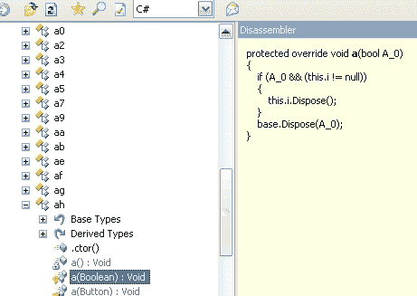
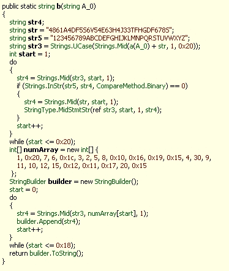
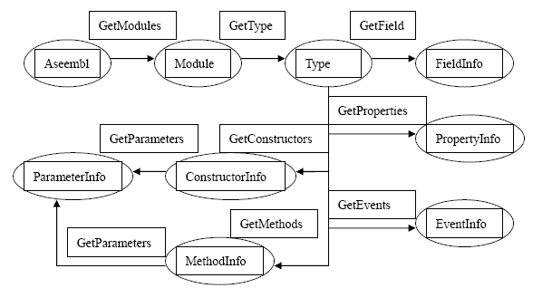

# dotNet 程序另类注册机--反射技术初探

> 原文：[`www.pediy.com/kssd/pediy10/64547.html`](https://www.pediy.com/kssd/pediy10/64547.html)

“反射（Reflection）是.NET 中的一个重要技术，通过反射，可以在运行时获得某个类型的各种信息，包括方法、属性、事件及构造函数等，还可以获得每个成员的名称、限定符和参数等信息。可以说有了反射，即可对每个类型了如指掌。知道了类型信息，就可以在程序运行时动态的创建对象，调用方法，设置属性和激发事件，所有这些都是在程序运行时而不是编译时完成的。”  
以上引自《.NET2.0 面向对象编程揭秘》一书的第十五章。  
反射原来是这么回事，可以在运行时获得某类的各种信息，我们也不难理解为何通过反射技术可以脱掉大部分加壳的.NET 程序。联想到以前跟踪软件时找到了计算注册码的关键 call，却苦于看不懂算法而郁闷，这时很多人想过能不能把这个 call 的代码提取出来放到我们自己的程序里，记得以前 laomms 好像写过这样一篇文章，讲如何从程序中扣代码出来为自己所用。然而.NET 时代来了，不用我们费那么大劲，反射技术为我们解决了所有问题。下面我们来看一个例子：  
   
上图是用 Reflector 反编译的一个.NET 程序，可以看到此程序的名称被混淆了，不过没有流程混淆，各个方法还是能看到，这样我们就能很快定位我们的关键 call，关键方法如下：  
   
其实这时我们已经可以编写注册机了，不过这不是我们今天的重点，我们要做到的是在我们的程序里调用这个函数，而不是我们自己重写这个函数。  
我们在 VS 里新建一个工程，将.NET 的程序添加到我们的资源里，这样做的目的只是为了最后的注册机只需要一个文件即可使用，不像用 keymaker 制作的内存主机那样非要放着程序目录才能使用。好了，开始写我们的注册机：  
 

代码:

```
//从资源中读取程序程序集 xx
Byte\[\] yuan = WindowsFormsApplication1.Properties.Resources.xx;
//载入程序集
Assembly ass = Assembly.Load(yuan);
//获取关键方法所在的类
Type t = ass.GetType(".bk");
//获取关键方法
MethodInfo reg = t.GetMethod("b", new Type\[\] { typeof(String) });
//定义变量
object sn;//注册码
String hardno;//硬件码
hardno = textBox1.Text;
//调用关键方法得到，让他为我们完成注册码的计算
sn = reg.Invoke(null, new object\[\]{hardno});
textBox2.Text = (String)sn;

```

  
至此，此另类注册机完成。附上运用反射技术时有用的图：  
