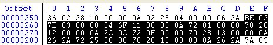
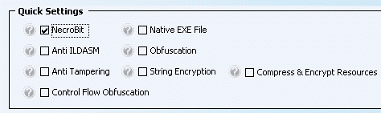
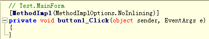
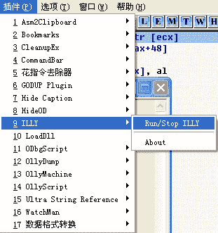
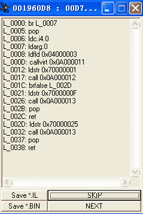
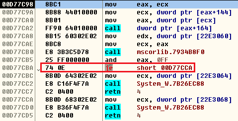
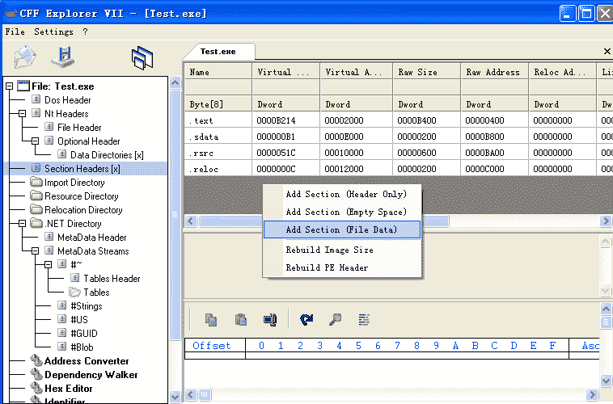
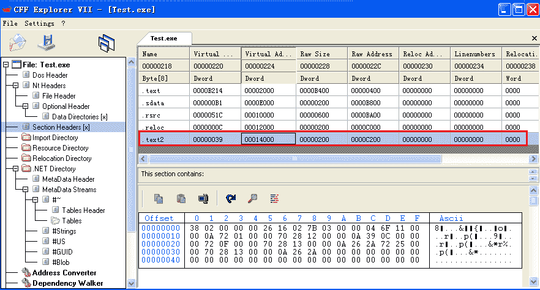
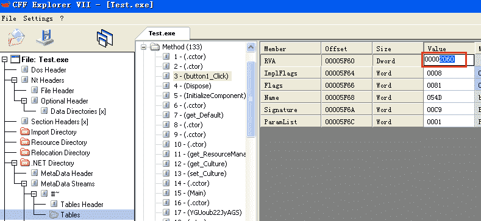
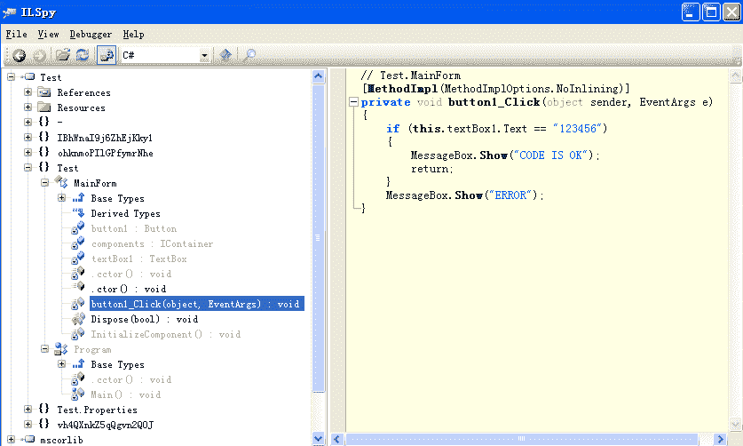

# 突破技术封锁，JIT 层脱壳浅析

> 原文：[`www.pediy.com/kssd/pediy12/144010.html`](https://www.pediy.com/kssd/pediy12/144010.html)

现在.Net 壳真是越来越强了，目前的主流保护思想都是基于“方法”层面的了，在内存中我们已经无法获得完整的 Assembly 了，即使 Dump 下来，也看不全 IL 代码。比较有代表性的壳就是 Reactor, MaxToCode, DNGuard HVM 等等。  
    可是不知道为什么，大牛们总是把技术藏着掖着，害得我们这些小菜们破解无路，经过细读 rick 大牛的文章和在某人的细心指点下，略有心得，特来和大家分享。  
    俗话说：“柿子要找软的捏”，在上面提到的三款强壳中，最弱的可就是要算 Reactor 了。虽然是最弱的，但是我相信几乎可以难倒 90%的 DOTNET 初学者。虽然大牛们不屑一顾，甚至秒杀，但是作为小菜的我们还是需要研究很久的。  
    为了便于研究，我们自己先创建一个小小的 CrackMe，代码非常简单如下：  

代码:

```
if (textBox1.Text == "123456")
{
      MessageBox.Show("CODE IS OK");
}
else
{
      MessageBox.Show("ERROR");
}

```

只要注册码为 123456 就可以注册成功，我们根据 RVA 地址可以顺利找到其二进制代码如下：  
  
  
我们再使用 Reactor4.4 对这个 CrackMe 进行加密，同样为了起到研究的目的，我们仅仅勾选 NecroBit 选项  
  
  
加密后，我们再也看不到 IL 代码了。  
  
这便是 Reactor 的独门秘籍了，基于方法体加密。  
  
    那么我们就真的没有办法了吗？方法当然是有的，其一是研究 Reactor 的自我解密函数，那么我们甚至就可以静态脱壳了，但这是属于牛人研究的范畴，我们暂且不研究。其二就是利用 Hook JIT 来截获 IL 代码。看雪论坛上已经有高手详细的解释了怎么编写一个 HOOK JIT 的代码，所以我就不展开讲了，我们甚至可以直接使用 OllyDBG 的 ILLY 插件来直接获取 IL 代码。  
[`bbs.pediy.com/showthread.php?t=116218`](http://bbs.pediy.com/showthread.php?t=116218)  
[`bbs.pediy.com/showthread.php?t=63940`](http://bbs.pediy.com/showthread.php?t=63940)  
** 在使用这个插件之前，请先搭建一个 Pure DOTNET 环境，所谓的 Pure DOTNET 环境是指一台裸机安装了原版 Windows XP 操作系统后，仅仅安装了.NET Framework v2.0.50727 版本的框架。**  
[`www.microsoft.com/downloads/z...d-aab15c5e04f5`](http://www.microsoft.com/downloads/zh-cn/details.aspx?familyid=0856eacb-4362-4b0d-8edd-aab15c5e04f5)  
    任何其他软件都没有安装。这个环境是非常利于 HOOK JIT 的，可以让我们今天使用的 ILLY 插件很稳定的截获 IL 代码。建议大家在虚拟机中建立这样的环境。  
  
    将 ILLY 插件拷贝到 OllyDBG 的 plugin 目录中去。然后将加密后的 CrackMe 拖进 OllyDBG 中，  
OllyDBG 很快就会中断到 compileMethod 方法处，并弹出了 IL 代码对话框，当然这里仅仅只 CrackMe 的入口点，为了测试，我们先暂停 ILLY 的监控，让程序跑飞。  
  
  
可以通过上面的菜单进行暂停或执行 ILLY 的监控。当程序跑飞后，我们再次启用 ILLY，点击按钮后，ILLY 插件就真正截获到我们需要的 IL 代码了。  
  
  
上图便是获得的核心 IL 代码，我们先不急着处理，看一个小小的意外收获。请看 OllyDBG 的反汇编代码：  
  
  
    这岂不就是那段 IL 代码编译后的 Native 代码么？？而红色标出的部分就是判断注册是否成功的关键跳，将 74 修改为 75 后，果然显示注册成功了！看样子如果我们只做一个内存补丁也是可以的，但不是今天研究的主题，我们暂不讨论。  
    在弹出的 ILLY 对话框中，我们可以点击 Save \*.BIN 到文件，这样我们就真正通过 HOOK JIT 获得了 Reactor 加密后的数据了。我们只需要将这些二进制代码还原到原程序中就行了，可是新的问题出现了：加密后的程序存储 IL 代码的字节数太少了，而我们获得的 IL 字节太多了，根本放不下去啊…..  
  
对于这个问题我纠结了很久，最后不得不向某人求助。某人是这样做的：他先用 CFF 在加密后的程序中新建一个 Section 将 Dump 到的 Bin 文件添加进去。如下图所示  
  
  
下图就是增加了 Section 后的截图，新的 Section 取名为.text2  
  
  
    我们只需要将 button\_click1 方法的 RAV 重新指向到这个新的解密后的方法就行了（.text2 的 RAV 是 14000）。但是这里我们一定要注意一个很大的问题，就是 Tiny Method 和 Fat Method，由于计算 Fat Method 的数据有点多，我们还是当作 Tiny Method 来处理，经过 IL 代码的大小计算后得出的 Tiny Method 头应该是 CA，因此我们将 RAV 14006 处修改为 CA，（限于篇幅，具体计算方法可以 Google 之）然后我们再将按钮点击出的 Button\_click1 的 RVA 修改为 14006  
  
将上图红色方框处修改为 14006  
  
存盘后，我们再用 ILSPY 打开看看，神奇的一幕出现了：  
  
  
我们成功的还原了 Reactor4.4 加密后的源代码！！！激动啊~~~~曾经难倒了多少菜鸟~~~  
程序试着跑一下，没有报错！！！剩下的破解工作太简单就不说了。  
  
    今天我们利用纯手工完成了对 Reactor4.4 加密后的程序的简单破解。大家还满意吗？如果写一个工具完成上述手工操作的全过程，那么整个 Reactor 壳就可以轻松脱去！！本文也仅仅是起到一个抛砖引玉的作用，虽然某人已经自己写出自动脱壳机了，可惜他没给我……。不能分享给大家了，实在抱歉……。  
    最后希望大家能写出来一个出来分享。  
附件提供了文中提到的 CrackMe，欢迎大家尝试，欢迎留帖或者发邮件给我一起讨论 [chenxiaolu2012@gmail.com](http://chenxiaolu2012@gmail.com)

上传的附件
|  || Test.rar  
 |