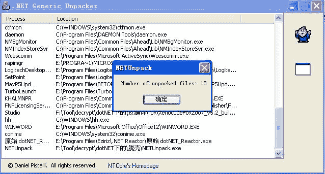
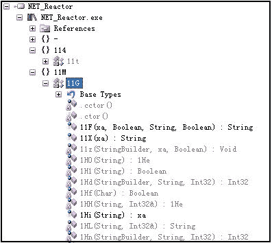
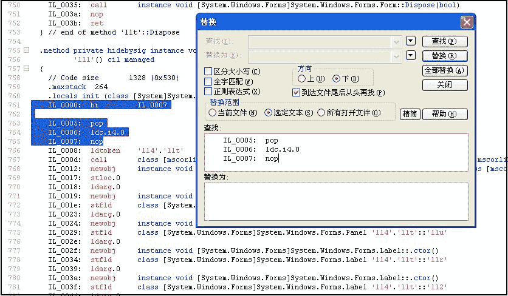

# .NET Reactor 分析（适合.net 新手实战入门）

> 原文：[`www.pediy.com/kssd/pediy09/pediy09-241.htm`](https://www.pediy.com/kssd/pediy09/pediy09-241.htm)

> 既然目前很多同学对.net 的认识还停留在 reflector+ildasm+ilasm 通知的阶段，干脆，我再写一篇入门的，让大家都能看明白，动起手来也很简单。  
>      .NET Reactor 是 EZIRIZ 公司出品的一款.net 保护软件，该软件保护.net 软件的功能不错，可惜对自己的保护却是很弱。前几个版本的混淆强度挺大，很难定位关键代码，可最新的 3.3.0.1 版保护就太弱了。MegaX 已经发布了它的破解，和他交流过程中发现思路我俩的思路有小差别，在此写出来。本文难度较低，适合初学.net 的进行实战入门。  
>     用 CFF Explorer 载入 reactor 的主程序，发现没有元数据，是个 win32 程序。通常来说这种.net 程序是被加壳了。Reactor 属于 whole assembly 保护，最大的弱点是完整程序集在内存中出现，脱壳的方法也很简单，用 NET Unpacker 直接脱既可。脱壳后可发现 15 个程序集（如图 1），其中一个已经显出了 reactor 的图标，那便是该程序的真身。（注：现在已经有好几种加密壳无法使用 NET Unpacker 直接脱了，强度比整体保护大很多。）  
> 
>   
> 图 1  用 NET Unpacker 对整体保护的程序进行脱壳  
>     用 Reflector 载入 dump 出的文件，发现其名称混淆形式如图 2 所示。真不知道 EZIRIZ 怎么想的，竟然混淆成这么短，且又好读又好记的名称。前几版的名称比该版本麻烦多了。  
>   
> 图 2  很简单的名称混淆  
>     下面看下流程混淆的形式，与前几个版本一样，使用一个跳转，中间加杂使堆栈溢出的指令，且每个方法的开头都是这三句：  
> 代码:
> 
> ```
> L\_0000: br L\_0007
> L\_0005: pop 
> L\_0006: ldc.i4.0 
> L\_0007: nop 
>  
> 
> ```
> 
>     反流程混淆的两种方法：一，用 ildasm 反编译成 il，在 EditPlus 中搜索前三句指令，并替换为空，如图 3 所示。  
>   
> 图 3  在 EditPlus 搜索流程混淆指令并替换  
>     第二种方法，使用我很久以前发的流程混淆小工具 replace，尤其对.net reactor 这个软件，效果及好。  
>     反流程混淆完成后，便可以用 C#代码浏览了。所有的敏感代码都在入口方法中，爆破的方法很简单，添加一句将 flag 变量设为真的指令就行了，如下（不敢想像，居然没有校验）：  
> 代码:
> 
> ```
> \[STAThread\]
> public static void uN(string\[\] A\_0)
> {
>     int num;
>     RSACryptoServiceProvider.UseMachineKeyStore = true;
>     bool flag = Gz();
>     flag = true;//添加的指令
>     111 = flag;
>     if (!flag)
>     {
>         110 = M0();
>         flag = false;
>     }
>     HTt.HCw = flag;
>     1LY.1LB(flag);
> 
> ```
> 
>     有兴趣的同学可以跟出它对注册文件的判断。早期版本我跟过，后来它改进了。有两种扩展名，.v3lic 和.license，应该也不难。  
>     就到这，这个软件就这么简单，没什么好多说的。对.net 有兴趣的同学可以进行实战的入门训练了。 

 4dd466d0e1e0cc123afbe504da2462ca