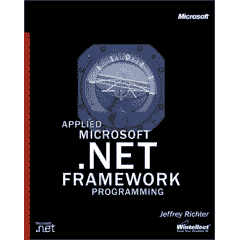
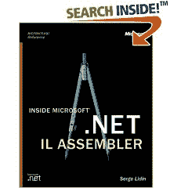
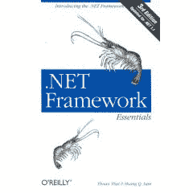
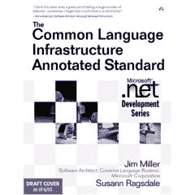
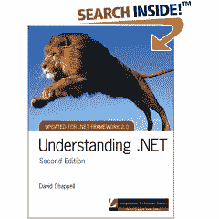
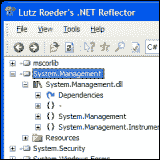
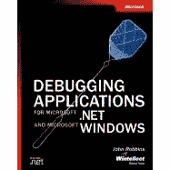
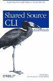

# 如果你不懂.net 逆向，又对它感兴趣，请进！（修正版）

> 原文：[`www.pediy.com/kssd/pediy08/pediy8-319.htm`](https://www.pediy.com/kssd/pediy08/pediy8-319.htm)

先声明，偶既不是专业程序员，从事的工作也和 IT 毫无关系，只是有兴趣时就看一点逆向的东东，纯粹是当游戏。所以各位大牛不用以专业的眼光来审视偶写的文章及偶做的工作。偶接触.net 可能比某些新手早些，为了让对.net 逆向有兴趣的朋友少走弯路，特写此文。  
  
**1、从哪儿着手**  
    要想逆，首先对写程序多少要有点了解。因此，偶觉得掌握一门高级的.net 编程语言是必须的，一般都是 C#、VC.net 或 VB.net。不必程序编得很好，但至少流程要看得懂吧。这类书很多，找本入门的看看既可。然后，就得了解.net 运行的基本机制了，类似于 win32 下 ring3 层必须要了解线程啊、进程啊、断点啊之类的，.net 下也必须了解一些最基本的运行机制。（后面还要介绍一些更底层的机制，类似于 win32 下的 rootkit，属于.net 中的 ring0）。  
    就像 win32 下逆向要学 asm 一样，.net 下也必须掌握 MSIL，这是.net 下的汇编语言。与 asm 比起来，IL 的语法简单的多，会很快掌握的。还有一个很重要的，就是.net 下 PE 的结构。这里讲的 PE 结构，和 win32 下也不同，指的是一种叫元数  
据的结构（Metadata），.net 下程序集的信息都以各种形式的 Metadata 存储在文件中。了解了元数据的结构，对于了解.net 下的各种运行机制（比如名称混淆）都很有帮助。  
    下面给出几本资料，有的有中文译本，但毕竟.net 是人家微软的东东，所以还是英文资料多（网上均可下）。不要求每本看完，但求用时有地方查：  
  
  
  
Applied Microsoft .NET Framework Programming(Microsoft Press)  
  
  
Inside Microsoft .NET IL Assembler (Microsoft Press)  
  
  
.Net Framework Essentials(O'Reilly)  
  
  
The Common Language Infrastructure Annotated Standard(Addison Wesley)  
  
  
Understanding .NET, Second Edition(Addison Wesley)  
  
  
**2、用哪些工具**  
    如果上面书都看完了（不会吧，你全都看完了？天才啊！），下面开始动手了。搞破解逆向玩儿的谁没几个用得得心应手的工具。下面我按分类列一些我用的多点的工具，不求全，但求精。  
  
2.1 程序设计  
    最好用的就是 VS.net 2003 和 2005 了，配合上 VisualAssist，程序设计就不愁了。买（或 D）一个 VS 套装，里面包含了.Net SDK 和 VS 的 IDE。  
  
2.2 编译  
    当然，如果是只有几行代码的小程序，C#的便可以用 CSC.exe 编译，IL 代码的可以直接用 ILASM 编译。  
  
2.3 反编译  
    这是逆向中最基本也可以说是最重要的一环，微软的东东往往是最基本也最不可或缺少的，SDK 中自带的 ildasm.exe。  
    再就是一些第三方开发的反编译软件，最好用的莫过于 Reflector（能在 PEDIY 里搜到的就不再贴链接了），当然，也因为它被使用的最广，现在越来越多 anti 的手段了，但仍是必不可少。  
  
    Decompiler .Net 2005 是另一个功能比较强的软件，但偶用的不多。还有就是 Xenocode Fox。IDApro 在 win32 是相当好用，可惜在.net 下其应用性实在是大打折扣。  
  
2.4 调试  
    调试一直是.net 下的弱项。其实不是弱，只是比起 win32 下起来，用户可做的感觉没那么多，没那么底层，操作习惯也是大有改变。  
    如果编程中的调试，用 VS.net 自带的调试功能既可，非常方便的。  
    对于无源码的程序要调试，可以用 ildasm 反汇编至 il，再带/debug 编译成 exe 文件，这样可以用 SDK 安装目录下的 GuiDBG 进行调试。不过现在这种可能性越来越少，比如最简单的混淆成不可见字符的.net 程序集，在编译回去时会报错。  
    如果直接调试，偶知道的目前唯一好用的就是 PEBrowse 的软件。关于它的使用坛里有文章，对于大多数.net 程序确实是一把利剑，强烈推荐大家使用。  
  
    我没说 Ollydbg 和 Windbg 不能用啊，只是调试起来不是很直观，不太方便。但仍有不少好例子，比如 Flier 大牛写的《用 WinDbg 探索 CLR 世界》，对.net 不是了解到一定层次是写不出这种文章的。  
  
2.5 混淆与反混淆  
    混淆的东西太多，只举几个有代表性的。偶知道的第一个混淆器就是 VS.net 自带的 Dotfuscator 的演示版，只是将有意义的字符变为几个简短的数字，谈不上什么强度。  
    另一个比较有名的就是 Xenocode 的混淆，文件名变为长长的字母加数字。不过说实话，这样搞还不如前面说的混淆成简短数字来的有效。但是它还有一个功能就是流程混淆（好像是它的功能，没有验证），类似于 win32 下的花指令，并且这种方法是对付 Reflector 静态反编译的有效利器。  
    再就是 Spices.net 出的混淆器了，将字符串加密为不可见字符，在 Reflector 里看到的都是方框。这种相对恼火一些，但这种混淆再强，只要花了足够的时间，总是可以找到关键的代码的。  
  
2.6 加壳  
    加壳是 win32 下很普遍的做法了，但在.net 下还不是很多。同样，分两种，压缩壳和加密壳。压缩壳不多说了，只说加密壳。比较好的是 MaxtoCode 和 Remotesoft Protector，这两个壳相当于在.net 和 windows 中添加了个过滤层，将源代码加密存储，动态解密执行，现在还没有较好的方法应付，也或者是有了但没公开。（当然，除了 JasonNET 大牛了，呵呵）  
  
    提一下，为什么很多 dump 软件对加密过的.net 程序不起作用，比如 MaxtoCode。因为.net 的程序是按方法既时在内存中编译的，再加上垃圾收集机制，所以任何时候在内存中通常不会出现完整的原程序。即使有，也可以将其代码加密，dump 下来也是没法阅读的。  
  
  
**3   .net 的核心**  
    这里讲讲前文提到的.net 下的 ring0，说白了三大块，Profiler、Debugger 和 Metadata。当你爆破过 N 个程序后，会感觉到止步不前，这时你就要考虑下看看更深层次的东西了。这些文档在.Net v1.1 中的目录是\\Microsoft.NET\\SDK\\v1.1\\Tool Developers Guide\\docs，V2.0 的文档已经被移到 MSDN 了。不过微软的开发手册更适合当资料查，还是看一些 tutorial 入门快些。这里给出一些文献，全都在 MSDN 中和 google 中可以搜到，大家一同学吧。虽然如 lccracker 所说，是别人数年前的东西，但还是得看啊（加红色为我已看过并强力推荐先阅读的）：  
  
dotNET Internals The Profiling API  
  
Drill Into .NET Framework Internals to See How the CLR Creates Runtime Objects  
  
Examine Running Processes Using Both Managed and Unmanaged Code  
  
Improve Your Understanding of .NET Internals by Building a Debugger for Managed Code  
  
Rewrite MSIL Code on the Fly with the .NET Framework Profiling API  
  
The .NET Profiling API and the DNProfiler Tool  
  
Tracing APIs in .NET Framework 2.0  
  
Write Profilers With Ease Using High-Level Wrapper Classes  
  
在 .NET Framework 2.0 中，没有任何代码能够逃避 Profiling API 的分析  
  
使用 .NET Profiler API 检查并优化程序的内存使用  
  
.NET Framework Developer Center CLR Run-Time Breaking Changes  
  
Modifying IL at runtime  
  
An Overview of Managed Unmanaged Code Interoperability  
  
Build a Logging and Event Viewing Library to Help Debug Your .NET Framework based App  
  
Taming the CLR： How to Write Real-Time Managed Code  
  
Using the Profiling API Enter／Leave Function Hooks  
  
Writing High-Performance Managed Applications  
  
    debugger 方面直接看 ref 也许不太容易入门，网上有篇非常好的 toturial，一步步讲解了 debugger 的原理和编写，实在是入门的经典《Debuggers under .NET》。  
http://blogs.chimpswithkeyboards.com/jonshute/category/2.aspx  
  
    上面这些是文章，还有一本书也涉及到这方面内容，非常值得一看。  
  
  
**Debugging Applications for Microsoft .NET and Microsoft Windows（MS Press）**  
  
  
    微软发布了代号为 rotor 的 shared source cli 的源代码，这个对想了解.net 核心运行情况是非常有帮助的。其中甚至包括了 ilasm、ildasm、一个 C#和 MSIL 的源代码。下载可以去 MSDN 的网站。关于 rotor 的资料不多（其实最好的资料就是源代码了），只有两本书，其中一本可以下载到电子版。  
  
  
    .net Framework 最好的讨论去处可能算 MSDN Forums 了，有两个分论坛不错，一个是 Common Language Runtime，另一个是专门讨论 debugger 的。人气虽然一般，但得到的回答一般是比较权威的。  
  
**4  .net 破解的层次**  
    这不是权威的层次划分，纯属搞笑，大家请勿对号入座。  
    第一层自然是静态分析加爆破了，用 Reflector 看程序的源码，搜索关键字符以找到注册码的比较代码，最简单的跳转指令修改，将 br.true 和 br.false 互改，这是人生必须经过的阶段。  
    第二层，仍是静态分析，但是找到了注册码计算的代码，并且会将这些代码粘贴到自己的程序中，写个小的 keygen。  
    第三层，能熟练运用动态调试工具对.net 程序集进行调试，能下关键的断点，动静结合并更容易的写出注册机（复杂的算法除外）。  
    第四层，能更精妙地运用已有的 Profiler 或 Debugger，甚至写个自己的小 Profiler 或 Debugger，在.net 的核心层上对程序进行分析。  
    第五层，在.net 中绝对属于大牛类型，对.net 内核极其清楚，能编写程序干预.net 与 windows 的通讯，能将 win32 的技术运用到.net 的保护中，从而破解（或编写）加解密程序。  
  
最后：写这篇文章就像搞逆向破解，反正又不靠它吃饭，纯粹是玩儿。所以你看时也别当真，就当小说吧！.Net 下的东西在国外已经研究很多年了，国内也有很多牛人，但明显进度和国外比差了点。没办法，毕竟是人家的东西，所以语言方面国人没有什么优势。因此，要想深入.net 核心，掌握英语也是必不可少的！ 

 4dd466d0e1e0cc123afbe504da2462ca