# VB 共享软件防破解设计技术初探（一）（二）（三）

> 原文：[`www.pediy.com/kssd/pediy10/72050.html`](https://www.pediy.com/kssd/pediy10/72050.html)

VB 共享软件防破解设计技术初探（一）  
  
  
××××××××××××××××××××××××××××××××××××××××××××××  
  
其他文章快速链接：  
  
VB 共享软件防破解设计技术初探（二）  
[`bbs.pediy.com/showthread.php?t=72204`](http://bbs.pediy.com/showthread.php?t=72204)  
  
VB 共享软件防破解设计技术初探（三）  
[`bbs.pediy.com/showthread.php?t=72489`](http://bbs.pediy.com/showthread.php?t=72489)  
  
  
××××××××××××××××××××××××××××××××××××××××××××××  
  
  
  
作者：爱琴海\[SCG\] 2008/09/04 （转载请保留该信息）  
  
  一转眼又过去了一年，回头一看，今年我没发表过任何破解类文章，没有任何有价值的文章，名下的精华只是徒有其表的 7 个，也许太忙，也许读大学读得后悔，也许堕落了。  
  
  在看雪注册的帐号一晃就是两个春夏秋冬了，大三要忙自己的学业了，估计以后也不会再有时间和精力破解软件，学习加密思想了。两年的时间发生了太多的事情，来不及回忆，来不及思考，我们班班长不久前溺水去逝了，估摸着也到头七了……  
  
这世事总无偿，让人来不及追忆，来不及哀悼。今天实习的时候，好好的，竟然被车床飞出来的铁屑烫伤……  
  
趁现在还在坛子里活动，趁现在脑子还没生锈，我琢磨着把自己两年来积累的部分经验和思想写下来，留下点什么有用的东西。  
  
学习 VB 编程也就一年，只是入门而已，谈不上什么高手。本系列是作者本人尝试过和破解过的一些技术经验之谈，如果有问题或者有纰漏和错误，敬请高位高手点明和说明；也不知道该系列能写多少，能写多久；若是有时间，有精力，有能力，我会继续写下去，谢谢大家的观看。  
  
加密解密一直是相辅相成的技术，没有矛何必有盾？有盾怎能没矛？  
  
在不断的尝试和实践中，才能积累起丰富的加密解密经验，为自己写的共享软件设计出一套完善的加密系统，或者攻克一个高度加密的共享软件，两者都是件令人欢心令人耗尽精力。终记起这样的一段诗句：“衣带渐宽终不悔，为伊消得人憔悴”。  
  
本系列第一篇，粗略的讲解我认识到的 VB 防破解技术，后续篇将实战演练教学  
  
我个人认识的 VB 防破解包括如下几下方面：  
  
1、  文件完整性，防止被非法修改  
2、  运行时的校验，防止被 LOADER  
3、  反调试，防止动态跟踪和挂接  
4、  防静态反汇编分析  
5、  注册码系统（算法部分，核心内容）  
6、  加壳防脱壳  
7、  隐蔽性设计  
8、  另辟蹊径  
  
由于 VB 天生的原因，有些功能实现起来非常麻烦，比方说算法部分，如果采用大数运算的话，缺少大数运行库。所以，有时也可以采用第三方 DLL 来补充大数的不足。  
  
我先粗略的讲下以上 8 大点的大概分类：  
  
1、  文件完整性，可采用 CRC32 或者 MD5 或者哈希算法等，计算出文件的加密值，在适当的时候进行对比，判断文件被修改与否。当然那也可以加猛壳来防止文件非法修改。还有简单点的检查文件最后修改时间，看看是否是你自己设置好的时间，如果不是，则很有可能被修改过；也可以检测文件大小，往往压缩壳被脱掉后，文件的大小会增加；保护壳被脱掉后，文件大小会变小，我们可以根据这个设置好临界值来检测有没有被脱壳。常用的还有故意设计好关于算法方面的陷阱，如果是破解者会主动掉进你的陷阱，而事实上，这个跳转除非爆破，不然在算法上是永远也无法到达的，这样就检出破解者在修改程序流程。你可以无声无息的程序死掉，不要直接退出，不然会被追踪到退出函数。  
  
2、  防止 LOADER，这个实现起来不容易，但是可以巧妙的应用 VB 里的 SHELL 函数，进行“金蝉脱壳”。常用的保护壳里有些也能防止 LOADER。  
在下次系列里将讲解“金蝉脱壳”技术  
  
3、  反调试，如同《使用 VB 进行反跟踪的技术点滴》一文讲解，基本差不多了。常见的有：检测父进程；遍历所有进程检查程序标题栏，看看是否有敏感字符；反 SMARTCHECK 加载；经典时值步长比较；异常处理技术（这个要当作重点）一些猛壳本身也有反调试功能。  
4、    
还可以检测程序启动时间，一般调试器加载都是比正常启动程序要慢 10 倍左右  
还可以检测内存分配，如果 OD 调试器启用了 HIDEOD 插件的话，那么程序获得的  
  
内存分配上限和下限都是不一样的  
  
还可以检测所有标题，枚举进程等  
  
一般要加几个 TIMER 控件来时时反调试，这样可以在 OD 挂接到程序的时候检测出来  
  
可参考实例：  
[`bbs.pediy.com/showthread.php?t=67232`](http://bbs.pediy.com/showthread.php?t=67232)  
[`bbs.pediy.com/showthread.php?t=57181`](http://bbs.pediy.com/showthread.php?t=57181)  
  
以前看雪论坛里有篇文章，laomms 大侠写的《使用 VB 进行反跟踪的技术点滴》一文，对我们学习 VB 的防破解设计是很有帮助的，为了大家观看方便，我将它引录到下文中：  
  
原文地址：[`bbs.pediy.com/showthread.php?t=26213`](http://bbs.pediy.com/showthread.php?t=26213)  
  
   跟其它语言相比，VB 总是被人“鄙视”，其实没有好与不好的语言，正如某程序员说的：没有最好的语言，只有最好的程序员。VB 也有它自己的特点，简单、方便、可视化强、利于快速开发，6M 的迷你版更是让人在不释手。而且容易入门，也是通往其它语言最好的一个奠基。可惜关于 VB 方面的保护技术的文章很少，软件加密技术里面有涉及 VB 的保护内容，但是源码太少了，大部分是 C 和 MASM 源码，这里我们也粗略的讲讲 VB 的一些保护技术，如果你还有更好的方法希望在下面补充。  
  
    一、检测父进程反 RING3 调试器，我们知道 WIN32 系统一般软件的父进程都是 EXPLORE，而 OD 等 RING3 调试器对软件进行调试时都是将它们的线程设为它的子线程，我们只要让程序检查父进程是否为 EXPLORE 就行，看附件里的 Anti-Debug,如果发现父进程不是 EXPLORE.EXE 就自动退出，源码如下：  
'相关的 API 自己查查  
hSnapShot = CreateToolhelp32Snapshot(TH32CS\_SNAPPROCESS, 0&) '建立进程快照  
      If hSnapShot Then  
    Process.dwSize = 1060  
    If (Process32First(hSnapShot, Process)) Then '遍历第一个进程,获得 PROCESSENTRY32 结构  
       Do  
        i = InStr(1, Process.szExeFile, Chr(0))       '获得映像名称  
        mName = LCase(Left(Process.szExeFile, i - 1)) '并转换成小写  
              If mName = "explorer.exe" Then      '是不是 explorer.exe  
             explorer = Process.th32ProcessID    '获得进程 ID  
        ElseIf Process.th32ProcessID = GetCurrentProcessId() Then '是不是自己  
             pid = Process.th32ParentProcessID   '获得自己父进程 ID  
        Else  
             flag = False  
        End If  
      Loop Until (Process32Next(hSnapShot, Process) < 1) '遍历所有进程直到返回值为 False  
    End If  
    l1 = CloseHandle(hSnapShot)  
    End If  
    If pid <> explorer Then  
     TerminateProcess hprocess, 0  
     Else  
     MsgBox "ok"  
     On Error Resume Next  
    End If  
End Sub  
当然这个方法也不是万能的，在 Process32First 下断，更改跳转轻易躲过。  
  
    二、反 SMARTCHECK 加载，SMARTCHECK 是调试 VB 的利器，有必要对其进行防范。小楼前辈在软件加密技术内幕中提到两种检测方法：  
利用 VB 的 AppActivate 函数激活 SMARTCHECK 窗口，然后发送 ALT+F4 进行关闭该窗口和利用 FindWindow 发现 SMARTCHECK 窗口直接将其关闭，其代码基本上是这样：  
winHwnd = FindWindow(vbNullString, "Numega SmartCheck")  
If winHwnd <> 0 Then  
AppActivate "Numega SmartCheck"  
sendkey "%{f4}", True  
sendkey "%y", True  
   其实，我觉得直接检测进程 SMARTCHK.EXE 是否存在也可以，方法跟上面类似，你还可以检测其它比如 W32DASM 等进程，附件中的 Anti-Load 就是实例，发现 SMARTCHK 调用，自动退出：  
…..  
 If InStr(LCase(Process.szExeFile), "smartchk.exe") > 0 Then  
           smart = Process.th32ProcessID  
          TerminateProcess hprocess, 0  
          Unload Me  
        Exit Do  
        End If  
…….  
  
    三、检测 SOFTICE，附件里的 Anti-ice 就是 Aming 前辈的代码，在内存中直接检测 SOFTICE。  
  
    四、利用 IsDebuggerPresent 检测调试器，这个对于 OD 来说已经一点用都没有了。具体看附件中的 IsDebuggerPresent。  
Private Declare Function IsDebuggerPresent Lib "kernel32" () As Long  
Private Sub Command1\_Click()  
If IsDebuggerPresent Then  
End  
Else  
MsgBox "没有被调试"  
End If  
End Sub  
  
    五、加密字符串。  
比如 Text1.text=”恭喜”，我们可以这样写：Text1.text=Chr(-18009) & Chr(-12366) & Chr(33)，另外一种就是写算法将字符串进行加密，实例 Encodestring 里你将找不到字符串信息，找到的是乱码。  
  
    六、实现软件代码校检防止被修改，比如用 CRC 或者 MD5 进行自身代码完整性检测，实现方法：  
先写一个用于增加 CRC 特征码的软件,假设定义为结尾部分:  
Const CRC\_HEAD = &H761226   '用于判断是否添加了 CRC 校验  
Private Type stCRC  
    lHead As Long   '验证是否进行 CRC 校验的标识  
    lCRC As Long    'CRC 校验值  
End Type  
Private Sub Command1\_Click()  
    CRC\_Exe App.Path & "\\工程 1.Exe"  
End Sub  
Private Function CRC\_Exe(ByVal strExe As String) As Boolean  
    Dim hFile As Long  
    Dim lFileLen As Long  
    Dim sCRC As stCRC  
    Dim btExe() As Byte  
    On Error GoTo Err\_CRC\_Exe  
    lFileLen = FileLen(strExe)  
    hFile = FreeFile  
    Open strExe For Binary As #hFile        '打开加密文件  
    Seek hFile, lFileLen - LenB(sCRC) + 1   '定位 CRC 标识域,位于 Exe 文件尾部文件  
    Get hFile, , sCRC      
       If sCRC.lHead = CRC\_HEAD Then     '如果已经添加了 CRC 校验则退出,反之添加 CRC 校验  
        MsgBox "已 CRC 验证!"  
        Close #hFile  
        Exit Function  
    Else  
        Seek hFile, 1               '定位到文件首部  
        ReDim btExe(lFileLen - 1)  
        Get hFile, , btExe          '按字节方式将 Exe 数据读入数组  
        sCRC.lHead = CRC\_HEAD       '添加 CRC 验证标识  
        sCRC.lCRC = Get\_CRC(VarPtr(btExe(0)), lFileLen) '获取 Exe 内容 CRC 值  
        Put hFile, , sCRC           '将 CRC 校验写入 Exe 文件尾部  
    End If  
    Close #hFile  
    MsgBox "CRC 校验完成!"  
    CRC\_Exe = True  
    Exit Function  
      
Err\_CRC\_Exe:  
    If hFile <> 0 Then Close #hFile  
    CRC\_Exe = False  
    MsgBox Err.Description  
End Function  
  
为程序本身增加 CRC 校检代码：  
Const CRC\_HEAD = &H761226   '用于判断是否添加了 CRC 校验  
Private Type stCRC  
    lHead As Long           '验证是否进行 CRC 校验的标识  
    lCRC As Long            'CRC 校验值  
End Type  
Private Sub Form\_Load()  
    Dim hFile As Long  
    Dim sCRC As stCRC  
    Dim strExe As String  
    Dim lFileLen As Long  
    Dim btExe() As Byte  
        strExe = App.Path & "\\" & App.EXEName & ".exe"  
    lFileLen = FileLen(strExe)      
     ReDim btExe(lFileLen - LenB(sCRC) - 1) As Byte   '定义 Exe 字节缓存数组  
     hFile = FreeFile  
    Open strExe For Binary As #hFile       '读取 Exe 数据到数组  
    Get #hFile, , btExe  
    Get #hFile, , sCRC  
    Close #hFile      
        If sCRC.lHead = CRC\_HEAD Then  '如果程序添加了 CRC 验证则验证 CRC 值  
        If Get\_CRC(VarPtr(btExe(0)), UBound(btExe) + 1) = lCRC Then   '验证 Exe 数据 CRC 和保存的 CRC 值是否相同  
            MsgBox "文件未修改!".  
        Else  
            MsgBox "文件被非法修改!"  
        End If  
    Else  
        MsgBox "文件尚未进行 CRC 验证!"      '检查尾部是否已已经增加 CRC 校检  
    End If      
End Sub  
  
   其中的 CRC 模块网上很多。附件中的 CRC32 就是实例，修改任何一处软件都提示被修改。增加自校检后建议再随便加个壳，否则用 UltraEdit 直接就可以对比原文件查出 CRC 校验值位置。  
  
    七、利用 SEH 进行反跟踪，附件里的 SHE 如果用 SMARTCHECK 调试的话就合自动退出，附上小楼的源码：  
Option Explicit  
Private Declare Sub DebugBreak Lib "kernel32" ()  
Private Sub Command1\_Click()  
On Error GoTo ERR\_RaiseException  
DebugBreak  
DebugBreak  
Exit Sub  
  
ERR\_RaiseException:  
   MsgBox "没有发现调试器!"  
End Sub  
  
Sub SetHandler()  
SetUnhandledExceptionFilter AddressOf NewExceptionHandler  
End Sub  
  
Sub RestoreHandler()  
SetUnhandledExceptionFilter 0  
End Sub  
  
Private Sub Form\_Load()  
SetHandler  
End Sub  
  
Private Sub Form\_Unload(Cancel As Integer)  
RestoreHandler  
End Sub  
'SHE 模块略过。  
除了上面的一些方法外，你还可以用一些密码学知识增加难度，如果技术够强，还可以借用内嵌汇编弄一些花指令和反调试 SEH 机制  
\_\_\_\_\_\_\_\_\_\_\_\_\_\_\_\_\_\_\_\_\_\_\_\_\_\_\_\_\_\_\_\_\_\_\_\_\_\_\_\_\_\_\_\_\_\_\_\_\_\_\_\_\_\_\_\_\_\_\_\_\_\_  
  
感谢 laomms 大侠给我们上了关于 VB 反调试的生动一课  
  
5、  代码混淆？加花，VM，选择 P-CODE 方式等，都可以起到不错的作用。  
  
有些干脆搬出假目标（什么“注册正确”之类的提示，其实这个地方根本没有正确的算法）甚至，你可以直接修改 VB 的开始语句：（主要是防 VBExplorer 静态分析）  
正常其实语句：  
  
004018CC >/$  68 7C1D4000   PUSH 1112.00401D7C  
004018D1  |.  E8 F0FFFFFF   CALL <JMP.&MSVBVM60.#100>   
这个明显透露了 VB 程序，我们要做的是搬走这个位置  
换句话说是把这个 CALL 移走，移到天南海角去……  
004018D6  |.  0000          ADD BYTE PTR DS:\[EAX\],AL  
004018D8  |.  0000          ADD BYTE PTR DS:\[EAX\],AL  
004018DA  |.  0000          ADD BYTE PTR DS:\[EAX\],AL  
004018DC  |.  3000          XOR BYTE PTR DS:\[EAX\],AL  
004018DE  |.  0000          ADD BYTE PTR DS:\[EAX\],AL  
004018E0  |.  3800          CMP BYTE PTR DS:\[EAX\],AL  
004018E2  |.  0000          ADD BYTE PTR DS:\[EAX\],AL  
004018E4  |.  0000          ADD BYTE PTR DS:\[EAX\],AL  
004018E6  |.  0000          ADD BYTE PTR DS:\[EAX\],AL  
004018E8  |.  3A28          CMP CH,BYTE PTR DS:\[EAX\]  
004018EA  |.  8A00          MOV AL,BYTE PTR DS:\[EAX\]  
004018EC  \\.  CF            IRETD  
修改后：———————————————————————》》》  
  004018CC > $ /E9 7FA50100   JMP 了凡第一.0041BE50  
004018D1     |90            NOP  
004018D2     |90            NOP  
004018D3     |90            NOP  
004018D4     |90            NOP  
004018D5     |90            NOP  
0041BE50    60              PUSHAD  
0041BE51    0F31            RDTSC  
经典时值，单步跟，不小心的话就会进入到错误地址  
0041BE53    8BC8            MOV ECX,EAX  
0041BE55    0F31            RDTSC  
0041BE57    2BC1            SUB EAX,ECX  
0041BE59    3D 00050000     CMP EAX,500  
0041BE5E  ^ 0F8F BAF9FFFF   JG 了凡第一.0041B81E  
0041BE64    83F8 00         CMP EAX,0  
0041BE67  ^ 0F8C C7F9FFFF   JL 了凡第一.0041B834  
0041BE6D    61              POPAD  
0041BE6E    68 68504000     PUSH 了凡第一.00405068  
0041BE73    60              PUSHAD  
0041BE74    0F31            RDTSC  
0041BE76    8BC8            MOV ECX,EAX  
0041BE78    0F31            RDTSC  
0041BE7A    2BC1            SUB EAX,ECX  
0041BE7C    3D 00050000     CMP EAX,500  
0041BE81  ^ 0F8F ADF9FFFF   JG 了凡第一.0041B834  
0041BE87    83F8 00         CMP EAX,0  
0041BE8A  ^ 0F8C 8EF9FFFF   JL 了凡第一.0041B81E  
0041BE90    61              POPAD  
0041BE91    E8 305AFEFF     CALL <JMP.&MSVBVM60.#100>  
搬到这里来了  
0041BE96  ^ 0F85 3A5AFEFF   JNZ 了凡第一.004018D6  
0041BE9C  ^ 0F84 345AFEFF   JE 了凡第一.004018D6  
  
效果：  
  
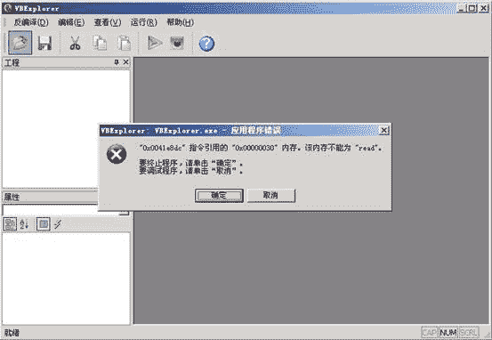  
   
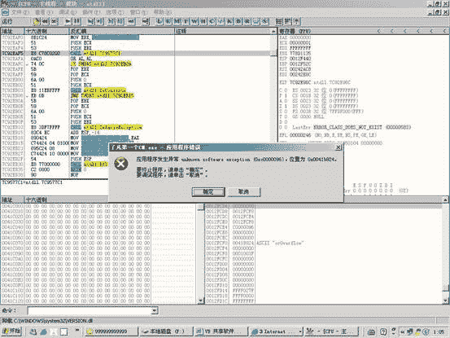  
   
  
如果有时间，你可以自己设计得更恐怖点，东一句西一句，让别人无法还原  
  
5、  注册算法系统  
  
这个是软件防破解的核心内容，推荐采用 陷阱＋隐藏关键算法到异常里面执行＋不可逆算法＋公开密码体制＋算法跟核心功能模块代码绑定，只有正确解密后的功能代码才能发挥因该有的功能。  
  
经常碰到 VB 的注册算法，一般共享软件不够重视这块内容，只是进行简单的加加减减，或者 XOR，或者凯撒＋矩阵，结果好像跟输入的用户名完全不一样，似乎很安全，其实只要破解者跟踪到了算法，按照那样的计算的话，基本都是明码比较，非常容易破解，甚至根本不用了解你的算法是什么。  
  
曾经看到过有共享软件作者在网上说：“我用的机器码是随机生成，保存在注册表里的，但是就算这样，别人用了什么内存注册机就把我的注册码算出来了，这到底怎么回事？太受打击了…”  
  
市面上出现明码比较的多是些新手写的软件，而且大部分是 VB 程序，为什么？因为 VB 本身的算法支持不是很好，大都是跟用户名的 ASCII 码绑定。这些都是弱点，容易被发现和跟踪，别人只要用函数断点断 MID，LEFT,RIGHT 字符函数，那么关于 ASCII 取用的基本都会被发现。  
  
在这里，我推荐采用浮点计算，除了算法本身不可逆，强度够大，经得起穷举外，还要小心谨慎的隐藏掉比较代码，因为大都初学破解 VB 程序的菜鸟都喜欢断 StrComp 函数，大都可以直接断到关键比较位置，如果你的良好的密码系统即将为你带来第一桶金，但是不幸你发现菜鸟断个比较函数，然后爆破了，呵呵，你的心情怎样？更不要说是明码比较的了。  
  
浮点计算，你要把字符串转为 DOUBLE 类型，指数运算和求余运算是比较好的算法，但是 VB 本身又不支持大数运算，单纯的指数运算和求余很可能会发生溢出错误。  
  
高次指数运算和求余可采用中国剩余定理来计算，也可以看看我写的代码，也许你会有启发：  
  
首先是 MOD 函数必须自己写一个，VB 自带的 MOD 范围太小  
  
Private Function Modx(x As Double, y As Double) As Double  
Dim w As Double  
w = Fix(x / y) \* y  
Modx = x - w  
End Function  
这样就实现了稍大数在 Vb 里的求余动作  
Private Function Rsa(p As Double) As Double  
Dim b As Double  
Dim rsan As Double  
rsan = 99221  
Rsa = 1  
For b = 1 To 15935  
Rsa = Rsa \* p  
Rsa = Modx(Rsa, rsan)  
Next b  
End Function  
  
通过每次都求余，剩下的继续执行指数运算，下次再求余，就避免的误差和溢出  
我们看下：  
  
3⁶ mod 25 = 729 mod 25 =4  
等同于：  
3⁶ mod 25 =(((((((((3 mod 25) \* 3) mod 25) \* 3) mod 25) \* 3) mod 25)\* 3) mod 25)\* 3 mod 25 = 4  
  
可发现计算结果一致，当然这个规律是可以证明的，通过这样的计算法则，我们可以大量减少运算强度。你不想实验下吗？  
  
上面给的程序其实就是 RSA 算法的应用，但是只能当作理论来用，实际上 N 太小了，非常容易被分解，呵呵，我们以此来学习 RSA 算法倒是没问题，以后用 RSA 的时候，只要用第三方 DLL 即可，比方说《共享软件加密算法库》即有相关应用。  
  
这里的 E 为 15935  
这里的 N 为 99221  
这里的加密法则为 C = P^E mod N  
  
如果 N 足够大，一般要求 512 位以上（二进制）才能有些安全度，要破解 RSA 算法，只要分解 N 为两个大质数的乘积即可……  
  
可以用 RSAtool 来分解，速度很快……  
分解后计算出 D （解密密钥）  
则解密算法为 P = C^D mod N  
  
这里计算出 D 为 48767  
  
也就是说逆运算为：  
'解密过程  
  
Private Function Jiemi(c As Double) As Double  
Dim b As Double  
Dim rsan As Double  
rsan = 99221  
Jiemi = 1  
For b = 1 To 48767  
Jiemi = Jiemi \* c  
Jiemi = Modx(Jiemi, rsan)  
Next b  
End Function  
  
当然，还有其他算法也很不错，到时有空再后续系列里详细演示……  
  
  关于如何隐藏关键算法到异常处理中去？  
  
  这个一直是 Vb 里很酷的技术，今天我把自己琢磨出的东西简单说一下，到下期系列的时候再具体演示  
  
  VB 里的异常处理机制是 通过 On error goto 这个语句进行的，这个功能可大了，配合 Resume Next、Resume 等语句，基本可以实现 VB 里的高级隐藏技术  
  
  大致是先在算法里嵌入迷惑性质的算法，通过一个可行的数值来产生一个指定的，不常见的错误，比方说可以除零，通过 On error goto 进行异常捕获，判断 Err.Number 是否等于某个数值（不同数值对应不同错误类型）或者故意制造出一个溢出来捕获，捕获后可以解密一两句算法，然后通过 Resume Next 回到原程序，继续解密，又产生其他的错误，然后继续解密真正的算法……  
  
大家可以看看具体应用的例子  
  
[`bbs.pediy.com/showthread.php?t=71741`](http://bbs.pediy.com/showthread.php?t=71741)  
[`bbs.pediy.com/showthread.php?t=72017`](http://bbs.pediy.com/showthread.php?t=72017)  
  
这些技术在 VB 共享软件里出现过，但是不常见，甚至可以说是稀少了；其作用真的很不错，因为破解者在不知道你具体用意的前提下，一步步分析下来，分析的是正常路径，绝对不会产生我们指定的错误，到最后发现总是无法解密算法，他才意识到似乎掉到一个非同寻常的陷阱里了，然后他回回头往上看，不停的分析，哪里才是正确的 JNZ 或者 JE 等跳转指令，殊不知若这样分析，他永远也分析不到我们指定的正确算法  
  
说得形象点吧，就像打 RPG 类单机游戏一样，破解者一步步玩下来，没出现任何差池，最后通关到了打 BOSS 的时候，发现不管怎么打就是要死，打得都没信心了，为什么如此？因为我们这个游戏要求在玩第一关或者前面几关的时候要触发某些隐藏剧情，或者隐藏剧情的任务奖励，奖励的东西是什么绝世神兵，可以秒杀 BOSS，或者要触发多个不同的隐藏剧情，获得一组或者好几组密钥等，参与最后的 BOSS 大决战，少了这些参数，就算游戏顺利玩下来了，最后也是徒劳的  
  
而这个隐藏的剧情不是发现了就可以进入隐藏剧情的，我们要求多少经验值，或者多少攻击力，或者以前做过些什么，比方说是帮老奶奶过马路，捡到一分钱交给警察叔叔等，而这些事情是普通玩家和破解者所不会做，或者做不到的  
  
比方说我要实现一个异常除零错误，来捕获流程进行注射关键代码（正常情况下是不会发生错误，也就得不到注射了，所以总是要感冒，总是要生病，总是要死的，最后他甚至认为你的程序写的有问题，算法无解等，其实是没有做隐藏任务）  
  
如：  
On Error GoTo chuling  
Dim a As Double  
Dim b As Double  
a = 110  
b = "&H" & Left(MD5(Right(Text2.Text, 16)), 5  
a = 110 / b Xor 123456789  
If a = 123 Then  
MsgBox "注册码错误", , "提示"  
Else  
If a = 0 Then MsgBox "注册码正确", , "提示"  
提示 ：想想，正常过来的画，a 怎么可能等于 0   
End If  
Exit Sub  
chuling:  
'关键核心算法  
噢，原来是发生了一次异常，在流程里注射了 “a = 0”这条指令  
a = 0  
Resume Next  
  
这只是个简单的实例，MD5 是 MD5 算法，因其逆算要穷举所以作为隐藏剧情的加密是可以的，你事先先计算好某个数字串的 MD5，转十进制后，算出其有效片段，将该有效片段作为 XOR 常量，即可。  
  
不知道要发生异常的人，只会直接看下来，到时总也无法注册成功，就算他知道要做隐藏任务，要使得 XOR 后为零，使得除数为零出错，他也无法根据已知 XOR 常数去反推原始数字串，除非爆破，否则难以为继。  
  
算法还有很多，比方说离散数学原理等都可以用上去  
  
如果算法还可以跟具体程序功能代码解密挂钩，那么效果不是一般的好  
  
现在是总的概要来说的，总结下：  
  
VB 加密算法要求   
  
1、不可逆及在不知道密钥的情况下，只能加密，不能解密   
2、算法隐藏很隐蔽的陷阱和隐藏剧情，及各类触发条件，最好是一般人都接触不到的触发条件   
3、尽量用公开算法   
4、关键比较必须隐蔽   
5、算法采用注射式，不同的注册码输入验证会激活不同的注射代码   
6、最重要的一点是：算法跟程序很紧密，甚至是程序的大段功能代码都必须用注册码来解密后才能执行正确的功能，否则解密出来的代码执行会出错，这样是为了防止爆破   
7、最后是非明码，用浮点计算  
  
6、  加壳防脱壳  
  
单单靠自己一个人的力量很多时候完成一套完整的安全的 VB 防破解体系是很困难的，我们要学会“站在巨人的肩膀上”，利用已有工具和加密思想，结合自己的创新，使得程序更加坚固。大部分保护壳都有反调试，防修改，时间限制等功能，好好利用可以增加你的软件的强度。VB 程序一般加壳有三类：  
  
第一，  压缩壳，然后在程序代码里加入检测文件大小等校验手法，主要目的是方修改和方便网络传输，减少体积  
第二，  保护壳，常见的有 ASProctect、Armadillo、EXECryptor、Themida 等，有些兼容性不好，有些已经别解密者摸透，不推荐用 ASProctect ，研究的人太多了。  
第三，  虚拟机保护，常见的有 VMProtect，将关键代码和算法过程及隐藏任务代码虚拟执行，代码急剧扩张，让人跟得头痛。VB 本身的 P-CODE 方式也是类似于虚拟机了，但是被人研究的多了，破解只是时间和精力上的问题。  
  
7、隐蔽性设计  
  
结合异常机制和，反调试机制，界面上进行迷惑等手段，假算法，假注册成功提示，通过给类手段，将真正的算法和功能模块隐藏，执行的时候是正确的流程，但是一旦有调试器存在就会朝着令一个方向，甚至是很多方向发展，无穷无尽的轮回……  
  
比方说我画出两个一模一样的注册按钮，当发现调试和异常问题后，就启动令一个模样一样的按钮，原先的按钮就此屏蔽，那么不管破解者如何努力，他们跟踪的算法和事件永远是替换后的按钮对应的算法和事件，而其是根本无法注册成功的  
  
参考实例：  
[`bbs.pediy.com/showthread.php?t=52623`](http://bbs.pediy.com/showthread.php?t=52623)  
[`bbs.pediy.com/showthread.php?t=52189`](http://bbs.pediy.com/showthread.php?t=52189)  
  
8、另辟蹊径  
  
常规的注册方式是用户名对应注册码，或者机器码对应注册码，或者机器码＋用户名＋注册码，或者是单独的注册码；有的是 KEYFILE 方式，有的是网路验证（目前网络验证结合本地验证已经越来越流行，越来越难搞了）  
  
他们有一个共同点，那都是要输入字符，或者是处理字符串，这样一来，都有可能被快速找到断点字符串处理的函数进行破解  
  
我想能不能用新的注册方式呢？还真的有，但是是概念性的，实用价值还不够大  
  
我想到的另辟蹊径是利用语音麦克风，让用户读出一段语音，由电脑自动判断是否是对应的“咒语”，这样就避免了字符处理，而且大家对声音的处理都不清楚，也就不好跟踪了，软件作者发售软件到时候，可以根据对方的机器码来计算出相应的读音，进行录音，然后传给消费者，或者刻录到光盘里邮寄给消费者，消费者在每次使用软件的时候，都要跟着录音念一遍咒语，即可被自动识别。  
  
根据这个原理，我曾经完成了一个 CM，下载地址如下：  
[`bbs.pediy.com/showthread.php?t=61417`](http://bbs.pediy.com/showthread.php?t=61417)  
  
朗读咒语的时候，请按住键盘的“Scroll Lock”键，朗读完咒语后松开此键。系统助手（一个老头）会自动通过语音告诉你结果如何。  
  
现在公布相关代码：（其实核心就是微软的语音识别技术）  
  
MyAgent.Characters.Load "Merlin", DATAPATH & "Merlin.acs"  
'获取与 CharacterID 相对应的 IAgentCtlCharacter 变量  
Set Merlin = MyAgent.Characters("Merlin")  
'显示/隐藏动画人物  
Merlin.LanguageID = &H409  
Merlin.Show  
Set GenieRequest1 = Merlin.MoveTo(880, 580) '450,300  
Merlin.Speak Chr(87) & Chr(101) & Chr(108) & Chr(99) & Chr(111) & Chr(109) & Chr(101) & Chr(46)  
Merlin.Speak Chr(80) & Chr(108) & Chr(101) & Chr(97) & Chr(115) & Chr(101) & Chr(32) & Chr(114) & Chr(101) & Chr(97) & Chr(100) & Chr(32) & Chr(121) & Chr(111) & Chr(117) & Chr(114) & Chr(32) & Chr(112) & Chr(97) & Chr(115) & Chr(115) & Chr(119) & Chr(111) & Chr(114) & Chr(100)  
Static initialized As Boolean  
'添加自定义命令  
If Not initialized Then  
Merlin.Commands.Add " ", " ", Chr(104) & Chr(101) & Chr(108) & Chr(108) & Chr(111), True, False  
Merlin.Commands.Add "  ", " ", Chr(99) & Chr(108) & Chr(111) & Chr(115) & Chr(101), True, False  
Merlin.Commands.Add "    ", "", Chr(83) & Chr(67) & Chr(71) & Right(zhucema, 6), True, False  
initialized = True  
End If  
Merlin.Show  
以上是加载语音空间，和电脑动画助手的代码  
Private Sub MyAgent\_Command(ByVal UserInput As Object)  
Dim apack As Byte  
Merlin.Play "read"  
Select Case UserInput.Voice  
这句是捕获麦克风语音的代码  
Case Chr(104) & Chr(101) & Chr(108) & Chr(108) & Chr(111)  
Merlin.Speak Chr(104) & Chr(101) & Chr(108) & Chr(108) & Chr(111) & Chr(44) & Chr(115) & Chr(105) & Chr(114) & Chr(46)  
Merlin.Speak Chr(80) & Chr(108) & Chr(101) & Chr(97) & Chr(115) & Chr(101) & Chr(32) & Chr(114) & Chr(101) & Chr(97) & Chr(100) & Chr(32) & Chr(121) & Chr(111) & Chr(117) & Chr(114) & Chr(32) & Chr(112) & Chr(97) & Chr(115) & Chr(115) & Chr(119) & Chr(111) & Chr(114) & Chr(100)  
Case Chr(99) & Chr(108) & Chr(111) & Chr(115) & Chr(101)  
Merlin.Speak Chr(65) & Chr(114) & Chr(101) & Chr(32) & Chr(121) & Chr(111) & Chr(117) & Chr(32) & Chr(115) & Chr(117) & Chr(114) & Chr(101) & Chr(32) & Chr(116) & Chr(111) & Chr(32) & Chr(99) & Chr(108) & Chr(111) & Chr(115) & Chr(101) & Chr(63)  
apack = MsgBox("你确定要退出本程序?", 4 + 32 + 0, "退出请示...")  
If apack = 6 Then End  
  
以上是相关处理了，具体代码不便公开了  
局限：没有麦克风和声卡的电脑就不要完成注册了  
  
所谓另辟蹊径指的就是使用别人都没有用过的技术，我记得以前有个软件作者（同时也是加密解密高手）将注册信息隐藏到了 JPG 或者 BMP 图片里，注册的时候只要把相应的图片选中即可（当然，其本质可能是得到里面的数据，进行处理后还原附加在里面的信息来完成注册，一般人就算能逆出算法，那要怎样修改图片才能使之即可以打开，又可以附带信息呢？）  
这个就是一个另辟蹊径，想他人没有想到的，做他人没有思路做的东西  
  
其本质还是要使用强壮的算法了，要不然也容易被逆  
好了，第一讲就到这里吧，第一讲是系统的粗略的讲解下 VB 防破解设计的思路和相关技术信息。  
  
如果有空，有时间，有精力，有能力，我将发布第二篇，也就是《共享软件防破解设计技术初探（二）》 所涉及的应该都是以上讲的，我会的一些具体程序设计过程和完整的代码和成品，手把手教你写出自己满意的，连自己在不源代码的情况下也不能破解的软件。  
  
  
  
作者：爱琴海\[SCG\] 2008/09/04 （转载请保留该信息） 

VB 共享软件防破解设计技术初探（二）  
  
  
××××××××××××××××××××××××××××××××××××××××××××××  
  
  
其他文章快速链接：  
  
VB 共享软件防破解设计技术初探（一）  
[`bbs.pediy.com/showthread.php?t=72050`](http://bbs.pediy.com/showthread.php?t=72050)  
  
VB 共享软件防破解设计技术初探（三）  
[`bbs.pediy.com/showthread.php?t=72489`](http://bbs.pediy.com/showthread.php?t=72489)  
  
  
××××××××××××××××××××××××××××××××××××××××××××××  
  
  
  
作者：爱琴海\[SCG\] 2008/09/06 （转载请保留该信息）  
  
  上个篇我粗略的讲了以下几个内容：  
  
1、  文件完整性，防止被非法修改  
2、  运行时的校验，防止被 LOADER  
3、  反调试，防止动态跟踪和挂接  
4、  防静态反汇编分析  
5、  注册码系统（算法部分，核心内容）  
6、  加壳防脱壳  
7、  隐蔽性设计  
8、  另辟蹊径  
  
列表在这里是为了提醒初学 VB 发布共享软件的朋友，在设计 VB 防破解的时候，不要出现“水桶效应”，也就是说，设计如水桶，任何一个角落缺失都将导致无法全部盛满水。  
  
  而这个水桶的捆圈恐怕就是保护文件完整性，防止修改了。  
  周末了，今天有点时间。赶快写好，等下吃晚饭，练练琴，然后陪陪女朋友。  
  
  接下去，我们将开始具体至微的讲解第 1、2 两个内容，剩下的老规矩：日后有空，有时间，有精力，有能力的话接着写。  
  
1、    文件完整性，可采用 CRC32 或者 MD5 或者哈希算法等，计算出文件的加密值，在适当的时候进行对比，判断文件被修改与否。当然那也可以加猛壳来防止文件非法修改。还有简单点的检查文件最后修改时间，看看是否是你自己设置好的时间，如果不是，则很有可能被修改过；也可以检测文件大小，往往压缩壳被脱掉后，文件的大小会增加；保护壳被脱掉后，文件大小会变小，我们可以根据这个设置好临界值来检测有没有被脱壳。常用的还有故意设计好关于算法方面的陷阱，如果是破解者会主动掉进你的陷阱，而事实上，这个跳转除非爆破，不然在算法上是永远也无法到达的，这样就检出破解者在修改程序流程。你可以无声无息的程序死掉，不要直接退出，不然会被追踪到退出函数。  
  
还有内存镜像校验，是为了防止普通的修改内存和普通断点问题。  
  
我们就具体演示 3 种 VB 程序的完整性校验设计。  
  
第一种是 VB 的 CRC32 自校验设计，包含过程，代码和所有工程文件及演示；  
第二种是 VB 程序的时间检测法则，包括过程，代码和所有工程文件及演示；  
第三种是 VB 程序的文件大小检测法则，包括过程，代码和所有工程文件及演示。  
  
其实还有些检测的办法，但是原理跟我们即将大曝光的三种办法差不多，都是衍生的吧。  
  
第二章  第一讲  
  
VB 的 CRC32 自校验设计  
  
来来来…大家跟我一起做运动，抖抖手啊，抖抖脚啊，做做深呼吸，本讲将会有点长，力求做到简单明了，容易明白，学完马上上手，学会应用的要求，我会具体点讲，不会像某些高人敝帚自珍，当然如果有错误的地方还请大家多多帮忙纠正，谢谢  
  
首先来简单复习下何谓 CRC32  
  
CRC 校验实用程序库 在数据存储和数据通讯领域，为了保证数据的正确，就不得不采用检错的手段。在诸多检错手段中，CRC 是最著名的一种。CRC 的全称是循环冗余校验，其特点是:检错能力极强，开销小，易于用编码器及检测电路实现。从其检错能力来看，它所不能发现的错误的几率仅为 0.0047%以下。  
  
有查表和计算法，我们可以在程序中自动生成码表来查表计算，方便和快速  
  
为了快速带过原理笔墨，节省点时间吃饭，我把网路上的一篇介绍《探究 CRC32 算法实现原理》引述过来，原文地址：  
  
[`www.diybl.com/course/6\_system...1/134331.html#`](http://www.diybl.com/course/6_system/linux/Linuxjs/200881/134331.html#)  
  
以下是引用部分  
  
基于不重造轮子的原则，本文尽量不涉及网络上遍地都是的资料。  
What's CRC ?  
简而言之，CRC 是一个数值。该数值被用于校验数据的正确性。CRC 数值简单地说就是通过让你需要做  
处理的数据除以一个常数而得到的余数。当你得到这个数值后你可以将这个数值附加到你的数据后，  
当数据被传送到其他地方后，取出原始数据(可能在传送过程中被破坏)与附加的 CRC 数值，然后将这里  
的原始数据除以之前那个常数(约定好的)然后得到新的 CRC 值。比较两个 CRC 值是否相等即可确认你的  
数据是否在传送过程中出现错误。  
那么，如何让你的数据除以一个常数？方法是对你的数据进行必要的编码处理，逐字节处理成数字。  
那么这个常数是什么？你不必关注它是什么，也不需要关注它是如何获得的。当你真的要动手写一个  
CRC 的实现算法时，我可以告诉你，CRC 的理论学家会告诉你。不同长度的常数对应着不同的 CRC 实现算法。  
当这个常数为 32 位时，也就是这里所说的 CRC32。  
以上内容你不必全部理解，因为你需要查阅其他资料来获取 CRC 完整的理论介绍。  
The mathematics behind CRC ?  
很多教科书会把 CRC 与多项式关联起来。这里的多项式指的是系数为 0 或 1 的式子，例如：  
a0 + a1\*x + a2\*x² + ... + an\*x^n。其中 a0, a1, ..., an 要么为 0 要么为 1。我们并不关注 x 取什么值。  
(如果你要关注，你可以简单地认为 x 为 2) 这里把 a0, a1, ..., an 的值取出来排列起来，就可以表示比特  
流。例如 1 + x + x³ 所表示的比特流就为：1101。部分资料会将这个顺序颠倒，这个很正常。  
什么是生成多项式？  
所谓的生成多项式，就是上面我所说的常数。注意，在这里，一个多项式就表示了一个比特流，也就是一堆  
1、0，组合起来最终就是一个数值。例如 CRC32 算法中，这个生成多项式为：  
c(x) = 1 + x + x² + x⁴ + x⁵ + x⁷ + x⁸ + x¹⁰ + x¹¹ + x¹² + x¹⁶ + x²² + x²³ + x²⁶ + x³²。  
其对应的数字就为：11101101101110001000001100100000(x³² 在实际计算时隐含给出，因此这里没有包含它  
的系数)，也就是 0xEDB88320(多项式对应的数字可能颠倒，颠倒后得到的是 0x04C11DB7，其实也是正确的)。  
由此可以看出，CRC 值也可以看成我们的数据除以一个生成多项式而得到的余数。  
如何做这个除法？  
套用大部分教科书给出的计算方法，因为任何数据都可以被处理成纯数字，因此，在某种程度上说，我们可以  
直接开始这个除法。尽管事实上这并不是标准的除法。例如，我们的数据为 1101011011(方便起见我直接给二进制  
表示了，从这里也可以看出，CRC 是按 bit 进行计算的)，给定的生成多项式(对应的值)为 10011。通常的教科书  
会告诉我们在进行这个除法前，会把我们的数据左移几位(生成多项式位数-1 位)，从而可以容纳将来计算得到  
的 CRC 值(我上面所说的将 CRC 值附加到原始数据后)。但是为什么要这样做？我也不知道。(不知道的东西不能含糊  
而过)那么，除法就为：  
            1100001010  
       \_\_\_\_\_\_\_\_\_\_\_\_\_\_\_  
10011 ) 11010110110000 附加了几个零的新数据  
        10011......... 这里的减法(希望你不至于忘掉小学算术)是一个异或操作  
        -----.........  
         10011........  
         10011........  
         -----........  
          00001....... 逐 bit 计算  
          00000.......  
          -----.......  
           00010......  
           00000......  
           -----......  
            00101.....  
            00000.....  
            -----.....  
             01011....  
             00000....  
             -----....  
              10110...  
              10011...  
              -----...  
               01010..  
               00000..  
               -----..  
                10100.  
                10011.  
                -----.  
                 01110  
                 00000  
                 -----  
                  1110 = 这个余数也就是所谓的 CRC 值，通常又被称为校验值。  
希望进行到这里，你可以获取更多关于 CRC 的感性认识。而我们所要做的，也就是实现一个 CRC 的计算算法。  
说白了，就是提供一个程序，给定一段数据，以及一个生成多项式(对于 CRC32 算法而言该值固定)，然后  
计算得出上面的 1110 余数。  
The simplest algorithm.  
最简单的实现算法，是一种模拟算法。我们模拟上面的除法过程，遵从网上一份比较全面的资料，我们设定  
一个变量 register。我们逐 bit 地将我们的数据放到 register 中。然后判断 register 最高位是否为 1，如果是  
则与生成多项式异或操作，否则继续处理。这个过程简单地模拟了上述除法过程：  
引用到此结束  
  
  
  
  
看来大家选择 CRC32 作为数据校验是有原因的，速度快，代价小，检错能力比较大。VB 软件作者对 CRC32 有个认识就好了。  
  
我们编写 VB 的 CRC32 自校验程序思路如下：  
  
1、  计算出目标文件除掉末尾 8 字节后的所有数据的 CRC32 值  
2、  将上面计算出来的结果储存在目标程序的末尾 8 个字节里  
3、  主体程序内置计算自身除掉末尾 8 字节后的所有数据的 CRC32 值的功能代码  
4、  主体程序读取末尾 8 字节内容与计算的 CRC32 值比较，不一致说明被修改  
  
由 1、2 点我们发现，如果手动来添加 CRC32 值将是件麻烦的事情，所以一般我们都会写一个具备计算要求的 CRC32 值，及把该值添加到目标程序指定位置的程序，帮我们节省时间和体力。  
  
为了方便记忆和理解，在这里我将它命名为 VB-CRC32 注射器，顾名思义，即将计算出来的 CRC32 注射到目标程序里。  
  
那么执行自校验的程序我称它为 VB-CRC32 主体程序。大家记住了哦，下面开始先设计 VB-CRC32 注射程序。  
  
请跟我一起来：  
  
打开 VB6.0 新建工程  
  
新建类模块，名字改为“clsCRC”，别告诉我你不会改名，当然是在“属性窗口”改的。  
  
将如下类模块代码复制到 clsCRC 类模块里去：（或者直接从我发布的附件来条用该类模块）  
  
注意：类模块后缀名是 CLS，请刚接触 VB 的同学注意，不要跟模块搞混了。  
  
我是代码起始线  
  
Option Explicit  
  
Public Enum CRCAlgorithms  
  CRC16  
  CRC32  
End Enum  
Private m\_Algorithm As Boolean  
  
Private m\_CRC16 As Long  
Private m\_CRC16Asm() As Byte  
Private m\_CRC16Init As Boolean  
Private m\_CRC16Table(0 To 255) As Long  
  
Private m\_CRC32 As Long  
Private m\_CRC32Asm() As Byte  
Private m\_CRC32Init As Boolean  
Private m\_CRC32Table(0 To 255) As Long  
  
Private Declare Function CallWindowProc Lib "user32" Alias "CallWindowProcA" (ByVal lpPrevWndFunc As Long, ByVal hWnd As Long, ByVal Msg As Long, ByVal wParam As Long, ByVal lParam As Long) As Long  
'此函数作用在这里是内联汇编之用  
  
Public Function AddBytes(ByteArray() As Byte) As Variant  
  Dim ByteSize As Long  
    '异常处理  
  On Local Error GoTo NoData  
  '计算大小  
  ByteSize = UBound(ByteArray) - LBound(ByteArray) + 1  
    '异常处理  
  On Local Error GoTo 0  
  '内联汇编提高处理速度  
  Select Case m\_Algorithm  
  Case CRC16  
    Call CallWindowProc(VarPtr(m\_CRC16Asm(0)), VarPtr(m\_CRC16), VarPtr(ByteArray(LBound(ByteArray))), VarPtr(m\_CRC16Table(0)), ByteSize)  
  Case CRC32  
    Call CallWindowProc(VarPtr(m\_CRC32Asm(0)), VarPtr(m\_CRC32), VarPtr(ByteArray(LBound(ByteArray))), VarPtr(m\_CRC32Table(0)), ByteSize)  
  End Select  
NoData:  
  '返回新值  
  AddBytes = Value  
End Function  
  
Public Function AddString(Text As String) As Variant  
  
  '将字符转为数组，以便套入函数计算 CRC  
  AddString = AddBytes(StrConv(Text, vbFromUnicode))  
    
End Function  
Public Property Let Algorithm(New\_Value As CRCAlgorithms)  
  
  '选择新算法  
  m\_Algorithm = New\_Value  
  
  '确定已经初始化新算法  
  Select Case m\_Algorithm  
  Case CRC16  
    If (Not m\_CRC16Init) Then Call InitializeCRC16  
  Case CRC32  
    If (Not m\_CRC32Init) Then Call InitializeCRC32  
  End Select  
  
  '标记  
  Call Clear  
    
End Property  
Public Property Get Algorithm() As CRCAlgorithms  
  
  Algorithm = m\_Algorithm  
    
End Property  
  
Public Function CalculateBytes(ByteArray() As Byte) As Variant  
  
  '重置 CRC 计算  
  Call Clear  
  '计算  
  CalculateBytes = AddBytes(ByteArray)  
    
End Function  
  
Public Function CalculateFile(Filename As String) As Variant  
  
  Dim Filenr As Integer  
  Dim ByteArray() As Byte  
    
  '检测文件是否包换数据  
  If (FileLen(Filename) = 0) Then Exit Function  
    
  '二进制模式读取文件储存到数组里  
  Filenr = FreeFile  
  Open Filename For Binary As #Filenr  
  ReDim ByteArray(0 To LOF(Filenr) - 9)  
  Get #Filenr, , ByteArray()  
  Close #Filenr  
    
  '将该数组交给处理函数计算出 CRC  
  CalculateFile = CalculateBytes(ByteArray)  
  
End Function  
  
Public Property Get Value() As Variant  
  
  Select Case m\_Algorithm  
  Case CRC16  
    Value = (m\_CRC16 And 65535)  
  Case CRC32  
    Value = (Not m\_CRC32)  
  End Select  
    
End Property  
  
Public Property Let Value(New\_Value As Variant)  
  
  Select Case m\_Algorithm  
  Case CRC16  
    m\_CRC16 = New\_Value  
  Case CRC32  
    m\_CRC32 = New\_Value  
  End Select  
    
End Property  
  
Private Sub InitializeCRC16()  
  
  Dim i As Long  
  Dim j As Long  
  Dim k As Long  
  Dim CRC As Long  
  Dim sASM As String  
    
  '创建表格  
  For i = 0 To 255  
    k = i \* 256  
    CRC = 0  
    For j = 0 To 7  
      If (((CRC Xor k) And 32768) = 32768) Then  
        CRC = (CRC \* 2) Xor &H1021  
      Else  
        CRC = (CRC \* 2)  
      End If  
      k = k \* 2  
    Next  
    m\_CRC16Table(i) = CRC '(CRC And 65535)  
  Next  
    
  '内联汇编预处理  
  sASM = "5589E55756505351528B45088B008B750C8B7D108B4D1431DB8A1E30E3668B149F30C66689D0464975EF25FFFF00008B4D0889015A595B585E5F89EC5DC21000"  
  ReDim m\_CRC16Asm(0 To Len(sASM) \\ 2 - 1)  
  For i = 1 To Len(sASM) Step 2  
    m\_CRC16Asm(i \\ 2) = Val("&H" & Mid$(sASM, i, 2))  
  Next  
    
  '标记  
  m\_CRC16Init = True  
    
End Sub  
Public Sub Clear()  
  
  m\_CRC16 = 0  
  m\_CRC32 = &HFFFFFFFF  
    
End Sub  
  
Private Sub InitializeCRC32()  
  
  Dim i As Long  
  Dim sASM As String  
    
  m\_CRC32Table(0) = &H0  
  m\_CRC32Table(1) = &H77073096  
  m\_CRC32Table(2) = &HEE0E612C  
  m\_CRC32Table(3) = &H990951BA  
  m\_CRC32Table(4) = &H76DC419  
  m\_CRC32Table(5) = &H706AF48F  
  m\_CRC32Table(6) = &HE963A535  
  m\_CRC32Table(7) = &H9E6495A3  
  m\_CRC32Table(8) = &HEDB8832  
  m\_CRC32Table(9) = &H79DCB8A4  
  m\_CRC32Table(10) = &HE0D5E91E  
  m\_CRC32Table(11) = &H97D2D988  
  m\_CRC32Table(12) = &H9B64C2B  
  m\_CRC32Table(13) = &H7EB17CBD  
  m\_CRC32Table(14) = &HE7B82D07  
  m\_CRC32Table(15) = &H90BF1D91  
  m\_CRC32Table(16) = &H1DB71064  
  m\_CRC32Table(17) = &H6AB020F2  
  m\_CRC32Table(18) = &HF3B97148  
  m\_CRC32Table(19) = &H84BE41DE  
  m\_CRC32Table(20) = &H1ADAD47D  
  m\_CRC32Table(21) = &H6DDDE4EB  
  m\_CRC32Table(22) = &HF4D4B551  
  m\_CRC32Table(23) = &H83D385C7  
  m\_CRC32Table(24) = &H136C9856  
  m\_CRC32Table(25) = &H646BA8C0  
  m\_CRC32Table(26) = &HFD62F97A  
  m\_CRC32Table(27) = &H8A65C9EC  
  m\_CRC32Table(28) = &H14015C4F  
  m\_CRC32Table(29) = &H63066CD9  
  m\_CRC32Table(30) = &HFA0F3D63  
  m\_CRC32Table(31) = &H8D080DF5  
  m\_CRC32Table(32) = &H3B6E20C8  
  m\_CRC32Table(33) = &H4C69105E  
  m\_CRC32Table(34) = &HD56041E4  
  m\_CRC32Table(35) = &HA2677172  
  m\_CRC32Table(36) = &H3C03E4D1  
  m\_CRC32Table(37) = &H4B04D447  
  m\_CRC32Table(38) = &HD20D85FD  
  m\_CRC32Table(39) = &HA50AB56B  
  m\_CRC32Table(40) = &H35B5A8FA  
  m\_CRC32Table(41) = &H42B2986C  
  m\_CRC32Table(42) = &HDBBBC9D6  
  m\_CRC32Table(43) = &HACBCF940  
  m\_CRC32Table(44) = &H32D86CE3  
  m\_CRC32Table(45) = &H45DF5C75  
  m\_CRC32Table(46) = &HDCD60DCF  
  m\_CRC32Table(47) = &HABD13D59  
  m\_CRC32Table(48) = &H26D930AC  
  m\_CRC32Table(49) = &H51DE003A  
  m\_CRC32Table(50) = &HC8D75180  
  m\_CRC32Table(51) = &HBFD06116  
  m\_CRC32Table(52) = &H21B4F4B5  
  m\_CRC32Table(53) = &H56B3C423  
  m\_CRC32Table(54) = &HCFBA9599  
  m\_CRC32Table(55) = &HB8BDA50F  
  m\_CRC32Table(56) = &H2802B89E  
  m\_CRC32Table(57) = &H5F058808  
  m\_CRC32Table(58) = &HC60CD9B2  
  m\_CRC32Table(59) = &HB10BE924  
  m\_CRC32Table(60) = &H2F6F7C87  
  m\_CRC32Table(61) = &H58684C11  
  m\_CRC32Table(62) = &HC1611DAB  
  m\_CRC32Table(63) = &HB6662D3D  
  m\_CRC32Table(64) = &H76DC4190  
  m\_CRC32Table(65) = &H1DB7106  
  m\_CRC32Table(66) = &H98D220BC  
  m\_CRC32Table(67) = &HEFD5102A  
  m\_CRC32Table(68) = &H71B18589  
  m\_CRC32Table(69) = &H6B6B51F  
  m\_CRC32Table(70) = &H9FBFE4A5  
  m\_CRC32Table(71) = &HE8B8D433  
  m\_CRC32Table(72) = &H7807C9A2  
  m\_CRC32Table(73) = &HF00F934  
  m\_CRC32Table(74) = &H9609A88E  
  m\_CRC32Table(75) = &HE10E9818  
  m\_CRC32Table(76) = &H7F6A0DBB  
  m\_CRC32Table(77) = &H86D3D2D  
  m\_CRC32Table(78) = &H91646C97  
  m\_CRC32Table(79) = &HE6635C01  
  m\_CRC32Table(80) = &H6B6B51F4  
  m\_CRC32Table(81) = &H1C6C6162  
  m\_CRC32Table(82) = &H856530D8  
  m\_CRC32Table(83) = &HF262004E  
  m\_CRC32Table(84) = &H6C0695ED  
  m\_CRC32Table(85) = &H1B01A57B  
  m\_CRC32Table(86) = &H8208F4C1  
  m\_CRC32Table(87) = &HF50FC457  
  m\_CRC32Table(88) = &H65B0D9C6  
  m\_CRC32Table(89) = &H12B7E950  
  m\_CRC32Table(90) = &H8BBEB8EA  
  m\_CRC32Table(91) = &HFCB9887C  
  m\_CRC32Table(92) = &H62DD1DDF  
  m\_CRC32Table(93) = &H15DA2D49  
  m\_CRC32Table(94) = &H8CD37CF3  
  m\_CRC32Table(95) = &HFBD44C65  
  m\_CRC32Table(96) = &H4DB26158  
  m\_CRC32Table(97) = &H3AB551CE  
  m\_CRC32Table(98) = &HA3BC0074  
  m\_CRC32Table(99) = &HD4BB30E2  
  m\_CRC32Table(100) = &H4ADFA541  
  m\_CRC32Table(101) = &H3DD895D7  
  m\_CRC32Table(102) = &HA4D1C46D  
  m\_CRC32Table(103) = &HD3D6F4FB  
  m\_CRC32Table(104) = &H4369E96A  
  m\_CRC32Table(105) = &H346ED9FC  
  m\_CRC32Table(106) = &HAD678846  
  m\_CRC32Table(107) = &HDA60B8D0  
  m\_CRC32Table(108) = &H44042D73  
  m\_CRC32Table(109) = &H33031DE5  
  m\_CRC32Table(110) = &HAA0A4C5F  
  m\_CRC32Table(111) = &HDD0D7CC9  
  m\_CRC32Table(112) = &H5005713C  
  m\_CRC32Table(113) = &H270241AA  
  m\_CRC32Table(114) = &HBE0B1010  
  m\_CRC32Table(115) = &HC90C2086  
  m\_CRC32Table(116) = &H5768B525  
  m\_CRC32Table(117) = &H206F85B3  
  m\_CRC32Table(118) = &HB966D409  
  m\_CRC32Table(119) = &HCE61E49F  
  m\_CRC32Table(120) = &H5EDEF90E  
  m\_CRC32Table(121) = &H29D9C998  
  m\_CRC32Table(122) = &HB0D09822  
  m\_CRC32Table(123) = &HC7D7A8B4  
  m\_CRC32Table(124) = &H59B33D17  
  m\_CRC32Table(125) = &H2EB40D81  
  m\_CRC32Table(126) = &HB7BD5C3B  
  m\_CRC32Table(127) = &HC0BA6CAD  
  m\_CRC32Table(128) = &HEDB88320  
  m\_CRC32Table(129) = &H9ABFB3B6  
  m\_CRC32Table(130) = &H3B6E20C  
  m\_CRC32Table(131) = &H74B1D29A  
  m\_CRC32Table(132) = &HEAD54739  
  m\_CRC32Table(133) = &H9DD277AF  
  m\_CRC32Table(134) = &H4DB2615  
  m\_CRC32Table(135) = &H73DC1683  
  m\_CRC32Table(136) = &HE3630B12  
  m\_CRC32Table(137) = &H94643B84  
  m\_CRC32Table(138) = &HD6D6A3E  
  m\_CRC32Table(139) = &H7A6A5AA8  
  m\_CRC32Table(140) = &HE40ECF0B  
  m\_CRC32Table(141) = &H9309FF9D  
  m\_CRC32Table(142) = &HA00AE27  
  m\_CRC32Table(143) = &H7D079EB1  
  m\_CRC32Table(144) = &HF00F9344  
  m\_CRC32Table(145) = &H8708A3D2  
  m\_CRC32Table(146) = &H1E01F268  
  m\_CRC32Table(147) = &H6906C2FE  
  m\_CRC32Table(148) = &HF762575D  
  m\_CRC32Table(149) = &H806567CB  
  m\_CRC32Table(150) = &H196C3671  
  m\_CRC32Table(151) = &H6E6B06E7  
  m\_CRC32Table(152) = &HFED41B76  
  m\_CRC32Table(153) = &H89D32BE0  
  m\_CRC32Table(154) = &H10DA7A5A  
  m\_CRC32Table(155) = &H67DD4ACC  
  m\_CRC32Table(156) = &HF9B9DF6F  
  m\_CRC32Table(157) = &H8EBEEFF9  
  m\_CRC32Table(158) = &H17B7BE43  
  m\_CRC32Table(159) = &H60B08ED5  
  m\_CRC32Table(160) = &HD6D6A3E8  
  m\_CRC32Table(161) = &HA1D1937E  
  m\_CRC32Table(162) = &H38D8C2C4  
  m\_CRC32Table(163) = &H4FDFF252  
  m\_CRC32Table(164) = &HD1BB67F1  
  m\_CRC32Table(165) = &HA6BC5767  
  m\_CRC32Table(166) = &H3FB506DD  
  m\_CRC32Table(167) = &H48B2364B  
  m\_CRC32Table(168) = &HD80D2BDA  
  m\_CRC32Table(169) = &HAF0A1B4C  
  m\_CRC32Table(170) = &H36034AF6  
  m\_CRC32Table(171) = &H41047A60  
  m\_CRC32Table(172) = &HDF60EFC3  
  m\_CRC32Table(173) = &HA867DF55  
  m\_CRC32Table(174) = &H316E8EEF  
  m\_CRC32Table(175) = &H4669BE79  
  m\_CRC32Table(176) = &HCB61B38C  
  m\_CRC32Table(177) = &HBC66831A  
  m\_CRC32Table(178) = &H256FD2A0  
  m\_CRC32Table(179) = &H5268E236  
  m\_CRC32Table(180) = &HCC0C7795  
  m\_CRC32Table(181) = &HBB0B4703  
  m\_CRC32Table(182) = &H220216B9  
  m\_CRC32Table(183) = &H5505262F  
  m\_CRC32Table(184) = &HC5BA3BBE  
  m\_CRC32Table(185) = &HB2BD0B28  
  m\_CRC32Table(186) = &H2BB45A92  
  m\_CRC32Table(187) = &H5CB36A04  
  m\_CRC32Table(188) = &HC2D7FFA7  
  m\_CRC32Table(189) = &HB5D0CF31  
  m\_CRC32Table(190) = &H2CD99E8B  
  m\_CRC32Table(191) = &H5BDEAE1D  
  m\_CRC32Table(192) = &H9B64C2B0  
  m\_CRC32Table(193) = &HEC63F226  
  m\_CRC32Table(194) = &H756AA39C  
  m\_CRC32Table(195) = &H26D930A  
  m\_CRC32Table(196) = &H9C0906A9  
  m\_CRC32Table(197) = &HEB0E363F  
  m\_CRC32Table(198) = &H72076785  
  m\_CRC32Table(199) = &H5005713  
  m\_CRC32Table(200) = &H95BF4A82  
  m\_CRC32Table(201) = &HE2B87A14  
  m\_CRC32Table(202) = &H7BB12BAE  
  m\_CRC32Table(203) = &HCB61B38  
  m\_CRC32Table(204) = &H92D28E9B  
  m\_CRC32Table(205) = &HE5D5BE0D  
  m\_CRC32Table(206) = &H7CDCEFB7  
  m\_CRC32Table(207) = &HBDBDF21  
  m\_CRC32Table(208) = &H86D3D2D4  
  m\_CRC32Table(209) = &HF1D4E242  
  m\_CRC32Table(210) = &H68DDB3F8  
  m\_CRC32Table(211) = &H1FDA836E  
  m\_CRC32Table(212) = &H81BE16CD  
  m\_CRC32Table(213) = &HF6B9265B  
  m\_CRC32Table(214) = &H6FB077E1  
  m\_CRC32Table(215) = &H18B74777  
  m\_CRC32Table(216) = &H88085AE6  
  m\_CRC32Table(217) = &HFF0F6A70  
  m\_CRC32Table(218) = &H66063BCA  
  m\_CRC32Table(219) = &H11010B5C  
  m\_CRC32Table(220) = &H8F659EFF  
  m\_CRC32Table(221) = &HF862AE69  
  m\_CRC32Table(222) = &H616BFFD3  
  m\_CRC32Table(223) = &H166CCF45  
  m\_CRC32Table(224) = &HA00AE278  
  m\_CRC32Table(225) = &HD70DD2EE  
  m\_CRC32Table(226) = &H4E048354  
  m\_CRC32Table(227) = &H3903B3C2  
  m\_CRC32Table(228) = &HA7672661  
  m\_CRC32Table(229) = &HD06016F7  
  m\_CRC32Table(230) = &H4969474D  
  m\_CRC32Table(231) = &H3E6E77DB  
  m\_CRC32Table(232) = &HAED16A4A  
  m\_CRC32Table(233) = &HD9D65ADC  
  m\_CRC32Table(234) = &H40DF0B66  
  m\_CRC32Table(235) = &H37D83BF0  
  m\_CRC32Table(236) = &HA9BCAE53  
  m\_CRC32Table(237) = &HDEBB9EC5  
  m\_CRC32Table(238) = &H47B2CF7F  
  m\_CRC32Table(239) = &H30B5FFE9  
  m\_CRC32Table(240) = &HBDBDF21C  
  m\_CRC32Table(241) = &HCABAC28A  
  m\_CRC32Table(242) = &H53B39330  
  m\_CRC32Table(243) = &H24B4A3A6  
  m\_CRC32Table(244) = &HBAD03605  
  m\_CRC32Table(245) = &HCDD70693  
  m\_CRC32Table(246) = &H54DE5729  
  m\_CRC32Table(247) = &H23D967BF  
  m\_CRC32Table(248) = &HB3667A2E  
  m\_CRC32Table(249) = &HC4614AB8  
  m\_CRC32Table(250) = &H5D681B02  
  m\_CRC32Table(251) = &H2A6F2B94  
  m\_CRC32Table(252) = &HB40BBE37  
  m\_CRC32Table(253) = &HC30C8EA1  
  m\_CRC32Table(254) = &H5A05DF1B  
  m\_CRC32Table(255) = &H2D02EF8D  
  
  '内联汇编预处理  
  sASM = "5589E557565053518B45088B008B750C8B7D108B4D1431DB8A1E30C3C1E80833049F464975F28B4D088901595B585E5F89EC5DC21000"  
  ReDim m\_CRC32Asm(0 To Len(sASM) \\ 2 - 1)  
  For i = 1 To Len(sASM) Step 2  
    m\_CRC32Asm(i \\ 2) = Val("&H" & Mid$(sASM, i, 2))  
  Next  
    
  '标记 CRC32  
  m\_CRC32Init = True  
  
End Sub  
Private Sub Class\_Initialize()  
  
  '默认为 CRC32 算法  
  Algorithm = CRC32  
    
End Sub  
  
我是代码终止线  
  
可以看到该类模块里应用了 VB 内联汇编的技巧，其核心是利用了 CallWindowProcA，将定义好的代码串作为数值编入 VB，然后通过 CallWindowProcA 来指定其为执行的代码进行执行。相关内容请到网上查找。  
  
该模块是我修改来急速计算文件 CRC32 或者 CRC16 的，默认情况下是计算 CRC32。  
  
如图：  
  
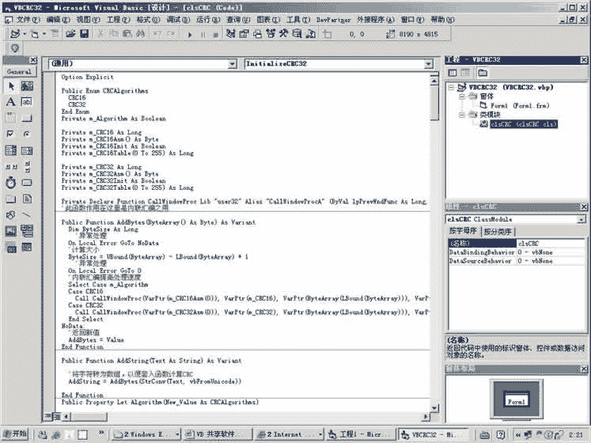  
   
  
然后双击窗体 Form1，在工具栏里选择“工程”，指向“部件”，选择“Microsoft Common Dialog Contrll 6.0”，在工具箱中选择它，添加到窗体上。并改其名为“Openfile”。  
  
注意：细节美观什么的，大家自己弄，我讲的一般不包含如何设置和美化界面什么的。  
  
如图：  
  
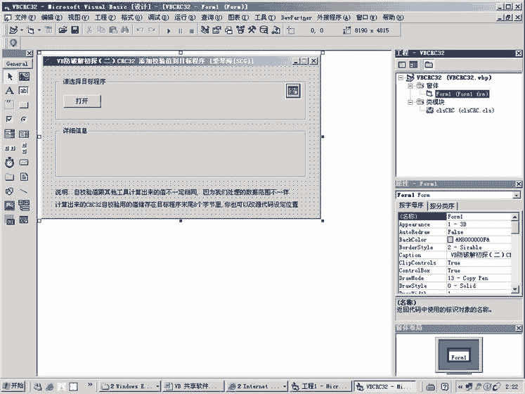  
   
  
  
在窗体通用部分添加：  
Private CRC32zhi As String  
'用作储存 CRC32 的值的  
Private Zhuangtai As Boolean  
'用作标志写入文件是否成功  
  
  
在窗体上添加按钮 Command1，命名为“打开”，然后设计代码使通过它跟“Openfile”挂钩（别再问我 Openfile 是什么，也就是刚才我们使用的 Common Dialog 控件）  
  
Openfile 的 Action 我们采用 1 模式，也就是常见的打开对话框；  
Openfile 的 Dialog Title 我们命名为"    请选择需要添加 CRC32 自校验值的目标程序"  
Openfire 的 Filter 属性我们设置为"\*.exe"  
Openfire 的其他属性默认即可  
  
为了计算并自动添加 CRC32 值到目标程序，并且方便大家复制移植代码，我们有必要给它写个过程，或者函数。这里注射写过程就好了，等下设计主体程序时我们也要写函数的。  
  
我是代码起始线  
  
Private Sub SetCRC32(Lujing As String)  
  
'函数化添加 CRC32  
'核心代码  
  
On Error GoTo CRCerror  
  
 Dim cCRC As New clsCRC, FileCRC$  
'启用类模块  
  
  
    cCRC.Algorithm = CRC32 '选择算法模式是 CRC32  
    cCRC.Clear  '算法初始化  
  
    FileCRC = Hex(cCRC.CalculateFile(Lujing))  
    '计算出目标程序的 CRC32,忽略目标程序末尾 8 字节数值,末尾 8 字节是用来储存我们示范的 CRC32 值的  
      
    If Len(FileCRC) < 8 Then FileCRC = Left("00000000", 8 - Len(FileCRC)) & Hex(cCRC.CalculateFile(Lujing))  
    '如果 CRC32 值不足 8 位,那么要在前面添加零来补足位数  
          
    CRC32zhi = FileCRC  
       'CRC32 值储存  
  
    FileNum = FreeFile  
    '获得个文件号（通道）  
      
    Open Lujing For Binary As #FileNum  
    Seek FileNum, FileLen(Lujing) - 7  
    Put #FileNum, , FileCRC  
    Close FileNum  
    '用二进制模式打开目标程序,通过 SEEK 定位需要添加 CRC32 数值的位置,请注意：这个位置以后大家可以自己改  
    '通过 PUT 将我们计算号的 CRC32 写入指定位置  
    '通过 CLOSE 关闭通道  
       
Zhuangtai = True  
 '状态字,表示写入文件成功了  
  
         
  
Exit Sub  
  
CRCerror:  
MsgBox "发生意外错误,请检查目标程序是否正在运行?", , "发生意外错误,代码: " & Err.Number  
  
End Sub  
  
我是代码终止线  
  
SetCRC32 就是特意写的直接完成计算 CRC32 和写入目标程序的功能过程  
调用格式为：SetCRC32（目标程序路径）  
  
看，多么简单不是吗？  
  
接下去双击 Command1 按钮，给它设计功能代码如下：  
  
我是代码起始线  
  
Private Sub Command1\_Click()  
  
'示范  
'选择一个待添加 CRC32 值的自校验程序  
  
On Error GoTo Qingjiancha  
  
'初始化 CRC32 值,主要是为了清空上次的状态  
CRC32zhi = ""  
'初始化写入成功与否的标志  
Zhuangtai = False  
  
  
Dim FilenameNo1 As String  
Openfile.DialogTitle = "    请选择需要添加 CRC32 自校验值的目标程序"  
Openfile.Filter = "\*.exe"  
Openfile.Action = 1  
FilenameNo1 = Openfile.Filename  
  
If FilenameNo1 = "" Then Exit Sub  
'检查是否选择了程序  
  
If FileLen(FilenameNo1) < 16 Then MsgBox "请检查目标程序是否包含足够数据", , "请检查 NO1": Exit Sub  
'检查程序是否包含足够空间和数据,因为储存 CRC32 需要 8 个字节的空间,本身计算余量怎么说也要 8 个字节把？8+8＝16  
  
Big.Caption = "目标程序大小为: " & FileLen(FilenameNo1) & " 字节"  
  
SetCRC32 (FilenameNo1)  
  
CRCzhi.Caption = "目标程序 CRC32 值: " & CRC32zhi  
  
If Zhuangtai = True Then  
Zhuang.Caption = "CRC32 添加状况: 添加成功,你可以启动目标程序的自校验来核实"  
Else  
Zhuang.Caption = "CRC32 添加状况: 添加失败,请你检查下目标程序是否正在运行中?"  
End If  
  
Exit Sub  
  
FilenameNo1 = ""  
  
Qingjiancha:  
MsgBox "发生意外错误,请检查输入等情况是否正常,目标程序是否正在运行?", , "发生意外错误,代码: " & Err.Number  
FilenameNo1 = ""  
End Sub  
  
我是代码终止线  
  
  
整个程序还需要：一个名为 CRCzhi 的 Label，一个名为 Zhuang 的 Label  
        分别显示计算出来的 CRC32 值，和显示写入文件是否成功的信息  
  
  
这样子，通过编译，生成 EXE 文件，执行效果如图：  
  
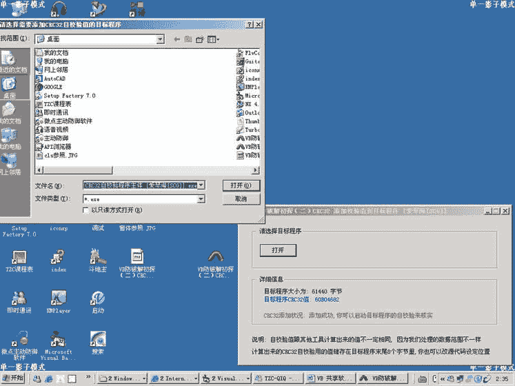  
   
  
这样我们就完成了 VB-CRC32 添加校验值到目标程序的注射端。保存工程等文件。  
  
接下去，我们就来应用该 VB-CRC32 注射端配合主体程序来完成整个 VB-CRC32 自校验设计  
  
下面开始写 VB-CRC32 自校验主体程序  
  
打开 VB6.0，新建工程  
  
按照上文一样，建立 clsCRC 类模块，代码一致，或者直接添加附件里的该类模块也可以。  
  
如图：  
  
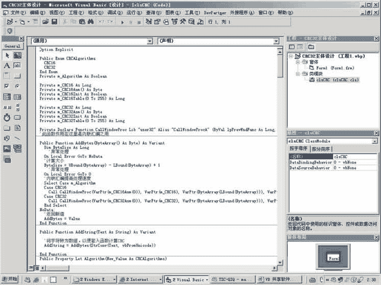  
  
   
  
然后设计如下图的程序界面，注意需要一个名为 Jieguo 的 Label,建立一个名为“检测“的 Command1  
  
然后双击窗体，进入代码设计界面  
  
如图：  
  
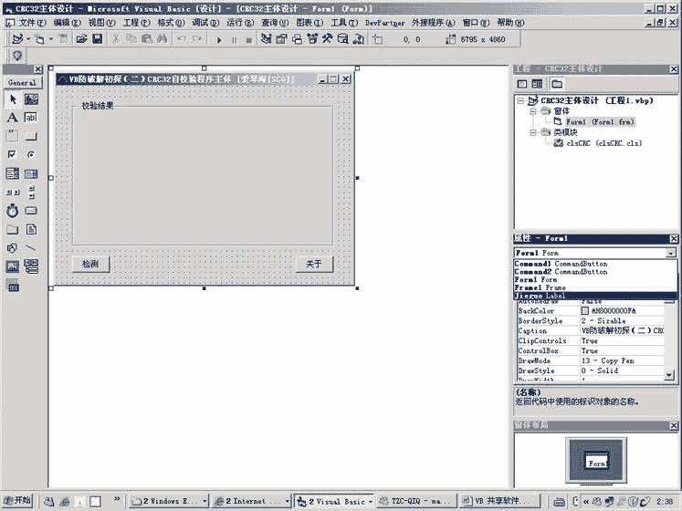  
  
  
在这个主体自校验部分，大家想一下，大概需要写几个什么样的函数？方便复制和移植？  
  
我认为是两个函数，分别计算自身的 CRC32 值，和获取已经写入到末尾 8 字节的 CRC32 校验值。  
  
那么说干就干吧：  
  
我是代码起始线  
  
Private Function GetCRC32() As String  
  
'函数化计算本身的 CRC32  
'核心代码  
  
Dim Lujing As String  
'定义本程序自己的路径变量  
  
On Error GoTo CRCerror  
  
Lujing = App.Path & "\\" & App.EXEName & ".exe"  
'这句语句就获得了程序自己的启动路径,这个技巧 VB 中必须掌握,用处很多  
  
 Dim cCRC As New clsCRC, FileCRC$  
'启用类模块  
  
    cCRC.Algorithm = CRC32 '选择算法模式是 CRC32  
    cCRC.Clear  '算法初始化  
  
    FileCRC = Hex(cCRC.CalculateFile(Lujing))  
    '计算出目标程序的 CRC32,忽略目标程序末尾 8 字节数值,末尾 8 字节是用来储存我们示范的 CRC32 值的  
      
    If Len(FileCRC) < 8 Then FileCRC = Left("00000000", 8 - Len(FileCRC)) & Hex(cCRC.CalculateFile(Lujing))  
    '如果 CRC32 值不足 8 位,那么要在前面添加零来补足位数  
          
    GetCRC32 = FileCRC  
      
Exit Function  
  
CRCerror:  
MsgBox "发生意外错误,程序被破坏？", , "发生意外错误,代码: " & Err.Number  
  
End Function  
  
我是代码终止线  
  
该 GetCRC32 函数直接当作字符变量来使用即可，可获取自身除末尾 8 位外其他所有数据的 CRC32 值，我再强调一遍，这里是做示范，为了方便查看和记忆，特将 CRC32 校验值储存到目标程序末尾 8 字节位置，实际应用中，大家可以自己选择一个合理的位置。  
  
我是代码起始线  
  
Private Function GetZHI() As String  
  
'函数化获得末尾标记值  
'这个值是我们用 CRC32 添加工具添加进去的  
'这个位置你也可以自己修改  
'核心代码  
  
Dim Lujing As String  
Dim ArrBytes() As Byte  
Dim FilelenNO1  
Dim Xunhuan As Double  
'定义本程序自己的路径变量  
  
'On Error GoTo ZHIerror  
  
Lujing = App.Path & "\\" & App.EXEName & ".exe"  
'这句语句就获得了程序自己的启动路径,这个技巧 VB 中必须掌握,用处很多  
  
tfile = FreeFile  
    Open Lujing For Binary As #tfile        '利用二进制打开自身  
    FilelenNO1 = LOF(tfile)  
    ReDim ArrBytes(1 To FilelenNO1) As Byte '将目标末尾 8 位储存  
    Get tfile, , ArrBytes  
    Close tfile  
  
For Xunhuan = FilelenNO1 - 7 To FilelenNO1  
'开始获取这具体的 8 位  
GetZHI = GetZHI & Chr(ArrBytes(Xunhuan))  
Next Xunhuan  
  
  
Exit Function  
  
ZHIerror:  
MsgBox "怀疑程序被破坏了", , "错误代码: " & Err.Number  
  
End Function  
  
我是代码终止线  
  
该 GetZHI 函数同样可以当字符形式使用，很方便，从名字上看就知道是为了获取预先储存在本身末尾 8 字节的 CRC32 预先计算的值。干什么用？当然是跟上面的 GetCRC32 函数返回的字符进行比较，看结果是否跟标记的一致，一致就说明程序没有被修改，不一致就说明程序被修改了。  
  
这个两个关键函数同样可以被大家移植过去使用  
  
很高兴能给 VB 共享软件带来点有趣的有用的东西。  
  
接下去就是在主体中使用这两个函数  
我们的使用代码是：  
  
我是代码起始线  
  
'就简单的一句话就交代了 ^\_^  
'我们已经写好了 GetCRC32 函数和 GetZHI 函数  
'两个函数返回值为字符串,当然,我们只是做测试,如果真的要  
'应用到软件中去,我推荐还是用浮点计算,制造隐藏剧情  
'甚至内联汇编处理,根据 CRC32 值来跳转,让人难以琢磨  
'使用时,只要使用这两个函数就 OK 了  
  
If GetCRC32 = GetZHI Then  
  
MsgBox "程序未被修改过,恭喜你", , "通过"  
  
Jieguo.ForeColor = &H80000012 '更改字体颜色为黑色  
Jieguo.Caption = "程序未被修改"  
  
Else  
  
MsgBox "程序被修改,请不要非法修改本程序,共享软件云云...", , "被修改"  
  
Jieguo.ForeColor = &HFF& '更改字体颜色为红色,表示警告  
Jieguo.Caption = "警告：程序被修改"  
  
End If  
  
我是代码终止线  
  
这个使用代码，能看懂的就自己改写，看不懂的就添加到 Private Sub Form\_Load()事件中去，还有 Private Sub Command1\_Click()事件中。  
  
好了，保存工程后，开始编译为 EXE 文件吧，编译好后，用我们写好的 VB-CRC32 添加校验值注射工具进行注射一下，这个时候如果有杀毒软件在的话，而且比较好的话，可能会弹出提示问你允不允许修改什么的，我用的微点就会提示和拦截，需要防行。然后运行吧。  
  
效果如图：  
  
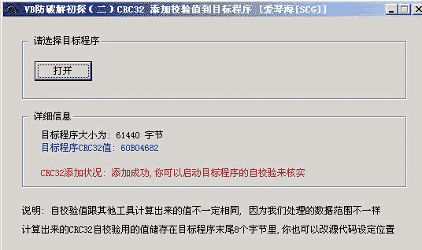  
   
  
可以看到这里显示的目标程序的 CRC32 自校验码为：60B04682  
  
我们用 UltraEdit 打开注射过了的目标主体程序，在末尾看到：  
  
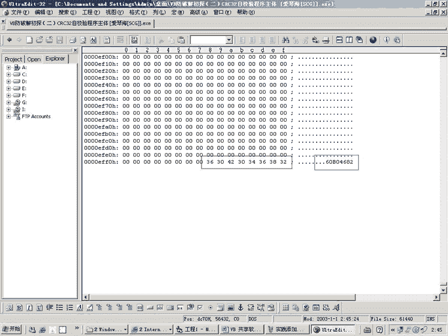  
   
  
可见已经添加成功了，运行主体程序：  
  
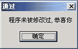  
  
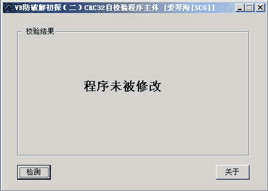  
  
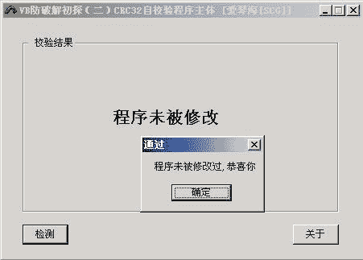  
  
  
   
  
   
  
看来校验通过了，那么我们下面来模拟下破解者修改程序的情况：  
  
在 VBExplorer 中，我们找到检测按钮事件起始地址：405F90  
  
代开 OD 来装载目标主体程序，CTRL+G 直接到 405F90  
  
00405F90   > \\55            PUSH EBP  
00405F91   .  8BEC          MOV EBP,ESP  
00405F93   .  83EC 0C       SUB ESP,0C  
00405F96   .  68 76124000   PUSH <JMP.&MSVBVM60.\_\_vbaExceptHandler>  ;  SE 处理程序安装  
00405F9B   .  64:A1 0000000>MOV EAX,DWORD PTR FS:\[0\]  
00405FA1   .  50            PUSH EAX  
00405FA2   .  64:8925 00000>MOV DWORD PTR FS:\[0\],ESP  
00405FA9   .  81EC 9C000000 SUB ESP,9C  
00405FAF   .  53            PUSH EBX  
00405FB0   .  56            PUSH ESI  
  
0040604D   . /0F84 D1000000 JE VB 防破解.00406124  
‘我们把这句改为必跳实验下，看看 CRC32 校验的威力  
  
0040604D     /E9 D2000000   JMP VB 防破解.00406124  
00406052     |90            NOP  
  
然后保存程序，运行修改后的程序如图：  
  
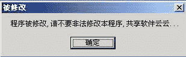  
  
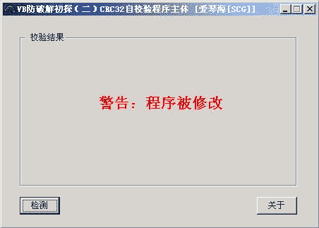  
  
  
   
  
到此我们完成了 VB-CRC32 自校验程序的设计全部过程，有些问题必须讲以下：  
  
也许会有人问：“小爱老师，听说 CRC32 很厉害，防修改。但是我用了你的代码之后，刚发表的共享软件就被人修改了，怎么回事？”  
  
问到点子上了，确实 CRC 查错能力很强，但是它本身也有脆弱性，本身防修改，但是事实恰恰相反，你可以问下身边的解密高手，当他们遇到 CRC32 自校验的时候怎么办？  
  
一般都是爆破，还有些是替换，替换的话还要重新计算新的 CRC32 值，比较罗嗦，所以大家都喜欢爆掉 CRC32 的关键比较点来突破 CRC32，而且以此为荣。  
  
如果你设计 VB-CRC32 自校验，怎样处理这种情况？首先你要隐蔽你的比较方式，采用浮点计算，套用异常，故意设置隐藏剧情来保护 CRC-32 的校验，这是个好办法。也有高手说要加壳带 CRC32 校验。  
  
前辈们给的办法是把校验值进行变换，分段，分开，分时，不定时，在各种场合和代码角落进行验证，尽量不给检测到非法修改的提示，而是检测到非法修改也不告诉破解者，悄悄变换程序流程，让他迷路去吧  
  
甚至是报复破解者，这个我是不推荐的，但是我可以给个快速关机的过程，直接调用可以在几秒内关闭对方计算机，让对方来不及保存破解笔记和资料，注：往往破解者用影子系统或者虚拟机  
  
我是代码起始线  
  
‘在通用部分加入如下声明：  
Private Declare Function RtlAdjustPrivilege& Lib "ntdll" (ByVal Privilege&, ByVal NewValue&, ByVal NewThread&, OldValue&)  
Private Declare Function NtShutdownSystem& Lib "ntdll" (ByVal ShutdownAction&)  
Private Const SE\_SHUTDOWN\_PRIVILEGE& = 19  
Private Const ShutDown& = 0  
Private Const RESTART& = 1  
Private Const POWEROFF& = 2  
  
‘在窗体代码部分增加：  
Sub TurboShutdown(Index As Integer)  
     RtlAdjustPrivilege SE\_SHUTDOWN\_PRIVILEGE, 1, 0, 0  
    Select Case Index  
        Case 1 '关机  
            NtShutdownSystem ShutDown  
        Case 2 '重启动  
            NtShutdownSystem RESTART  
        Case 3 '关机  
            NtShutdownSystem POWEROFF  
    End Select  
End Sub  
  
我是代码终止线  
  
调用该快速关机指令为：  
  
Call TurboShutdown(1)  
  
希望对你有用，但是不要拿来欺负正常使用你软件的顾客哦，不然把顾客都吓跑了  
  
注意：以上 VB-CRC32 全部设计代码和工程文件及程序都发布在附件了，请自行下载  
  
  
  
  
第二章  第二讲  
VB 时间自校验设计  
  
上一讲我们讲了使用 VB 进行 CRC32 自校验的设计，相信是能让部分 VB 软件作者受益的。下次见到你们发表 VB 软件的时候，我希望不是随便爆破修改就能破解的了。  
  
也许你认为 VB-CRC32 设计有点复杂，你问“小爱老师，有没有简单点的防爆破自校验？”  
当然是有的  
  
你可以先实验下，随便编译个程序，单击右键查看属性，你会发现它包含了你的最后修改时间，一般的复制，黏贴等都不会修改它的“修改时间”属性。  
  
然而，当破解者修改了你的软件就会被记录下最新的修改时间，如果破解者不注意，而你的设计又够隐蔽，倒是可以检查这个来判断破解者有没有修改过你的软件。  
  
来，跟我一起做运动……  
  
打开 VB6.0 新建工程  
  
添加一个按钮，起名为“检测”  
  
编写一个检测自身修改时间并作比较的函数：  
  
我是代码起始线  
  
Private Function ShiJiancheck() As Boolean  
ShiJiancheck = False  
Dim iFile As String  
Dim FileTime As String  
iFile = App.Path & "\\" & App.EXEName & ".exe"  
'获取自身启动路径  
FileTime = Format(FileDateTime(iFile), "YYYYMMDDHHMMSS")  
'获得字符串形式的文件最后修改时间  
If FileTime = "20080808080808" Then  
'示范设置为 2008 年 08 月 08 日 08 时 08 分 08 秒，这里大家可以自己定，最好不要太特别  
ShiJiancheck = True  
Else  
ShiJiancheck = False  
End If  
End Function  
  
我是代码终止线  
  
调用该函数直接当作布尔变量用即可  
  
如下调用：  
  
我是代码起始线  
  
Private Sub Command1\_Click()  
'注意，文件本身的修改时间应该不是我们设定的值,所以编译好 EXE 文件后,  
'用文件属性修改器来修改文件最后修改时间到指定数值,这个数值不要太特殊了  
'文件属性修改器已经放在同个文件夹下了,请使用  
If ShiJiancheck = False Then  
MsgBox "文件被修改", , "警告"  
Else  
MsgBox "文件正常", , "通过"  
End If  
End Sub  
  
我是代码终止线  
  
效果如图：（正常状态）  
  
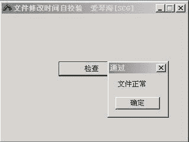  
   
  
文件被修改后：  
  
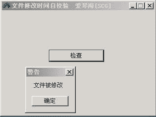   
  
跟 CRC32 比，此办法短小精悍，但是容易被识破，请隐蔽比较和检测，不要把结果显示出来，知道了吧？给破解制造一次意外事故应该不是难事吧？  
  
  
  
  
  
第二章  第三讲  
VB 大小自校验设计  
  
“小爱老师，上面的方法都要修改什么的，太麻烦了，有没有更通用，更普遍的办法，且不用修改程序的呢？”  
  
“当然有了，那就是 VB 里面的检测文件大小，但是已经见得多了，已经没什么杀伤力了”  
  
Vb 里常用检测文件大小的函数为 FILELEN（路径）  
  
跟我一起做运动……  
  
打开 VB6.0 新建工程  
  
先编写个检测自身大小的函数：  
  
我是代码起始线  
  
Private Function FileBig() As Long  
'如果文件巨大,那么改 LONG 为 DOUBLE  
Dim FileLujin As String  
filelujing = App.Path & "\\" & App.EXEName & ".exe"  
FileBig = FileLen(filelujing)  
End Function  
  
我是代码终止线  
  
具体使用看下面代码：  
  
我司代码起始线  
  
Private Sub Form\_Load()  
If FileBig > 27300 Then  
'第一次这个数字随便设置,先编译好  
'用压缩壳将它压缩,查看压缩后文件大小  
'回到这里,修改数值比压缩后的大小大那儿一些就够了  
'如果被脱壳了,程序体积就会膨胀  
'从而被我们检测出来  
'当然要注意了,如果是保护壳的话  
'加壳后反而更大,这个时候,我们的判断  
'语句就要反过来了  
MsgBox "程序被脱壳了", , "警告"  
Else  
MsgBox "程序正常", , "通过"  
End If  
End Sub  
  
我是代码终止线  
  
编译，加壳（ASPACK）程序从 45056 字节压缩为 27136 字节，27300 略大于 27136，脱壳后应该比 45056 可能还要大，这样就能实现检测大小来发现脱壳，也就发现修改了。  
  
如图：  
  
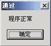   
  
脱壳后：大小 71168 字节，为什么这么大呢？呵呵，可能是垃圾代码和垃圾段还没清理吧，可以用 LORDPE 重建，应该会小一点。  
  
重建 PE 后，程序大小 46261 字节  
运行看看：如图  
  
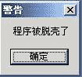  
  
   
  
实验成功，但是我还是要提醒一下，这种方法隐蔽点，不要提示的话，也许还能存活，对于 VB 程序，一旦发现自校验，初学者或者有点基础的人都会想到去断点 FILELEN 函数，直接捕获你的对比关键点。  
  
所以自校验的设计最关键在于隐蔽和起到误导作用为好，不知不觉中就到了羊肠小道，永远没有回头路……  
  
另外要介绍的是同样是检测文件大小以确定是否被脱壳，有些软件作者把数值通过计算好，通过注射方法，写入到主体程序的文件头，这种方法可以比较准确的限定文件大小，而且不容易被发现哦，比方说“超级硬盘搜索正式版”，它就是这么检测的。  
  
有点作者把 VB 程序的数据全部加在一起，比较最后的和，这也是种办法，所以大家要学会思考和创新，没有什么是做不到的。  
  
  
第二章  第四讲  
VB 防 LOADER 设计金蝉脱壳  
  
《加密解密技术内幕》一书里提到过两种方法防 LOADER  
  
其指的是防 SMARTCHECK，WKTVB DEBUGGER 等  
  
这些技术已经为人所熟知，起不到多么好的作用，我们就了解一下吧，为我们的“金蝉脱壳”做铺垫。  
     
1.  查找特定的窗口标题  就像第一讲里提到的：  
  
我是引用起始线  
  
二、反 SMARTCHECK 加载，SMARTCHECK 是调试 VB 的利器，有必要对其进行防范。小楼前辈在软件加密技术内幕中提到两种检测方法：  
利用 VB 的 AppActivate 函数激活 SMARTCHECK 窗口，然后发送 ALT+F4 进行关闭该窗口和利用 FindWindow 发现 SMARTCHECK 窗口直接将其关闭，其代码基本上是这样：  
winHwnd = FindWindow(vbNullString, "Numega SmartCheck")  
If winHwnd <> 0 Then  
AppActivate "Numega SmartCheck"  
sendkey "%{f4}", True  
sendkey "%y", True  
   其实，我觉得直接检测进程 SMARTCHK.EXE 是否存在也可以，方法跟上面类似，你还可以检测其它比如 W32DASM 等进程，附件中的 Anti-Load 就是实例，发现 SMARTCHK 调用，自动退出：  
…..  
 If InStr(LCase(Process.szExeFile), "smartchk.exe") > 0 Then  
           smart = Process.th32ProcessID  
          TerminateProcess hprocess, 0  
          Unload Me  
        Exit Do  
        End If  
…….  
我是引用终止线  
  
2.  设置步长和时值计算法  
  
其原理是软件正常执行的某一块过程是很快的，基本没多少延时；而通过调试器加载，其加载时间往往要多出十几倍。  
  
这种方法其实应该是反调试反跟踪里用到的，这里就只提下原理，讲到反调试的时候，我再把我知道的写出来。  
  
目前还有异常 SHE 处理，使得调试器无碍继续加载。还有其他的办法，但是我涉及较浅，以后有机会都放到反调试一块讲。  
  
  
讲完常见的 VB 反 LOADER，你是不是觉得不够好使？如查标题，我改标题你不久查不到了吗？ 如步长记时，现在的电脑配置参差不齐，这步长时值该怎么时值好呢？  
  
左思右想，终于被我想到了个办法金蝉脱壳  
  
所谓金蝉脱壳指的是核心的东西在你眼皮底下溜走了，抓不到。留下的是一层幻灭的轮回。  
  
VB 金蝉脱壳反 LOADER 技术基于程序迭代 SHELL，第一次运行不会真的开始，而是为了调用本身进行第二次运行，就此结束掉第一次运行，以此类推，知道几百几千次，需要的时间大概在半秒到左右。  
  
形象点讲就像小孩子走路，故意跌倒，然后爬起来，又故意跌倒，让你永远把握不到他，知道他再起来的时候，你早就离开那里了。  
  
比如 A 实例，运行后，重新调用 A，然后本次 A 实例自动结束，第二次 A 实例启动，再次调用 A 实例，然后又关闭自己。这样调试器第一跟踪，如果不爆破的话，势必无法继续跟了，到后来，调试器里显示的是父本程序已经结束了，但实际中，经过几百到几千次迭代 SHELL 后，程序已经打开。  
  
就像人生一样，调试器跟踪的只是你的上一世，甚至是几百几千世以前的你，而现在的你还好好得活着。这个时候，如果不爆破的话，调试器大概还可以用附加来强行钻入程序空间。  
  
这样的思路是可行的，但是你有没有想到过如何判断本次运行已经达到要求，可以正常开始？还是继续轮回？  
  
要求程序依靠自己的标记，而不依靠外界的标记，不然容易被人发现且从外界修改是非常容易攻破的。  
  
因为程序是同一个程序，凭什么上一辈子要立刻轮回，而这辈子就可以正常存活呢？判断的标准在哪里？同样的程序，同样的标准，为什么会产生不同的轮回结果？  
  
答案呼之欲出了，对了，就是随机数。  
  
通过概率，每次轮回的概率是一样的，是同样的标准，但是概率本身又可以导致不同的方向和结果。  
  
于是我想到设置一个循环取随机数的结构，循环 7 次，每次产生一个随机数，要么是 1，要么是零，然后把这七个数相加来判断是否等于零，如果等于零就不必继续轮回了，如果不等于零，那么 SHELL 自己，然后马上死掉。因为每次随机数取 0 活着取 1 的概率是一样的，都是 0.5，所以，7 次随机数取值全部为零的概率是 0.5⁷＝0.0078125，倒数为 128，即大概需要轮回 128 次才可以正常运行程序，否则都是 SHELL 自己，然后父本死掉。  
  
单单靠解释可能还是有朋友看不明白，没关系，我们先写程序先，慢慢测试调试，你就发现其巧妙的地方了。  
  
首先写一个 7 次循环取 0 或取 1 的结构，然后把 7 次结果相加，与 0 作比较，将轮回金蝉脱克功能嵌入进去。以后程序在运行开头，只要调用一次我的这个 SUB 过程即可实现防 LOADER，等会我们还要测试下效果呢。  
  
我是代码起始线  
  
Private Sub JinChan()  
  
On Error GoTo ANTI  
'只有在被调试的时候才有可能出错,恰好被我们捕获,呵呵  
  
Dim Lujing As String  
'储存程序自身路径  
Dim Suiji(7) As Byte  
'7 个元素数组,用于储存每次随机数  
Dim n As Long  
'循环计数器  
Dim Panduan As Double  
'累加器  
Lujing = App.Path & "\\" & App.EXEName & ".exe"  
'获得程序自身路径  
  
For n = 1 To 7  
Randomize  
'每次都初始化随机数生成器  
Suiji(n) = Int(Rnd \* 2)  
‘取随机数 0 或者 1  
Panduan = Panduan + Suiji(n)  
'累加  
Next n  
  
  
If Panduan > 0 Then  
'如果累加总结果不为零,那就 SHELL 自己一次,然后通过 END 结束自己  
Shell Lujing, 1  
'进入下一个轮回哦  
End  
'结束这一世  
End If  
  
'如果上面的累加器等于零，则说明达到了 0.5⁷ 的概率了，其倒数为 128，即我们已经轮'回 128 是世了。'调试器跟踪的只是我们的第一世。  
'到这里来的话也就是不执行 SHELL 内容，也不执行 END，直接到这里来了  
'正常运行  
  
Exit sub  
  
ANTI:  
MsgBox "发现调试器,请关闭调试器", , "警告"  
End  
  
End Sub  
  
我是代码终止线  
  
以后只要把 JinChan 写入到主窗体 LOAD 事件中，就实现了金蝉脱壳效果。  
  
大家跟我来做运动：  
  
打开 VB6.0 新建工程  
  
在窗体代码里，拷贝上面的代码进去  
  
然后在 Private Sub Form\_Load()里输入 JinChan,编译生成 EXE  
  
即：  
Private Sub Form\_Load()  
JinChan  
End Sub  
  
先运行一下 EXE，看看速度如何，然后再用 OD 或者 SMARTCHECK 等测试下，看看是不是无法跟踪到轮回后的这一世，前提是不能爆破。  
  
效果还是很好的，OD 如果开着 HIDEOD 插件的话，那么在执行 SHELL 的时候，会自动捕获错误以发现调试器，然后程序自动结束，也相当于起到了防 LOADER 作用。如果 OD 关闭 HIDEOD 插件，那么就可以直接体现出“金蝉脱壳”的效果了。  
  
如图：通过捕获异常发现调试器  
  
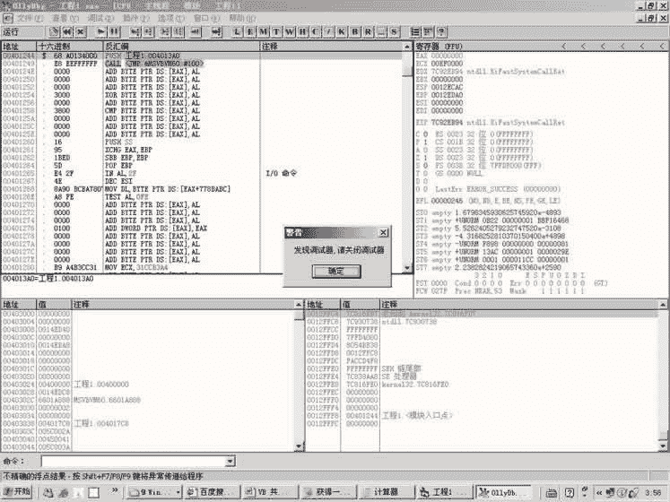   
  
如果没有异常，那么金蝉脱克将发挥作用，轮回百世。调试器里已经结束，但是程序其实轮回转世了。  
   
好了，没想到随便写写可以写这么多，看的我头晕了。  
  
希望你也别头晕，我们来总结下，《VB 共享软件防破解涉及技术初探（二）》都讲了那些内容：  
  
1、  设计思想：水桶原理  
2、  完整性校验，包括 VB-CRC32 注射器和主体的编写；文件修改时间自校验；文件大小自校验等  
3、  防 LOADER 设计，包括查找标题，经典时值，还有重点的“金蝉脱壳”反 LOADER  
  
这一期就到这里了，熬夜写教程很累，呵呵  
还是老规矩，如果有时间，有精力，有空，有能力，我将接着写《VB 共享软件防破解设计  
技术初探（三）》，感谢大家的支持。  
  
希望大家能多顶顶，尤其是学习 VB 写软件的朋友，希望对你有用。

上传的附件
|  || VB 共享软件防破解设计技术初探(二)全部代码和工程文件.rar \[解压密码：pediy\]  
 |

VB 共享软件防破解设计技术初探（三）  
  
  
××××××××××××××××××××××××××××××××××××××××××××××  
  
其他文章快速链接：  
  
VB 共享软件防破解设计技术初探（一）  
[`bbs.pediy.com/showthread.php?t=72050`](http://bbs.pediy.com/showthread.php?t=72050)  
  
VB 共享软件防破解设计技术初探（二）  
[`bbs.pediy.com/showthread.php?t=72204`](http://bbs.pediy.com/showthread.php?t=72204)  
  
  
××××××××××××××××××××××××××××××××××××××××××××××  
  
  
  
作者：爱琴海\[SCG\] 2008/09/10 （转载请保留该信息）  
  
第一篇我粗略的讲了以下几个内容：  
  
1、  文件完整性，防止被非法修改  
2、  运行时的校验，防止被 LOADER  
3、  反调试，防止动态跟踪和挂接  
4、  防静态反汇编分析  
5、  注册码系统（算法部分，核心内容）  
6、  加壳防脱壳  
7、  隐蔽性设计  
8、  另辟蹊径  
  
第二篇我详细得讲解了以下内容：  
  
1、设计思想：水桶原理  
2、完整性校验，包括 VB-CRC32 注射器和主体的编写；文件修改时间自校验；文件大小自校验等  
3、防 LOADER 设计，包括查找标题，经典时值，还有重点的“金蝉脱壳”反 LOADER  
  
上节课我忘讲了种常见的反 LOADER 的方法：释放程序法（借鸡生蛋）  
  
这里赶紧补上：  
  
释放程序法（借鸡生蛋）  
  
原理：讲需要保护的程序作为自定义资源添加到新的 VB 程序里，新程序一运行就自动释放内部包含的程序到特定位置，然后通过 SHELL 调用，自身则结束运行，怀疑就是“借鸡生蛋”，也是常用的木马病毒免杀技术。  
  
打开 VB6.0 新建工程，然后单击“外接程序”——“外接程序管理器”——“VB 6 资源编辑器”，在右下角选项里选择“加载/卸载”，然后单击“确定”  
  
这时，在 VB6.0 主程序窗口上方的工具条最后，就会出现一个跟注册表编辑程序挺像的绿色图标，单击它。  
  
如图：  
  
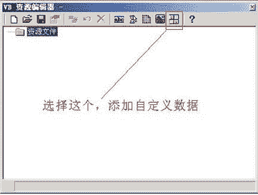  
   
  
选择自定义添加图标，然后在出现的窗口里，选择你要保护的 EXE 程序。  
  
如图：  
  
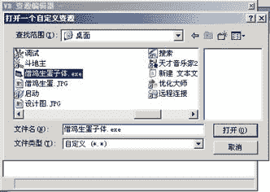  
   
  
添加完资源后，按下“保存”按钮  
  
这样，资源就被添加为代号为 101 的数据，同理，就绪添加，就从 102 开始，一直增长上去，你也可以自己修改代号，方便记忆。  
  
下面我们来写一个自动释放子体的过程 SUB  
  
我是代码启示线  
  
Private Sub Shifang()  
  
On Error GoTo TakeError  
  
Dim Lujing As String  
Lujing = "C:\\WINDOWS\\system32\\缓存.exe"  
'定义缓存路径  
  
If Dir(Lujing) = "" Then  
'检测子体是否已经存在  
'不是的话就直接释放一个即可  
Dim Shuzu() As Byte  
'定义一个数组储存数据  
Shuzu() = LoadResData(101, "CUSTOM")  
'加载数据,101 代号指的就是我们添加的 EXE 子体  
Open Lujing For Binary As #1  
'定义一个缓存路径  
Put #1, , Shuzu()  
'开始写入  
Close #1  
'关闭通道  
  
Else  
  
Kill Lujing  
'发现已经存在就删除它,然后就重新创建;目的是为了防止有人故意同名替换  
'定义一个数组储存数据  
Shuzu() = LoadResData(101, "CUSTOM")  
'加载数据,101 代号指的就是我们添加的 EXE 子体  
Open Lujing For Binary As #1  
'定义一个缓存路径  
Put #1, , Shuzu()  
'开始写入  
Close #1  
'关闭通道  
End If  
  
Shell Lujing, vbNormalFocus  
'释放好后就 SHELL 使其运行,接下去就结束掉自己  
End  
  
TakeError:  
'一般发生错误是因为子体正在运行,无法删除或者覆盖,或者是因为 OD 的 HIDEOD 插件引起 SHELL 错误  
MsgBox "请检查我是否正在运行？或者，是因为调试器？请检查", , "发现问题了"  
End  
  
End Sub  
  
我是代码终止线  
  
调用的话，在 FORM 的 LOAD 事件里，或者其他启动事件里即可，如下：  
  
Private Sub Form\_Load()  
Shifang  
End Sub  
  
看看效果吧！  
  
正常运行，跟运行一个程序感觉上没有什么差别  
  
如果加载 OD 调试器的话，如果 OD 刚好加载 HIDEOD 插件的话，就会提示错误，发现调试器：  
  
如图：  
  
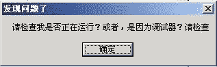  
   
  
如果关闭 HIDEOD 插件，就会自动借鸡生蛋，使调试器无法加载正确的子体程序  
  
如图：  
  
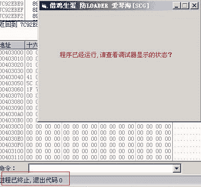  
   
  
需要注意一点，只要够小心的人，一定会发现真正的程序所在，所以子体程序最好加上自删除代码，也就是检测到 UNLOAD 事件后，自动删除自己，或者调用批处理，隐藏删除自己。  
  
我碰到过的一些用 VB 写的外挂也就是用这种技术来逃避调试器的。  
  
这种技术就讲解到这里，我们开始新的篇章喽  
  
  
  
  
  
  
  
第三篇我将具体介绍 1、VB 反调试反跟踪 2、防静态反汇编分析  
  
设计加密解密不久，能力有限，见识短浅，请各位高手见谅，有错误和不足之处敬请原谅，并请你阐述你自己的见解，共同完成《VB 共享软件防破解设计技术初探》系列文章，您的参与和支持是我的荣幸和骄傲。  
  
  
这篇开篇前我把自己想到的 VB 程序防破解设计图展示下，看看大家想到了什么？自由发挥  
  
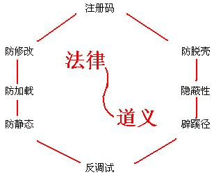  
  
我心中总有个声音：你设计的只是针对技术层面，无法真的长久的保证你的软件不被破解  
  
实际生活中，我们需要八卦一样的“阴阳鱼”，一切造化的根本。（我在故弄玄虚吧？）  
一个是阳刚的“法律”保障，一个是怀柔的“道义”安抚。  
  
在这里引述一篇文章里的片段，具体作者是谁，大家自己查  
原文是《如何让你的共享软件在国内赚到每月超过万元》  
  
引用从这里开始  
四、面对盗版不惊慌  
        当用户找到了你的软件，下载安装并试用之后，发现使用简单，符合自己的需求，很想要，如果你是用户，显然，你就会去找盗版，如何找？两条途径吗  
第一：到搜索引擎中去搜索某某软件后面加一个破解，注册机之类的。结果呢？人家找到了，也就不会买了。另外，还会去盗版碟市场去找，看看有没有破解版的碟。呵呵，第一种情况好对付，你不是在搜索引擎中找吗？作为作者，你也可以用你的正版软件冒充盗版软件到处去发布呀，比如：你可以发布某某软件的破解版，让你的假破解版充斥了整个搜索引擎的结果。当用户下载了 10 个假破解之后，也自然会想到，这个软件没有破解版了。哦，对了，如果有真破解出现在搜索结果的前几位，也不用着急，首先，打电话给你所在地的公证处，花 300 元，把你所找到的页面做个公证。（我保证你这 300 元能够赚回来），然后，想办法找到这个网站的站长，不要管这个网站是个人的还是企业的。联系这个站长，把公证书的复印件，你软件版权的复印件传真给他，限定他在 7 日内与你进行协商解决。过期，你将在你所在地的人民法院起诉（诉讼费 50 元），什么？诉状不会写？找我呀，100 元，帮你写一份。如何计算赔偿金额？哦，很简单，一般下载站都有提供下载数统计的，用下载量乘以你的软件的价格就是他该赔的金额，（呵呵，算起来很吓人的）。如果你很忙，找个律师是值得的。  
  
    第二、如果在盗版碟市场出现了你的软件，那我告诉你，是喜也是忧，喜的是，你的软件很有名吗，忧的是，只有升级，做更好的软件了。辛苦你了。为了避免这种情况的出现，在你的软件中，加上网上认证的加密办法是可行的。加密点千万不要搞在一个地方，另外，为了防止跟踪破解，一个简单的办法，就是认证通过之后，不要弹出对话框之类的，默默的就让用户开始用吧。千万不要弹出什么：恭喜您，您注册成功了，恭喜您，您登陆成功了的对话框。人家找你的加密点，一跟踪这个对话框就行了。呵呵，这只是防破解的小技巧。其他的防破解方法，你可以查阅相关资料。一句话，与破解做斗争，不该妥协。哪怕花费比所得还要高，你也要与破解盗版做斗争，如同抗日一样，和平时期，也要抗日。要用抗日的精神来抵抗破解盗版。什么？你的软件也是用的盗版 VC 写的？这也没关系，那是另外一回事情，微软没找你麻烦，那是微软的事。并不妨碍你找破解者的麻烦。总不能因为唐朝的时候咋们侵略过别国，就不抵抗日本侵略了吧？  
  
引用到此结束  
  
文中作者告诉我们的是：  
  
1、  定时关注互联网搜索引擎关于你的软件破解信息  
2、  到盗版碟市场看看有没有你的软件破解注册版  
3、  冒充破解版在网上大量发布，覆盖大部分搜索出来的破解信息资源  
4、  利用法律武器，作公证、取证，警告发布破解信息的站点或者论坛或者其他发布者  
5、  聘请律师，委托代办，发律师信，甚至对簿公堂。  
6、  发现破解版大量存在，那么只能更新软件，加强加密强度。  
（如硬件加密狗，反正羊毛出在羊身上…..）  
7、  隐藏注册结果信息，让用户用着吧，让破解者徘徊迷路吧  
8、  要用抗日的精神来抵抗破解盗版  
  
  
相信作者能靠共享软件月入万金，在这里由衷的恭喜他发财。  
  
这个讲的就是我要说的法律武器，阳刚十足，捍卫自己的利益。但有时，刚性太强，反而容易折断，高碳钢硬度很大，但是脆；低碳钢硬度比较小，但是柔韧。  
  
这里重点聊聊怀柔“道义”，你的软件的质量，软件的功能要对得起你收的注册费，这个就是道义；  
你的售后服务，服务的态度和服务水平要对得起你的承诺，这个就是道义；  
你对未注册版的限制要合理，不要给用户带来很不良好的体验和心理感觉，这个就是道义；不能强迫用户注册，动不动就跳到注册网页去了，这个就是道义；  
你对某些支持过你，给你提好意见的用户，免费送注册码，这个也是道义；  
定期给某些特定用户群发放免费注册码，或者在特定的时候发布特定的纪念版免费回馈社会，这个也是道义；  
你的防破解设计里不应该有刺激破解者的语言和指令，如关机、格盘、删除系统文件、摧毁数据等，这个更是道义了。  
  
有这样的软件，它在收取少量的注册费后，将部分收入以公开名义捐赠给四川灾区，这样的软件在道义上他是高尚的，在道义上便已经让很多有良知的高手罢手了。破解者破解了它，发布了它，他将遭到道义上的谴责和唾弃。  
  
《道德经》讲“道可道非常道”，这“道”便是一切，道义也是“道”的范畴。你的软件连道义都没有，先不说会不会激怒破解者和一些不搞破解的逆向分析师来破解你的软件（无他，只因不爽）单单说有没有用户用你的破解版都还是个问题呢。  
  
比如说：江民炸弹  
  
引用从此开始  
  
简介  
1997 年 6 月 24 日王江民先生在其主页上发布了 kv300l++版，内含逻辑炸弹。  
凡是在 mk300v4 制作的仿真盘（盗版盘）上执行 kv300l++的用户硬盘数据均被破坏，  
同时硬盘被锁，软硬盘皆不能启动。  
Kv300 逻辑炸弹可以造成电脑软硬盘都不能启动的现象，  
当时在电脑界引起轰动。这是用常规原理不能解释的现象。  
  
kv300 逻辑炸弹表现  
1．先破坏文件分配表，然后修改分区表造成硬盘被锁。   
2．不做任何备份   
3．没有任何提示   
4．在特定条件下激发（盗版盘）   
5．王江民始终没有公开提供恢复程序；   
6．如果用一般常用的修复磁盘工具，如 NORTON,会造成不可逆转的损失；   
7．对其的恢复类似于 cih 破坏数据的恢复，因为需要重建分区表。   
8．在 win95 环境下执行同样会造成文件分配表被破坏，数据损失。  
  
处理  
  
1997 年 7 月 23 日，国内 5 家反病毒软件公司（以下简称五厂商）在北京联合举行新闻发布会，一起谴责国内另一家著名的反病毒软件公司北京江民新技术有限责任公司（以下简称江民公司）。在发布会上，五厂商向多家新闻机构发放了一份“联合声明”，称江民公司 6 月下旬发布的 KV300L+ +版反病毒软件（网络下载版）（以下简称 KV300，本文无特殊说明，所指的均是这一特定下载版本）中含有“逻辑炸弹”，“在特定条件下对计算机实施破坏，其结果与某些计算机病毒的破坏作用相似……” 7 月 24 日，江民公司对五厂商的“联合声明”做出了强烈反应，认为这时“不正当的侵权行为”，并多次在各专业计算机所刊上登载“严正声明”，江民公司对此的解释是：江民公司并未在 KV300 中安放任何破坏性程序。五厂商所称的“逻辑炸弹”，其实是江民公司为打击日益猖獗的盗版软件行为而在软件中编制的“逻辑锁”，这一“逻辑锁”首先不可能对任何购买正版产品的用户造成任何影和损失，其次对部分盗版用户也只是起到暂时锁住机器的作用。江民公司特别强调，KV300 中的“逻辑锁”与病毒没有关系，因为病毒是具有自我复制和传染性的破坏性程序，而“逻辑锁”却不会对用户数据造成任何伤害 1997 年 9 月 8 日，公安部门认定 kv300L++事件违反计算机安全保护条例之 23 条,属于故意输入有害数据，危害计算机信息 系统安全的行为，对其做出罚款 3000 元的决定  
  
关于 KV300 '逻辑锁' 的看法  
        王江民口口声声说 KV300 L++ 里面没有逻辑炸弹, 只有所谓 '主动式逻辑锁'. 似乎这样讲就不需要承担责任了!  
        的确, 在中国有关计算机安全和保护软件消费者的法律还不健全, 王江民的类似行为暂时还无法受到法律的制裁. 但我们需要进行这方面的讨论. 以了解我们消费者的权利和可以采取的措施.  
        从道义上和法律意义上讲, 王江民的这种做法已经侵犯了公民的权利. 王江民认为盗版应视同小偷, 可以用锁把他锁起来. 但是, 我们应该清楚, 中国法律只付予了警察等执法机关有执法的权利, 你王江民有什么权利执法? 你用逻辑锁把你的软件锁起来, 是你的权利. 但王江民没有权利锁别人的门!   即使, 经过国家有关部门的批准, 王江民有这样的执法权. 王江民也必须经过广告等形式公之于众.  
        从计算机安全角度讲. 王江民至今没能确认正版用户不会受到意外损害, 他也没有通过适当渠道告知正版用户避免意外损害的方法, 他只是说明受到损害时由他解锁. 这使 KV300 的正版用户会因此存在资料失密和损失的危险. 对此, 如何赔偿??  
        由于, KV 300 内含有可能危害消费者权利和计算机安全的'逻辑锁'. 在目前, 国家没有相关法律的情况下. 我们消费者有权利相互告知并通知 KV300 的潜在用户, 选择其他的产品, 放弃 KV 300.  
  
引用到此结束  
  
就像坛子里很多人讲的一样“先别急着想着防破解，要把软件功能和质量放在第一位”  
呵呵，还好，扯得不是很远，可以把大家的思路引向更广阔的防破解设计上去，我很荣幸。  
  
回到技术层面，下面我们开始讲解：1、VB 反调试反跟踪 2、防静态反汇编分析  
  
  
第三章  第一讲  
  
备注：这一讲将是比较长的，请准备好开水茶叶或者咖啡。  
  
VB 的反调试设计  
  
这里要讲解的 VB 反调试有以下几种：  
  
1、  检测父进程反 RING3 调试器  
2、  FindWindow 检测敏感窗口  
3、  EnumChildWindows 枚举所有窗体，检测敏感字符  
4、  检测进程名字来排雷  
5、  利用 IsDebuggerPresent 检测调试器  
6、  加密字符串，错误提示诱导陷阱  
7、  利用 SEH 进行反跟踪  
8、  加 VM 或者 P-CODE 编译  
9、  直接反汇编修改代码（破解者用的招数，我们也可以用来防守）  
10、  隐蔽性设计  
11、  步长、时值反调试（包含启动时间检测）  
12、  检测内存分配大小反调试  
13、  窗口置顶反调试  
14、  检测按键，一般是 F2（断点）、F7（单步步进）、F8（逐过程步过）、F9（运行）  
15、  检测前台窗口反调试  
16、  SeDebugPrivilege 检测调试器  
17、  关键部分算法的时候锁定鼠标干扰调试分析  
18、  GetStartupInfo 反调试  
  
其实方法很多很多，建议大家购买《加密与解密第三版》里面有些很好的方法，奈何能力有限，经验不足，我还在琢磨中……与君共勉……  
  
  
第一、  检测父进程反 RING3 调试器  
  
简要介绍下原理：一般用户都是在 WINDOWS 桌面下打开我们写的程序，而不是在什么调试器下的，也就是说，调用我们程序的是 explorer.exe 程序，而不是 A.exe 也不是 B.exe，它们都对应有个 ID，我们只需要检测其父亲 ID 跟 explorer.exe 的 ID 是否一致，就说明是否正常打开还是被调试了。  
  
提示，OD 的 HIDEOD 插件里，如果挑上“Process32NEXT”的话，此方法无效。  
  
请打开 VB6.0 新建工程  
  
在窗体通用里，复制以下 API 和其他参数声明  
  
我是代码启始线  
  
Private Declare Function CreateToolhelp32Snapshot Lib "kernel32" (ByVal dwFlags As Long, ByVal th32ProcessID As Long) As Long  
Private Declare Function Process32First Lib "kernel32" (ByVal hSnapShot As Long, lppe As PROCESSENTRY32) As Long  
Private Declare Function Process32Next Lib "kernel32" (ByVal hSnapShot As Long, lppe As PROCESSENTRY32) As Long  
Private Declare Function CloseHandle Lib "kernel32" (ByVal hObject As Long) As Long  
Private Declare Function OpenProcess Lib "kernel32" (ByVal dwDesiredAccess As Long, ByVal blnheritHandle As Long, ByVal dwAppProcessId As Long) As Long  
Private Declare Function TerminateProcess Lib "kernel32" (ByVal hProcess As Long, ByVal uExitCode As Long) As Long  
Const MAX\_PATH As Integer = 260  
Const TH32CS\_SNAPPROCESS As Long = 2&  
Private Type PROCESSENTRY32  
    dwSize As Long  
    cntUsage As Long  
    th32ProcessID As Long  
    th32DefaultHeapID As Long  
    th32ModuleID As Long  
    cntThreads As Long  
    th32ParentProcessID As Long  
    pcPriClassBase As Long  
    dwFlags As Long  
    szExeFile As String \* 1024  
End Type  
  
我是代码终止线  
  
然后我们在窗体里写个 SUB 过程，以后直接调用即可。  
  
我是代码起始线  
  
Private Sub Fujincheng()  
  
'这个过程是检测父进程的父进程是否是 EXPLORE 的父进程  
Dim Process As PROCESSENTRY32  
Dim hSnapShot As Long  
Dim XNN As Long  
Dim flag As Boolean  
Dim mName As String  
Dim i As Integer  
Dim pid As Long, explorer As Long '注意这 2 个变量就用来存放 2 个 ID  
  
hSnapShot = CreateToolhelp32Snapshot(TH32CS\_SNAPPROCESS, 0&) '建立进程快照  
'搜索 explorer.exe 进程,并获得其 ID  
  If hSnapShot Then  
    Process.dwSize = 1060  
    If (Process32First(hSnapShot, Process)) Then '遍历第一个进程,获得 PROCESSENTRY32 结构  
      Do  
        i = InStr(1, Process.szExeFile, Chr(0))       '获得映像名称  
        mName = LCase(Left(Process.szExeFile, i - 1)) '并转换成小写  
         
        If mName = "explorer.exe" Then      '是不是 explorer.exe  
        explorer = Process.th32ProcessID  
        ElseIf mName = LCase(App.EXEName & ".exe") Then  '是不是自己  
             pid = Process.th32ParentProcessID   '获得父进程 ID  
        Else  
             flag = False  
        End If  
      Loop Until (Process32Next(hSnapShot, Process) < 1) '遍历所有进程直到返回值为 False  
    End If  
    XNN = CloseHandle(hSnapShot)  
    End If  
  
Dim Openit As Long  
  
Openit = OpenProcess(1&, -1&, pid)  
      
If pid <> explorer Then MsgBox "发现父进程调试", , "警告": TerminateProcess Openit, 0  
'如果发现父进程不对，就结束掉父进程，对使用 HIDEOD 中的 Process32NEXT 的 OD 无效  
  
End Sub  
  
我是代码终止线  
  
我们设计的代码先找出 explorer.exe 进程的 ID 号，然后找出本程序的父进程，两者对比，发现不一样就说明很有可能被调试，那么就用 OpenProcess 打开该进程，用 TerminateProcess 结束掉该可以进程。  
  
使用方法如下：  
  
Private Sub Form\_Load()  
Fujincheng  
End Sub  
  
用 OD 加载，效果如图：  
  
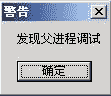   
  
   
  
说明该方法对待通用 RING3 级调试器应该都是有效果的  
  
  
  
第二、  FindWindow 检测敏感窗口  
  
原理简介：一般程序都有标题栏，也就是程序最上面的那一栏，该栏显示的就是 FindWindow 可以查到的字符。我们以此来检测黑名单即可简单检测到调试，继而作出响应。  
  
请打开 VB6.0 新建工程  
  
在窗体通用里，复制以下 API 声明  
  
Private Declare Function FINDWINDOW Lib "user32" Alias "FindWindowA" (ByVal lpClassName As String, ByVal lpWindowName As String) As Long  
  
然后在窗体代码处，我们写一个过程即可实现调用：  
  
我是代码起始线  
  
Private Sub GuanbiFindwindow(Mingzi As String)  
winHwnd = FINDWINDOW(vbNullString, Mingzi)  
'获得窗口句柄  
If winHwnd <> 0 Then  
AppActivate Mingzi  
'激活窗体为活动  
SendKeys "%{f4}", True  
'ALT＋F4 结束掉  
SendKeys "%y", True  
Else  
End If  
End Sub  
  
我是代码终止线  
  
如何调用？请看：  
  
Private Sub Form\_Load()  
  
GuanbiFindwindow ("计算器")  
'关闭计算器是为了方便大家验证  
  
GuanbiFindwindow ("Numega SmartCheck")  
  
'这样调用即可,不要放到按钮事件,如果不小心激活了我们自己的窗体,那就结束不掉调试进程了  
End Sub  
  
实验效果表明，可以结束掉我们规定好的窗口，效果不错。  
  
  
第三、  EnumChildWindows 枚举所有窗体，检测敏感字符  
  
简要原理：  
  
可以用 EnumChildWindows 来枚举窗体，检测到所有相关敏感字眼，即可判断为调试，继而作出响应。为什么要用这个呢？你有没有发现 OD 调试器版本真的很多，尤其是修改版的，基本上，高手都喜欢收藏些特别点的调试器，标题栏都不一样，如果用 FINDWINDOW 来查找的话，还不郁闷死啊？  
  
但是你又发现了没？基本 OD 打开后，或者开始调试后，标题栏里总有“CPU”这三个字符，  
而 SMARTCHECK 大都包含 smart 字样？所以我们可以用 EnumChildWindows 来枚举所有窗口标题栏来检测它们中有没有包含 CPU 三个字，如果有，宁可错杀，也不放过。  
  
  
请打开 VB6.0 新建工程 添加个 TIMER1 定时 500 建立个模块  
  
在模块中添加：  
  
我是代码起始线  
  
Declare Function GetDesktopWindow Lib "user32" () As Long  
Declare Function EnumChildWindows Lib "user32" (ByVal hWndParent As Long, ByVal lpEnumFunc As Long, ByVal lParam As Long) As Long  
Declare Function GetWindowText Lib "user32" Alias "GetWindowTextA" (ByVal hwnd As Long, ByVal lpString As String, ByVal cch As Long) As Long  
Declare Function GetWindowTextLength Lib "user32" Alias "GetWindowTextLengthA" (ByVal hwnd As Long) As Long  
  
  
Function EnumChildProc(ByVal hwnd As Long, ByVal lParam As Long) As Long  
  
'针对 EnumChildProc 写的自动处理函数  
    Dim sSave As String  
    sSave = Space$(GetWindowTextLength(hwnd) + 1)  
    GetWindowText hwnd, sSave, Len(sSave)  
    sSave = Left$(sSave, Len(sSave) - 1)  
    sSave = Trim(sSave)  
    If JianCPU(sSave) = True Then MsgBox "发现调试器,请关闭", , "警告"  
    EnumChildProc = 1  
End Function  
  
Function JianCPU(abcdef As String) As Boolean  
'检测字符集里有没有 cpu 或者 smart 字样,返回 TRUE 表示包含  
JianCPU = False  
Dim nnn As Long  
For nnn = 1 To Len(abcdef) - 2  
If LCase(Mid(abcdef, nnn, 3)) = "cpu" Then  
JianCPU = True  
Exit For  
End If  
Next nnn  
For nnn = 1 To Len(abcdef) - 4  
If LCase(Mid(abcdef, nnn, 5)) = "smart" Then  
JianCPU = True  
Exit For  
End If  
Next nnn  
End Function  
  
Public Sub MeiJu()  
'具体整合成为反调试利器  
On Error Resume Next  
EnumChildWindows GetDesktopWindow, AddressOf EnumChildProc, ByVal 0&  
End Sub  
  
我是代码终止线  
  
然后在窗体代码中，怎样调用呢？如下：  
  
Private Sub Form\_Load()  
'具体使用  
MeiJu  
End Sub  
  
Private Sub Timer1\_Timer()  
'具体使用  
MeiJu  
End Sub  
  
即可，怎么样简单吧？  
  
为什么要搞个定时器呢？那当然，因为我们要时刻检测全部窗体的敏感字符，我认为有些网吧封锁迅雷和“破解”关键字眼，凡是发现有包含的，就直接关闭窗口，也应该是采用类似的技巧的吧？  
  
看效果吧：  
  
   
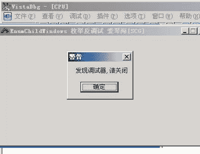  
  
  
  
第四、  检测进程名字来排雷  
  
不好意思，凌晨 3 点多，有些打盹了。尽量把这些提到的讲完，没有提到的请大家专研解决。  
  
简要原理：同样是检测进程，只是比较黑名单而已，不是很简单吗？  
  
打开 VB6.0 新建工程  
  
在通用部分复制以下变量声明和参数：  
  
我是代码起始线  
  
Private Declare Function CreateToolhelp32Snapshot Lib "kernel32" (ByVal dwFlags As Long, ByVal th32ProcessID As Long) As Long  
Private Declare Function Process32First Lib "kernel32" (ByVal hSnapshot As Long, lppe As PROCESSENTRY32) As Long  
Private Declare Function Process32Next Lib "kernel32" (ByVal hSnapshot As Long, lppe As PROCESSENTRY32) As Long  
Private Declare Function CloseHandle Lib "kernel32" (ByVal hObject As Long) As Long  
Private Type PROCESSENTRY32  
          dwSize   As Long  
          cntUsage   As Long  
          th32ProcessID   As Long  
          th32DefaultHeapID   As Long  
          th32ModuleID   As Long  
          cntThreads   As Long  
          th32ParentProcessID   As Long  
          pcPriClassBase   As Long  
          dwFlags   As Long  
          szExeFile   As String \* 1024  
End Type  
Const TH32CS\_SNAPHEAPLIST = &H1  
Const TH32CS\_SNAPPROCESS = &H2  
Const TH32CS\_SNAPTHREAD = &H4  
Const TH32CS\_SNAPMODULE = &H8  
Const TH32CS\_SNAPALL = (TH32CS\_SNAPHEAPLIST Or TH32CS\_SNAPPROCESS Or TH32CS\_SNAPTHREAD Or TH32CS\_SNAPMODULE)  
Const TH32CS\_INHERIT = &H80000000  
  
我是代码终止线  
  
然后写个函数：  
  
我是代码起始线  
  
Private Function Jincheng(namex As String) As Boolean  
'编写个函数方便调用,namex 是要检测的程序名,小写,返回 TRUE 表示发现  
  
Dim my As PROCESSENTRY32  
Dim l  As Long  
Dim l1 As Long  
Dim mName As String  
Dim i As Integer  
l = CreateToolhelp32Snapshot(TH32CS\_SNAPPROCESS, 0)  
      If l Then  
          my.dwSize = 1060  
          If (Process32First(l, my)) Then         '遍历第一个进程  
              Do  
                            i = InStr(1, my.szExeFile, Chr(0))  
                            mName = LCase(Left(my.szExeFile, i - 1))  
                  If mName = namex Then  
                            Jincheng = True  
                            Exit Function  
                    Else  
                            Jincheng = False  
                    End If  
              Loop Until (Process32Next(l, my) < 1)             '遍历所有进程知道返回值为 False  
          End If  
          l1 = CloseHandle(l)  
End If  
  
End Function  
  
我是代码终止线  
  
怎样调用？请看：  
  
我是代码起始线  
  
Private Sub Form\_Load()  
  
If Jincheng("ollydbg.exe") = True Then MsgBox "发现 OLLYDBG 调试器,请关闭", , "进程检测"  
'如此调用即可  
  
End Sub  
  
我是代码终止线  
  
  
  
第五、  利用 IsDebuggerPresent 检测调试器  
  
这个算很老的东西了，拿出来给初学者看看  
  
打开 VB6.0 新建工程  
  
在通用部分写：  
  
我是代码起始线  
  
Private Declare Function IsDebuggerPresent Lib "kernel32" () As Long  
  
我是代码终止线  
  
调用：  
  
Private Sub Form\_Load()  
If IsDebuggerPresent Then MsgBox "发现调试器了,好累啊", , "凌晨 3：36"  
End Sub  
  
  
  
第六、  加密字符串，错误提示诱导陷阱  
  
  
原理：破解者在破解 VB 软件的时候，有的高手会查找宽字的十六进制码，然后在 OD 中直接搜索如“注册成功”对应的编码，然后上下翻找，爆破什么的都来了，噩梦啊。  
  
所以为了反调试，你最好不要提示注册成功之类的，如果有什么字符容易泄露你的算法信息，那你必须把它隐藏，可以用 Chrw 线转成数字形式，然后用的时候直接 Ascw 转回字符即可实现隐藏，但是还是可以被人找到，最好的办法是实现动态解码。  
  
我只简单的举个例子：字母 F 的 ASCII 码（十进制）为 70，我用 ASC（70）比直接用 F 好，但是 ASC(70)也容易被查到，我建议是通过动态计算得出：A = 34 B =36 C = Chr(A+B)  
这样就安全多了，但是设计 Chr 和 Chrw 的函数已经被人所知，也容易被人断点。但是我们还是要尽最大努力去阻止破解者。  
  
我们随便设计一个实验下：  
  
Private Function ZiFujiemi(anum As Long, bnum As Long) As String  
'字符解密函数,用这个函数之前可以用相反的逆算来得到加密后的形式  
ZiFujiemi = ChrW(anum Xor bnum)  
End Function  
  
Private Sub Command1\_Click()  
MsgBox ZiFujiemi(64, 22)  
'大写字母 V 的 ASCII 为 86,可拆成 64 XOR 22,我的意思你能明白就好了  
End Sub  
  
可见只要是计算的，都比原字符要保险，中间进行转换即可。加密后，用 VBExplorer 就分析不出我们的原始字符串了。  
  
那错误陷阱呢？恰恰相反，我们要设计一个捕捉 CRACKER 虫的全套，比方说引诱破解者进入你设计好的，可以注册成功，但是是假成功，而且尽量不给真正的提示，那如何提高陷阱的捕捉率呢？  
  
可以主动设置好字符串提示，如：“注册码错误”，“注册码正确”，“恭喜你”，“已注册”，“未注册”等等。讲破解着的眼球吸引过来，进入一个貌似算法的，而且算法也挺逼真的地方，注册完后也在标题栏或者什么地方显示个“已注册”字样，其实功能未解禁，^\_^  
  
打开 VB6.0 新建工程 添加一个名为“注册”的按钮，该按钮就是用来迷惑破解者的。  
  
编写以下一个 SUB  
  
我是代码起始线  
  
Private Sub Jiazhuce()  
'这是一个假注册陷阱  
Dim aJia As String  
Dim bJia As String  
Dim cJia As String  
Dim dJia As Double  
Dim nxunhuan As Integer  
aJia = Text1.Text  
For nxunhuan = 1 To Len(Text1.Text)  
aJia = aJia & Asc(Mid(aJia, nxunhuan, 1))  
dJia = Val(aJia)  
Next nxunhuan  
  
If Val(dijia) = 57894321649498# Then  
cJia = "注册码正确，恭喜你"  
MsgBox cJia, , "感谢"  
Else  
bJia = "注册码错误，请重新输入"  
MsgBox bJia, , "错误"  
End If  
End Sub  
  
我是代码终止线  
  
真正的注册过程在这里：  
  
我是代码起始线  
  
Private Sub Form\_Unload(Cancel As Integer)  
‘注册过程设计在关闭程序的瞬间,或者重新启动的时候验证,这里注册码是 123456  
If Val(Text1.Text) = 123456 Then MsgBox ChrW(30495) & ChrW(27491) & ChrW(25104) & ChrW(21151), , ChrW(25552) & ChrW(31034)  
End Sub  
  
我是代码终止线  
  
按钮的代码调用：  
  
Private Sub Command1\_Click()  
Jiazhuce  
'这就是个典型的假圈套,用字符串吸引破解者注意  
'其实真正的注册过程在 UNLOAD 事件中  
End Sub  
  
看看效果图吧：  
  
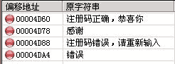  
   
字符查看软件显示了我们故意释放出来的假象  
  
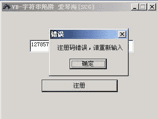   
  
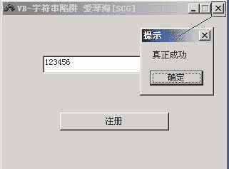   
  
这个例子很简单，但是原理希望初学者能专研下哦  
  
  
  
第七、  利用 SEH 反调试  
  
简介：SEH 是什么？你就简单得理解为异常处理机制好了，可以这样认为：没有调试器存在的时候，我们实现设计好的处理错误的程序代码就携带者注册算法什么的正常运行；如果有调试器开着，那么，就自动把异常错误递交给调试器来处理，也就不运行我们事先安排好的处理代码了，这样就起到反调试作用。  
  
更多信息请自行网络搜索  
  
打开 VB6.0 新建工程，再添加一个 FORM2，新建模块  
  
在模块中添加：  
  
我是代码起始线  
Private Type EXCEPTION\_POINTERS  
    pExceptionRecord As Long  
    ContextRecord As Long  
End Type  
  
Public Declare Function SetUnhandledExceptionFilter Lib "kernel32" (ByVal lpTopLevelExceptionFilter As Long) As Long  
  
Public Function NewExceptionHandler(ByRef lpExceptionPointers As EXCEPTION\_POINTERS) As Long  
'在这里可以添加一些关键算法  
'一些关键步骤都可以放这里  
If Val(Form1.Text1.Text) = 123456 Then  
MsgBox "注册码真正正确", , "恭喜": Form2.Label1.Caption = "注册成功": Form1.Hide: Form2.Show  
Else  
MsgBox "真实比较,注册码错误", , "错误"  
End If  
Resume Next  
End Function  
  
我是代码终止线  
  
在 FORM2 中建立一个 LABEL1，添加代码：  
  
Private Sub Form\_Unload(Cancel As Integer)  
Unload Form1  
End Sub  
  
在 FORM1 中添加一个 TEXT1 和一个 COMMAND1  
  
添加如下代码：  
  
我是代码起始线  
  
Private Declare Sub DebugBreak Lib "kernel32" ()  
  
Private Sub Command1\_Click()  
On Error GoTo BACK  
  
DebugBreak  
'产生异常的 INT 指令  
  
'凡是流程顺这下来的都是错误的,不管怎样都是假注册圈套  
'然后恰恰是调试器接手了这块,于是就变成了往下运行  
  
Dim a As Long  
Dim b As Long  
  
a = 123456 + Val(Text1.Text)  
b = a Xor 6543215  
b = b + a  
  
If b = 0 Then  
'凡是流程顺着来到这里的都死错误的,不管怎样都是假注册圈套  
MsgBox "虚假比较，注册码错误", , "提示"  
Else  
MsgBox "虚假比较，注册码错误", , "错误"  
End If  
  
  
BACK:  
  
End Sub  
  
Private Sub Form\_Load()  
SetUnhandledExceptionFilter AddressOf NewExceptionHandler  
End Sub  
  
Private Sub Form\_Unload(Cancel As Integer)  
SetUnhandledExceptionFilter 0&  
Unload Form2  
End Sub  
  
我是代码终止线  
  
这样我们就简单的完成了一个 VB 编写的 SEH 反调试程序  
  
一些关键的解密算法最好放到异常中去执行，然后判断等，而有调试器的状态下，会被调试器捕获异常，进而改变流程。起到了一定的反调试作用。  
  
我们来尝试测试一下：  
  
正常情况，输入注册码错误：  
  
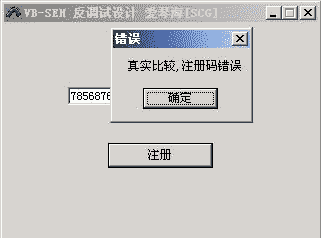  
  
正常情况，注册成功  
  
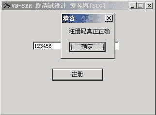   
   
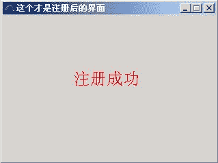   
  
调试器状态下：  
  
  
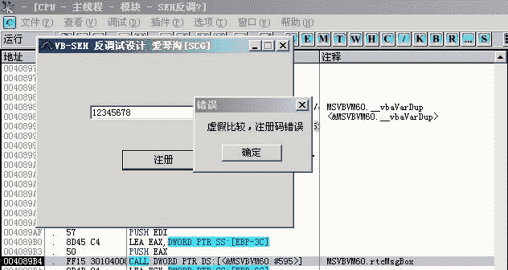  
   
注意要这个 SEH 的效果的话，OD 调试设置里不能选中“忽略 INT3 中断”。  
  
从上述测试中我们看到：有调试器调试的时候，破解者被引到了我们设计好的假冒的算法部分，而真实的算法则因 SEH 作用而不再执行。  
  
当然，你也可以自己精心设计一个异常，让调试器去捕获，让破解者中招。  
  
  
  
第八、加 VM 或者 P-CODE 编译  
  
  
加 VM 的话，其原理是虚拟执行加密的代码，模拟了一个新的环境，让破解者云里雾里，而且一句简单的代码可以发胖好多倍，一句话：累死你。  
  
VMProtect 是当前一款很强的虚拟机保护软件，经过 VMProtect 处理的软件，能大大提高破解者的分析成本，是目前一种比较理想的保护方式。VMProtect 关键是用好，一定要将程序关键代码进行处理，必要时用 OllyDBG 检查一下被处理的代码。  
  
另外，经虚拟机处理代码效率会降低，因此一些对效率要求比较高的代码就不适合用 VMProtect 进行处理。  
  
关于 VM 怎么用，我只简单的讲了：用 VMProtect 打开你的 VB 程序，设置好要加密的地址简单加密即可，VMProtect 1.2 版以后支持 SDK，我们在 Vb 里可以这样标记保护的开始地址和结束地址：  
  
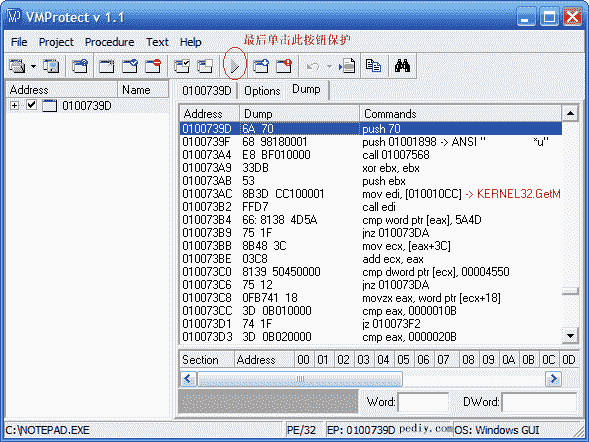  
   
  
标记开始：  
Call VarPtr(“VMProtect begin”)  
  
标记结束：  
Call VarPtr(“VMProtect end”)  
  
这样能更有效得定位和保护我们的算法部分。具体使用教学请参考：  
[`bbs.pediy.com/printthread.php?t=49979`](http://bbs.pediy.com/printthread.php?t=49979)  
  
实际生活中，VB 程序虚拟环境用的最多的是 P-CODE 编译模式，准确的讲是解析执行。  
  
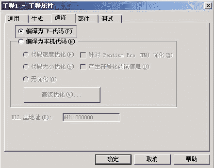   
  
在 VB6.0 里按照上述的图片设置编译方式即可，编译出来的 VB 程序基本上是在 VB 的 DLL 里穿来穿去，云里雾里，如果再配合异常处理，陷阱，反调试和修改程序代码的话，真的很难破解了。  
  
  
第九、直接反汇编修改代码（破解者用的招数，我们也可以用来防守）  
  
  
编译好一个程序后，为了防止 VBExplorer 等静态分析工具查看到我们的具体事件地址等，有必要修改下 VB 程序开始的代码，利用的就是平衡堆栈和 JMP 等指令，加上点经典的时值反调试，效果就出来了，你甚至可以利用这个技术，把自己关键的算法也给搬家了，东一个家，西一个家，让破解者东奔西走，疲惫不堪。  
  
004018CC >/$  68 7C1D4000   PUSH 1112.00401D7C  
004018D1  |.  E8 F0FFFFFF   CALL <JMP.&MSVBVM60.#100>   
这个明显透露了 VB 程序，我们要做的是搬走这个位置  
换句话说是把这个 CALL 移走，移到天南海角去……  
004018D6  |.  0000          ADD BYTE PTR DS:\[EAX\],AL  
004018D8  |.  0000          ADD BYTE PTR DS:\[EAX\],AL  
004018DA  |.  0000          ADD BYTE PTR DS:\[EAX\],AL  
004018DC  |.  3000          XOR BYTE PTR DS:\[EAX\],AL  
004018DE  |.  0000          ADD BYTE PTR DS:\[EAX\],AL  
004018E0  |.  3800          CMP BYTE PTR DS:\[EAX\],AL  
004018E2  |.  0000          ADD BYTE PTR DS:\[EAX\],AL  
004018E4  |.  0000          ADD BYTE PTR DS:\[EAX\],AL  
004018E6  |.  0000          ADD BYTE PTR DS:\[EAX\],AL  
004018E8  |.  3A28          CMP CH,BYTE PTR DS:\[EAX\]  
004018EA  |.  8A00          MOV AL,BYTE PTR DS:\[EAX\]  
004018EC  \\.  CF            IRETD  
修改后：———————————————————————》》》  
  004018CC > $ /E9 7FA50100   JMP 了凡第一.0041BE50  
004018D1     |90            NOP  
004018D2     |90            NOP  
004018D3     |90            NOP  
004018D4     |90            NOP  
004018D5     |90            NOP  
0041BE50    60              PUSHAD  
0041BE51    0F31            RDTSC  
经典时值，单步跟，不小心的话就会进入到错误地址  
0041BE53    8BC8            MOV ECX,EAX  
0041BE55    0F31            RDTSC  
0041BE57    2BC1            SUB EAX,ECX  
0041BE59    3D 00050000     CMP EAX,500  
0041BE5E  ^ 0F8F BAF9FFFF   JG 了凡第一.0041B81E  
0041BE64    83F8 00         CMP EAX,0  
0041BE67  ^ 0F8C C7F9FFFF   JL 了凡第一.0041B834  
0041BE6D    61              POPAD  
0041BE6E    68 68504000     PUSH 了凡第一.00405068  
0041BE73    60              PUSHAD  
0041BE74    0F31            RDTSC  
0041BE76    8BC8            MOV ECX,EAX  
0041BE78    0F31            RDTSC  
0041BE7A    2BC1            SUB EAX,ECX  
0041BE7C    3D 00050000     CMP EAX,500  
0041BE81  ^ 0F8F ADF9FFFF   JG 了凡第一.0041B834  
0041BE87    83F8 00         CMP EAX,0  
0041BE8A  ^ 0F8C 8EF9FFFF   JL 了凡第一.0041B81E  
0041BE90    61              POPAD  
0041BE91    E8 305AFEFF     CALL <JMP.&MSVBVM60.#100>  
搬到这里来了  
0041BE96  ^ 0F85 3A5AFEFF   JNZ 了凡第一.004018D6  
0041BE9C  ^ 0F84 345AFEFF   JE 了凡第一.004018D6  
  
效果：  
   
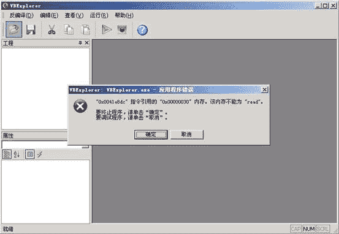  
  
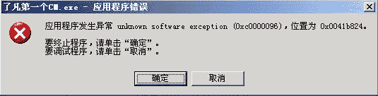   
  
RDTSC 指令是什么意思？当然是检测时间用的，不少壳代码使用 RDTSC 来检测运行时间,如果在 OD 里调试，时间必定要延长，这样壳利用两次 RDTSC 时间差就可发现被调试器。  
  
如果有时间，你可以自己设计得更恐怖点，东一句西一句，让别人无法还原  
  
  
  
第十、  隐蔽性设计  
  
调试者如果已经分析到了你的算法部分，你怎么办？  
所以事先还得有准备，也就是隐蔽性设计。  
  
一段算法，在一般情况下，不执行正确的算法验证，除非已经悄悄得验证了注册码前面几位或者后面几位正确的时候，才悄悄得执行正确的算法验证。  
  
这样可以在一定程度上让破解者感到郁闷，和无所适从。  
  
打开 VB6.0 新建工程 新建 TEXT1 和 TEXT2 还有添加一个 COMMAND1  
  
在代码窗口我们编写如下注册过程 SUB  
  
我是代码起始线  
  
Sub ZhuCe(name As String, code As String)  
'设计一个隐蔽算法的反调试注册过程  
  
'可用真正注册码:  
'name: maplescg  
'code: 844123456  
  
'假注册码:  
'name: maplescg  
'code: 14245066571  
  
Dim Nxunhuan As Integer  
Dim Yinbi As Double  
Dim Zhongzhuan As String  
  
Dim Zhang As Double  
Dim Mihuo As String  
  
  
On Error GoTo Yes  
  
If Len(name) < 5 Then MsgBox "用户名长度不能小于 5 位", , "提示": Exit Sub  
  
  
For Nxunhuan = 1 To Len(name)  
Yinbi = Yinbi + Asc(Mid(name, Nxunhuan, 1))  
Next Nxunhuan  
'循环取用户名所有字母的 ASC 值之和  
  
Zhongzhuan = Yinbi  
  
If Len(code) <= Len((Zhongzhuan)) Then MsgBox "注册码长度不够", , "提示": Exit Sub  
  
Zhang = Yinbi Xor Val(Left(code, Len(Zhongzhuan)))  
'将上述值跟输入注册码左边开始，相同长度的数值 XOR  
  
Zhang = Log(Zhang)  
'对 XOR 值进行 LOG 运算，注意 LOG 有个特点是什么？  
'当 ZHANG 为零的时候会出现一个数值为 5 的异常  
'我们这里就是利用这个特点来设计隐蔽的注册过程来  
'反跟踪。  
'请问，破解者跟到这里了，他怎么会知道这里必须  
'产生一个异常值为 5 的异常才能跟到正确的注册过程,  
'如果不出现 5 异常的话，也没什么现象可以给他分析的  
'他只能继续分析下去，就像走一条大路，他根本就没发现  
'必须走小路才有收获，而一直走下去，貌似正确，实际被耍了  
  
  
Mihuo = Right(Zhang, 8)  
If Right(code, Len(code) - Len(Zhongzhuan)) = Mihuo Then  
MsgBox "假注册成功,无语了吧?", , "^\_^"  
Else  
MsgBox "假注册码错误,落入陷阱", , "^\_^"  
  
End If  
Exit Sub  
  
Yes:  
If Err.Number = 5 Then  
'检测异常类型是否为 5，若为 5 说明是 LOG 异常了，表示可以进行正确的注册算法过程了  
'如果不是 5，那就处理一般性的异常处理事务。  
'\_\_\_\_\_\_\_\_\_\_  
'这里开始可以嵌入我们真正的算法了  
  
If Right(code, Len(code) - Len(Zhongzhuan)) = "123456" Then  
MsgBox "真正注册成功", , "学会了吧?"  
End If  
'真正算法里面最好不要出现太明显的提示信息，所以这里我把注册失败给提示给去掉了  
'\_\_\_\_\_\_\_\_\_\_  
  
Else  
MsgBox "不好意思,请检测输入是否有问题", , "出错了"  
End If  
End Sub  
  
我是代码终止线  
  
调用如下：  
  
我是代码起始线  
  
Private Sub Command1\_Click()  
ZhuCe Text1.Text, Text2.Text  
'可用真正注册码:  
'name: maplescg  
'code: 844123456  
  
'假注册码:  
'name: maplescg  
'code: 14245066571  
End Sub  
  
我是代码终止线  
  
看明白了吧？原来是这样的注册反调试过程：  
  
如图：  
  
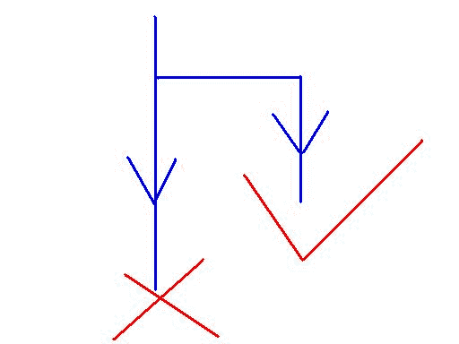  
   
  
正常状况下，维持左边正常假注册过程，只有在三叉路口，实现了代号为 5 的异常的时候，才执行右边正确的算法过程，而破解者基本看不明白在哪里有跳转，因为没有出现 JMP 这类的代码，而关键的 LOG 也被认为是计算注册码的必要函数，其实我们只是拿它来实现特定条件下的跳转工作。  
  
我们把这个决定分支启动的关键点称为“门”。“门”要么很坚固，进不去；要么很隐蔽，找不到。小说里，电视里常常出现这样的“门”，为了找什么秘籍或者宝物，总是要找到很隐蔽或者很坚固的门才行。  
  
该方法胜在隐蔽，而不是强大上。抗破解能力不是很强，但是绝对会让别人惊喜一下（假注册成功）配合别的技巧，当真是有用武之地的，望君勉之。  
  
看效果图：  
  
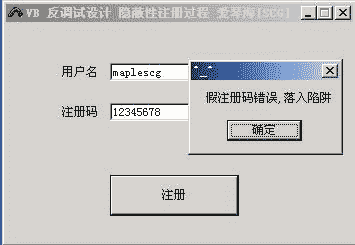  
   
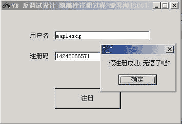  
   
  
真正注册成功：  
  
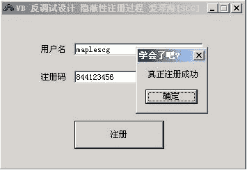   
  
  
第十一、步长、时值反调试（包含启动时间检测）  
  
除了前面我们讲过的 RDTSC 是经典的时值反调试指令可以被直接反汇编来写进我们的程序外，我们也可以用 VB 自身携带的一些时值检函数如：TIMER（精确到毫秒）；也可以用 API 里的 GetTickCount（精确到毫秒）  
  
甚至可以用 API: GetProcessTimes 来进行加载检测，以起到反调试作用。  
  
这些技术，接下去，我们都要学，而且都要学会，一点都不难。  
  
先看 RDTSC 指令：  
  
0041BE74    0F31            RDTSC  
‘获得时间  
0041BE76    8BC8            MOV ECX,EAX  
‘传值到 ECX  
0041BE78    0F31            RDTSC  
‘再次获得时间  
0041BE7A    2BC1            SUB EAX,ECX  
‘用这个值减去刚才我们储存到 ECX 的值，也就得到了时间差  
0041BE7C    3D 00050000     CMP EAX,500    
‘比较这个时间差是否大于 500（H），若是大了说明存在调试  
0041BE81  ^ 0F8F ADF9FFFF   JG 了凡第一.0041B834  
‘然后就随机跳到坟墓  
0041BE87    83F8 00         CMP EAX,0  
‘比较这个时间差是否小于 0（H），想想怎么可能小于零？光速也不行。  
0041BE8A  ^ 0F8C 8EF9FFFF   JL 了凡第一.0041B81E  
  ‘如果小于零说明调试时间太长了，以至轮回到了负数  
  
在 VB 里该指令我也不知道怎么编译，干脆大家也自己通过反汇编后来汇编添加吧  
  
下面再讲：GetTickCount （返回系统启动以来经过的时间：毫秒）  
  
同样也是利用时间差来计算一段或者一句指令执行的时间差，这个值不应该超过我们设置好的一个值。  
  
打开 VB6.0 新建工程，添加一个 COMAND1  
  
在通用部分，添加 GetTickCount 声明：  
  
我是代码起始线  
  
Private Declare Function GetTickCount Lib "kernel32" Alias "GetTickCount" () As Long  
  
我是代码终止线  
在 COMMAND1 事件里添加以下代码：（实际编写中可以不拘一格）  
  
我是代码起始线  
  
Private Sub Command1\_Click()  
  
'假设这里是我们的注册过程，我们隔三差五随意将以下代码复制粘帖  
'  
Dim atime As Long  
Dim btime As Long  
atime = GetTickCount  
btime = GetTickCount  
If btime - atime = 0 Then  
MsgBox btime - atime, , "正常运行,经历时间:"  
'实际软件中，应该彻底隐蔽这些提示消息  
Else  
MsgBox btime - atime, , "发现调试器,经历时间:"  
'实际软件中，应该彻底隐蔽这些提示消息，直接引入错误的分支去执行乱七八糟的代码  
End If  
'  
'算法部分......  
  
End Sub  
  
我是代码终止线  
  
效果如图：  
  
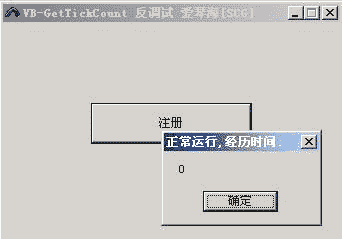   
  
发现调试工作：  
  
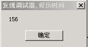   
  
再讲系统自带的 TIMER 函数  
  
打开 VB6.0 新建工程 添加 COMMAND1  
  
在它的事件代码里编写：  
  
我是代码起始线  
  
Private Sub Command1\_Click()  
  
'假设这里是我们的注册过程，我们隔三差五随意将以下代码复制粘帖  
'------------------------------  
Dim ctime As Double  
Dim dtime As Double  
ctime = Timer  
dtime = Timer  
If dtime - ctime = 0 Then  
MsgBox dtime - ctime, , "正常运行,经历时间:"  
'实际软件中，应该彻底隐蔽这些提示消息  
Else  
MsgBox dtime - ctime, , "发现调试器,经历时间:"  
'实际软件中，应该彻底隐蔽这些提示消息，直接引入错误的分支去执行乱七八糟的代码  
End If  
  
End Sub  
  
我是代码终止线  
  
可见 TIMER 跟 GetTickCount 有差不多的应用，可以扩展下思维吧。  
  
关于时间类反调试，我讲最后一个，一是重点介绍的一个：  
  
API: GetProcessTimes  
  
我们先来看看它的作用和使用规范：  
  
Private Declare Function GetProcessTimes Lib "kernel32" Alias "GetProcessTimes" (ByVal hProcess As Long, lpCreationTime As FILETIME, lpExitTime As FILETIME, lpKernelTime As FILETIME, lpUserTime As FILETIME) As Long  
  
获取与一个进程的经过时间有关的信息  
  
Long，非零表示成功，零表示失败。会设置 GetLastError  
  
hProcess -------  Long，一个进程句柄  
  
lpCreationTime -  FILETIME，指定一个 FILETIME 结构，在其中装载进程的创建时间  
  
lpExitTime -----  FILETIME，指定一个 FILETIME 结构，在其中装载进程的中止时间  
  
lpKernelTime ---  FILETIME，指定一个 FILETIME 结构，在其中装载进程花在内核模式上的总时间  
  
lpUserTime -----  FILETIME，指定一个 FILETIME 结构，在其中装载进程花在用户模式上的总时间  
    
适用平台  
Windows NT  
  
可见可以用它来检测加载时候的创建时间，一般在 OD 加载它，但是还没按 F9 或者点运行，但是系统早已自动帮我们记录了它的“启动”时间，我们只要到程序获得自主权的时候，检测这个“启动”到底花了多少时间就可以发现调试器，进而反调试了。  
  
跟我一起来：  
  
打开 VB6.0 新建工程 添加一个 LABEL1  
  
在通用部分写下以下代码：  
  
我是代码起始线  
  
Option Explicit  
Private Declare Sub GetLocalTime Lib "kernel32" (ntt As SystemTime)  
Private Declare Sub GetProcessTimes Lib "kernel32" (ByVal hProcess As Long, lpCreationTime As FILETIME, lpExitTime As FILETIME, lpKernelTime As FILETIME, lpUserTime As FILETIME)  
Private Declare Function GetCurrentProcess Lib "kernel32" () As Long  
Private Declare Sub FileTimeToSystemTime Lib "kernel32" (lpFileTime As FILETIME, lpSystemTime As SystemTime)  
Private Type SystemTime  
    wYear As Integer  
    wMonth As Integer  
    wDayOfWeek As Integer  
    wDay As Integer  
    wHour As Integer  
    wMinute As Integer  
    wSecond As Integer  
    wMilliseconds As Integer  
End Type  
Private Type FILETIME  
    dwLowDateTime As Long  
    dwHighDateTime As Long  
End Type  
Dim id As Long  
Dim ctt As FILETIME  
Dim ett As FILETIME  
Dim ktt As FILETIME  
Dim utt As FILETIME  
Dim stt As SystemTime  
Dim ntt As SystemTime  
Dim qtt As Double  
  
我是代码终止线  
  
下面开始编写一个函数，可以方便复制和移植。  
  
我是代码起始线  
  
Private Function Antitime() As Boolean  
'自定义了一个利用 GetProcessTimes 自动进行检测调试器的函数  
GetLocalTime ntt  
'获得现在系统时间  
id = GetCurrentProcess  
'获得本进程 ID  
GetProcessTimes id, ctt, ett, ktt, utt  
'获得本进程 ID 对应的信息  
FileTimeToSystemTime ctt, stt  
'转换时间格式  
qtt = Val(ntt.wSecond) \* 1000 + ntt.wMilliseconds - Val(stt.wSecond) \* 1000 - stt.wMilliseconds  
'计算时间差  
If qtt > 80 Or qtt < 0 Then  
'如果时间差大于 80 微秒或者小于 0 就认为发现了调试，这个值大家可以自行修改  
Antitime = True  
Else  
Antitime = False  
End If  
End Function  
  
我是代码终止线  
  
如何引用？必须放到窗口的 LOAD 事件或者 Initialize 事件里，因为这连个事件在程序启动时加载，刚好可以给我们限定启动时间。请看代码：  
  
我是代码起始线  
  
Private Sub Form\_Initialize()  
'这样调用即可  
If Antitime = True Then  
MsgBox "发现调试器了", , "提醒"  
Label1.ForeColor = &HFF&  
Label1.Caption = "发现调试器"  
Else  
Label1.ForeColor = &H80000012  
Label1.Caption = "没有发现调试"  
End If  
End Sub  
  
我是代码终止线  
  
请看效果图：  
  
  
没有调试时：  
   
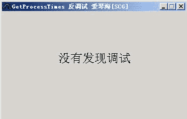  
  
OD 装载调试：  
  
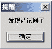  
   
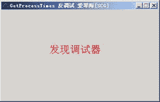   
  
你可以测试别的调试器，结果基本一样，可靠性还是比较高的。  
  
请合理利用，比较点等要设计的比较隐蔽才可以。  
  
  
第十二、检测内存分配大小反调试  
  
  
有没有发现？当程序被 OD 带 HIDEOD 插件调试的时候，其分配的内存底线和上线跟正常的情况是不一致的。利用这点，我们可以设计一个反 OD 的函数。（其实其作用就是检测 HIDEOD 插件用的，只要开启该插件，就能被发现）  
  
需要 API: GetProcessWorkingSetSize  
  
我们一起测试下：  
  
打开 VB6.0 新建工程 添加 COMMAND1  
  
在通用部分添加：  
  
我是代码起始线  
  
Private Declare Function GetCurrentProcess Lib "kernel32" () As Long  
Private Declare Function GetProcessWorkingSetSize Lib "kernel32" (ByVal hProcess As Long, lpMinimumWorkingSetSize As Long, lpMaximumWorkingSetSize As Long) As Long  
  
我是代码终止线  
  
然后我们编写函数  
  
我是代码起始线  
  
Private Function JianNeicun(biggest As Long, smallest As Long) As Boolean  
'我们这里的最大值是 1413120，最小值是 204800  
Dim yx As Long  
Dim ax As Long  
Dim bx As Long  
Dim cx As Long  
yx = GetCurrentProcess  
'获得 ID  
ax = GetProcessWorkingSetSize(yx, bx, cx)  
'获得内存分配信息  
'MsgBox bx, , "min" '这里可以自行打开,以确定你的程序实际最小内存分配  
'MsgBox cx, , "max" '这里可以自行打开,以确定你的程序实际最大内存分配  
If bx <> smallest Or cx <> biggest Then  
JianNeicun = True '发现调试器 OD  
Else  
JianNeicun = False  
End If  
End Function  
  
我是代码终止线  
  
怎样使用？  
  
请看：  
  
我是代码起始线  
  
Private Sub Command1\_Click()  
If JianNeicun(1413120, 204800) = True Then  
'这个值可以修改为你的程序的实际内存交付  
MsgBox "发现调试器 OD", , "提示"  
Else  
MsgBox "没有发现调试器", , "恭喜"  
End If  
End Sub  
  
我是代码终止线  
  
效果图：  
  
正常：  
  
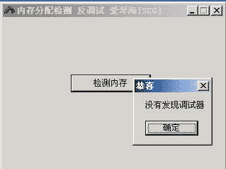   
  
发现调试器 OD（HIDEOD）  
  
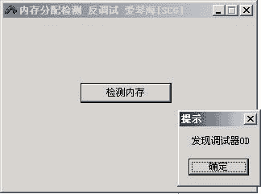  
  
   
  
同样，每一个设计的反调试都需要隐蔽些，不然不就等于告诉别人“快来解决我”吗？  
  
  
第十三、窗口置顶反调试  
  
这个只是些小技巧，对付初级破解者还好，对付有些经验的破解者就容易过了。  
  
简要原理：利用 API，将本程序窗口置顶，覆盖其他程序界面，使得破解者无法看到其他内容，也就无法看到调试器了。最好在注册过程中使用，以免影响用户其他作业。而且在置顶后，不要用 MSGBOX 函数，否则会卡死掉，直接用 LABEL 或者 TEXT 显示结果和信息即可。注册结束后不要忘了解除置顶（直接关闭也可以）  
  
需要使用 API: SetWindowPos  
  
代开 VB6.0 新建工程 添加 COMMAND1 和两个 LABEL  
  
在通用里添加如下代码：  
  
我是代码起始线  
  
Private Declare Function SetWindowPos Lib "user32" (ByVal hwnd As Long, ByVal hWndInsertAfter As Long, ByVal X As Long, ByVal Y As Long, ByVal cx As Long, ByVal cy As Long, ByVal wFlags As Long) As Long  
Private Const HWND\_TOPMOST = -1  
Private Const SWP\_NOMOVE = &H2  
Private Const SWP\_NOSIZE = &H1  
Private Const SWP\_NOZORDER = &H8  
  
我是代码终止线  
  
设计以下两个过程  
  
我是代码起始线  
  
Private Sub SetFormTopmost()  
'该过程是使窗口置顶  
MAXme  
SetWindowPos Form1.hwnd, HWND\_TOPMOST, 0, 0, 0, 0, SWP\_NOZORDER + SWP\_NOMOVE + SWP\_NOSIZE  
End Sub  
  
Private Sub MAXme()  
'该过程是使窗口占满整个屏幕  
Me.Left = 0  
Me.Top = 0  
Me.Width = Screen.Width  
Me.Height = Screen.Height  
End Sub  
  
我是代码终止线  
  
调用如下：  
  
我是代码起始线  
  
Private Sub Command1\_Click()  
If Val(Text1.Text) = 123456 Then  
Label2.Caption = "注册成功,您可以关闭注册窗口了"  
Text1.Enabled = False  
Else  
Label2.Caption = "授权码错误,请重新输入"  
End If  
End Sub  
  
Private Sub Command1\_MouseMove(Button As Integer, Shift As Integer, X As Single, Y As Single)  
'在鼠标触及按钮的时候启动置顶  
'实际应用中，你可以自己选择个隐蔽的地方来启动  
SetFormTopmost  
End Sub  
  
我是代码终止线  
  
编译即可  
  
当用户注册的时候，鼠标触及 COMMAND 后自动最大化窗口并且置顶，覆盖普通调试器。  
  
如果用户强行断点 COMMAND CLICK 事件想跟踪注册算法的话，会引发窗口锁死，OD 的无法显示，本程序锁定无法继续操作。在一定程度上阻止了调试。一般来说破解这个反调试手段是爆破和修改相关 CALL 调用，因此需要我们的 CRC32 等及反调试手段相结合。  
  
该注册窗口可以作为你的程序的注册页面，其他页面没必要置顶。  
  
我们看看效果：  
  
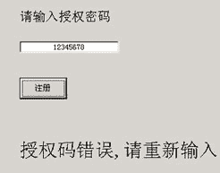   
  
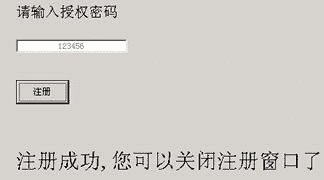   
  
  
  
第十四、检测按键，一般是 F2（断点）、F7（单步步进）、F8（逐过程步过）、F9（运行）  
  
  
一般程序都是用不到 F2、F7、F8、F9 等，而 OD 刚好都需要，破解者破解过程中，会不停的按这些键，这个恐怕大家都养成习惯了，用鼠标的话比较麻烦。利用大家的习惯和不注意，我们可以检测这些按键，发现按键后立即警告等，随便你处理了。  
  
这个很好玩，大家来实验下：  
  
打开 VB6.0 新建工程，添加 COMMAND1 和一个 TIMER1(计时器) 设置为打开，100 微秒。  
  
在通用添加：  
  
我是代码起始线  
  
Option Explicit  
Private Declare Function GetAsyncKeyState Lib "user32" (ByVal vKey As Long) As Integer  
'定义 API 调用  
  
我是代码终止线  
  
接着设计一个检测按键并做相应的 SUB  
  
我是代码起始线  
  
Private Sub Anjian()  
If GetAsyncKeyState(vbKeyF2) Then  
MsgBox "你按了 F2 键,怀疑你在用 OD 断点", , "警告"  
End  
End If  
If GetAsyncKeyState(vbKeyF7) Then  
MsgBox "你按了 F7 键,怀疑你在用 OD 调试", , "警告"  
End  
End If  
If GetAsyncKeyState(vbKeyF8) Then  
MsgBox "你按了 F8 键,怀疑你在用 OD 调试", , "警告"  
End  
End If  
If GetAsyncKeyState(vbKeyF9) Then  
MsgBox "你按了 F9 键,怀疑你在用 OD 调试", , "警告"  
End  
End If  
End Sub  
  
我是代码终止线  
  
调用如下：  
  
我是代码起始线  
  
Private Sub Command1\_Click()  
MsgBox "本按无对应算法注册,只是演示监视按键来反调试,假设破解者追踪本按钮事件", , "提醒"  
End Sub  
  
Private Sub Timer1\_Timer()  
'用计时器来时时检测按键  
Anjian  
End Sub  
  
我是代码终止线  
  
  
其他按钮也能检测出来，效果还好的。在程序运行的时候，如果下 F2 断点，同样可以发出警告提示。  
  
  
第十五、检测前台窗口反调试  
  
  
当你的程序的注册按钮被点击，或者其他互动事件发发生，程序窗体就调到前台位置了。  
  
我们可以据此检测是否有调试活动  
  
利用 API：GetForegroundWindow  
  
打开 VB6.0 新建工程，添加注册按钮  
  
在通用部分添加：  
  
我是代码起始线  
  
Private Declare Function GetForegroundWindow Lib "user32" () As Long  
  
我是代码终止线  
  
编写函数：  
  
我是代码起始线  
  
Private Function JianWindow() As Boolean  
Dim abcg As Long  
abcg = GetForegroundWindow  
If abcg = Me.hWnd Then  
JianWindow = False  
Else  
JianWindow = True  
End If  
End Function  
  
我是代码终止线  
  
调用如下：  
  
我是代码起始线  
  
Private Sub Command1\_Click()  
'如果断点在这里,那么就会被我们发现调试  
If JianWindow = True Then  
MsgBox "你在调试我", , "提示"  
Else  
MsgBox "没有发现调试", , "恭喜"  
End If  
End Sub  
  
我是代码终止线  
  
  
第十六、SeDebugPrivilege 检测调试器  
  
  
简要原理：当调试器调试程序的时候，程序的获得了对 csrss.exe 进程的读取权利，而正常情况下，程序是没有这个权限的，我们来检测程序是否具备读取 csrss.exe 的能力来判断是否被调试。针对 OD 的话，如果 HIDEOD 插件开启防护的话，那就没用了。  
  
打开 VB6.0 新建工程 添加 COMMAND1  
  
在通用部分加入代码：  
  
我是代码起始线  
  
Private Declare Function CreateToolhelp32Snapshot Lib "kernel32" (ByVal dwFlags As Long, ByVal th32ProcessID As Long) As Long  
Private Declare Function Process32First Lib "kernel32" (ByVal hSnapShot As Long, lppe As PROCESSENTRY32) As Long  
Private Declare Function Process32Next Lib "kernel32" (ByVal hSnapShot As Long, lppe As PROCESSENTRY32) As Long  
Private Declare Function CloseHandle Lib "kernel32" (ByVal hObject As Long) As Long  
Private Declare Function TerminateProcess Lib "kernel32" (ByVal hProcess As Long, ByVal uExitCode As Long) As Long  
 Private Declare Function OpenProcess Lib "kernel32" (ByVal dwDesiredAccess As Long, ByVal blnheritHandle As Long, ByVal dwAppProcessId As Long) As Long  
      
Const MAX\_PATH As Integer = 260  
Const TH32CS\_SNAPPROCESS As Long = 2&  
Private Type PROCESSENTRY32  
    dwSize As Long  
    cntUsage As Long  
    th32ProcessID As Long  
    th32DefaultHeapID As Long  
    th32ModuleID As Long  
    cntThreads As Long  
    th32ParentProcessID As Long  
    pcPriClassBase As Long  
    dwFlags As Long  
    szExeFile As String \* 1024  
End Type  
  
我是代码终止线  
  
下面开始编写函数  
  
我是代码起始线  
  
Private Function Opencsrss() As Boolean  
'发现调试器返回 TRUE，没有发现则返回 FALSE  
  
On Error GoTo maple  
Dim Process As PROCESSENTRY32  
Dim hSnapShot As Long  
Dim l1 As Long  
Dim flag As Boolean  
Dim mName As String  
Dim i As Integer  
Dim pid As Long, WOW As Long '注意这 2 个变量就用来存放 2 个 ID  
hSnapShot = CreateToolhelp32Snapshot(TH32CS\_SNAPPROCESS, 0&) '建立进程快照  
  If hSnapShot Then  
    Process.dwSize = 1060  
    If (Process32First(hSnapShot, Process)) Then '遍历第一个进程,获得 PROCESSENTRY32 结构  
      Do  
        i = InStr(1, Process.szExeFile, Chr(0))       '获得映像名称  
        mName = LCase(Left(Process.szExeFile, i - 1)) '并转换成小写  
         
        If mName = "csrss.exe" Then      '是不是 WOW.exe  
             WOW = Process.th32ProcessID    '获得进程 ID  
        End If  
      Loop Until (Process32Next(hSnapShot, Process) < 1) '遍历所有进程直到返回值为 False  
    End If  
    l1 = CloseHandle(hSnapShot)  
    End If  
       If WOW <> 0 Then  
     
   Dim jiejie As Long  
   jiejie = OpenProcess(1&, -1&, WOW)  
   '测试打开能力  
   If jiejie <> 0 Then  
   Opencsrss = True  
   Else  
 Opencsrss = False  
   End If  
     
     
     End If  
Exit Function  
maple:  
Opencsrss = False  
  
End Function  
  
  
我是代码终止线  
  
调用如下：  
  
我是代码起始线  
  
Private Sub Command1\_Click()  
If Opencsrss = True Then  
MsgBox "发现调试器,请关闭", , "警告"  
Else  
MsgBox "没有发现调试", , "恭喜"  
End If  
End Sub  
  
我是代码终止线  
  
  
  
  
第十七、关键部分算法的时候锁定鼠标干扰调试分析  
  
  
这个是个示范，其实你也可以编写针对键盘的封锁，来抗调试。  
  
打开 VB6.0 新建工程 添加一个 TEXT1 添加一个 COMMAND1 添加一个 TIMER1  
选择 FORM1 的 BORDERSTYLE 为 NONE，然后在 FORM1 上画一个关闭叉叉，用 IMAGE1 来覆盖，事件放在 IMAGE1 CLICK 事件里来模拟关闭按钮。  
TIMER1 的频率设置为 100 微秒，默认打开。调节 FORM1 的默认启动位置为屏幕中心。  
  
在通用部分添加：  
  
我是代码起始线  
  
Private Type RECT  
          left   As Long  
          top   As Long  
          right   As Long  
          bottom   As Long  
  End Type  
  Private Type POINT  
          x   As Long  
          y   As Long  
  End Type  
  Private Declare Sub ClipCursor Lib "user32" (lpRect As Any)  
  Private Declare Sub GetClientRect Lib "user32" (ByVal hWnd As Long, lpRect As RECT)  
  Private Declare Sub ClientToScreen Lib "user32" (ByVal hWnd As Long, lpPoint As POINT)  
  Private Declare Sub OffsetRect Lib "user32" (lpRect As RECT, ByVal x As Long, ByVal y As Long)  
  
我是代码终止线  
  
下面写成过程  
  
我是代码起始线  
  
Private Sub Suoding()  
'锁定鼠标范围的过程  
Dim client     As RECT  
Dim upperleft     As POINT  
GetClientRect Me.hWnd, client  
upperleft.x = client.left  
upperleft.y = client.top  
ClientToScreen Me.hWnd, upperleft  
OffsetRect client, upperleft.x, upperleft.y  
ClipCursor client  
End Sub  
  
我是代码终止线  
  
其他调用和算法：  
  
我是代码起始线  
  
Private Sub Timer1\_Timer()  
Suoding  
'每过 100 微秒锁定一次，防止鼠标脱离  
'设计思路是程序一起动就自动锁定鼠标不离开程序范围，除非结束掉程序，或者完成注册为止  
End Sub  
  
Private Sub Image1\_Click()  
'自定义关闭按钮，画出来的，哈哈哈  
End  
End Sub  
  
Private Sub Command1\_Click()  
If Val(Text1.Text) = 123456 Then  
MsgBox "恭喜你,注册成功", , "恭喜": End  
Else  
MsgBox "注册码错误哦", , "错误"  
End If  
End Sub  
  
我是代码终止线  
  
可见程序调用计时器每 100 微秒锁定一次鼠标范围到我们程序自己身上，一启动程序的时候就发挥作用，使得破解者来不及使用其他程序，包括调试器。  
  
注册成功或者单击关闭叉叉后就可以退出程序，具有一定的实际意义，要去用户注册时候不能动别的程序，直接注册或者就别注册。  
  
破解者很可能会关闭我们的计时器，或者修改程序以躲避这个凡人的锁定，所以我们可以配合 CRC32 等自校验或者其他抗调试手段结合在一起，使得这个锁定不容易被去除。  
  
效果还可以。  
  
请看图效：  
  
   
  
  
第十八、GetStartupInfo 反调试  
  
今天看了看前人的经典，发现可以在 Vb 里实现 GetStartupInfo 反调试  
  
打开 VB6.0 新建工程 添加 COMMAND1  
  
在通用里：  
  
我是代码起始线  
  
Private Declare Sub GetStartupInfo Lib "kernel32" Alias "GetStartupInfoA" (lpStartupInfo As STARTUPINFO)  
  
Private Type STARTUPINFO '(createprocess)  
    cb As Long  
    lpReserved As Long  
    lpDesktop As Long  
    lpTitle As Long  
    dwX As Long  
    dwY As Long  
    dwXSize As Long  
    dwYSize As Long  
    dwXCountChars As Long  
    dwYCountChars As Long  
    dwFillAttribute As Long  
    dwFlags As Long  
    wShowWindow As Integer  
    cbReserved2 As Integer  
    lpReserved2 As Long  
    hStdInput As Long  
    hStdOutput As Long  
    hStdError As Long  
End Type  
  
我是代码终止线  
  
编写函数：  
  
我是代码起始线  
  
Private Function StartAnti() As Boolean  
Dim Huanjing As STARTUPINFO  
GetStartupInfo Huanjing  
If Huanjing.dwX <> 0 Or Huanjing.dwY <> 0 Or Huanjing.dwXCountChars <> 0 Or Huanjing.dwYCountChars <> 0 Or Huanjing.dwFillAttribute <> 0 Or Huanjing.dwXSize <> 0 Or Huanjing.dwYSize <> 0 Then  
StartAnti = True  
Else  
StartAnti = False  
End If  
End Function  
  
我是代码终止线  
  
调用如下：  
  
我是代码起始线  
  
Private Sub Command1\_Click()  
If StartAnti = True Then  
MsgBox "发现调试器,请关闭", , "警告"  
Else  
MsgBox "没有发现调试器", , "通过"  
End If  
End Sub  
  
Private Sub Form\_Load()  
If StartAnti = True Then  
MsgBox "发现调试器,请关闭", , "警告"  
Else  
MsgBox "没有发现调试器", , "通过"  
End If  
End Sub  
  
我是代码终止线  
  
  
  
好累，第三章第一讲到此结束，我们回顾下，主要讲了以下几个内容：  
  
1、  检测父进程反 RING3 调试器  
2、  FindWindow 检测敏感窗口  
3、  EnumChildWindows 枚举所有窗体，检测敏感字符  
4、  检测进程名字来排雷  
5、  利用 IsDebuggerPresent 检测调试器  
6、  加密字符串，错误提示诱导陷阱  
7、  利用 SEH 进行反跟踪  
8、  加 VM 或者 P-CODE 编译  
9、  直接反汇编修改代码（破解者用的招数，我们也可以用来防守）  
10、  隐蔽性设计  
11、  步长、时值反调试（包含启动时间检测）  
12、  检测内存分配大小反调试  
13、  窗口置顶反调试  
14、  检测按键，一般是 F2（断点）、F7（单步步进）、F8（逐过程步过）、F9（运行）  
15、  检测前台窗口反调试  
16、  SeDebugPrivilege 检测调试器  
17、  关键部分算法的时候锁定鼠标干扰调试分析  
18、  GetStartupInfo 反调试  
  
其实方法多种多样，远不只这些，奈何我触及加密解密时间尚短，经验太少，水平太差，暂时无法详细给大家演示其他的反调试手段，大家可以看下《加密解密第三版》，对你也会有启发。  
  
这篇文章写了几天，主要是白天太忙，金工实习，根本没时间写文章，发表得有些晚。  
  
  
  
  
  
  
第三章  第二讲  
  
防静态反汇编分析  
  
  
这一讲将是简短至极，相信大家也累了，我也写不了多少。  
  
VB 防静态反汇编，有以下途径：  
  
1、  修改程序头，使得一些识别 VB 的反汇编工具无法识别  
2、  加壳，最好是保护壳中的猛壳，可以很有效得保护你的资源和代码  
3、  虚拟机保护关键过程和代码  
4、  将程序作为子程序当作数据形式储存在母程序里（借鸡生蛋），事先先经过 XOR 等的加密，运行母程序的时候 XOR 逆算回子程序数据，然后释放到某个地方执行。  
5、  P-CODE 方式编译，然后破坏程序开头等位置，也有一定的效果  
6、  大量使用假信息，迷惑静态分析的破解者。  
7、  按照高人的话说，似乎可以依靠 VB 内联汇编来添加花指令来抗静态分析。  
  
应该还有更多方法，我知道的太少了，^\_^  
  
好了，《VB 共享软件防破解设计技术初探（三）》就写到这里吧，精力差不多耗尽了。  
下一篇《VB 共享软件防破解设计技术初探（四）》我们将讲述：注册码系统（算法部分，核心内容）和加壳防脱壳，估计那篇会比较短些。  
  
还是老规矩，若是有时间，有精力，有空，有能力，我将继续写下去，尽力完成整个系列，给 VB 软件的防破解领域加入催化剂。  
  
  
作者：爱琴海\[SCG\] 2008/09/10 （转载请保留该信息） 

上传的附件
|  || VB 共享软件防破解设计技术初探（三）全部工程文件和代码.rar  
 |
|   
 ||  |