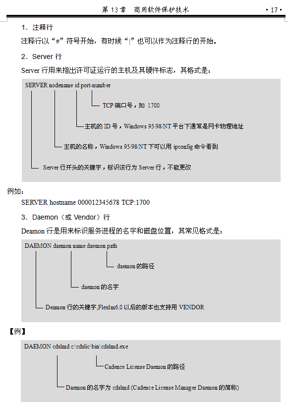
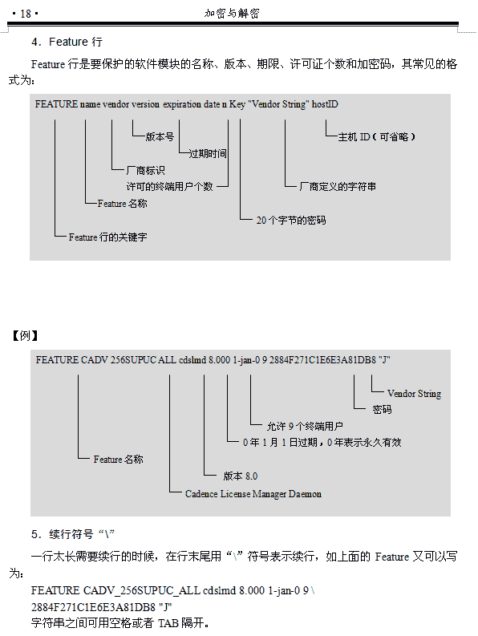
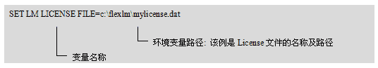
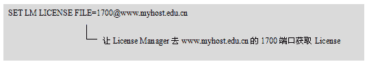
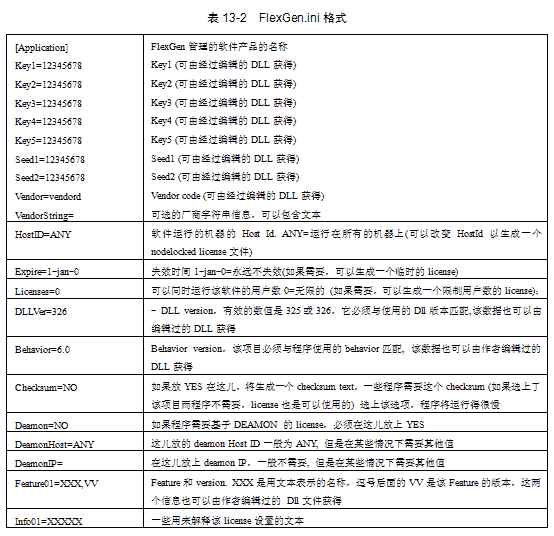
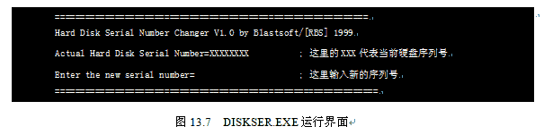
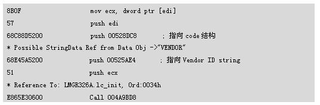
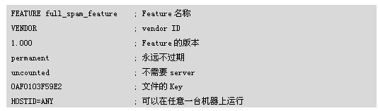

# 《加密与解密》第二版 13.6 Flexlm 保护

> 原文：[`www.pediy.com/kssd/pediy10/60864.html`](https://www.pediy.com/kssd/pediy10/60864.html)

  

说明  
这部分内容是《加密与解密》第二版的，没有放进第三版。书上 Flexlm 这部分比较基础，放出来与大家分享。由于与电子工业出版社还有版权合同问题，因此，这部分内容仅对论坛注册会员可见，不想大面积传播，还请谅解。  
其中，主要部分“FlexGen 工具用法”、“利用 FlexLm SDK 解密”由 Fisheep 参与编写，在此表示感谢！  
  
  
**13.7 Flexlm 保护**  
*完稿时间:2003.1*  
  
许可证管理（License manager）是一种授权加密保护方式，属于这类的保护的有 Flexlm、ElanLM、SentinelLm 等。其中以 Flexlm 最为著名，很多大型专业软件都采用它进行加密。但是其安全性是没有保证的，不是因为它技术不好，而是因为人们对它的研究最深入和透彻。  
许可证的原理通常是把要保护的软件同计算机固有的唯一的硬件特征联系起来，例如工作站的主机号（Hostid）、以太网卡得 MAC 地址等。  
  
**13.7.1 License 文件格式**  
Flexlm 加密的程序在使用时，一般都会有一个 License 文件，在此有必要先了解一下 License 文件的结构。License 文件由注释行、Server 行、Demon 行和 Feature 行构成，另外有一个续行符“\\”用来表示一行的继续。  
  
  
  
  
  
**13.7.2 设置环境变量**  
一般来说，License Manager 需要一个环境变量才能找到 License 文件。有的软件不需要设置环境变量，只需要将 license 文件放置到它的某个目录下面就可以了，如 ActiveVHDL3.3，只要将 license.dat 放在它的 dat 目录下。  
通常环境变量名称是 LM\_LICENSE\_FILE，大小写无关，Windows 9x 下的设置方法是在 Autoexec.bat 中加入一行：   
  
  
  
如果有多个 License 文件，可以用分号隔开，如：  
SET LM\_LICENSE\_FILE=c:\\flexlm\\license1.dat;d:\\flexlm\\license2.dat   
应用软件的 License Manager 自动遍历环境变量指定的所有 License 文件，查找它所需要的 Feature。不同 License 与文件路径的先后次序无关。   
除了 LM\_LICENSE\_FILE 这个环境变量名称外，有些软件还使用自己特定的环境变量名称。安装软件的时候，安装程序一般会自动添加这些环境变量，如 Specctra8.0 使用 CDS\_LIC\_FILE 环境变量名称：  
SET CDS\_LIC\_FILE=c:\\cdsLic\\license.dat   
MentorGraphicsRenoir 以及 ModelSimEE 如果安装的时候选择 Mentor Graphics License Manager，软件使用 MGLS\_LICENSE\_FILE 环境变量：  
SET MGLS\_LICENSE\_FILE=c:\\flexlm\\license.dat   
如果 License 是由 Server 提供的，那么环境变量的路径应该给出 Server 的名称以及端口，而非 License 文件的路径以及名称，如：  
  
  
  
Windows NT/2000/XP 下设置环境变量需要在控制面板里面添加，格式相同。  
  
**13.7.3 Flexlm Server**  
Flexlm 这个名字是 Flexible License Manager 的简写，Flexlm Server 方式的 License 应该如下设置：  
License.dat 文件放在主机中，主机运行 Server，提供 License 服务。  
客户端的环境变量设置为：  
SET LM\_LICENSE\_FILE=\[TCP/IP 端口\]:\[主机名称\]   
其中端口和主机名称应该和主机的 License 文件中的 Server Line 一致。启动 Server 的方式有两种，一是 DOS 命令行方式，二是 Windows 的窗口方式。  
  
**1．DOS 方式**  
在 c:\\flexlm 目录下可以找到一个 Lmgrd.exe 文件 License Manager Daemon，这个 Daemon 是 Flexlm Server。License.dat 文件需要和 Daemon 文件放在同一个目录下，启动 License server，可在 c:\\flexlm 目录下执行：  
c:\\flexlm\\lmgrd -app -c   
关闭 License server，可在 c:\\flexlm 目录下执行：   
c:\\flexlm\\lmutil lmdown   
lmutil.exe 是 License Manager Utility。  
  
**2．Windows 的窗口方式**  
安装某些软件的时候，会有一个安装 License Server 的选项，选中它安装完成后，会在控制面板中发现一个 Flexlm License Manager 的小工具。在 Flexlm License Manager Setup 的 TAB 里可以选择 Daemon、License 文件，以及输出的日志文件。Control 的 TAB 中可以启动/关闭 Server 以及查看 Server 状态，另外几个 TAB 还提供一些其他辅助功能。  
Windows 下的这个 Flexlm License Manager 要比命令行方式的方便一些，至少它可以浏览，选取 Daemon/License 文件，不过有时候发现控制面板里面找不到。事实上它是一个控制面板的扩展应用程序，如在 PowerPCB 目录下可以找到 Flexlm.cpl 这个文件，用鼠标双击它就运行上面提到的那个管理窗口。  
  
**13.7.4 FlexGen 工具用法**  
  
**1．FlexGen.ini 配置**  
FlexGen 是通用基于 Flexlm 的 License 生成器，它需要输入一些不同的信息。这些信息保存在 FlexGen.Ini 文件中，该文件是可以编辑和更新的，这样就可以添加信息以生成新软件的 License。  
FlexGen.ini 包括生成 License 文件需要的不同信息。对于每个软件的信息，它都拥有表 13-2 的格式。  
  
  
  
已经准备好 INI 文件，可以用它来生成 License。运行 FlexGen，按“Generate”试一下，如果得到一个错误信息，就表示有一些信息输错了；如信息正确，再按“Check”检测 License 是否合法，如果得到肯定的回答，就表示 INI 中输入的信息都是正确的。这样，就可自制 INI 中的信息来为程序生成 License 文件。按“Automatic License Generation”生成的 INI 文件中放入所有 Feature 的 License，生成 License 后按“Save”按钮将其保存。  
  
**2．编辑过的 DLL 使用方法**  
（1）先用 FileMon 等工具检测软件的运行，观察软件使用的 lmgr32XX.dll 文件名和所在的目录。  
（2）退出应用软件的运行，用 FlexGen 提供的 LMGRS 目录下的相应 DLL 替换原先的 DLL（最好先将原先的文件备份）。  
（3）运行软件，将有一个对话框弹出，记录其标题（是 Flexlm 的 Vendor Name）和显示的数值，有 80 个字符（称为 Magic Number 是经过处理的 Flexlm 的 Key）。  
（4）运行 FlexGen 程序，选择“Make INI from Magic Number”选项运行，填入上面得到的两个信息，然后按“GENERATE”，再按“SAVE”按钮，如果一切都正确，将得到一个 TEMPLATE.INI。填写它的所有信息，添加到当前 FLEXGEN.INI 文件后面，就可使用 FlexGen 来生成该软件的 License 文件了。  
（5）退出应用软件的运行，用 FlexGen 提供的 LMFEAT 目录下的相应 Lmgr32XX.dll 替换原先的 DLL，然后运行应用程序，出现一个对话框，其文本为 FEATURE 的名称，其标题为该 FEATURE 的版本号（Version）。记录下这两项内容，添加到先前生成的 Template.ini 文件中。在应用程序中多运行一些功能，可能发现更多的 FEATURE，都将它们记录下来，然后添加到先前的 Template.ini 文件中。  
  
**3．硬盘序列号修改**  
上面的方法固然很不错，但是有的时候会发现个别 Flexlm 加密的软件并不调用 lmgr32XX.dll。  
Flexlm 是根据硬盘序列号生成机器号的，如果有了一个机器的序列号，这时解密者修改硬盘的序列号，让它们生成一样的机器号，那么那个密码就可以在多台机器上用了。以前在 DOS 下的时候可以用 NU8 中的 diskedit 来编辑硬盘的序列号，这样对那些不懂磁盘结构的人来说很不方便。用 FlexGen 配套的 DISKSER.EXE 就可轻松解决这个问题，打开这个软件，会出现图 13.7 的界面。  
  
  
  
输入 8 位数字后它会自动提示：“Serial Number Changed”，这样硬盘序列号就改变了。  
FlexGen 配套的 DGET.EXE 是查看硬盘序列号的软件。  
对软件作者加密时的建议：计算本机序列号的时候尽量使用稳定的不容易变化的东西作为计算的依据，比如 BIOS 中的厂家的名字，但不要用 BIOS 的版本号因为这个东西要经常变，而主板厂家的名字却很少有人去刻意改变。硬盘序列号是一个很不错的依据，但是有了 DISKSER.EXE 就不怎么安全了。可把这类可以依靠的判断条件选择几个，计算出机器号，切不可只用一个来计算，不然很容易被修改！  
  
**13.7.5 利用 FlexLm SDK 解密**  
Flexlm 的 License 文件可以用函数 f 如下表示：   
f( 主机号，软件名，版本，期限，许可证个数，加密参数）= 加密串   
这个函数还和 Flexlm 的版本有关系，实际上只要得到相应版本的 Flexlm SDK，就可以执行此函数。Flexlm SDK 是公开的（以前如此），唯一保密的是 f 函数中的“加密参数”由 Flexlm 公司通过保密的途径提供给其客户，这些参数由五个 Vendor Key（客户码）和两个 Encryption Seed（加密种子）组成，只要知道了这七个参数，就可以用相应版本的 SDK 构造出完整的 License 文件。该方法是一种最彻底的、最完美的办法，但也是 flexlm 重点防范的对象，他们采用了很多技术隐藏上述信息。  
根据 SDK 的描述，如下两个函数最重要：  
 lc\_init( )使用基本的 Vendor Key 等信息进行 Flexlm 的初始化，通过它可以得到基本信息；  
 lc\_checkout( )检查是否可以使用指定 Feature 的功能，通过它可以得到程序的所有 Feature 名称。  
为了讲述方便，在此以 FlexLm 加密的 XprismPro 1.0 程序为例。  
  
**1．SDK 开发包**  
首先安装 Flexlm 开发包，这里所要关心的主要文件是：   
 lm\_code.h 在这要设置所要解密程序的加密信息，有 Vendor 名称、Vender Key 和 Seed 等，这些内容是重点；  
 lm\_client.h 包含 Flexlm 用来保护软件的函数原型和出错码的定义；  
 GenLic32.exe 该程序用来检查在 lm\_code.h 中设置的 Key 等信息生成 Flexlm 的 License 文件。  
  
**2．使用 lc\_init( )得到信息**  
使用 lc\_init( )来找 Vendor Name、Vendor Key 1 - Vendor Key 4。载入目标 EXE 文件，然后在 lc\_init 调用处设置一个断点，运行程序，直到它停止。  
在 lm\_client.h 中，可以看到 lc\_init 的原型如下：   
  
代码:

```
lm\_extern API\_ENTRY lc\_init lm\_args(
                   (LM\_HANDLE\_PTR job,  
                   LM\_CHAR\_PTR vendor\_id,  
                   VENDORCODE\_PTR vendor\_key, 
                   LM\_HANDLE\_PTR\_PTR job\_id)
          );

```

  
在最前面的 job 将是 NULL，job\_id 是一个指向将被填充的 job 结构的指针，这里所关心的是 Vendor\_id 和 vendor\_key，其中 Vendor\_id 是一个文本字符串。  
再看看 lm\_client.h 中的结构：  
  
  
代码:

```
typedef struct vendorcode5 { 
                            short type;             /\* 结构类型\*/ 
                            unsigned long data\[2\];  /\* 加密的 Seed 信息 \*/ 
                            unsigned long keys\[4\];  /\* Vendor Keys 1 到 4 \*/
                            short flexlm\_version; 
                            short flexlm\_revision; 
                            char flexlm\_patch\[2\]; 
                            char behavior\_ver\[LM\_MAX\_BEH\_VER + 1\]; 
                          } VENDORCODE5,  FAR \*VENDORCODE\_PTR; 
#define LM\_MAX\_BEH\_VER  "06.0"

```

  
在上面的结构中：  
data\[0\] = Seed1 XOR VendorKey5  
data\[1\] = Seed2 XOR VendorKey5  
keys\[0..3\] = vendor keys 1 到 4   
behavior\_ver\[\] = 包含 Flexlm 版本的字符串(在这儿是"06.0")   
在调用 lc\_init 前，上面的的内容将被压到栈中。  
程序中断后将看到如下代码：  
  
  
  
这里获得了 vendor ID 字符串（这里是“VENDOR”），用 W32Dasm 反汇编主程序，再看 00528DC8 处的内容，可以看到 code 结构的内容：  
  
代码:

```
\[00528DC8\] - 00000004  ....
\[00528DCC\] - ab5e32e5  .?^    ; seed1 XOR key5
\[00528DD0\] - 7bc6313d  =1.{   ; seed2 XOR key5 
\[00528DD4\] - fc62965d  \].l.   ; key 1 
\[00528DD8\] - 853df75c  \\7=.   ; key 2
\[00528DDC\] - 2f324f23  #O:.   ; key 3 
\[00528DE0\] - 1133e43b  ;.3.   ; key 4 
\[00528DE4\] - 00000006  ....   ; version and revision
\[00528DE8\] - 36300069  i.06   ; patch 和 behaviour\_ver 
\[00528DEC\] - 0000302e  .0..

```

  
这里面获得了 4 个 Keys 和 2 个加密的 Seed 值。  
  
**3．找 Feature 名称**  
需要 Feature 名称，得到一个可以使用的 License 文件。清除在 lc\_init( )处设的断点后，然后用 lc\_checkout 设置断点。  
在 lm\_client.h 中可以看到如下的函数原形：  
  
代码:

```
lm\_extern API\_ENTRY lc\_checkout lm\_args((LM\_HANDLE\_PTR job,  
                                const LM\_CHAR\_PTR feature, 
                                const LM\_CHAR\_PTR  version,  
                                int nlic,  
                                int flag,  
                                const VENDORCODE\_PTR key,  
                                int dup));

```

  
在程序中看起来：  
  
代码:

```
push  00004000 
push  0528DC8                 ; code 结构
push  00000000 
lea   eax, dword ptr \[esp+10\] 
push  00000001 
push  eax                     ; 版本
push  ecx                     ; feature 名称 
push  edx 
Call  LMGR326A.lc\_checkout 

```

  
这里获得一个 Feature 名称，反汇编后就可在该 Feature 名称的周围，看到一些程序可能用到的其他 Feature 名称。  
  
**4．制作 license.dat 文件**  
编辑 lm\_code.h 文件，在其中填入所找到的加了密的 seeds 值和 vendor keys 1 到 4，先设置 key 5 为 0。  
运行 genlic32.exe。如果跳出一个错误框，则表示 lm\_code.h 中信息有错；输入在前面找到的 feature 名称，点击“permanent”和“run anywhere”，这样就不需要一个 server daemon 在运行。点击“Make License”，填好文件名 license.dat，然后点击“Make License”，查看 License 文件，应该看起来像这样：  
  
  
  
**5．寻找 Vendor Key 5**  
FlexLm 提供基于 Vendor 名称的 5 个 Key，因此它必须以某种方式进行校验。如果在 lm\_code.h 里的 Key1 到 Key4 或 Vendor 名称有错，那么 genlic32.exe 就不会正常工作。  
再次装载目标文件，设置 lc\_checkout 断点，载入 daemon DLL，开始单步执行，单步跟踪到里面。程序检查 licence.dat 文件：  
l\_validversion( ), l\_compare\_version( ) 检查 license 文件中的版本；  
l\_date( ), l\_extract\_date( ) 在加密的 Key 中展开日期（无时间限制的日期被转化为 1-jan-0）；  
l\_start\_ok( ) 运行日期是正确的；  
l\_host( ) 运行的机器是否正确；  
然后进入一些有很多 XOR 运算的函数中，这里是用 XOR 运算加密 Seed 的地方，可以看到 Key1、Key 2、Key 3、Key 4 以及 Vendor 名称，然后碰到如下代码：  
  
代码:

```
call 10021160                    ; 将 key 5 放到 ebx 
add  esp, 0000000C 
mov  eax, dword ptr \[edi+04\]     ; 从 license.dat 取 seed1 
xor  eax, ebx                    ; seed1 XOR key5   
lea  ecx, dword ptr \[ebp-58\]    
push ecx 
mov  dword ptr \[ebp-54\], eax     ; 保存 seed1 
mov  eax, dword ptr \[edi+08\]     ; 从 license.dat 取 Seed2
mov  edi, dword ptr \[ebp+0C\] 
xor  eax, ebx                    ; seed2 XOR key5 
mov  dword ptr \[ebp-50\], eax     ; 保存 seed2 
lea  eax, dword ptr \[edi+54\] 
push eax 
push esi 
call LMGR326A.l\_extract\_date

```

  
就这样，得到 key5 和经过 XOR 的 seeds1 和 Seed2。  
  
  
**6．制作最终的 license.dat**  
在 lm\_code.h 中替换掉 seeds 和 key5 的值，运行 genlic32.exe 制作完全的 licence 文件。  
上面这一篇教程是针对使用 Flexlm 的 DLL 加密的程序。其函数名称可以从 DLL 的输出表中得到，给予解密一个很大的提示。但是对于那些没有使用 DLL 的加密程序，该如何发现这些关键函数的位置呢?  
这时候可以使用 IDA 和 SoftICE 来进行解密。首先用 IDA 的辅助工具 Flair（该工具仅 IDA 注册用户有）建立 Flexlm SDK 的 Sig 文件，然后使用 IDA 对目标程序进行反汇编，再将建立好的 Flexlm 的 Sig 作用于已经反汇编的目标文件，这样就能直观地看到 Flex 关键函数所在的地址。  
在 SoftICE 中载入该目标程序，然后在 IDA 中得出的关键函数地址处设置断点，运行就可以在所期望的地方停下来，使用 D 命令得到需要的信息。  
因为已经存在 Flexlm 的辅助解密工具，可以根据部分信息 Key1～Key4、Vendor 名称得到另外的信息 Key5 和 Seeds。这样，解密工作就可简化为在\_lc\_init 处设置断点，获得部分加密信息，使用 Flexlm 辅助工具得到另外的信息 Key5 等，然后在\_lc\_checkout 处设置断点获得加密程序的 Feature 名称，最后使用所有得到的信息，生成没有限制的 license 文件。  
  
看雪软件安全  
[`www.pediy.com`](http://www.pediy.com)  
本文结稿时间：2003.1