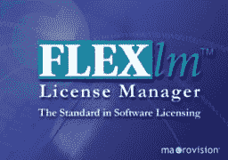

# CrackZ 的文章：FLEXlm--愚人的商业许可证管理器

> 原文：[`www.pediy.com/kssd/pediy08/pediy8-769.htm`](https://www.pediy.com/kssd/pediy08/pediy8-769.htm)

原作者：CrackZ  
原文出处：[`www.woodmann.com/crackz/Flexlm.htm`](http://www.woodmann.com/crackz/Flexlm.htm)  
标题：FLEXlm--愚人的商业许可证管理器  
翻译：sln  
申明：感谢 Flexlm 群，看雪上的朋友，新年将至，作为礼物送给大家。  
特别注意：考虑到未涉及技术,该部分不加以翻译，文中有说明。

**译文：**

在 2005 年 2 月 7 日，Macrovision 公司再次成功地攻击我的主机关闭了这个页面。现在这是他们第二次决定用他们的律师团（不像大部分保护主义者通过改进软件，但愿不会如此!），这次关闭持续了两周。

FLEXlm,还是“灵活的谎言管理者”这取决于你的理解。现在出了这么多的版本，你或许惊讶于今天又要干掉哪个，或者开发商怎么可能去信任这个系统呢，下面我所写的仍旧使用现在这个版本(v9.x),括号里面引自 Macrovison(版权所有等等，等等)，之前他们一直试图关闭我的网站。

 

**\*****新 2006 年 8 月**

我已经将 Lmkg 源代码给 Nolan Blenders(此处为我猜测).只要给出 vendor name, 你自己就可以用这个生成 V9 版之前的 vendor keys 和 CRO keys，此外，该代码也可以生成与 v10 兼容的 key，现在可以从[这](http://www.woodmann.com/crackz/FLEXlm/Lmkg.zip)下载（141k）。承蒙 tom324 的好意，带来了一个礼物，就是[FLEXlm v10.0 的 vendor key 生成器（18k）](http://www.woodmann.com/crackz/FLEXlm/Vkey10.zip)。

嘿！FLEXlm 迷们（afficionados,这个单词字典里也没有，我又自作主张的猜测一下），看过我最新的 FLEXlm v8.x 和 9.x 的文章没？如果还没有看过的话，现在[就点这看](http://www.woodmann.com/crackz/Tutorials/Flex2004.htm)吧（2004 年更新！）并且有快速回收 seed 的小窍门！

   “清除 seed 变量的默认止是 3D4DA1D6。很多的软件厂商(vendor)或者是懒亦或是愚蠢吧，他们不去修改这个默认值。所以，一个非常容易的方法就是只要在汇编代码里搜索 3D4DA1D6h。你能搜索到很多下面模样的代码：mov \[ebp-xxxx\], 3D4DA1D6h。只要在每个的含有该值的立即数上下断……跑一下。如果程序去检查许可证(license),当第一次断下时记下\[ebp-xxxx\]的值。这个就是你的 SEED1(不是用 key5 XOR 过的 SEED,就是真正的 SEED1)。第二次断下时你得到的是 SEED2。往回跟踪到函数入口处，key(1-4)在参数里。无论如何，这个方法并不适用于所有的情况，但是对于新手，很容易学习。;-)。”

**FLEXlm****的说法**

   “最佳的交配加密技术”－－大约从 v8.1 开始，Macrovision 终于成功地经由 license 生成器（从 Certicom 购买）来实现对产品的加密。曾经倍受赞誉的诸如“异或加密（xor encryption）”，“ 用随机数据隐藏关键值（hiding keys with random data）”“ 藏匿法安全技术（security by obscurity）”“弱随机数生成（weak random number generation）”之类的加密概念成为光荣历史，如今被抛弃不用。我能这么说吗,努力尝试并最终得到正确答案？ 良好的加密到来使得许可证生成器能获得最大的安全,麻烦的是,零碎的补丁仍然能够打败 FLEXlm。

 “用 Macrovision 咨询服务为您的商务实现最佳的许可解决方案”—－因为这些家伙甚至不能保证自己旗舰产品的安全，我不会让他们靠近我需要极力保护的东西。

我鼓励所有想购买 FLEXlm 的人去访问 Macrovision 的网页，然后回到这来浏览我的网页，他们自己的 Safecast 和 CD 技术也已经被破解了多年了。

[`www.globetrotter.com`](http://www.globetrotter.com/)现在已经被[Macrovision](http://www.macrovision.com/products/flexlm/index.shtml)购买（或者那就是 Microvision ;-)）。

   “FLEXlm 是软件工业最流行的许可证管理器，让 FLEXlm 最负盛名的是它能允许软件从网络上的任意一个地方获得许可证（浮点），而不必捆绑在某一台机器上。浮点许可既有利于用户又有利于许可证管理员。用户可以通过网络共享而用更少的许可证数达到高效的利用。许可证管理员可以控制已授权申请的用户以及许可证可用的节点”。 “或者我应该说它曾经是最流行的”…

 \[if gte vml 1\]><v:shape id="\_x0000\_i1025" type="#\_x0000\_t75" style='width:4.5pt;height:7.5pt;mso-wrap-distance-left:9.05pt; mso-wrap-distance-right:9.05pt;mso-position-horizontal-relative:page; mso-position-vertical-relative:page'> <v:imagedata src="flexlm\_2006\_ 译文\_ 完.files/image002.png" o:href="http://www.woodmann.com/crackz/Images/greenball.gif" embosscolor="#000002"/> <o:lock v:ext="edit" aspectratio="f"/> </v:shape><!\[endif\] [让人嗤之以鼻的 FLEXlm 许可授权](http://www.woodmann.com/crackz/Flexlm.htm#flexsniff)（经 Skullcoder 同意），[v7.2 资料摘录 ](http://www.woodmann.com/crackz/Flexlm.htm#v72snippets#v72snippets), \[if gte vml 1\]><v:shape id="\_x0000\_i1026" type="#\_x0000\_t75" style='width:4.5pt;height:4.5pt;mso-wrap-distance-left:9.05pt; mso-wrap-distance-right:9.05pt;mso-position-horizontal-relative:page; mso-position-vertical-relative:page'> <v:imagedata src="flexlm\_2006\_ 译文\_ 完.files/image002.png" o:href="http://www.woodmann.com/crackz/Images/greenball.gif" embosscolor="#000002"/> <o:lock v:ext="edit" aspectratio="f"/> </v:shape><!\[endif\] [FLEXlm 盗版讨论](http://www.woodmann.com/crackz/Flexlm.htm#flexlmpiracy#flexlmpiracy) (EDA 开发者们小心了), \[if gte vml 1\]><v:shape id="\_x0000\_i1027" type="#\_x0000\_t75" style='width:4.5pt;height:4.5pt; mso-wrap-distance-left:9.05pt;mso-wrap-distance-right:9.05pt; mso-position-horizontal-relative:page;mso-position-vertical-relative:page'> <v:imagedata src="flexlm\_2006\_ 译文\_ 完.files/image004.gif" o:href="http://www.woodmann.com/crackz/Images/greenball.gif" embosscolor="#000002"/> <o:lock v:ext="edit" aspectratio="f"/> </v:shape><!\[endif\] [FLEXlm seeds](http://www.woodmann.com/crackz/Flexlm.htm#seeds#seeds) , \[if gte vml 1\]><v:shape id="\_x0000\_i1028" type="#\_x0000\_t75" style='width:4.5pt;height:7.5pt; mso-wrap-distance-left:9.05pt;mso-wrap-distance-right:9.05pt; mso-position-horizontal-relative:page;mso-position-vertical-relative:page'> <v:imagedata src="flexlm\_2006\_ 译文\_ 完.files/image002.png" o:href="http://www.woodmann.com/crackz/Images/greenball.gif" embosscolor="#000002"/> <o:lock v:ext="edit" aspectratio="f"/> </v:shape><!\[endif\] [SentinelLM / ElanLM 部分 ](http://www.woodmann.com/crackz/Flexlm.htm#sentinellm#sentinellm)

我的许多对高端或专业软件应用熟悉的读者已经很了解 FLEXlm 了，在某些市场 GlobeTrotter 已经开始建立他们自己的 WINDOWS 平台。现在已经有了足够多的资料，我按 FLEXlm 自己的特点分类附上。我真诚建议你下载下面地 SDK 以及工具地同时仔细地读读 FLEXlm 的使用手册。

**FLEXGen**

由 RBS 放出，BlastSoft 的 FLEXGen 利用了早期在 FLEXlm dll 里的许多漏洞。由于 BlastSoft 的退出(译者注：quit the scene 是退场、离开人间的意思，我不知道作者这里是不是说 BlastSoft 已经去世还是仅仅收手了呢? 从语气上看已经去世了)FLEXGen 已经不可能在未来能够获得支持。FLEXGen 现在已经重新开放（应大家的要求）并且现在包括了其全部的源代码（请不要滥用它;-）)。

FLEXGen [Disk 1](http://www.woodmann.com/crackz/FLEXlm/Flexgen/Flexgen1.zip), [Disk 2](http://www.woodmann.com/crackz/FLEXlm/Flexgen/Flexgen2.zip), [Disk 3](http://www.woodmann.com/crackz/FLEXlm/Flexgen/Flexgen3.zip), [Disk 4](http://www.woodmann.com/crackz/FLEXlm/Flexgen/Flexgen4.zip), [Disk 5](http://www.woodmann.com/crackz/FLEXlm/Flexgen/Flexgen5.zip) （总共大约 3Mb).

**FLEXlm SDK + ****有用的东西**

下面你会看到老版本的 SDK 序列号，还有很多新版的。你可以从下面这地方下载[FLEXlm 工具](http://www.woodmann.com/crackz/Tools/Flextool.zip) (166k) :-

Nolan Blender 的 lmvkey5 v1.0 和 lmrecode。  
prs 的 FLEXlm Key 5 生成器。  
UCF 的 FlexSeedGen v0.3.  
  

还很糊涂吗？看我写的 SDS/2 教程吧（描述了非常基础的 FLEXlm 操作）。承蒙 ZiGo 好意提供了这些旧的修改过的[FLEXlm dll's](http://www.woodmann.com/crackz/Tools/Zigoflex.zip)，这页已经从网上删除已久了，现在保留在这纯粹当作为历史意义上的参考资料（100k）。

出于保密的原因，GlobeTrotter 已经大部分网站上和他们的公用 FTP 上删除了 SDK（距离 RBS 放出 BlastSoft 利用 dll 里的漏洞做的 FlexGen 仅三个月）。有意思的是 GlobeTrotter 对这仅是做了个列黑名单用户 ISSUER=BlastSoft(在最新 dll 的反汇编里可以清楚的看见)的应对措施，虽然也有一些算法和 key 隐藏的改进。

**SDK(2003****年 9 月)**

由于带宽的限制，同时我希望能够鼓励社区[为我的网站提供捐款](http://www.woodmann.com/crackz/Helpme.htm),FLEXlm SDK 的下载已经删除了，现在只能是那些有权限的用户从其他站点获得。这里列出了现在可以下载的版本，（感谢 sporaw 纠正了一些我版本里的不精确之处）。

FLEXlm SDK SUN 版

FLEXlm v5.0b, v5.0e Update, v5.12, v6.0k, v6.1g, v7.0a, v7.0b, v7.0d, v7.0e, v7.0f, v7.0g, v7.1b, v7.1c, v7.1d, v7.1e, v7.1f, v7.2a, v7.2c, v7.2d, v7.2e, v7.2f, v7.2g, v7.2h, v7.2i, v8.0b, v8.0c, v8.0d, v8.1a, v8.1b, v8.3b, v8.4a, v8.4b, v9.0, v9.2d Source Code, v9.2.2, v9.2i (总共 37 个 SDK).

[FLEXlm v8.1 ECC 补丁](http://www.woodmann.com/crackz/Tools/Flexeccpatch.zip) – 补丁了\_l\_pubkey\_verify()的返回值。  
[FLEXlm v8.x lmv8gen](http://www.woodmann.com/crackz/FLEXlm/Lmv8gen.zip) – 生成 FLEXlm8.x 的 vendor keys (17k).  
[FLEXlm 系统 ID 改变器 适合于 IRIX 6.5](http://www.woodmann.com/crackz/FLEXlm/Sgiflex.zip) (承蒙 WellMoon 的同意) (2k).

我很抱歉的告诉告诉大家，尽管我有几个 Linux 版 SDK,但没有把它们放在这，这正是我很当心的地方。

**序列号 (这个是必须的用到的)**

v5.12 - 5537-2182-6912-6163-32.  
v6.0 - 7445-5305-5517-4801-06 or 2143-0909-0581-5196-06 (v6.0k).  
v6.1g - 7334-3535-3425-7783-1261-6354-07 or 7461-5321-5517-4305-07.  
v7.0a/b - 1631-3020-1109-7436-47.

**对 FLEXlm 授权许可嗤之以鼻**

This is the core of a very rough yet interesting text I received from Skullcoder.

我收到 Skullcoder 的信，这是精髓之所在，虽然很粗糙，但是很吸引人。

Hello CrackZ, I have a lot of pleasant hours playing with VirtuoZo software license creation and have no success with license generation at all using standard methods of seed & vendor codes recovery. I already have good practice with FLEXlm deprotection but VirtuoZo implementation made me really stuck. Once I have visited your website and read really interesting issue by Acme about "alternative license generation" for FLEXlm 5.1. You may know this issue doesn't work for v6.1 and future versions but inspired by this I have discovered how a license can be created in a similar way.

CrackZ 你好，我在制作 VirtuoZo 许可证里度过了快乐的时光，但是用标准的 SEED 和 VENDOR 代码回收技术没有成功生成许可证。对于 FLEXlm 的去保护我已经过有良好的实践，但是 VirtuoZo 把我给难住了。我曾经浏览过您的网站，认真读过 Acme 的 FLEXlm5.1“许可证生成又一法”中令人感兴趣的问题。你知道，这个方法对于 v6.1 和今后的版本已经不适用了，但是在这个的启发之下，我已经发现怎样用这个相似的方法制作许可证。

I'll describe the method in few words and probably you'll bring my ideas to more people interested in FLEXlm 6.1/7.0 license keys for 1-3 features without Genlic32 or Flexgen but just with SoftICE. The software has just v6.1 FLEXlm code implemented into about 30 executables with nothing special. I've turned on FLEXlm diagnostics inside registry and discovered feature name and version. Vendor name was easy to find too. Next I have played a lot with seeds and vendor code before discovering a really interesting part of code (address .4712F0). "It really looks like license creation", I continued with tracing this part of code. Next part appears really cool (address .471538) because it looks like usual text-with-binary comparison!.

我用几句话来描述这个方法，或许你可以将我的想法告诉给对 FLEXlm6.1/7.0 的 license key 制作感兴趣的人(有 1-3 个 FEATURE,没有 Genlic32 或 Flexgen 但只有 SoftICE)。这个软件用 v6.1 FLEXlm 的代码大约 30 个可执行文件，没有什么特别之处。启动 FLEXlm 诊断发现 FEATURE NAME 和版本。VENDOR NAME 也很容易找到。下一步，在找到真正让人感兴趣的代码（地址 .4712F0）之前我花了很多时间在 SEED 和 VENDOR 代码上。“它真的象极了许可证的制作”，我继续跟踪这部分代码。下一步看起来真的很酷（地址 .471538）因为这怎么看怎么象通常的文本－二进制比较！

Voila! At address .4715EC you can see the best part of all FLEXlm code -- license number from license.dat and generated number comparison. That's all. You can have it directly by typing :D DS:71E1B8 or by passing all JNE 471613 with zero flag and wait while FLEXlm converts this binary to text string at .471609!. Another interesting thing has been revealed. This procedure have been called twice so not only one valid license number can be generated but some more :-).

瞧，那就是！地址.4715EC,你看到了所有 FLEXlm 代码中最棒的部分――从 license.dat 读出的 license 数值和生成的数值比较。一切就到此为止。你直接键入：D DS:71E1B8 或用 0 标记过所有的 JNE 471613,你等着 FLEXlm 将这个二进制在地址.471609 转变为字符串吧。还发现了另一个有意思的事情。这个过程被调用两次，所以不会仅是一个有效的许可证数码的生成，而且还有别的东西:-)。

.004712CF: push esi  
.004712D0: call .0048EDA8 -------- (1)  
.004712D5: add esp,00C ;""  
.004712D8: jmps .004712DD -------- (2)  
.004712DA: mov esi,\[ebp\]\[0000C\]  
.004712DD: mov d,\[ebp\]\[-0004\],0 ;"  
.004712E4: cmp d,\[ebp\]\[-0024\],0 ;" "  
.004712E8: jle .004714C9 -------- (3)  
.004712EE: xor eax,eax  
.004712F0: mov cl,\[eax\]\[esi\] <-- 制作许可证的数码  
.004712F3: xor \[eax\]\[0071E1B8\],cl  
.004712F9: inc eax  
.004712FA: cmp eax,8 ;""  
.004712FD: jl .004712F0 -------- (4)  
.004712FF: cmp d,\[ebp\]\[-0004\],000 ;" "  
.00471303: jne .004714AA -------- (5)  
.00471309: mov ecx,\[ebp\]\[00008\]  
.0047130C: cmp d,\[ecx\]\[00000020C\],000 ;" "  
.00471313: jne .00471454 -------- (6)

代码继续 :-

.00471521: mov d,\[ebp\]\[-0008\],000000008 ;"  
.00471528: cmp d,\[ebp\]\[00018\],066D8B337 ;  
.0047152F: jne .00471538 -------- (1)  
.00471531: mov d,\[ebp\]\[-0008\],000000006 ;"  
.00471538: xor esi,esi <-- 开始比较  
.0047153A: cmp \[ebp\]\[-0008\],esi  
.0047153D: jle .00471601 -------- (2)  
.00471543: lea edi,\[ebp\]\[-0020\]  
.00471546: mov bl,\[edi\]  
.00471548: call \_\_p\_\_\_mb\_cur\_max ;MSVCRTD.dll  
.0047154E: cmp d,\[eax\],001 ;""  
.00471551: jle .00471564 -------- (3)  
.00471553: movsx eax,bl  
.00471556: push 004  
.00471558: push eax  
.00471559: call \_isctype ;MSVCRTD.dll

.004715D6: je .004715EC -------- (1)  
.004715D8: movzx eax,bl  
.004715DB: push eax  
.004715DC: lea edx,\[esi\]\[00071E1B8\]  
.004715E2: push esi  
.004715E3: push edx  
.004715E4: push d,\[ebp\]\[00008\]  
.004715E7: call ecx  
.004715E9: add esp,010 ;""  
.004715EC: cmp \[esi\]\[00071E1B8\],bl <- 猜猜这是什么?  
.004715F2: jne .00471613 -------- (2)  
.004715F4: add edi,002 ;""  
.004715F7: inc esi  
.004715F8: cmp \[ebp\]\[-0008\],esi  
.004715FB: jg .00471546 -------- (3)  
.00471601: push d,\[ebp\]\[00018\] <-- 在这里，数码转化为字符串  
.00471604: push 0071E1B8 ;" qá¸"  
.00471609: call .004716AC -------- (4)  
.0047160E: add esp,008 ;""  
.00471611: jmps .00471615 -------- (5)

Needless to say, you should be able to find something useful amongst this snippet to search for with your hex editor.

毋庸置言，用十六进制编辑器搜索你能在这个代码段里找到有用的东西。

**v7.2 ****摘录**

对 FLEXlm v7.2x 的绪言性评论来自两个地方。

“v7.2 有几个变化：（a）4 个 vendor seed;(b)CRO key。我试着用特定的 seed 和 key 做了个 deamon,编译了一个新的 demo.exe 和 lmcrypt.exe。然而，demo.exe 不认 lmgrypt 做出来的 license。我想问题主要出在 SEED3 和 SEED4 是我自己指定的”。

“不幸的是，该 SEED 并没有保存在 deamon 里。ECC 专用的 SEED3 和 SEED4 用来制作公匙和私匙。DEAMON 和/或应用程序从许可证文件读取到的 SIGN=只是用来验证签名（signature）,并不是真正的 key。私匙是用来制作签名并仅编译在 lmcrypt 的二进制文件里。回收 SEED3 和 SEED4 是 ECC 制作关键的第一步，然后，一旦私匙确定下来，你就得做逆向工程：私匙是如何从 SEED 里产生。希望这对你有用。”

所以在早期，看起来我们很像又回到了补丁 ;-)。

| **文档标题** || **说明** || **日期** |
| --- | --- | --- |
| [Ansoft Serenade v8.5/v8.7](http://www.woodmann.com/crackz/Tutorials/Serenade.htm) || FLAIR 辅助 FLEXlm 许可证的制作 || 30/12/01 |
| [Crypt Filters](http://www.woodmann.com/crackz/Tutorials/Nbufilt.htm) || 承蒙 Nolan Blender 好意,描述了加密滤波器（crypt filter）如何执行并如何用标准工具破解 || 21/11/00 |
| [ECC FLEXlm](http://www.woodmann.com/crackz/Tutorials/Flexecc.htm) || 讨论了早期 FELXlm 用来提高性能的 ECC 的弱点 || Dec 2001 |
| ["How to crack a PC-based license manager"](http://www.woodmann.com/crackz/Tutorials/Flexpilg.htm) || Pilgrim 的 FLEXcrypt 和 FLEXlm 破解文章（2 篇合并在一块） || 30/10/98  
07/01/99 |
| ["FlexLock ...less secure than the rest of FLEXlm"](http://www.woodmann.com/crackz/Tutorials/Flexlock.htm) || FlexLock 破解, pilgrim 的第三篇友情贡献. || June 1999 |
| [IMSL](http://dev.csdn.net/user/zxg32) || FLEXlm 逆向拓展,7 个教程. || April 2004 |
| [Information hiding methods used by FLEXlm targets](http://www.woodmann.com/crackz/Tutorials/Nolflex2.htm) || 描述了新版的 FLEXlm 如何隐藏重要的 SEED 代码。FLEXlm 专家 Nolan Blender 提供。 || October 1999 |
| [lc\_new\_job() FLEXlm v6.1 by dan](http://www.woodmann.com/crackz/Tutorials/Danflex.htm) || 很棒的分析文章，描述了 GlobeTrotter 所用迷乱法的逆向来回收 key || September 1999 |
| [Reversing GlobeTrotter's FLEXcrypt](http://www.woodmann.com/crackz/Tutorials/Nolflexc.htm) || Nolan Blender 的 Key 提取与加密算法逆向 || 17/09/99  |
| [SDS2 v6.112](http://www.woodmann.com/crackz/Tutorials/Sdsflex.htm) || 简单的例子演示了怎样生成 FLEXlm 的许可证 || 28/08/99 |
| [Siul+Hacky's FLEXlm Linux Cracking](http://www.woodmann.com/crackz/Tutorials/Siulflex.htm) || 一个非常棒的文章，描述了 Linux 的调试与反汇编和 FLEXlm 的弱点（开山鼻主之作） || July 1999 |
| [UGFLEX - modified FLEXlm by Unigraphics](http://www.woodmann.com/crackz/Tutorials/Ugmaci1.htm) || Macilaci's first foray inside Unigraphics. || 15/11/99 |
| [UGFLEX2 - let UGFLEX generate the keys for you](http://www.woodmann.com/crackz/Tutorials/Ugmaci2.htm) || Macilaci's second Unigraphics tutorial, this time to generate the correct keys. || 16/11/99 |
| [Using FLEXlm Internal Diagnostics](http://www.woodmann.com/crackz/Tutorials/Acmeflex.htm) || 利用 FLEXlm 内诊断来找到一,Acme 倾情奉献。 || Jul. 1999 |
| [Vendor Defined Encryption (locating and reversing)](http://www.woodmann.com/crackz/Tutorials/Amante1.htm) || 开发商的自定义保护，Amante4 倾情奉献。 || 08/01/00 |
| [Zendenc](http://www.woodmann.com/crackz/Tutorials/Nolflex3.htm) || 出自 Nolan Blender 之手，提供更多的 FLEXlm 技巧. || June. 2001 |

**FLEXlm****加密滤波器和其他的问题**

Most of this is reworked from posts I saw at Fravia's Message Board (it may however be useful even if the questions are target related) :-

大部分是我从 Fravia 的信息公告栏里的帖子整理出来（即使问题是个案相关，但是可能有用）:-

**Q1.** I have read most all the essays I could get my hands on and the API, header files, observed lc\_set\_attr etc, etc. Yet I still can't seem to generate correct codes with the keys/seeds I extract. The target is Pixar Renderman, found a copy and thought it would be fun to play around with. At any rate, I'm not positive that I have the correct vendor key 5, although from previous posts, I gather that the only thing used to make the keys, is the seeds. Has this changed in Flex 6.1?.

**问 1**. 我看完了我手头能有的所有文章,API,头文件, 观察 lc\_set\_attr 等等、等等。但我似乎仍不能产生正确的 key/seed。 目标是 pixarRenderMan,找到一个拷贝,以为会玩地很好. 无论如何,我不认为我得到正确的 vendor key 5,尽管有以前的帖子， 我推测, 唯一用来制造 key 的是 SEED. 这在 Flex6.1 里难道有不这样吗? 

**A1.** Another poster has mentioned that this product uses crypt filters. Although this makes it more difficult, it is still possible to keygen these as well. The key is to understand what the filter does. If you have the 6.1 FLEXlm SDK, start by examining what happens when you use the -filter\_gen argument to lmrand1.exe. One approach may be to write your own program which incorporates the crypt filters, then examine what goes in/out of the filter subroutines.

**答 1.**已经有帖子谈到这个软件用了加密滤波器。尽管这使得破解更加困难，但仍旧可以 keygen 出所有的东西。关键是要去了解滤波器作了什么。如果你有 6.1 的 FLEXlm SDK，从检查 filter\_gen 参数的开始使用到 lmrand1.exe 发生了什么入手。另外一个方法是写一个你自己的程序，用上加密滤波器，然后看看加密滤波器子程序进去了什么，出来了什么。

**Q2.** How can I find more features in the program which was encrypted by FLEXlm? Such as Cadence Specctra, I have looked through all .exe .dll files, but I can't find similar features. Other programs which were integrated with lmgrxxx.dll, I also can't find more features. I can only find one feature prior to lc\_checkout, where were the other features placed?.

**问 2**.我怎样才能在用 FLEXlm 加密的程序里找到更多的 FEATURE？比如 Cadence Specctra,我看遍了所有的.exe、.dll 文件，但是我没有找到相似的 FEATURE。其它的整合 lmgrxxxx.dll 的程序，我照样找不到更多的 FEATURE。我只能在 lc\_checkout 前找到一个 FEATURE，其它的 FEATURE 能在哪里呢？

**A2.** You can often find the features by doing a search of the executable for the feature you know - often the other features are very close to it in the binary. One thing you can do is start up the cdslmd server and see if the program is trying to check out any specific features - attempts to check out unsupported features will show up in the log file. I've found that there's usually an attempt to check out a license before it bombs; A few programs call lc\_get\_config and then check the returned list for features.

Either way, you find out what it is trying to do. Try searching everything for \_ALL to see if you can find anything. Tell me the version of FLEXlm that cdslmd uses, plus the first two bytes of ENCRYPTION\_SEED1 and I may be able to help you more.

**答 2**.你经常可以在可执行文件里搜索找到你已经知道的 FEATURE—通常情况下其它的 FEATURE 也就在附近。你可以将 cdslmd 服务器启动，看看程序是否试图去检查所说的 FEATURE――试图检查出那些不支持的 FEATURE 并在 log 文件里列出来。我已经发现在它轰炸(bombs)之前经常会去检查 license;少数的程序会调用 lc\_get\_config 然后检查返回的 FEATURE 列表。

**Q3.** I used IDA in conjuction with SoftICE to get a nice map of a particular vendor daemon. Everything was going great, I loaded the \*.nms with Symbol Loader. I set the following breakpoints - lc\_init, l\_sg, l\_key, lc\_checkout and a memory address close to l\_sg (just for the hay of it). I wrote out a dummy license file and tried both node-locked and floating models with 0'ed out encryption strings. I then tried firing up my target on both accounts and nothing. SoftICE never broke.

I spent the next 20 or so minutes trying to figure out what was wrong. I restarted and stopped the license server and made sure the dat file syntax was correct. Just as an experiment I double clicked on the vendor daemon and SoftICE broke on all of the bpx except lc\_checkout and not the bpm. I got inside lc\_init, then l\_sg, inside l\_sg was l\_key I searched around in there and I managed to find the major version in memory. I read some essays, and none of them could seem to help. I already have the vc's and es's for this target, but I would like to find them myself.

**问 3.**我用 IDA 与 SoftICE 分析一个 vendor deamon 得到漂亮的地址表。一切都很顺利，我载入带 Symbol Loader 的.nms 文件。设置如下断点――lc\_init,l\_sg,l\_key,lc\_checkout 和靠近 l\_sg 的内存地址（只是为了弄乱它）。我做了一个伪许可证文件，并试了节点锁定（node－locked）与浮点(floating)模式，他们的加密串为 0 代替。然后我启动了目标，两个模式都试了，这什么都没有。SoftICE 没有断下。

**A3i.** Most likely the FLEXlm libs are built into the target itself (you don't need a daemon running, the target application looks at the license directly). Try putting USE\_SERVER in the license file after the SERVER and DAEMON lines.

**答 3i.**极可能是因为 FLEXlm libs 被内置到目标程序里（你不需要跑 deamon,目标程序直接去找许可证文件）。试试将 USER\_SERVER 添加放在许可证文件的 SERVER 与 DEAMON 行之后。

 

**Q4.** I try to make a license with 20 characters, but I can't. I have the good seeds and vendors keys and have modified lsvendor.c:ls\_a\_lkey\_long=1 & ls\_a\_lkey\_start\_date=1, my license had 16 characters.

**问 4.**我试着做了一个 20 个字符的许可证文件，但我失败了。我有正确的 SEED 和 VENDOR KEY，并且修改了 lsvendor.c:ls\_a\_lkey\_long=1 和 ls\_a\_lkey\_start\_date=1ls\_a\_lkey\_start\_date=1,我的许可证有 16 个字符。

**A4.** lsvendor.c is only for building the daemon - try building lmcrypt, then use lmcrypt -verfmt 5 -longkey license.dat and see what happens.

**答 4.** lsvendor.c 只是用来编译 deamon—－试着编译 lmcrypt,然后用 lmcrypt-verfmt5-长加密匙 license.dat,看看发生了什么。

**Q5.** I have utilized Amante4's essay (vendor-defined encryption / lc\_set\_attr $0f) to obtain valid license keys for my target. However, when I use the same method (that is, BP the exit points of the vendor-defined encryption routine) to get the keys for the next release of the target, I realize that the routine is not called at all. I assumed that it could be due to the target calling lc\_set\_attr to indicate a vendor-defined checkout filter; However, my disassembly didn't show a push 0000002D (if I remember correctly ;-) prior to calling lc\_set\_attr.

In addition, my target seems to call lc\_set\_attr(b) = 11 = LM\_A\_NORMAL\_HOSTID which is undocumented. I dont like to patch lc\_checkout to return a 0 always; my target detects that and though it runs initially, it is not very functional. May I kindly request for some assistance in this matter; Have you ever come across such a situation?

**问 5.**我已经用 Amanted4 文章方法（vendor-defined 加密/lc\_set\_attr $0f）做出我目标程序有效的 license key。但是，当我用同样的方法（那就是，BPvendor-defined 加密子程序出口点）得到我目标程序下一个版本的 license key,我发现这个子程序根本没有被调用。我猜这是因为目标程序调用 lc\_set\_attr 以指示进行 vendor-defined 的检查过滤；然而，我的反汇编并没有发现在调用 lc\_set\_att 之前有 push 0000002D(如果我记得没错的话;-)

此外，我的目标程序看来调用 lc\_set\_attr(b)=11=LM\_A\_NORMAL\_HOSTID，这个是不公开的。我不想总是将 lc\_checkout 的返回补丁为 0；我的目标程序会检测这个然后从头开始运行，这不怎么有用。我希望就这个问题得到帮助；你从来没有碰到这样的情况吗？

**A5.** I recently worked on an application where I knew I had the right keys and seed, but could not get them to work. My target had checkout filters. I found that the vendor was doing something in the daemon itself. There are two daemons the lmgrd and a vendor daemon. So basically all I did was compile the vendor daemon and replace it with mine ... it worked.

**答 5.**我最近在弄一个应用程序，我知道我的 key 和 seed 是正确的，但是就是不能用。我的目标程序有校验滤波器。我发现，软件厂商在 deamon 做了手脚。有两个 deamon,lmgrd 和 vendor deamon。所以，我所能做的就是编译个 vendor daemon 并用自己的代替原有的…,成功了。

**Q6.** I have a demo license for software protected by FLEXlm v6.1, I saw something unusual in the feature names, this particular software used special charaters like $, /, \\ in the feature name, as shown below :-

FEATURE my$feature .....  
FEATURE my/feature .....

I was able to extract the vendor seeds and generate licenses for features which did not contain the special charaters, but when I tried for my$feature, I got an error message saying that special characters are not allowed in feature name. Can anyone let me know, how to generate license with special characters in feature name?.

**问 6.**我有一个 FLEXlm v6.1 加密程序的试用 license,我发现它的 FEATURE name 与众不同，这个特别的软件有特殊的字符如$,/,\\在 FEATURE name 里，如下所示:-

FEATURE my$feature .....  
FEATURE my/feature .....

我能将 vendor 提取出来并就没有特殊字符的 FEATURE 生成 license，但是当我试图对 my$feature 生成 license 时，我得到错误提示说 FEATURE name 不得用特殊字符。有人能告诉我怎么生成带特殊字符 FEATURE NAME 的的 license 文件吗？

**A6.** I think that it may still generate correct keys even though it gives you a warning - try -verfmt 4 to lmcrypt maybe. I can't remember if that does it or not, but some Sun stuff does this.

**答 6.**我想即使有错误提示依旧可以生成正确的 license――试试－\-verfmt 4 到 lmcrypt 或许就可以。我不记得这行不行了，但是某些 SUN 的软件可以。

**…&****还有更多的 FLEXlm 片断…**

"One alternative method of custom encryption of the FLEXlm seeds (that do not use the lm\_set\_attrib() function to set either user encyption or user filter) is implemented by rsinc. IDL [`www.rsinc.com`](http://www.rsinc.com/) uses custom encryption of all the vendor information. All the license checkouts including the FLEXlm routines are located in the idl32.dll. There is a routine that generates the VENDORCODE structure and the VendorID string prior calling lc\_init. It also sets a flag into the LM\_HANDLE->CONFIG structure for alternate generation of the VENDORCODE seeds (look at l\_sg, l\_n36\_buff call in the lmgr326b.lib).

“另外一个另类的自定义加密 FLEXlm SEED 的方法（不用 lm\_set\_attrib()函数去设置 user encyption 或 user filter）是用 rsinc 实现的。ID L[`www.rsinc.com`](http://www.rsinc.com/)用自定义加密所有的 vendor 资料。所有的许可证检查包括 FLEXlm 子程序位于 idl32.dll。在调用 lc\_init 之前有个子程序会生成 VENDORCODE 结构和 VendorID 字符串。同时设置一个标记到 LM\_HANDLE->CONFIG 结构为这个另类方法生成 VENDORCODE SEED（查看 l\_sg, l\_n36\_buff 在 lmgr326b.lib 的调用）。

Upon the first call to the l\_sg from the lc\_init, a standard (l\_key) routine is called to generate the crypt keys. On the second l\_sg call (from the lm\_checkout for instance), alternate crypt seeds are generated in a custom l\_n36\_buff routine, and naturally FLEMlm generates wrong key message (-8)".

在第一次从 lc\_init 调用 l\_sg 时，调用了标准的子程序（l\_key）生成密匙。第二次 l\_sg 调用(从 lm\_checkout 来)，在自定义的 l\_n36\_buff 子程序里生成另类的加密 SEED,自然地 FLEXlm 就有错误地密匙报错信息(-8)”。

"Mentor Graphics - The daemon's name is mgcld. They check the vendor string using a proprietary checksum algorithm. If you get the message "FATAL CS ERROR" it's because you don't have the checksum correct. It's not all that tough a protection - basically certain information such as the start date, number of licenses, expiry, and feature name are combined. This is run through a checksum routine, and the value compared against the one supplied in the vendor\_string".

“曼托尔图――该 Daemon 的名字是 mgcld。他们用一个私有的检查和算法来检查 vendor 字串。如果你得到的是"FATAL CS ERROR"信息，那是因为你没有检查和（checksum）正确。并不是所有的保护都这样――基本上某些资料比如开始日期（start date）, 许可证的数量（number of licenses）, 到期（expiry）和 FEATURE name 会组合一块用。这通过一个 checksum 子程序来完成，这些值与 vendor\_string 提供的值进行比较”。

**特别的目标程序 (拓展)**

Cossap (simulation program from Synopsys) on HPUX 10.20. Older Synopsys products use vendor defined encryption, so simply getting the seeds is insufficient to generate valid licenses. You will have to firstly generate a license file containing a set of licenses without the vendor defined encryption, then set a breakpoint at the vendor defined encryption routine (this is easy to find, since lc\_set\_attr is used to force FLEXlm to use this routine), then look at the return values from that routine. There will be multiple calls to the routine, about 3 for every feature. Later products use SCL (Synopsys Common Licensing) which has a different vendor name, and uses user crypt filters instead.

Cossap(Synopsys 的模拟软件)在 HPUX10.20 上用。更旧的 Synopsys 产品用 vendor 定义加密，所以仅是简单地得到 SEED 来生成有效地许可证是行不通地。你不得不首先生成一个没有 vendor 定义加密的许可证文件，然后在 vendor 定义加密子程序处下断点（这个很容易找到，因为 lc\_set\_attr 是强迫 FLEXlm 用这个子程序），然后看看这个子程序的返回值。有多次调用这个子程序，大约每个 FEATURE 调用 3 次。最新的产品用 SCL(Synopsys Common Licensing),这个东西有个不一样的 vendor name,并利用了用户加密滤波器。

My target is Synplify, which uses FLEXlm v6.1 linked statically. After reading Dan's essay I tried to find out the vendor codes / seeds his way, but in my target "vector call" never occurs. In \_l\_sg it always uses standard ^key5 method. It seems like my target calls lc\_init, not lc\_new\_job. So I tried usual ways to get the seeds, generated license file and... nope. My target contains vendor checkout procedure, but bpx there never breaks - maybe some earlier test leads to -8?. My question is : does FLEXlm v6.1 library obfuscate keys in any way if the client simply calls lc\_init, not lc\_new\_job?.

我的目标是 Synplify,利用 FLEXlm v6.1 静态的链接。读完 Dan 的文章后我试着照他的方法找到 vendor 代码/SEED，但是我的目标程序“vector call”从来没有出现。在 l\_sg 它总是用标准的ˆkey5 法。看起来像是我的目标程序调用 lc\_init,而不是 lc\_new\_job。所以我试着用通用的方式得到 SEED,生成许可证文件…不是。我的目标程序有 vendor 检验程序，但是 bpx 从来没有断下过――或许在这之前的有测试导致\-8?。我的问题是：如果客户仅调用 lc\_init,而不是 lc\_new\_job,那么 FLEXlm v6.1 库会以任何方式迷惑密匙吗？

Think this one needs a special vendor defined hostid - also there was something that had to be in the vendor string. It's now solved, it actually was the problem with vendor-defined hostid, I simply didn't know that I need to include the vendor-defined hostid functions in my key generator, I thought (how stupid I was), that it's needed only by client side. I've included a function from examples modified to return label = 'SKEY' and type=1003. The actual value returned doesn't matter and voila! My key generator works.

想到这，我们要作的一个特别的软件厂商定义的 hostid（vendor-defined hostid）—也要在 vendor 字串里来点什么东西。现在问题解决了，事实上，问题就在于软件厂商定义的 hostid(vendor-defined hostid),我知道我不需要将软件厂商定义的 hostid 包括在我的密匙生成器里，我认为（多么愚蠢的我啊），那仅是客户端需要。我将例子里的函数修改成返回 label='SKEY'以及 type=1003 后加入。实际的返回值并不重要，哦，成功了！我的密匙可以用了。

'SKEY' type=1003 is used for evaluation licenses (thus length SKEY = %.8X) and type=1001 for dongle based licenses (thus length SKEY = %.4X).

'SKEY' type=1003 用于使用版的许可证文件（因此长度 SKEY= %.8X）以及 type=1001 是基于狗的许可证（因此 length SKEY = %.4X)。

\---------------------->这里开始,不涉及技术,不加以翻译ß\---------------------------------------

**FLEXlm Piracy Concerns**

**FLEXlm****盗版问题**

Just an interesting publicity snippet (this refers to a very well known message board in the east ;-) ).

SAN JOSE, Calif. — An online EDA discussion group is circulating tips on how to get free software by illegally cracking FLEXlm license managers, EE Times has learned. The group has come to the attention of EDA activist John Cooley, who says he'll reactivate his "Stealthnet" mailing list to warn EDA vendors about the potential thefts.

FLEXlm, from Globetrotter Software, is used by nearly all EDA vendors to manage a variety of licensing schemes. Although it's not positioned as a security system, many vendors rely on FLEXlm to protect their software from piracy. But FLEXlm has been attacked by hackers in the past, prompting Cooley to launch Stealthnet in 1999, a private mailing list for EDA vendor representatives to share information about hacking activity.

The latest attacks come from a discussion group that Cooley has declined to publicly identify, on the grounds that anyone who finds it will have immediate access to a lot of illegal software. Numerous postings, some confirmed by EE Times, share tips on how to crack FLEXlm or point to Web sites containing code for breaking licenses on specific EDA products.

"Basically, these guys are doing things like downloading evaluation copies of \[Model Technology\] ModelSim and cracking licenses," Cooley said. "They have no intention of buying it." While some participants in the discussion group are apparently from China — where software theft is rampant — others appear to be from established U.S. or European companies like AMD and Infineon, Cooley noted.

One individual, using an anonymous Yahoo address, boasted of hacking FLEXlm licenses on products from Altera, Novas, Exemplar, Agilent EEsof, Innoveda, Synopsys and Avanti, among others. This individual offered to help readers crack licenses for other tools as well. "So if you have tools that are not listed above or newer releases, I am very glad to check them for you," wrote this helpful individual. "The purpose of me \[sic\] is to find a robust way for FLEXlm cracking."

Cooley, moderator of the E-Mail Synopsys User's Group (ESNUG), said he could understand why an EDA user might want to temporarily bypass a FLEXlm license. "But when the purpose is to steal the software and never pay the EDA vendor, that's problematic," he said. "I lose in the long run because they \[EDA vendors\] don't develop better software." Rich Mirabella, vice president of marketing at Globetrotter Software, said he wasn't aware of any new attacks on FLEXlm. But, he acknowledged, they've happened "on and off for over five years."

Mirabella emphasized that FLEXlm is positioned as a licensing manager, not a security system. "The business purpose is to allow software vendors to offer licensing models that match how people use their products," he said. "The security is there to keep honest people honest. In every release we do things to increase the security, but it's like an arms race — we do stuff, the hackers do stuff."

Mirabella said that Globetrotter has participated in several criminal prosecutions of people who have hacked FLEXlm and has helped shut down hacker Web sites in the U.S. and abroad. But the actual party injured is the software vendor, he noted; Globetrotter assists in prosecutions but is not the plaintiff in these cases. United States copyright laws, Mirabella said, provide penalties of up to five years in prison and $500,000 fines for hacking products such as FLEXlm. But people outside the U.S. are subject to the laws of the host country, he noted.

Mirabella downplayed the role of FLEXlm hacking on EDA revenues. "I'm sure it does happen on occasion, but in the high end you wouldn't see it much," he said. "The kinds of companies that use those products wouldn't engage in these kinds of practices." Some hacking does take place, he said, with "low end" products such as pc-board layout tools, which might be used by small, struggling companies.

Much more revenue loss, he said, comes from honest companies who lack the means to keep track of licenses in networked environments. When Cooley launched Stealthnet in 1999, Globetrotter was critical. Matt Christiano, Globetrotter's chief executive, wrote an angry letter to ESNUG stating that Cooley's efforts could encourage hackers and cause EDA vendors to seriously inconvenience users.

But some EDA vendor representatives lauded Cooley's efforts. "I want to thank you on behalf of the EDA industry for your handling of the situation and condemning of these hackers," wrote Rob Genco, director of software operations at Synopsys. Mirabella scoffed at Cooley's intent to relaunch Stealthnet. "If issues arise, users and software vendors should come to us directly," Mirabella said. "I don't see any value added that John Cooley brings to the situation. It's not clear what his agenda is."

Cooley responded that Globetrotter is trying to avoid any public discussion of potential problems with FLEXlm. He didn't contact Globetrotter about the EDA discussion group, he said, because of the company's negative reaction last time. Cooley will announce the relaunch of Stealthnet, open only to confirmed EDA vendor representatives, in an upcoming ESNUG bulletin. Previous bulletins, including several past discussions of FLEXlm hacking, are archived at the EDTN DeepChip Web site.

See reversers ;-), by exposing these snake oil salespeople you might 'seriously inconvenience users' by forcing developers to learn a little about protections cracking, god forbid.....

\-----------------――\--->**这里结束,不涉及技术,不加以翻译**ß\-------------------------------------

**Seeds**

On the other side I am currently in the process of building and maintaining a FLEXlm vendor & seed database, after some consideration (from several e-mails I mighten add ;-) ) I have decided to make this list private since with these just about anyone can generate licenses.

另一方面,我目前正在建立和维护一个 FLEXlm vendor 及其 SEED 的数据库,再三考虑后(从几封电邮,我将来会加上;-))我决定让这个列表私密使用,因为这使得任意一个人都能生成许可证。

**SentinelLM / ElanLM**

SentinelLM v7.2 information (courtesy of myself) - A good indication of the version of SentinelLM being used is the actual file version info from the file lsapiw32.dll e.g. 7.2.0.0 = v7.2.

SentinelLM v7.3 information - this courtesy of FoxB (applicable to patching WlscGen.exe).

"Query/Response length is 0x10, algo cells are 0x0C, 0x20, 0x28, 0x2C. The table emulation passed - all response place in WlscGen.exe. Cell 0x0F = 0x800".

SentinelLM SDK v7.1, v7.2, v7.3 & Sentinel RMS v8.0 (Regrettably. As with the FLEXlm SDK's this download is now on the [other side](http://www.woodmann.com/crackz/Helpme.htm)). Or check [here](http://www.woodmann.com/crackz/Flexsdk.htm).

[ElanLM API Guide](http://www.woodmann.com/crackz/Tools/Dongles/Elanapi.zip) :- (138k).  
[SentinelLM Remover](http://www.woodmann.com/crackz/Tools/Sentlm.zip) :- A tool that claims to generically remove SentinelLM (237k), I'd be pretty interested to know which SentinelLM targets this has been tested with because it doesn't seem to recognise SentinelLM at all.  
[SentinelLM Signatures for IDA](http://www.woodmann.com/crackz/Tools/Sentlmsigs.zip) :- Courtesy of Nolan Blender (40k).  
[SentinelLM Toolkit](http://www.woodmann.com/crackz/Tools/Slmtkit.zip) :- Includes a SDK serial number generator and vendor array generator, courtesy of me & moZfet (CROSSFiRE) (632k).  
[SentinelLM Vendor ID to Serial Number](http://www.woodmann.com/crackz/Tools/Slmvidsn.zip) :- Type in your desired Vendor ID and this little tool will give you the SentinelLM installation serial number (619k).  
[Wlscgen Patch for SentinelLM SDK v7.1](http://www.woodmann.com/crackz/Tools/Wlscgenpatch.zip) :- Remove the dongle for Wlscgen (17k).

SentinelLM v7.2 资料 (我本人自己提供)――从文件 lsapiw32.dll 可以得到所用的 SentinelLM 实际的版本信息，比如，7.2.0.0=v7.2。

SentinelLM v7.3 资料――FoxB 提供（适合于补丁 WlscGen.exe）。“Query/Response length 为 0x10, algo cells 为 0x0C, 0x20, 0x28, 0x2C。表仿真通过――所有的响应位于 WlscGen.exe。Cell 0x0F＝0x800。”

SentinelLM SDK v7.1,v7.2,v7.3 和 Sentinel RMS v8.0(很抱歉。与 FLEXlm SDK 一起，现在得在[其它地方](http://www.woodmann.com/crackz/Helpme.htm)下载)。或看看[这](http://www.woodmann.com/crackz/Flexsdk.htm)吧。 

[ElanLM API 指南](http://www.woodmann.com/crackz/Tools/Dongles/Elanapi.zip) :- (138k).  
[SentinelLM 杀狗机 ](http://www.woodmann.com/crackz/Tools/Sentlm.zip) :- 这个工具据称能除去 SentinelLM 狗 (237k), 我一直很想知道在什么样的 SentinelLM 狗保护软件上测试过，因为这个东西看起来似乎连 SentinelLM 都不能识别。

[SentinelLM 签名文件 IDA](http://www.woodmann.com/crackz/Tools/Sentlmsigs.zip) :- Nolan Blender 提供 (40k).  
[SentinelLM 狗工具箱](http://www.woodmann.com/crackz/Tools/Slmtkit.zip) :- 里面有 SDK 注册机和 vendor array 注册机, 由我和 moZfet (CROSSFiRE) (632k) 提供。  
[SentinelLM Vendor ID to Serial Number](http://www.woodmann.com/crackz/Tools/Slmvidsn.zip) :- 键入你想要的 Vendor ID，这个小巧的工具就会生成 SentinelLM 安装的序列号(619k)。  
[SentinelLM SDK v7.1 的 Wlscgen 补丁](http://www.woodmann.com/crackz/Tools/Wlscgenpatch.zip):- Wlscgen 去狗 (17k).

| **Document Title** || **Description** || **Date** |
| --- | --- | --- |
| [Code Archaeology with ElanLM](http://www.woodmann.com/crackz/Tutorials/Pilgelan.htm) || Reviving functions from the past, courtesy of pilgrim.还原以前的函数，pilgrim 提供。  || Jan 2001 |
| [Delphi v5.0 Trial](http://www.woodmann.com/crackz/Tutorials/Cyberheg1.htm) || Cracking the SentinelLM Delphi v5.0 Trial, courtesy of CyberHeg.破解 SentinelLM Delphi v5.0 试用版, CyberHeg 提供。  || 22/11/00 |
| [MrSID GEOSPATIAL ENCODER v1.4](http://www.woodmann.com/crackz/Tutorials/Cyberheg2.htm) || Cracking the SentinelLM protected program MrSID GEOSPATIAL ENCODER v1.4 Desktop edition, courtesy of CyberHeg.破解 SentinelLM 保护程序 MrSID GEOSPATIAL ENCODER v1.4 桌面版，CyberHeg 提供。 || 22/11/00 |
| [SentinelLM Cracking](http://www.woodmann.com/crackz/Tutorials/Cyberheg3.htm) || Removing need for dongle in SentinelLM Wlscgen.exe, courtesy of CyberHeg.SentinelLM Wlscgen.exe 狗的移除，CyberHeg 提供。 || 21/11/00 |
| [SentinelLM Installation Cracking](http://www.woodmann.com/crackz/Tutorials/Nbslm1.htm) || Generating keys for SentinelLM, courtesy of Nolan Blender.制作 SentinelLM 的密匙，NolanBlender 提供。 || 20/11/00 |
| [SentinelLM Investigation](http://www.woodmann.com/crackz/Tutorials/Zenslm.htm) || My own generic research paper into SentinelLM.我自己研究 SentinelLM 的文章。 || September 2001 |
| [Wlscgen.exe For You](http://www.woodmann.com/crackz/Tutorials/Wlscgen.htm) || Creating your own Wlscgen courtesy of Mayaputra.制作一个自己的 Wlscgen, Mayaputra 提供。 || February 2006 |

 4dd466d0e1e0cc123afbe504da2462ca