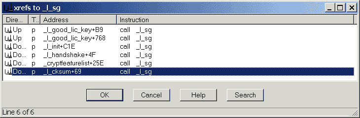
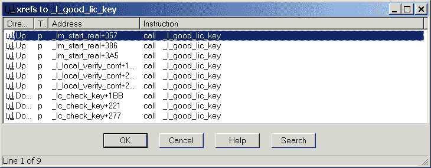

# FLEXlm latest information by CrackZ

> 原文：[`www.pediy.com/kssd/pediy08/pediy8-772.htm`](https://www.pediy.com/kssd/pediy08/pediy8-772.htm)

原文出处：[`www.woodmann.com/crackz/Tutorials/Flex2004.htm`](http://www.woodmann.com/crackz/Tutorials/Flex2004.htm)  
关于译文：  
1）涉及固定格式部分的内容不加以翻译，比如 license 里的内容：Feature vendor,假使翻译过来会很难看，更何况是在 license 格式的规范之下。  
2）这个英文是我见过最糟糕的，我自己臆测了不少，所以，部分没有去翻译它。但是该部分并没有涉及技术。  
3）同时，因为我的臆测，本人也非计算机专业，是个新手，所以文章必然难看，若有疑问，请大家参考原文。  
4）重要的是，将里面的错误指出，并改之，这样就能有所提升，对大家有用。  
5）这是初稿，我没有校过，我会结合大家的意见不断修改。  
  
特别申明！！！以此文感谢看雪论坛，FLEXlm QQ 群上的大家，尤其是手把手教过我的人 大家的帮助使我获益匪浅！！！  
  
CrackZ 之 FLEXlm 最新资料  
  
应 WISE 软件（本文档涉及到的一个程序开发商）法律要求，该程序名称和许可证的 Feature 不在本文出现，而用“censored”这个字眼代替，以变避免任何法律问题。 应该注意到，这将不会掩饰 FLEXlm 是一恶心的保护这个事实。   
  
25-01-2005 什么是 sign？   
  
介 绍  
本文讨论了３个用 FLEXlm 保护程序的逆向分析。 本文是一经典的例子，用一很简单的（事实上也很一般的）技术绕过厂家购用的 Macrovisions 的 "提高安全"技术。 遍及本文，我使用 Tip 来帮助你理解。   
  
Bitplane Imaris v4.0.3 (FLEXlm v9.0.0), v3.2 可以当作是背景知识来看。   
Censored v13.0 (FLEXlm v8.2a)。   
SDS 2 v6.318 (FLEXlm v8.1a)。   
  
＊  Tip＊  
使用 lmtools.exe 中的 Utilitise 工具（有时随同你的应用程序带着或在 FLEXlm SDK 里）打开用 FLEXlm 加密的文件可以用来识别所用的 FLEXlm 库的版本号。 或用 UltraEdit 之类的工具打开用 FLEXlm 加密的文件搜索 lmgr.lib 或 liblmgr.a 字串来确定 FLEXlm 的版本号。   
  
具有一些基本信息的后，我开工了。   
  
Bitplane Imaris――我从 v3.1/2（使用 FLEXlm7.2e 保护 ）得知 vendor keys、seed 和 feature name，对于新的 FLEXlm 的 Feature 我一无所知。建议从 Bitplane 的网站上去下载文件。   
  
censored v13.0－－我手头有已被补丁过、去掉保护的程序，初步分析表明其 FLEXlm 并未被补丁，不得不进一步检查。   
  
SDS 2 v6.318 －－我手头的这个是破解版并带一个无效的 FLEXlm 许可证。 我从一位用户那里知道 SDS 使用了与前几版不一样的新的 FLEXlm SIGN＝license 许可证格式。   
  
拿 Bitplane Imaris 开刀，已经知道了 vendor keys, seeds 和 license 文件格式，我希望确定这一切会因此而变得容易一些。 我创建一个如下假的 license（在我已经了解的以前版本格式的基础上，同时假定 vendor name"bitplane"没有改变、因为有个同名的 deamon 程序在软件里面，这样看来这个假设很不错）∶   
  
＃ Bitplane v4.0.3 的 license   
  
FEATURE feature\_name vendor\_name 1.000 permanent uncounted 123456654321 \\   
HOSTID=ANY   
  
#license 结束   
  
在以前，对于假的 license,Imaris 总是跳出的一个友好的信息窗口，提示程序需要的 Feature name 和 FLEXlm 错误码。本版这些东西都没有了，而是到了演示模式。 我们需要去定位\_lc\_checkout()。   
  
定位\_lc\_checkout()   
定位\_lc\_checkout()（当你知道怎么做的话）事实上是很非常简单的，然而，我用 SoftICE 攻击我的目标程序，只能也必能用 IDA 经过 lmgr.lib 来识别定位，在这里我们进行了漂亮的分析，你也可以告诉人们你找到的校验程在什么地方。 IDA 做的 lmgr.lib 反汇编确实不错（确认选 lm\_ckout.obj 作为 object,因为程序里有 60 多个，如果你有其他的理由，可以看看其它的）。 搜索字符串参考"lm\_ckout.c" 、这个交叉引用相当的精确（在各子程序的偏移量之正下方），我的目标程序里找到 3 处该检验码。 由此处它会进入，并调用\_l\_checkout()。   
  
＊Tip＊  
注意：你可以用 IDA 的 FLAIR 工具 lmgr.lib 产生签名文件，然而该签名并非没有错误并经常缺失关键函数，因为\_l\_sg()函数与冗余\_l\_svk()函数（该函数是 GlobeTrotter 特意用来迷惑用的）很是接近，所以基本上每次分析必然会缺\_l\_sg()。 如果使用 IDA 法，我推荐使用我的 lmgr.lib。   
  
由此处我们得到版本号（4.0）和 Feature 名 ImarisBase 以及 job 结构。 从\_l\_checkout()往下看（在 lmgr.lib 的反汇编里），可以很快地追踪到我们的老朋友\_l\_sg()。 现在\_l\_checkout()拒绝我们伪造的许可证，并提示－8 错误（可恶的 LM\_BADCODE）。 使用 HIEW 或任何其他的好的十六进制编辑器，搜索 F8FFFFFF（-８，逆字节次序）就可以找到地方。   
  
我们会找到三个地方； 在 Imaris 里，分别是 5F7282, 5F77D7 和 5F8AE5，前两个在\_l\_good\_lic\_key()引用到、最后一个在\_l\_ckout\_ok()里引用到，我们可以将这些打上补丁，但是，现在要跟踪\_l\_checkout()，各事件次序如下∶   
  
\_l\_zcp()。   
\_l\_getattr()。   
\_l\_ckout\_borrow()。   
\_lm\_start\_real() - 返回-８（我们将追踪到这之下）。   
  
由此可见，\_lm\_start\_real()是关键之所在，也要注意一下代码片断∶   
  
mov \_lm\_start$S23038, offset \_lm\_start\_real； lm\_start＝lm\_start\_real   
  
从以前的\_l\_sg()来看，FLEXlm 迷惑项会记得这个途径。 向上看∶   
  
\_l\_valid\_version() - 检查有效的版本。   
\_l\_clear\_error() -从 \_l\_ckout\_borrow()清除错误。   
\_l\_zcp()   
\_l\_next\_conf\_or\_marker()   
\_l\_local\_verify\_conf()   
\_l\_good\_lic\_key()－－返回－8 错误提示。   
  
再一次，我们得到一些并不重要的初始化代码，配置证实然后\_l\_good\_lic\_key()设置错误信息。   
  
\_l\_xor\_name(bitplane) - l\_xorname(job->vendor, &vc)；   
\_l\_sg() - l\_sg(job, job->vendor, &vc);； （你知道 l\_sg 的意思是 "signature vendor\_key5" ;-)）。   
  
我们的老朋友\_l\_sg()在这,为了确认是否有什么变化，我决定用 Nolan Blenders 的种子回收技术来看看。   
  
:005F6F7D lea ecx, \[ebp+var\_280\]   
:005F6F83 push ecx <-- Vendor code structure   
:005F6F84 mov edx, \[ebp+arg\_0\]   
:005F6F87 add edx, 30Ch   
:005F6F8D push edx <-- Vendor name   
:005F6F8E mov eax, \[ebp+arg\_0\]   
:005F6F91 push eax <-- Job structure   
:005F6F92 call \_l\_sg   
  
在追踪\_l\_sg()之前，一定要注意到 vendor code structure，就我的来说象如下这样，也要注意到 job structure 可能没有填充∶   
  
04 00 00 00 19 59 D5 7A ED A3 2D 80 ED 11 A0 18   
97 E1 4B 27 A8 21 6A E2 41 04 58 52 09 00 00 00   
  
在追踪在\_l\_sg()以后、我们看到下面的变化∶   
  
Vendor code structure   
  
04 00 00 00 52 EE F9 99 A6 14 01 63 ED 11 A0 18   
97 E1 4B 27 A8 21 6A E2 41 04 58 52 09 00 00 00   
  
Job structure   
  
66 00 00 00 EA 00 AA 00 C6 E0 F4 21 93 65 B8 00   
00 00 6F 00 00 00 00 00 00 00 00 00 02 00 00 00   
  
将这些值代入到 calcseed.exe 里，我们成功地导出 0x0A192837(seed 1)和 0xF0E1D2C3(seed 2)，与前几版的 SEED 一样。用升级版的 lmkg.exe 产生 vendor key（好友 Nolan Blender 制作或使用 lmv8gen.exe（去我的 FLEXlm 网页找）），我们可以生成 licenses（注意：你需要将 ENCRYPTION\_SEED1 和 ENCRYPTION\_SEED2 插入到 define，或从旧的 lm\_code.h 复制过来），后来我在 SDK 的 LM\_SEED 里发现必须定义，尽管他们没有什么用如果你的 LM\_STRENGTH 设置适当地话。   
  
Bitplane 现在成功地通过了许可证检查，这意味着无需使用任何那新的 FLEXlm feature 即使没有将全部的子程序编译出来，你现在可以自由地产生新的 FEATURE 的 licenses，得到许可证选择权。  
  
暗礁  
FLEXlm 不会这么容易吧？ 真的吗？ 让我们用上面的技术来试试 censored 吧…..由测试可知，censored 可以追出 7 个 Feature:  
\*censored\*/\*censored\*/\*censored\*/\*censored\*/\*censored\*/\*censored\*/\*censored\*(\*censored\*与\*censored\*分别被 ODB2DT.exe 及 PADS2GT 校验)。  
  
有人告诉我，这跟 consored 的编辑类型相对应，所以实际上只有一个 Feature 成功通过了校验。我做了一个 consored 的 license,但是\_l\_checkout()拒绝该 license,并有-8(LM\_BADCODE)错误提示，其他的 Feature 以-5(LM\_NOFEATURE)错误提示而告失败。这没有什么好奇怪的，关键的是我们现在知道了在\_l\_checkout()之下必有一个东西在决定该 license 是无效的。  
  
我相当自信地认为 license 被拒的原因是新的 ECC 加密，因为该技术已经得到很好地实现（Certicom 做得很对），指望不上能够找到真正的 LM\_SEED。强力攻击需要 2∧96 次。\[此处有一句实在猜不出什么意思，但对技术没有用，没有翻译\]。现在有 2 件事情可以去做。第一，我们可以从 FLEXlm 库里提取-8 报错(0xFFFFFFF8)并找到它的位置（就像 Imaris 一样，用 16 位编辑器打开 censored,然后查找），能够找到 6 个地址备用，经过简单地测试，可以找到正确地那个。或者第二，我们在 censored 里从\_l\_sg 开始跟踪。  
  
继续跟踪，我简单地比较了 Imaris 与 consored 的代码流(code flow)。紧接着，两者都调用\_l\_ckout\_crypt()并且在调用\_real\_crypt()之后代码流开始不一样。这时修改执行文件会产生一个空指针错误。Imaris 的代码流径直向我们熟悉的真实 license 与从 license 文件读取的 license 逐字比较处，这暗示着\_real\_crypt()与其下面的子程序决定了是否进行老格式的 license 校验还是进行新格式的 license 校验。让我们看看控制这个的代码段吧(取自 Imaris):  
\_real\_crypt()  
:005F9AF0 push ebp  
:005F9AF1 mov ebp, esp  
:005F9AF3 sub esp, 9ACh  
:005F9AF9 lea eax, \[ebp+var\_93C\]  
:005F9AFF mov \[ebp+var\_4\], eax  
:005F9B02 mov \[ebp+var\_948\], 0  
:005F9B0C mov \[ebp+var\_960\], 0  
:005F9B16 mov \[ebp+var\_950\], 0  
:005F9B20 mov \[ebp+var\_968\], 0  
:005F9B2A mov ecx, \[ebp+arg\_4\]  
:005F9B2D mov edx, \[ecx+50h\]  
:005F9B30 mov \[ebp+var\_964\], edx  
:005F9B36 mov eax, \[ebp+arg\_8\]  
:005F9B39 mov \[ebp+var\_944\], eax  
:005F9B3F mov \[ebp+var\_96C\], 0  
:005F9B49 mov \[ebp+var\_940\], 0  
:005F9B53 mov ecx, \[ebp+arg\_0\]  
:005F9B56 mov edx, \[ecx+3FCh\]  ; 将要校验的 license 类型  
:005F9B5C and edx, 100000h  
:005F9B62 test edx, edx  
:005F9B64 jnz short loc\_5F9B72  
5F9B56 处的 EDX 值控制着将要进行哪种类型的 license 校验。Imaris 里该值是 0x1048C0,consored 里该值为 0x48C0。如果我现在在当前的活动调试会话窗里修改这个值，consored 将会用旧的 FLEXlm 加密校验通过，我们成功地获得许可授权。下一步要去看看 FLEXlm 子程序在哪地方设置这个标记(flag)。用个简单的 bpm 吧，我们向后追踪到该值用一个“or ecx, 100000h”指令在\_l\_good\_lic\_key()里设置，以这为参考，往回跟踪另一个标记校验在\_l\_sg（）之后。  
  
:005F6F92 call \_l\_sg  
:005F6F97 add esp, 0Ch  
:005F6F9A mov ecx, \[ebp+arg\_0\]  
:005F6F9D cmp dword ptr \[ecx+51Ch\], 0  
:005F6FA4 jz loc\_5F704A <-- if ((job->L\_SIGN\_LEVEL) && !conf->lc\_keylist).  
  
所以，如果我们在这得到 0 值，则进行旧格式的许可校验。我们现在可以在这里以打补丁的方式来解决这一问题。但是我们往后再次跟踪。这次可以找到有 2 个位置将 1 值写到我们的\[ecx+51Ch\]标记处，在 consored 里，它们分别是 6AF454(在\_l\_sg()的结尾处)和 6B219C(在\_lc\_new\_job()的结尾处)。  
  
标记 1  
  
6AF454—在 6AF426 地址处用静态指令“ADD ECX, 1”设为 1，就只用了一个字节的改变将 ADD ECX,0 打补丁了。但是 Imaris 有同样的参考所以在代码路径(code path)必须有个变量(variation)。经过比较 Imaris 与 censored 的代码流，我们发现了下面的“开关”代码：  
:006AF354 mov edx, \[ebp+var\_5DC\]  
:006AF35A cmp dword ptr \[edx\], 0  
:006AF35D jz loc\_6AF434 ;      0x0 Imaris, 0x10 \*censored\*  
这是我们向后跟踪的真正开关，它位于\_l\_buf\_36()（子程序，在下面有描述）里面，唯一可靠查找方式是去的定位静态值存储在什么地方，如下所示。  
  
i)在\_l\_buf\_36()子程序下断点，下 d \*(esp+8)命令，在数据窗口查看 vendor 代码结构的指针，有时候，你可能要用 SoftICE 叫出该地址。  
  
ii)在\[vedor 代码结构＋3Ch\]设 bmp w 命令，监视写出的值，任何非零的值都是数据写入的静态位置（注意,你可能得到 3 或\*\*\*\*\*\*此处为翻译，实在不知道是什么意思。）。一旦我们确定了正确的位置，我们就可以在这打个静态数据的小补丁。  
:00405FB6 mov eax, \[edx+3Ch\]  
:00405FB9 add eax, dword\_81C7F8 ; 0x10 静态数据  
:00405FBF mov ecx, \[ebp+0Ch\]  
:00405FC2 mov \[ecx+3Ch\], eax ;    写标记  
标记 2  
  
6B219C –通过调用\_lc\_new\_job()来设置。看下面的代码：  
  
\_lc\_new\_job proc near  
:006B20B0 push ebp  
:006B20B1 mov ebp, esp  
:006B20B3 sub esp, 14h  
:006B20B6 mov eax, \_l\_n36\_buf  
:006B20BB mov \[ebp+arg\_4\], eax  
:006B20BE lea ecx, \[ebp+var\_10\]  
:006B20C1 push ecx  
:006B20C2 push 0  
:006B20C4 push 0  
:006B20C6 push 0  
:006B20C8 mov edx, \[ebp+arg\_8\]  
:006B20CB push edx  
:006B20CC lea eax, \[ebp+var\_C\]  
:006B20CF push eax  
:006B20D0 call \[ebp+arg\_4\] ; \_l\_n36\_buf()  
\_l\_n36\_buf dd 401000h  
:0040100F mov eax, \[ebp+1Ch\]  
:00401012 mov dword ptr \[eax\], 1 ; 设置标记 (我们要的是 0)  
这需要打个补丁，在 Imaris 里，该处标记设为 AND 0，censored 设为 1，SDS 设为 2。如果我们做些必要的改动，censored 会启动并许可授权成功。我已经开发了一个“muster”，你可以将这个打出来并用于你的下一个 FLEXlm 目标程序。现在用我这个技术来破解 SDS2V6.318 吧（请注意，本法不全是依赖快速的替换成用 lmgr.lib 注释的 IDA 数据库），下面的截屏来自注释的.idb 文件。  
＊  Tip＊值得载入 lm\_crstr.obj 到 IDA 里以帮助注释你的目标程序 idb  
1、  定位\_l\_sg()  
在程序头开始，通过搜索 16 进制常量 6F7330B8h（unsigned long x = 0x6f7330b8; /\*- v8.x \*/）这看来是小事一桩（注意：有两处引用了该常量，是第一个才是\_l\_sg(), 另一个位于\_l\_svk(),纯粹是用来迷惑用的）。如果你感觉足够倾向的话，你能将 dword\_161DEC4 标记为\_1\_n36\_buff。  
\_l\_sg = sub\_DBFD0A  
  
2、  定位\_l\_init()  
\_l\_sg()应该有 6 处交叉引用。迅速地地查找代码，在每个调用\_l\_sg 之后，可以找到默认的 SEED0x87654321 与 0x12345678。\_l\_init()即可确定。  
:00DCD13E call \_l\_sg  
:00DCD143 add esp, 0Ch  
:00DCD146 cmp dword ptr \[ebp-27Ch\], 87654321h  
:00DCD150 jz short loc\_DCD15E  
:00DCD152 cmp dword ptr \[ebp-278h\], 12345678h  
:00DCD15C jnz short loc\_DCD1BB  
:00DCD15E  
:00DCD15E loc\_DCD15E: ; CODE XREF: sub\_DCC520+C30j  
\_l\_init() = sub\_DCC520  
3、  定位\_l\_good\_lic\_key()  
查看其他的\_l\_sg 引用，\_l\_good\_lic\_key()是唯一一个引用\_l\_sg()两次的函数，从我的注释过的.idb 里很容易看出这个。  
【图一】  
  
\_l\_good\_lic\_key = sub\_DBE15D  
4、\_l\_good\_lic\_key()有 9 个交叉引用，为 3 个函数的 3 次交叉引用。库里最上头的那个是\_lm\_start\_real()。在完全注释的.idb 里，这个看的很清楚。  
【图二】  
  
\_lm\_start\_real() = sub\_00DBD112  
对\_lm\_start\_real()唯一的交叉引用应该在\_l\_checkout()里面  
\_l\_checkout() = sub\_DBCA0E  
从\_l\_checkout()我们很容易地推知：在函数地开始处寻找对 lm\_ckout.c 的引用（其它对\_l\_checkout()的引用在\_l\_reconnect()里面）。\_lc\_checkout() = sub\_DBC940  
  
5、\_lc\_checkout()有两个交叉引用，第二个引用是 mov dword ptr \[reg32+30h\]，offset\_lc\_checkout()格式(实际上这是 InitLmInterface()的一部分)向上滚动，我们在\[reg32+0Ch\]（或第一个入口处）标记该子程序为\_lc\_init(), 这得出\_lc\_new\_job()调用\_lc\_init()为 sub\_DC8610,调用\_l\_n36\_buf 为 dd 0E07100h。  
\*Tip\* 将 lmgr.lib 载入 IDA 并选择 l\_look\_load.obj,你能标出 InitLmInterface()所有的函数。在之后的 FLEXlm 版本里，目标程序所用的 lc\_auth\_data（）可以在 l\_check.obj 里找到  
6、在一个当前运行的调试会话窗里设置断点：  
\_l\_n36\_buf = E07100  
\_l\_sg = DBFD3D  
\_lc\_checkout = DBC99D  
我们做了一个假的许可文件，如下（注意：你应该能确认 vendor deamon 的名字）：  
FEATURE somefeature dsndata 1.0 permanent uncounted 0 \\  
HOSTID=ANY  
从\_l\_n36\_buf()里的下断来看，我们发现,我们的 2 个坏标记分别在地址 E07112 与 E0D4BD。从\_lc\_checkout()里的下断看，我得到了 Feature name:sds2 以及版本号:6.318, 好了，将 lincense 相应的修订一下。  
FEATURE sds2 dsndata 6.318 permanent uncounted 0 \\  
HOSTID=ANY  
\* Tip \*  
大多 FLEXlm 程序的 vendor deamon 没有用\_l\_n36\_buf()配置标记，这使得他们很容易用：lmgrd –z deamon\_name –c license\_file 来回收 SEED，特别是你不在常规的目标程序的\_l\_sg 下断或让\_l\_checkout()返回 EAX=-15 处下断的时候。  
现在，你可以在\_l\_sg()断下，调用\_l\_n36\_buff()解码子程序，这样你就可以回收到 SEED(0x987AC78F 和 0xC8D6382B)。用 lmv8gen 你就能生成 vendor key，编译 lmcrypt.exe,这样你就能作出有效的 license。  
\* Tip \*  
通过下在\_lc\_checkout()的断点，你能回收到其他的被你目标应用程序校验的 Feature name,然后再拿去作出他们的 license。  
对于 SDS2,我用如前所述的方法让\_lc\_checkout()返回 0，然而，程序意外地崩溃了。这很令人困惑，因为 warez 放出地这个版本只是补丁了 sub\_DBC940(就是大家所知地让\_lc\_checkout()为 XOR EAX, EAX/RETN)，对我们的 license 同样有效。同时，该 license 很明显地用到我上述回收到的关键信息制作出的（因为 lmcrypt 并不改变它）。SDS2 很明显是个 FLEXlm 保护程序反常的例子。我试了三个其他的，没有重现这个情况。然而，这对我们了解对\_lc\_checkout()打补丁这个“粗暴的技术”是有用的。自从有了文件完整性检查，补丁也用来静态校验数据，这个是开发商防止文件被攥改的方法。  
结论  
我已经很长时间没有看 FLEXlm 了，Macrovision 被赞为最终的保护技术安全的密匙生成器，然而，同时他们一贯的错误继续存留，旧格式的 FLEXlm 许可证依旧可以制作，以及使用补丁技术可以轻而易举地让许可层接受。即使我的方法被击破，依旧可以很容易的直接对\_lc\_checkout()API 补丁。  
  
什么是 SIGN?  
本教程描述了补丁 FLEXlm 许可授权层通过用 license key 来验证的原理(这是最古老也是最简单的 FLEXlm 验证方法，我选它纯粹是因为简单)。Globetrotter 从第 7.x 版(只有 12 个字符)开始增加基本的 SIGN 性质并且只是增强了一下算法（可能是更耐攻击）以及更好的 SEED 隐藏技术，这怎么称呼呢，这些只能算是“提高”吧。  
现在，许多的客户开始转向使用 CRO 或者 TRO(防伪抗攥改之选)，事实上是只是在老事物上装个新名词。这使得客户们可以制作新格式的 ECC SING 许可证，其字符长度可达 58 个。据我所知，现在还没有人成功攻击 ECC FLEXlm 完整的回收私匙(private key)或 LM\_SEED(但我并不排除具有足够强的计算处理能力能够回收这些值)。  
对于新长度的 SIGN，破解者会选择对\_lm\_pubkey\_verify()打补丁然后用自己的 LM\_SEED 制作 SIGN=许可证。然而，可以用另外一种方法，就是强制许可授权层(licensing layer)进行旧格式的 SIGN=12 字符的校验方式。该法仅涉及简单地对我们发现的存在于\_l\_n36\_buf()(如上)里面的第 2 个坏标记处补丁。我们可以象以前那样回收到加密过的 SEED 并用 SDK 或本站可下载的 Lmgryptgui 制作 license。该补丁的工作原理是告诉许可授权层(licensing layer)别去取\_lm\_pubkey\_verify()的地址，\_lm\_pubkey\_verify()会在\_l\_sg()之后马上就行校验。  
另一个值得注意的重要事情是，很容易确认你的目标程序是否允许使用旧格式的 SING=校验，在\_l\_sg()后 vendor code 结构里的变形 SEED 处下断点，如果得到回收的 seed 则可以制作旧格式的标准 SIGN,如果不能，你就要打补丁了。变形 SEED 断点补丁后可以获得成功，就如之前回收的一样。  
  
重大修改:  
1,2006 年 11 月 25 日 下面段落有重要修改,修改后为:   
5、\_lc\_checkout()有两个交叉引用，第二个引用是 mov dword ptr \[reg32+30h\]，offset\_lc\_checkout()格式(实际上这是 InitLmInterface()的一部分)向上滚动，我们在\[reg32+0Ch\]（或第一个入口处）标记该子程序为\_lc\_init(), 这得出\_lc\_new\_job()调用\_lc\_init()为 sub\_DC8610,调用\_l\_n36\_buf 为 dd 0E07100h。

卡巴杀导入表，两字节地址指向 kernel32.dll 字符串就杀，而修改这两字节指向的字符串（不是 kernel32.dll）就不杀，但是这两字节必须指向 kernel32.dll 字符串。。这种情况该怎么免杀，请高手指点。。。谢谢 

事由：如题，我已经翻译了 CrackZ 文章，见：[`bbs.pediy.com/showthread.php...;threadid=35082`](http://bbs.pediy.com/showthread.php?s=&threadid=35082)  
其中有两个函数:\_l\_n36\_buff 与\_l\_n36\_buf CrackZ 没有解释怎么找到，也没有解释清楚。热心的 orchid88 首先指出问题，并提出他的见解。我所做的是给大家提供个参考。  
申明：所有实验都是用 IDA pro 做的，标注也是 IDA 依据 sig 自动标注，没有我人工分析的成分。  

引用:  *最初由** orchid88 **发布*  
不错，辛苦了。有一些笔误请修正，比如文中多次把\_l\_n36\_buff()误为\_l\_buf\_36()。这篇文章我很早的时候就看过英文原文，里面有一点没有说清楚的就是\_l\_n36\_buff()函数是怎么找到的，其实就是\_l\_sg()函数中非零不跳转处那个调用过后可以用 calc seed 工具找出 seed 的地方。请大家注意，\_l\_n36\_buff()和\_l\_n36\_buf()是不同的两个函数，一个是加密，另一个是解密函数。  

  
基于此，我用 IDA pro 找了个带 ECC 加密的 flexlm,对这两个函数解释如下：  
1)关于\_l\_n36\_buf()  
这个函数在 liaoqian 方法定位 l\_sg 部分可以找到，相信大家看地懂下面的代码  
  
.text:092534E6.text:09253478 ; \*\*\*\*\*\*\*\*\*\*\*\*\*\*\* S U B R O U T I N E \*\*\*\*\*\*\*\*\*\*\*\*\*\*\*\*\*\*\*\*\*\*\*\*\*\*\*\*\*\*\*\*\*\*\*\*\*\*\*  
.text:09253478  
.text:09253478 ; Attributes: bp-based frame  
.text:09253478  
.text:09253478                 public l\_sg  
.text:09253478 l\_sg            proc near               ; CODE XREF: l\_good\_lic\_key+A3p  
.text:09253478                                         ; l\_good\_lic\_key+784p  
.text:09253478                                         ; l\_init+988p  
.text:09253478                                         ; l\_handshake+59p  
.text:09253478  
.text:09253478 var\_34          = dword ptr -34h  
.text:09253478 var\_28          = dword ptr -28h  
.text:09253478 var\_24          = dword ptr -24h  
.text:09253478 var\_20          = dword ptr -20h  
.text:09253478 var\_1C          = dword ptr -1Ch  
.text:09253478 var\_18          = dword ptr -18h  
.text:09253478 var\_14          = dword ptr -14h  
.text:09253478 var\_10          = dword ptr -10h  
.text:09253478 var\_C           = dword ptr -0Ch  
.text:09253478 var\_8           = dword ptr -8  
.text:09253478 arg\_0           = dword ptr  8  
.text:09253478 arg\_4           = dword ptr  0Ch  
.text:09253478 arg\_8           = dword ptr  10h  
.text:09253478  
.text:09253478                 push    ebp  
.text:09253479                 mov     ebp, esp  
.text:0925347B                 sub     esp, 28h  
.text:0925347E                 push    edi  
.text:0925347F                 push    esi  
.text:09253480                 push    ebx  
.text:09253481                 mov     \[ebp+var\_14\], 0  
.text:09253488                 mov     \[ebp+var\_18\], 6F7330B8h    =>这个很著名了，不懂的话看 laoqian 与 newsearch 的文章  
.text:0925348F                 mov     \[ebp+var\_1C\], 0  
.text:09253496                 mov     \[ebp+var\_20\], 0  
.text:0925349D                 mov     \[ebp+var\_24\], 3  
.text:092534A4                 mov     eax, \[ebp+arg\_0\]  
.text:092534A7                 mov     edx, \[eax+6Ch\]  
.text:092534AA                 mov     ax, \[edx+0F54h\]  
.text:092534B1                 and     eax, 0FFFF8000h  
.text:092534B6                 test    ax, ax  
.text:092534B9                 jz      short loc\_92534E6  
.text:092534B9  
.text:092534BB                 cmp     l\_n36\_buff, 0              ＝>l\_n36\_buff 第一次  
.text:092534C2                 jz      short loc\_92534E6  
.text:092534C2  
.text:092534C4                 mov     eax, \[ebp+arg\_8\]  
.text:092534C7                 push    eax  
.text:092534C8                 mov     eax, \[ebp+arg\_4\]  
.text:092534CB                 push    eax  
.text:092534CC                 mov     eax, \[ebp+arg\_0\]  
.text:092534CF                 push    eax  
.text:092534D0                 mov     ebx, l\_n36\_buff            ＝>l\_n36\_buff 第二次  
.text:092534D6                 mov     \[ebp+var\_28\], ebx  
.text:092534D9                 mov     edi, \[ebp+var\_28\]  
.text:092534DC                 call    edi                        =>这个 CALL 很著名了  
.text:092534DE                 add     esp, 0Ch  
.text:092534E1                 jmp     loc\_9253628  
.text:092534E1  
.text:092534E6 ; ---------------------------------------------------------------------------  
.text:092534E6  
  
  
2)关于 l\_n36\_buf 函数，我依据 CrackZ 的文章，列个 lc\_new\_job 里的来说明吧  
.text:0925D4F0  
.text:0925D4F0 ; \*\*\*\*\*\*\*\*\*\*\*\*\*\*\* S U B R O U T I N E \*\*\*\*\*\*\*\*\*\*\*\*\*\*\*\*\*\*\*\*\*\*\*\*\*\*\*\*\*\*\*\*\*\*\*\*\*\*\*  
.text:0925D4F0  
.text:0925D4F0 ; Attributes: bp-based frame  
.text:0925D4F0  
.text:0925D4F0                 public lc\_new\_job  
.text:0925D4F0 lc\_new\_job      proc near               ; CODE XREF: sub\_92241D0+60p  
.text:0925D4F0  
.text:0925D4F0 var\_1C          = dword ptr -1Ch  
.text:0925D4F0 var\_14          = dword ptr -14h  
.text:0925D4F0 var\_10          = dword ptr -10h  
.text:0925D4F0 var\_C           = dword ptr -0Ch  
.text:0925D4F0 arg\_0           = dword ptr  8  
.text:0925D4F0 arg\_4           = dword ptr  0Ch  
.text:0925D4F0 arg\_8           = dword ptr  10h  
.text:0925D4F0 arg\_C           = dword ptr  14h  
.text:0925D4F0  
.text:0925D4F0                 push    ebp  
.text:0925D4F1                 mov     ebp, esp  
.text:0925D4F3                 sub     esp, 14h  
.text:0925D4F6                 push    esi  
.text:0925D4F7                 push    ebx  
.text:0925D4F8                 mov     eax, l\_n36\_buf              ＝>这个是什么？   
.text:0925D4FD                 mov     \[ebp+arg\_4\], eax  
.text:0925D500                 lea     eax, \[ebp+var\_14\]  
.text:0925D503                 push    eax  
.text:0925D504                 push    0  
.text:0925D506                 push    0  
.text:0925D508                 push    0  
.text:0925D50A                 mov     eax, \[ebp+arg\_8\]  
.text:0925D50D                 push    eax  
.text:0925D50E                 lea     eax, \[ebp+var\_C\]  
.text:0925D511                 push    eax  
.text:0925D512                 mov     ebx, \[ebp+arg\_4\]  
.text:0925D515                 call    ebx                        ＝>这个呢？  
.text:0925D517                 add     esp, 18h  
.text:0925D51A                 push    0  
.text:0925D51C                 push    0  
.text:0925D51E                 push    0  
.text:0925D520                 push    0  
.text:0925D522                 push    0  
.text:0925D524                 push    0  
.text:0925D526                 mov     ebx, \[ebp+arg\_4\]  
.text:0925D529                 call    ebx  
.text:0925D52B                 add     esp, 18h  
.text:0925D52E                 mov     eax, \[ebp+arg\_C\]  
.text:0925D531                 push    eax  
.text:0925D532                 mov     eax, \[ebp+arg\_8\]  
.text:0925D535                 push    eax  
.text:0925D536                 lea     eax, \[ebp+var\_C\]  
.text:0925D539                 push    eax  
.text:0925D53A                 mov     eax, \[ebp+arg\_0\]  
.text:0925D53D                 push    eax  
.text:0925D53E                 call    lc\_init  
.text:0925D53E  
.text:0925D543                 add     esp, 10h  
.text:0925D546                 mov     eax, eax  
.text:0925D548                 mov     \[ebp+var\_10\], eax  
.text:0925D54B                 cmp     \[ebp+var\_10\], 0  
.text:0925D54F                 jnz     loc\_925D5F1  
.text:0925D54F  
.text:0925D555                 mov     eax, \[ebp+arg\_C\]  
.text:0925D558                 mov     edx, \[eax\]  
.text:0925D55A                 mov     eax, \[edx+6Ch\]  
.text:0925D55D                 mov     edx, \[ebp+arg\_C\]  
.text:0925D560                 mov     ecx, \[edx\]  
.text:0925D562                 mov     edx, \[ecx+6Ch\]  
.text:0925D565                 mov     esi, \[edx+0F54h\]  
.text:0925D56B                 or      esi, 8000h  
.text:0925D571                 mov     \[eax+0F54h\], esi  
.text:0925D577                 mov     eax, \[ebp+arg\_C\]  
.text:0925D57A                 mov     edx, \[eax\]  
.text:0925D57C                 mov     eax, \[ebp+arg\_4\]  
.text:0925D57F                 mov     \[edx+618h\], eax  
.text:0925D585                 mov     eax, \[ebp+arg\_C\]  
.text:0925D588                 mov     edx, \[eax\]  
.text:0925D58A                 cmp     word ptr \[edx+440h\], 2655h  
.text:0925D593                 jnz     short loc\_925D5B1  
.text:0925D593  
.text:0925D595                 push    0  
.text:0925D597                 push    0  
.text:0925D599                 push    0  
.text:0925D59B                 push    2  
.text:0925D59D                 push    0  
.text:0925D59F                 push    0  
.text:0925D5A1                 mov     ebx, \[ebp+arg\_4\]  
.text:0925D5A4                 call    ebx  
.text:0925D5A6                 add     esp, 18h  
.text:0925D5A9                 mov     eax, eax  
.text:0925D5AB                 test    eax, eax  
.text:0925D5AD                 jnz     short loc\_925D5B1  
.text:0925D5AD  
.text:0925D5AF                 jmp     short loc\_925D5D3  
.text:0925D5AF  
.text:0925D5B1 ; ---------------------------------------------------------------------------  
.text:0925D5B1  
.text:0925D5B1 loc\_925D5B1:                            ; CODE XREF: lc\_new\_job+A3j  
.text:0925D5B1                                         ; lc\_new\_job+BDj  
.text:0925D5B1                 mov     eax, \[ebp+arg\_C\]  
.text:0925D5B4                 mov     edx, \[eax\]  
.text:0925D5B6                 mov     eax, \[edx+6Ch\]  
.text:0925D5B9                 mov     edx, \[ebp+arg\_C\]  
.text:0925D5BC                 mov     ecx, \[edx\]  
.text:0925D5BE                 mov     edx, \[ecx+6Ch\]  
.text:0925D5C1                 mov     esi, \[edx+0F54h\]  
.text:0925D5C7                 or      esi, 40000h  
.text:0925D5CD                 mov     \[eax+0F54h\], esi  
.text:0925D5CD  
.text:0925D5D3  
.text:0925D5D3 loc\_925D5D3:                            ; CODE XREF: lc\_new\_job+BFj  
.text:0925D5D3                 mov     eax, \[ebp+arg\_C\]  
.text:0925D5D6                 mov     edx, \[eax\]  
.text:0925D5D8                 mov     eax, \[ebp+var\_14\]  
.text:0925D5DB                 cmp     eax, \[edx+5D0h\]  
.text:0925D5E1                 jle     short loc\_925D5F1  
.text:0925D5E1  
.text:0925D5E3                 mov     eax, \[ebp+arg\_C\]  
.text:0925D5E6                 mov     edx, \[eax\]  
.text:0925D5E8                 mov     eax, \[ebp+var\_14\]  
.text:0925D5EB                 mov     \[edx+5D0h\], eax  
.text:0925D5EB  
.text:0925D5F1  
.text:0925D5F1 loc\_925D5F1:                            ; CODE XREF: lc\_new\_job+5Fj  
.text:0925D5F1                                         ; lc\_new\_job+F1j  
.text:0925D5F1                 mov     edx, \[ebp+var\_10\]  
.text:0925D5F4                 mov     eax, edx  
.text:0925D5F6                 jmp     short $+2  
.text:0925D5F8                 lea     esp, \[ebp-1Ch\]  
.text:0925D5FB                 pop     ebx  
.text:0925D5FC                 pop     esi  
.text:0925D5FD                 leave  
.text:0925D5FE                 retn  
.text:0925D5FE  
.text:0925D5FE lc\_new\_job      endp  
.text:0925D5FE  
.text:0925D5FE ; ---------------------------------------------------------------------------  
.text:0925D5FF      
  
希望对大家看 CrackZ 的文章有用。祝大家好运，我也算对文章的翻译有个交代。  
这里感谢 orchid88，感谢所有的人。  4dd466d0e1e0cc123afbe504da2462ca