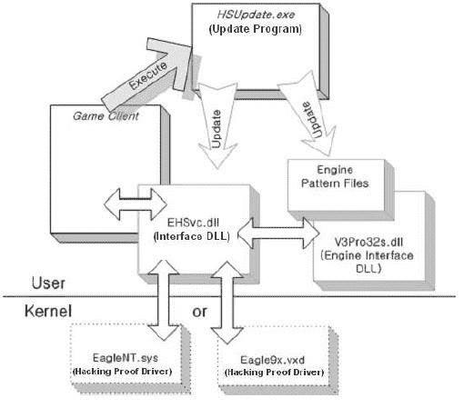
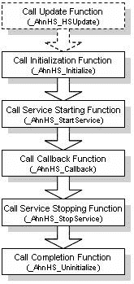

# HackShield 分析(1)

> 原文：[`www.pediy.com/kssd/pediy11/104951.html`](https://www.pediy.com/kssd/pediy11/104951.html)

我学习研究了一段时间的 hackshield，写一些资料，与大家共享。共同学习，共同进步。  
  
主要有三部分。  
 第 1 HackShield 的组成  
  1) EhSvc.dll  
      游戏和 Hack Shield 的通信 dll,  
  2) V3Pro32s.dll:  
      HackShield 的 anti tools 侦测 dll；  
  3) 3N.mhe:  
      样式库，可以通过一些规则来查找 hack tool  
 4) psapi.dll:  
    进程信息库  
 5) V3Warp(d)(n)s.v3d:  
     和 3N.mhe 类似，需要 3N.mhe 工作，  
 6) EagleNT.sys:  
     地球人都知道的，HS 的驱动库，呵呵，hook ntopenprocesss,read/writeprocessmemory,...等函数  
第 2，HackShiled 的流程  
  
这个图是 HackShield 的工作流程  
  
第 3，byPass 的一些想法  
      HackShiled 通过 CallBack 函数，通知主程序一些异常信息，比如"侦测到...工具"  ;  
     可以 hook 这个函数，来 bypass  
 查找方法，IDA，找关键字符，比如“侦测到违法工具”,然后找到处理这些字符的函数  
.nop 掉。通常游戏就不会再弹出对话框，也不会关掉游戏了  
  
  
(....内容有些多，稍后我会不定期更新下，）