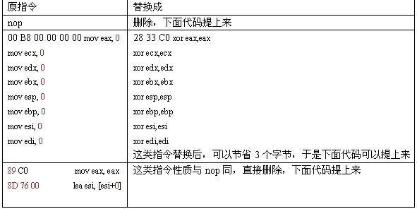
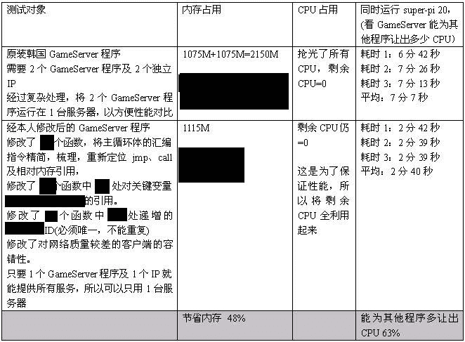
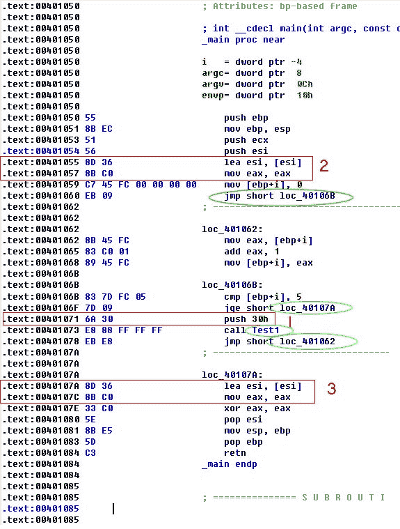
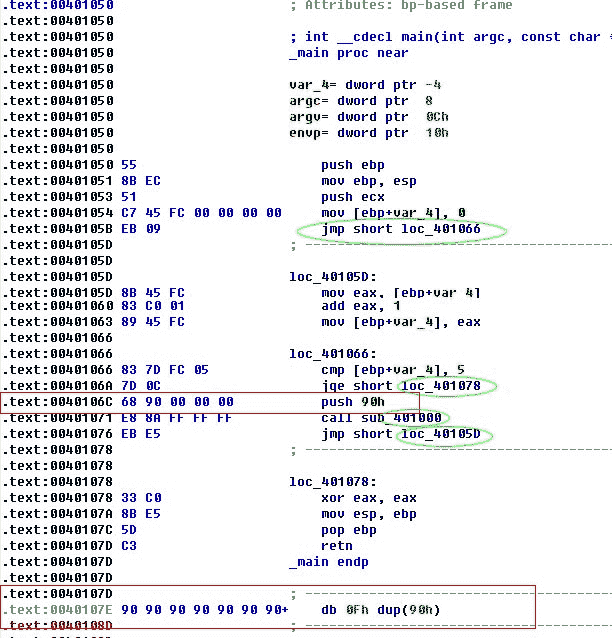

# 对韩国原装 X 游戏的服务器端及客户端加固

> 原文：[`www.pediy.com/kssd/pediy11/106394.html`](https://www.pediy.com/kssd/pediy11/106394.html)

近日受一位朋友委托，对他公司运营的游戏服务器端及客户端做加固。该游戏暂称为 X  
  
X 是个韩国游戏，得过很多奖项，据公开资料，其几年前的代理费为 500 万美元。韩国开发团队的软件工程效率很高，政 府也出面组织引擎共享，代码复用，所以，如果你逆向了多个韩国游戏，你会发现他们的代码复用率很高，当然，正如我们调侃某人考试作弊一样：“你抄就抄了，怎么把别人名字也写在自己考卷上了？”是的，多数韩国游戏连 bug 都很相似。  
  
X 这个游戏，Server 端既有在 Linux 上的，也有在 Windows 上的，而且我没有源代码，一切工作只能从逆向入手。Windows 上的 Crack、Hook、Patch 资料都很多，但是 Linux 上的一切都要靠摸索了(当然，Linux 的相关源代码都是开放的，你随时都可以参考)。  
  
用 Linux 或\*BSD 做 Server 的游戏很多，但他的开发门槛高，周期长，而且一旦开发完成，维护成本也高，维护人员的素质也要求高。所以，用 Linux 做 Server 的游戏，比例不大，但是数量也不少，国内有很多公司用 Linux/\*BSD 做 Server，如 ZT，WM，WL  
  
本人与运营商详细沟通及认真逆向分析后，得出这个 X 游戏致命问题如下：  
1.  因对 recv 缓冲区长度的判断不严谨及具体协议 Command 有漏洞，存在缓冲区溢出的问题。轻则受到攻击后 Server 崩溃，重则被精心构造的 ShellCode 执行了恶意操作，例如添加个超级用户之类的，死都不知道是怎么死的。  
2.  该游戏曾经狂受欢迎(代理费竞争到了 500 万美元就能说明问题了)，所以至今仍有外挂小组孜孜不倦地为他开发外挂。到现在，通讯协议的加密，资源的打包及加密，几乎都赤裸裸地呈现在外挂小组面前了，他们几乎可以随心所欲地实现他们的功能(随意踢别人下线)，因此，我需要与这种恶意外挂正面作战(本人不鄙视外挂，只是立场不同，需要对抗恶意外挂而已)。  
3.  Server 端未做穿墙加速判断，导致游戏中外挂可以穿墙加速，甚至改资源文件都可以穿墙。  
4.  GameServer 与 LoginServer 上的玩家 OnlineTag 没有严格同步，当网络异常时(外挂可以有意模拟出异常)，装备可以被复制。  
5.  对不良网络情况未做容错判断，微小的网络异常，都会导致客户断开。所以，如果服务器架在电信，而跨 ISP 去联他(例如铁通、网通、XX)，断线的概率非常大。知道的人说是 Server 程序先天不足，不知道的，还以为是运营商没有实力，舍不得花钱买好机器买好带宽。所以，客户流失率很高。  
其他非致命问题如下：  
6.  原装的 Server 端中，GameServer 需要 2 台服务器，而现在随着硬件的发展，以前 2 台 Server 干的活，现在 1 台也完全能胜任，所以我的任务是，尽最大可能修改 bin 文件，使之用 1 台 GameServer 就能搞定，这样，即省 IP，又省维护资源。  
  
以上问题，韩国官方至今没有解决，其结果，就是造成了 X 这款挺好玩的游戏，韩国、日本、大陆、台湾、香港、东南亚、美国官服都很难运营，几百万美元打了水漂。到现在，官服几乎像个弃儿，玩家爱来玩就玩，不来玩也不宣传；来玩的人，能忍受就忍受，受不了就走人。  
  
该游戏 Server 及 Client 都有 NP SDK，客观地说，用了 NP SDK，的确强度比没用 SDK 好，但是强中自有强中手，外挂小组已经 fuck 了 NP。而我们对 Server 和 Client 的加固，不能脱下美丽的 NP 外衣，否则赤裸裸的游戏，不是更容易被更多的外挂小组蹂躏？所以，我们应在不触动 NP 的情况下，对 NP 做改进和补充，假如 NP 是美丽外衣的话，我们的改动就是加个围巾。  
  
解决步骤：  
第一、首先是静态分析，假如有加壳，那么就需要脱壳分析，或直接分析内存。  
第二、动态分析，用调试器去运行之，并且设置合适断点，观察其软件的运行方式。  
第三、模拟故障的发生，尝试解决之。  
第四、有了成熟的解决代码后，将其嵌入到目标 bin 文件中。  
  
前面的第 1，2，3，都是与具体的应用紧密相关的。关于第 4 点，比较通用，我是采用将目标 bin 中的汇编代码重新优化整理，删除冗余代码，对相对的 jmp/call/内存引用等做重定位处理。  
部分冗余代码如下：  
  
当删除冗余代码，其余代码向上做靠拢后，会出现 1 个问题，相对 jmp/call/地址引用等，会错误，所以这里还需要修正，修正时，分 2 种情况：假如 DstAddr 在本次优化整理范围内，其地址会变化，则用 DstAddr 的新地址-当前指令执行完后的 EIP 做为新的 EIP 修正量；假如 DstAddr 在本次优化范围外，其地址不变，则用当前指令的的相对优化移动量去修正。  
经过汇编级别的优化整理，基本上空间足够我们添加代码，不需要增加新的 Section，实现 ZeroAdd.  
  
可能有同学会问，你调整那么多汇编代码，多累啊，还要计算，太容易出错了，为什么不用高级语言写个 hooker，hook 在合适的点呢？  
  
我对此的回答及做法是：  
window 上可执行程序是 exe/com/dll/sys,PE 结构，linux 上文件扩展名没有强制要求，文件结构也不是 PE，是 ELF 结构。如果我们对目标 bin 程序的改进，是用 UltraEdit 逐个字节加入的话，当修改规模大到一定程度的时候，会出现以下问题：  
1：在我们尝试修正的时候，我们很难控制各个测试版本是否会混乱。  
2：假设 A bug 的修正集合是改动了 5 处，B bug 的修正集合是改动了 6 处，显然，在不断的尝试中，我们会因为这些修正的组合错误或改动点的不小心错误，带来更大的问题。  
3：可能因为修正 A bug 引入 A+ bug，  
  
而我换个思维，先去磨了刀，再来砍柴，自己写了个程序，能作到以下要求：  
1：对指定 bin 程序(PE/ELF 都可)中某 Section 一定范围内的汇编程序自动做优化调整。该删的删、该插的插，优化后的汇编指令直接向前靠，同时能修正相对 jmp/call/内存引用。  
2：自动修改 PE/ELF 文件，自动嵌入汇编代码(用 VC++和 GNUC++写，编译后摘出关键汇编代码，修正)，这样可以使得我能从高级语言的视角去看整体的改进，所以即使改动很大，从思维上也能控制整个程序的改进，不会版本错乱，而且降低修正某 bug 带来新 bug 的可能性  
如果能站在高级语言的角度去看整个程序及所有改进，并且有足够空间容纳我们的汇编代码，其实这时候已经不需要用 hooker 了。  
本人修正了以上 6 个 bug，改动近 300 处  
  
2010-1-31，本人对原装韩国程序和经本人修改后的程序，做了对比测试，列表如下：  
  
以上测试严格按照同等环境测试，每测试大项完毕 1 次，都会关机，停 10 秒，再开机，以消除内存残留数据的影响，测试小项完毕不关机。  
以上环境为：  
E5300 CPU 4G 内存机，  
\------------------------------------------------------------------------  
关于优化汇编，调整汇编代码次序省出空间，放我们 patch 的好处，请见下面例子。  
例如附件中的 patchme.exe  
以下 lea esi,\[esi\]之类的 align 代码，在实际程序中一般会存在，我为了将函数尽可能在同个屏幕内显示出来，所以构造了个小函数，并人工加了这些 align 代码进去，以利于理解。  
  
其中  
.text:00401071 6A 30                    push 30h  
.text:00401073 E8 88 FF FF FF           call Test1  
如果我们想 push 1 个正整数 144，给函数 Test1，即  
push 0x90  
call Test1  
不能直接改成 6A 90，因为 6A 是 push 1 个 BYTE，如果你 6A 90，会符号扩展，变成 push 0xFFFFFF90，变成负数了，显然，我们应该用  
68 90 00 00 00           push 90h  
这才是 push 1 个 DWORD，而这时候，00401071 的空间不够我们直接改的，如果我们能将函数中汇编代码优化并整理，调整相对 jmp/call/内存引用，则我们可以很轻松地将  
6A 30                    push 30h  
改成  
68 90 00 00 00           push 90h  
，见  
  
请注意图中红色框部分，和绿色圈部分与前图的区别  
  
  
本人 Q:2003255，加的时候请注明“看雪”。因本人经常写程序，所以不会做到天天上 Q，请理解。  
  
附件 patchme.rar