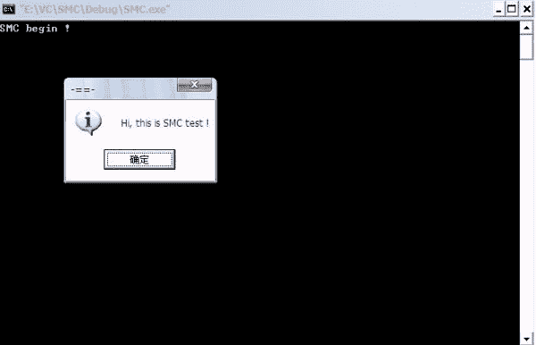
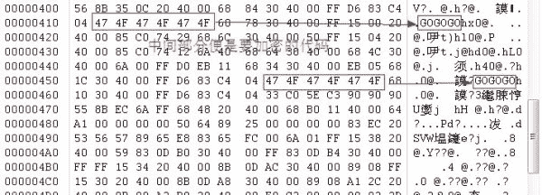
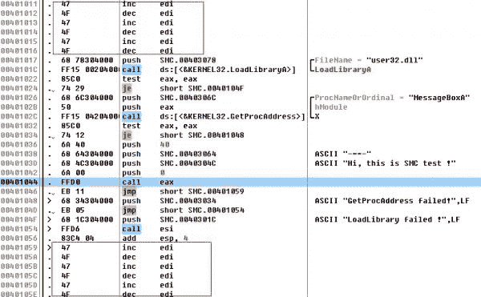
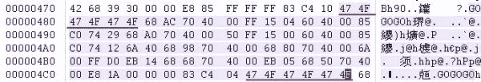
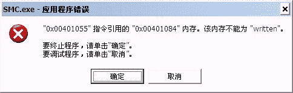
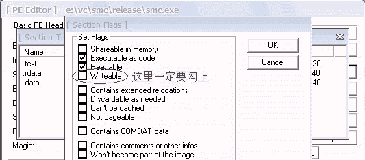
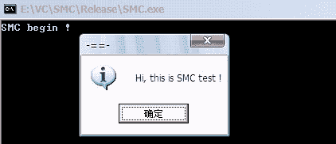

# 在 SMC 中加入密码学算法

> 原文：[`www.pediy.com/kssd/pediy10/92375.html`](https://www.pediy.com/kssd/pediy10/92375.html)

学习新的知识是一件很令人高兴和满足的事情，但是能和别人分享学习的经验，更令人快乐。  
由于我是一个菜鸟，所以有很多说不清楚的地方，还希望高手指正，毕竟，讨论才是学习永恒的主题。  
  
废话少说~~  
**SMC 简介:**  
Self Modifing Code, 自修改代码. 指的是软件在运行的过程中, 对自己的部分之前经过加密的代码进行解密之后再运行. SMC 可以极好地抵抗解密者的静态分析, 而且如果解密者发现不了我们所使用的加密算法, 则会给他更多的麻烦.  
  
下面我一起来打造一个使用 SMC 进行对抗静态分析的示例.  
  
  

代码:

```
#include "stdafx.h"
#include <windows.h>

#pragma comment(linker,"/opt:nowin98")

typedef int (\_\_stdcall \*PFNMESSAGEBOX)(HWND, LPCTSTR,LPCTSTR,UINT);

int main(int argc, char\* argv\[\])
{
  HMODULE hMod = NULL;
  PFNMESSAGEBOX lpfnMsgBox = NULL; 

  printf("SMC begin !\\n");

  \_\_asm
  {
    \_emit 'G'   ;inc edi
    \_emit 'O'   ;dec edi
    \_emit 'G'
    \_emit 'O'
    \_emit 'G'
    \_emit 'O'
  }

  if (NULL != (hMod = LoadLibrary("user32.dll")))
  {
    if (NULL != (lpfnMsgBox = (PFNMESSAGEBOX)GetProcAddress(hMod,"MessageBoxA")))
    {
      lpfnMsgBox(NULL,"Hi, this is SMC test !","-==-",MB\_ICONINFORMATION);
    }
    else
    {
      printf("GetProcAddress failed!\\n");
    }
  }
  else
  {
    printf("LoadLibrary failed !\\n");
  }

  \_\_asm
  {
    \_emit 'G'
    \_emit 'O'
    \_emit 'G'
    \_emit 'O'
    \_emit 'G'
    \_emit 'O'
  }

  printf("SMC end !\\n");

  return 0;
}

```

  
其中我们在程序代码中加上 GOGOGO 字串是为了在 16 进制工具中更清楚地看到我们需要加密的代码.  
为什么选择 GOGO 了? 因为 G 的机器码是 46,代表的指令为 inc edi, O 的机器码为 4F,代表的指令为 dec edi, 所以这两条指令互相抵消, 不会影响程序的正确运行.  
  
我们先看一下程序的运行截图, 见下图  
  
  
我们再来看一下用 16 进制编辑工具打开 exe 文件后的情形.  
我们为了更方便的观看, 使用的是 Release 版本的, 且打开了 nowin98 的连接器选项.  见下图  
  
  
上面图示中的两个 GOGOGO 中间的部分即时需要我们加密的代码.  
  
我们在来看一下在 OD 中的情况. 见下图  
  
  
然后, 我们用 WinHEX 将这些机器码拷贝出来, 如下:  
代码:

```
unsigned char data\[66\] = {
  0x68, 0x78, 0x30, 0x40, 0x00, 0xFF, 0x15, 0x00, 0x20, 0x40, 0x00, 0x85, 0xC0, 0x74, 0x29, 0x68, 
  0x6C, 0x30, 0x40, 0x00, 0x50, 0xFF, 0x15, 0x04, 0x20, 0x40, 0x00, 0x85, 0xC0, 0x74, 0x12, 0x6A, 
  0x40, 0x68, 0x64, 0x30, 0x40, 0x00, 0x68, 0x4C, 0x30, 0x40, 0x00, 0x6A, 0x00, 0xFF, 0xD0, 0xEB, 
  0x11, 0x68, 0x34, 0x30, 0x40, 0x00, 0xEB, 0x05, 0x68, 0x1C, 0x30, 0x40, 0x00, 0xFF, 0xD6, 0x83, 
  0xC4, 0x04
};

```

我们现在需要做的就是将这些机器码加密, 然后将密文覆盖到原来的位置. 然后我们在程序中真正使用这些代码之前对其进行解密. 当然, 在这个程序例子中, 由于此部分代码位于 main 函数中, 我们就直接在一进入 main 函数中就对这部分的代码进行解密. 当我们开发的是大型软件的时候, 我们可以选择一些比较重要的模块中的部分代码进行 SMC, 而且我们只在需要使用该部分代码的时候才进行解密, 那样会更加具有隐蔽效果的.   
  
好了, 我们现在需要选择一种加密算法.   
  
我们就使用我以前介绍过的维吉尼亚密码进行加密 . 不过在这里字母表就要换成是 Z-256 了. 首先我们得选定一个 Key. 比如我们是 Miczosoft 公司, 现在要发行 msz9.0, 我们设置 key 为:  
代码:

```
unsigned char strKey\[\] = “Miczosoft.MSZ.9.0”;

```

加密 call 以及解密 call 如下:  
代码:

```
void VigenereEncrypt(unsigned char \*M, int length, unsigned char \*C)
{
  int i = 0;
  int nLenKey = strlen(strKey);
  for(;i<length;++i)
  {
    C\[i\] = (M\[i\] + strKey\[i%nLenKey\]) % 0x100;
}
}

void VigenereDecrypt(unsigned char \*C, int length, unsigned char \*M)
{
  int i = 0;
  int nLenKey = strlen(strKey);
  for(;i<length;++i)
  {
  M\[i\] = (C\[i\]  strKey\[i%nLenKey\] + 0x100) % 0x100;
}
}

```

在上面我们已经得到要加密的字节为 data\[66\], 也即长度为 66. 我们可以自行写个小程序将这 66 个字节进行维吉尼亚加密, 这里我直接贴加密后的数据, 如下:  
  
加密后的机器码:  
代码:

```
unsigned char edata\[66\] = {
  0xB5, 0xE1, 0x93, 0xBA, 0x6F, 0x72, 0x84, 0x66, 0x94, 0x6E, 0x4D, 0xD8, 0x1A, 0xA2, 0x62, 0x96, 
    0x9C, 0x7D, 0xA9, 0x63, 0xCA, 0x6E, 0x88, 0x73, 0x86, 0xB4, 0x2E, 0xD2, 0x13, 0xCE, 0x40, 0xA3, 
    0x6E, 0x98, 0xB1, 0x99, 0xA3, 0x7A, 0xD7, 0xBF, 0x9F, 0xA6, 0x74, 0x98, 0x4D, 0x52, 0x2A, 0x19, 
    0x4A, 0x96, 0x64, 0x7D, 0xA9, 0x63, 0x65, 0x74, 0xDB, 0x8B, 0x96, 0xB4, 0x2E, 0x4C, 0x29, 0xDD, 
    0xF2, 0x3D
};

```

现在我们直接在 main 函数中加入这么一句作为 SMC 的解密部分:  
代码:

```
VigenereDecrypt((unsigned char\*)12345,66,(unsigned char\*)12345);

```

当然这里的 12345 是随便写的, 因为我们添加了代码, 程序会重新编译的, 以前的 GOGOGO 的位置也会发生变化, 所以我们先暂时写成 12345, 等它编译成功, 我们再用 WinHEX 打开看一看到底 GOGOGO 后面的代码部分的地址是多少, 这里要注意因为是自修改代码, 所以明密文的地址我们应该写成一样的.   
因为我们使用的是 C 语言编写的示例, 所以只好使用这种方法, 如果使用汇编的话, 我们直接就可以将标签作为变量使用进而十分容易地得到某处代码的起始地址.  
  
我们看编译后的 SMC.exe 在 WinHEX 中的情况:   
如图所示:  
  
  
  
现在代码部分的文件偏移地址为:0x484.   
所以我们可以得到在内存中代码部分的地址为:   
0x00400000 + 0x1000 + (0x484  0x400) = 0x00401084 .   
  
然后我们把上面的 12345 改成 0x00401084, 重新编译. 得到 SMC.exe 然后我们把之前加密后的代码的机器码 edata\[66\]复制粘贴到最新的 SMC.exe 中的 GOGOGO 之间的部分.   
当然, 为了更好地隐藏, 我们最后还可以把 GOGOGO 两个标记也擦掉.   
  
我们这时运行 SMC.exe, 发现会有异常对话框出现, 如图所示  
  
  
我们看到异常为”内存 written 错误”, 这里非常重要的一部是要改变代码区段的属性, 一定要加入 writeable 属性 . 我们可以通过 LordPE 等类似工具修改之. 如图 :  
  
  
  
  
除此之外, 细心的读者会发现, 这次的 GOGOGO 之间的代码字节数变为了 69 . 这是为什么了? 我们在程序代码中用 GOGOGO 包含起来的代码语句一点都没改变啊...  不错, 虽然我们要保护的代码没有改变, 但是我们在程序中加入了两个全局函数以及一个全局变量, 并在 main 函数中调用了其中的 VigenereDecrypt 函数, 这些细微的变化都会影响特定的编译器的. 比如我们加入的全局变量 key 就会影响到我们要保护代码中的一些字符串的地址.   
  
在我们未加入全局代码之前, “user32.dll”的地址为: 0x00403078(见图 12.6-3)  
而在我们加入全局代码之后, “user32.dll”的地址为: 0x004070AC(如下 OD 中所示)  
00401084    68 AC704000     push    SMC.004070AC                     ; ASCII "user32.dll"  
00401089    FF15 04604000   call    ds:\[<&KERNEL32.LoadLibraryA>\]    ; kernel32.LoadLibraryA  
  
  
所以在最后我们要检查一下机器码字节数是否发生了变化, 如若发生了变化则必须重新获得之. 通过这次教训,  我们得知最好在代码框架定型之后再进行机器码的加密.  
  
其实, 如果在 OD 中再看一下, 我们会发现这多出来的两个字节是由于两个 printf 的 call 不同导致的, 原来的 66 个字节中, printf 是通过 call esi (机器码: FF D6)进行的. 而 69 个字节的机器码中, printf 是通过 call 004010E0 (机器码为 5 个字节)进行的.  
  
现在我们重新通过 WinHEX 得到待加密机器码为:  
待加密机器码:  
代码:

```
unsigned char data\[69\] = {
  0x68, 0xAC, 0x70, 0x40, 0x00, 0xFF, 0x15, 0x04, 0x60, 0x40, 0x00, 0x85, 0xC0, 0x74, 0x29, 0x68, 
  0xA0, 0x70, 0x40, 0x00, 0x50, 0xFF, 0x15, 0x00, 0x60, 0x40, 0x00, 0x85, 0xC0, 0x74, 0x12, 0x6A, 
  0x40, 0x68, 0x98, 0x70, 0x40, 0x00, 0x68, 0x80, 0x70, 0x40, 0x00, 0x6A, 0x00, 0xFF, 0xD0, 0xEB, 
  0x14, 0x68, 0x68, 0x70, 0x40, 0x00, 0xEB, 0x05, 0x68, 0x50, 0x70, 0x40, 0x00, 0xE8, 0x1A, 0x00, 
  0x00, 0x00, 0x83, 0xC4, 0x04
};

```

我们用与上面同样的方法得到加密后的机器码:  
加密后机器码:  
代码:

```
unsigned char edata\[69\] = {
  0xB5, 0x15, 0xD3, 0xBA, 0x6F, 0x72, 0x84, 0x6A, 0xD4, 0x6E, 0x4D, 0xD8, 0x1A, 0xA2, 0x62, 0x96, 
  0xD0, 0xBD, 0xA9, 0x63, 0xCA, 0x6E, 0x88, 0x6F, 0xC6, 0xB4, 0x2E, 0xD2, 0x13, 0xCE, 0x40, 0xA3, 
  0x6E, 0x98, 0xE5, 0xD9, 0xA3, 0x7A, 0xD7, 0xF3, 0xDF, 0xA6, 0x74, 0x98, 0x4D, 0x52, 0x2A, 0x19, 
  0x4D, 0x96, 0x98, 0xBD, 0xA9, 0x63, 0x65, 0x74, 0xDB, 0xBF, 0xD6, 0xB4, 0x2E, 0x35, 0x6D, 0x5A, 
  0x2E, 0x39, 0xB1, 0xF4, 0x51
};

```

现在, 我们就可以直接将这 69 个字节的机器码覆盖到 GOGOGO 包含的区域. 然后再运行, 就不会有任何问题了. 如图所示  
  
  
  
  
这样, 我们就得到了一个将维吉尼亚密码应用于 SMC 的程序 .  
  
  
附件为源码以及 bin 文件.

上传的附件
|  || SMC\_bin.rar\[解压密码：pediy\]  
 |
|  || SMC\_src.rar  
 |