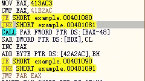

# 读 Reversing Secrets of Reverse Engineering 所感

> 原文：[`www.pediy.com/kssd/pediy12/131700.html`](https://www.pediy.com/kssd/pediy12/131700.html)

最近在读 Reversing Secrets of Reverse Engineering 这本书，不管看懂看不懂，瞎看呗，顺便试验了下书中的例子，试着试着有点感觉，于是编了个小程序干扰调试器的程序。。。希望跟我一样的菜鸟学习一下，也希望跟我不一样的大牛指点一下  
调试器是分不清程序某些位是数据还是指令，我们构造一些垃圾数据，当调试器分把我们构造的垃圾数据当程指令时，我们的诡计就成功了，后面的代码就会像多米诺骨牌一样被调试器一错再错。理论上是这样不过当调试器遇到一些开始的代码时（比如通过 jmp 到一个新地方），会重新识别这些数据，然后反汇编出来，我们的诡计对后面的代码就不起作用了。。难道我们就没有办法了吗？办法当然有，就是在不起作用的地方再加上花指令，让它继续一错再错……（别砸我哈）不过这的确是一种方法，我也明白了为什么脱壳时候会遇见无数的  
cmp eax,a  
cmp eax,b  
je c （c 地址后是垃圾指令，a 和 b 不相等，这个跳转永远不会实现）  
jne continue  
!@##$%(没有什么作用的代码)  
后面那些没有用的代码实际上是有用的代码，但是由于我们的垃圾数据，被调试器调错了，如下图：  
  
  
其实只要按着跳转往下跟肯定能柳暗花明又一村的，只要别被花指令磨的没有耐心就行。  
看到这，某些聪明的家伙可能就会想到花指令是在 jne continue 这条指令下面添加的，因为从这条指令下面的才是被调试器混淆了的代码，所以下面的代码才会看起来毫无作用。  
于是 jne continue 下面就应该是  
c：  
db 0ff  (也可以是其它指令的十六进制形式)  
continue:  
continue 后面就是正常程序。。只要别让调试器有重新分析数据的时候就行了，具体怎么构造，就看大家的了，我这里只起到抛钻引玉的作用。。  
好了，砖也抛完了，我废话就不多说了，直接看代码吧。  
.386  
.model flat,stdcall  
option casemap:none  
        include \\masm32\\include\\windows.inc  
         include \\masm32\\include\\user32.inc  
         include \\masm32\\include\\kernel32.inc  
         includelib \\masm32\\lib\\user32.lib  
         includelib \\masm32\\lib\\kernel32.lib  
  
.data  
titl db "SEH example By HYH",0  
caption db "Hello,World!",0  
  
.code  
start:  
mov eax,\[411ac3h\]  
cmp eax,dword ptr \[4102ach\]  
je junk  
call seh  
junk:  
db 0ffh  
here:  
push 0  
mov eax,\[4052e3h\]  
cmp eax,dword ptr \[41b2a2h\]  
je junk1  
jne here1  
junk1:  
db 0ffh  
here1:  
push offset titl  
mov eax,\[4053c3h\]  
cmp eax,dword ptr \[41b2ach\]  
je junk2  
jne here2  
junk2:  
db 0ffh  
here2:  
push offset caption  
mov eax,\[402ac3h\]  
cmp eax,dword ptr \[4162ach\]  
je junk3  
jne here3  
junk3:  
db 0ffh  
here3:  
push 0  
mov eax,\[415ac3h\]  
cmp eax,dword ptr \[4162a3h\]  
je junk4  
jne here4  
junk4:  
db 0ffh  
here4:  
call msgbox  
exit:  
assume fs:nothing  
pop fs:\[0\]  
add esp,4  
invoke ExitProcess,NULL  
  
seh:  
mov eax,\[413ac3h\]  
cmp eax,dword ptr \[41e2ach\]  
je junk5  
jne here5  
junk5:  
db 0ffh  
here5:  
pop eax  
mov eax,\[403ad3h\]  
cmp eax,dword ptr \[42a2ach\]  
je junk6  
jne here6  
junk6:  
db 0ffh  
here6:  
call setupseh  
mov eax,\[414ac3h\]  
cmp eax,dword ptr \[43b2ach\]  
je junk7  
jne here7  
junk7:  
db 0ffh  
here7:  
mov eax,\[esp+0ch\]  
push eax  
mov eax,\[401ac3h\]  
cmp eax,dword ptr \[41c2ach\]  
je junk8  
jne here8  
junk8:  
db 0ffh  
here8:  
lea ebx,offset here  
mov eax,\[4d2ac3h\]  
cmp eax,dword ptr \[413each\]  
je junk9  
jne here9  
junk9:  
db 0ffh  
here9:  
pop eax  
mov dword ptr \[eax+0b8h\],ebx  
mov eax,\[40aac3h\]  
cmp eax,dword ptr \[4a42ach\]  
je junk10  
jne here10  
junk10:  
db 0ffh  
here10:  
xor eax,eax  
push eax  
mov eax,\[415ac3h\]  
cmp eax,dword ptr \[4350ach\]  
je junk11  
jne here11  
junk11:  
db 0ffh  
here11:  
pop eax  
ret  
setupseh:  
mov eax,\[408ac3h\]  
cmp eax,dword ptr \[45a2ach\]  
je junk12  
jne here12  
junk12:  
db 0ffh  
here12:  
push fs:\[0\]  
mov fs:\[0\],esp  
mov eax,\[4d5ac3h\]  
cmp eax,dword ptr \[4032abh\]  
je junk13  
jne here13  
junk13:  
db 0ffh  
here13:  
xor eax,eax  
mov \[eax\],eax  
msgbox:  
pop ebx  
mov eax,\[415dc3h\]  
cmp eax,dword ptr \[4162ach\]  
je junk14  
jne here14  
junk14:  
db 0ffh  
here14:  
call MessageBox  
mov eax,\[405ac3h\]  
cmp eax,dword ptr \[4142ach\]  
je junk15  
jne here15  
junk15:  
db 0ffh  
here15:  
push ebx  
ret  
end start  
  
  
代码越乱越好，呵呵，只要别把 cpu 整晕了就行，嘿嘿，可以看到基本上每条指令前面都加上了花指令，这样程序中就会有无数的跳转，而且很多代码看起来毫无意义，还有一处异常处理，下面看反汇编结果吧：  
00401000 > $  B8 C31A4100   MOV EAX,411AC3  
00401005   .  3D AC024100   CMP EAX,4102AC  
0040100A   .  74 05         JE SHORT example.00401011  
0040100C   .  E8 61000000   CALL example.00401072  
00401011   >  FF6A 00       JMP FAR FWORD PTR DS:\[EDX\]               ;  远跳转  
00401014      B8            DB B8  
00401015      E3            DB E3  
00401016   .  52 40 00      ASCII "R@",0  
00401019      3D            DB 3D                                    ;  CHAR '='  
0040101A      A2            DB A2  
0040101B      B2            DB B2  
0040101C      41            DB 41                                    ;  CHAR 'A'  
0040101D      00            DB 00  
0040101E      74            DB 74                                    ;  CHAR 't'  
0040101F      02            DB 02  
00401020      75            DB 75                                    ;  CHAR 'u'  
00401021      01            DB 01  
00401022      FF            DB FF  
00401023      68            DB 68                                    ;  CHAR 'h'  
00401024      00304000      DD example.00403000  
00401028      B8            DB B8  
00401029   .  C3            RETN  
0040102A   .  53 40 00      ASCII "S@",0  
0040102D      3D            DB 3D                                    ;  CHAR '='  
0040102E      AC            DB AC  
0040102F      B2            DB B2  
00401030      41            DB 41                                    ;  CHAR 'A'  
00401031      00            DB 00  
00401032      74            DB 74                                    ;  CHAR 't'  
00401033      02            DB 02  
00401034      75            DB 75                                    ;  CHAR 'u'  
00401035      01            DB 01  
00401036      FF            DB FF  
00401037      68            DB 68                                    ;  CHAR 'h'  
00401038      17304000      DD example.00403017                      ;  ASCII "Hello,World!"  
0040103C      B8            DB B8  
0040103D   .  C3            RETN  
0040103E   .  2A 40 00      ASCII "\*@",0  
00401041      3D            DB 3D                                    ;  CHAR '='  
00401042      AC            DB AC  
00401043   .  62 41 00      ASCII "bA",0  
00401046      74            DB 74                                    ;  CHAR 't'  
00401047      02            DB 02  
00401048      75            DB 75                                    ;  CHAR 'u'  
00401049      01            DB 01  
0040104A      FF            DB FF  
0040104B      6A            DB 6A                                    ;  CHAR 'j'  
0040104C      00            DB 00  
0040104D      B8            DB B8  
0040104E   .  C3            RETN  
0040104F   .  5A 41 00      ASCII "ZA",0  
00401052      3D            DB 3D                                    ;  CHAR '='  
00401053      A3            DB A3  
00401054   .  62 41 00      ASCII "bA",0  
00401057      74            DB 74                                    ;  CHAR 't'  
00401058      02            DB 02  
00401059      75            DB 75                                    ;  CHAR 'u'  
0040105A      01            DB 01  
0040105B      FF            DB FF  
0040105C      E8            DB E8  
0040105D   .  C700 0000648F MOV DWORD PTR DS:\[EAX\],8F640000  
00401063   .  05 00000000   ADD EAX,0  
00401068   .  83C4 04       ADD ESP,4  
0040106B   .  6A 00         PUSH 0                                   ; /ExitCode = 0  
0040106D   .  E8 E2000000   CALL <JMP.&kernel32.ExitProcess>         ; \\ExitProcess  
00401072   $  B8 C33A4100   MOV EAX,413AC3  
00401077   .  3D ACE24100   CMP EAX,41E2AC  
0040107C   .  74 02         JE SHORT example.00401080  
0040107E   .  75 01         JNZ SHORT example.00401081  
00401080   .  FF58 B8       CALL FAR FWORD PTR DS:\[EAX-48\]           ;  远调用  
00401083   .  D33A          SAR DWORD PTR DS:\[EDX\],CL  
00401085   .  40            INC EAX  
00401086   ?  003D ACA24200 ADD BYTE PTR DS:\[42A2AC\],BH  
0040108C   .  74 02         JE SHORT example.00401090  
0040108E   .  75 01         JNZ SHORT example.00401091  
00401090   >  FFE8          JMP FAR EAX                              ;  非法使用寄存器  
00401092   ?  6200          BOUND EAX,QWORD PTR DS:\[EAX\]  
00401094   ?  0000          ADD BYTE PTR DS:\[EAX\],AL  
00401096   .  B8 C34A4100   MOV EAX,414AC3  
0040109B   .  3D ACB24300   CMP EAX,43B2AC  
004010A0   .  74 02         JE SHORT example.004010A4  
004010A2   .  75 01         JNZ SHORT example.004010A5  
004010A4   .  FF8B 44240C50 DEC DWORD PTR DS:\[EBX+500C2444\]  
004010AA   .  B8 C31A4000   MOV EAX,example.00401AC3  
004010AF   .  3D ACC24100   CMP EAX,41C2AC  
004010B4   .  74 02         JE SHORT example.004010B8  
004010B6   .  75 01         JNZ SHORT example.004010B9  
004010B8   .  FF8D 1D121040 DEC DWORD PTR SS:\[EBP+4010121D\]  
004010BE   .  00B8 C32A4D00 ADD BYTE PTR DS:\[EAX+4D2AC3\],BH  
004010C4   .  3D AC3E4100   CMP EAX,413EAC  
004010C9   .  74 02         JE SHORT example.004010CD  
004010CB   .  75 01         JNZ SHORT example.004010CE  
004010CD   .  FF58 89       CALL FAR FWORD PTR DS:\[EAX-77\]           ;  远调用  
004010D0   .  98            CWDE  
004010D1   .  B8 000000B8   MOV EAX,B8000000  
004010D6   .  C3            RETN  
004010D7   ?  AA            STOS BYTE PTR ES:\[EDI\]  
004010D8   ?  40            INC EAX  
004010D9   ?  003D AC424A00 ADD BYTE PTR DS:\[4A42AC\],BH  
004010DF   .  74 02         JE SHORT example.004010E3  
004010E1   .  75 01         JNZ SHORT example.004010E4  
004010E3   .  FF33          PUSH DWORD PTR DS:\[EBX\]  
004010E5   .  C050 B8 C3    RCL BYTE PTR DS:\[EAX-48\],0C3             ;  移位常量超出 1..31 的范围  
004010E9   .  5A            POP EDX  
004010EA   .  41            INC ECX  
004010EB   ?  003D AC504300 ADD BYTE PTR DS:\[4350AC\],BH  
004010F1   .  74 02         JE SHORT example.004010F5  
004010F3   .  75 01         JNZ SHORT example.004010F6  
004010F5   .  FF58 C3       CALL FAR FWORD PTR DS:\[EAX-3D\]           ;  远调用  
004010F8   $  B8 C38A4000   MOV EAX,408AC3  
004010FD   .  3D ACA24500   CMP EAX,45A2AC  
00401102   .  74 02         JE SHORT example.00401106  
00401104   .  75 01         JNZ SHORT example.00401107  
00401106   >  FF64FF 35     JMP DWORD PTR DS:\[EDI+EDI\*8+35\]  
0040110A   ?  0000          ADD BYTE PTR DS:\[EAX\],AL  
0040110C   ?  0000          ADD BYTE PTR DS:\[EAX\],AL  
0040110E   .  64:8925 00000>MOV DWORD PTR FS:\[0\],ESP  
00401115   .  B8 C35A4D00   MOV EAX,4D5AC3  
0040111A   .  3D AB324000   CMP EAX,example.004032AB  
0040111F   .  74 02         JE SHORT example.00401123  
00401121   .  75 01         JNZ SHORT example.00401124  
00401123   .  FF33          PUSH DWORD PTR DS:\[EBX\]  
00401125   .  C089 005BB8C3>ROR BYTE PTR DS:\[ECX+C3B85B00\],5D        ;  移位常量超出 1..31 的范围  
0040112C   .  41            INC ECX  
0040112D   ?  003D AC624100 ADD BYTE PTR DS:\[4162AC\],BH  
00401133   .  74 02         JE SHORT example.00401137  
00401135   .  75 01         JNZ SHORT example.00401138  
00401137   >  FFE8          JMP FAR EAX                              ; |非法使用寄存器  
00401139   ?  1100          ADC DWORD PTR DS:\[EAX\],EAX  
0040113B   ?  0000          ADD BYTE PTR DS:\[EAX\],AL  
0040113D   .  B8 C35A4000   MOV EAX,405AC3  
00401142   .  3D AC424100   CMP EAX,4142AC  
00401147   .  74 02         JE SHORT example.0040114B  
00401149   .  75 01         JNZ SHORT example.0040114C  
0040114B   .  FF53 C3       CALL DWORD PTR DS:\[EBX-3D\]  
0040114E   $- FF25 08204000 JMP DWORD PTR DS:\[<&user32.MessageBoxA>\] ;  user32.MessageBoxA  
00401154   .- FF25 00204000 JMP DWORD PTR DS:\<&kernel32.ExitProcess>;  kernel32.ExitProcess  
看是看不明白的，自己调试附件吧，我也是菜菜，理解不够深刻，表达也不太清楚，希望你们能有所收获。。 大牛们指点一下哈！！拜托。。。

上传的附件
| ![ || example.rar  
 |